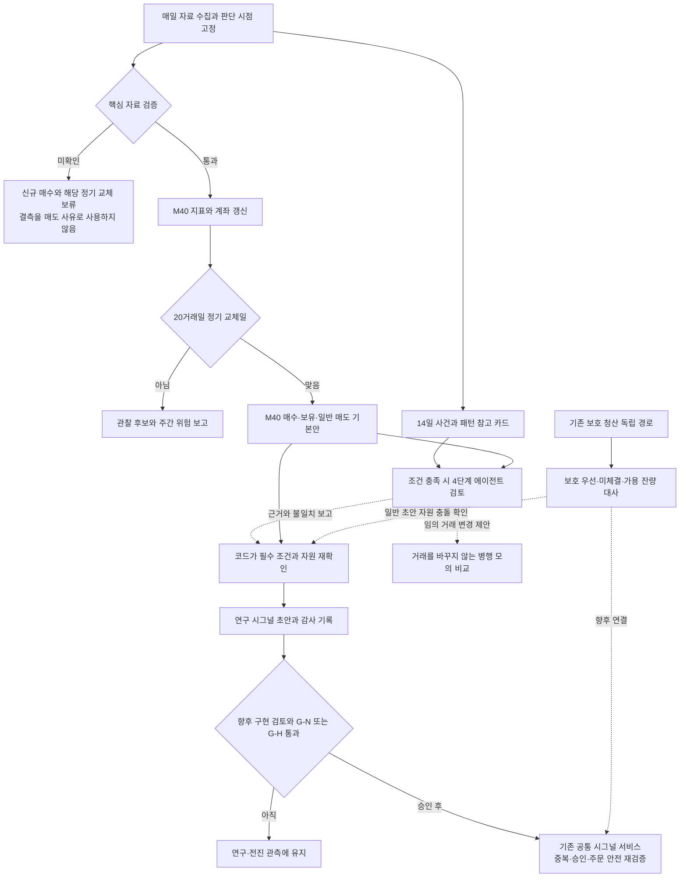
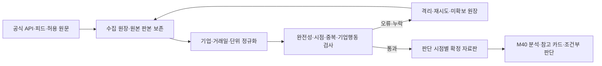

# T-156 — 미국 종목분석의 매수·매도 시점 개선안 조사

## 실행 도구·절차 이력

| 이벤트 ID | 시각(KST) | 사건 | 이전 → 현재 담당 / 현재 절차 | 범위·인계 대상·남은 일 | 근거 |
|---|---|---|---|---|---|
| exec-001 | 2026-11-06 13:53 기록 | start | 없음 → codex / codex_scoped | 현행 구현과 자료 공백을 조사하고 개선안 제시 | 이 대화의 사용자 요청 및 NYSE 시총 상위 50개 확인 |
| exec-002 | 2026-11-06 14:26 기록 | resume | codex → codex / codex_scoped | S&P 500·Nasdaq Composite 주간 연구 입력과 검산 | 사용자의 1990년 이후 주간 흐름·국면 패턴·예측 입력 추가 요청 |
| exec-003 | 2026-11-06 15:09 기록 | resume | codex → codex / codex_scoped | NAS 작업 폴더 재연결, 시장 입력의 표본 외 평가, 운영 기록 읽기, 종목별 검증 설계 | 사용자 요청 범위는 분석·설계 |
| exec-004 | 2026-11-06 15:29 기록 | resume | codex → codex / codex_scoped | 지정 영상 분석 노트와 자막 대조, 재현 가능한 가설의 탐색 검증 | 사용자가 TheThinker 레퍼런스 URL 및 최종 검토 전 설계·백테스트 범위를 지정 |
| exec-005 | 2026-11-06 15:40 기록 | resume | codex → codex / codex_scoped | 당시 자료 확보 가능성, 관측된 매수·매도 결과의 제한 비교, 최종 검토안 | 사용자 요청은 자료 검증·비교 백테스트와 검토안 작성 |
| exec-006 | 2026-11-06 16:17 기록 | resume | codex → codex / codex_scoped | 차단 기록을 제외한 가격 기반 백테스트와 장전 예측 샘플 | 검증 단계의 차단 기록 대신 과거 지표와 등락폭을 사용하라는 사용자 지시 |
| exec-007 | 2026-11-06 16:28 기록 | resume | codex → codex / codex_scoped | 기존 발화·저장 경로 대조, 관찰 후보 관리 및 분석→시그널 인계 설계 | 여러 자료를 활용한 후보 관리의 변화점과 절차 보완 요청 |
| exec-008 | 2026-11-06 16:56 기록 | resume | codex → codex / codex_scoped | 판단 역할·단계별 실험과 전체 설계 점검표·흐름도 | 네 판단 구간을 절차에 반영하고 구현 전 전체를 다시 검토하라는 사용자 요청 |
| exec-009 | 2026-11-06 17:24 기록 | resume | codex → codex / codex_scoped | 네 구간의 기준치 초안·매수/매도 비교군 | 필수 조건·에이전트 기준을 나누어 수치·근거·조치와 검증 방법을 명시하라는 사용자 요청 |
| exec-010 | 2026-11-06 17:41 기록 | resume | codex → codex / codex_scoped | 가용 NAS/NYS 일봉 전 기간 가격 재생과 구현 전 판정 검토 | v0.1 재백테스트·단계별 통과율·매수/매도 성과·표본/통과/중단 기준 정리 요청 |
| exec-011 | 2026-11-06 18:05 기록 | resume | codex → codex / codex_scoped | 예상수익 기반 매수·매도 계좌, 종목·거래별 예상과 실현의 비교 | 이후 등락을 판단 입력으로 쓰지 않고 예측값으로 매매 수익을 모의 계산하라는 요청 |
| exec-012 | 2026-11-06 18:21 기록 | resume | codex → codex / codex_scoped | 공개 시점 재구성 공시·뉴스, 에이전트 적용, 동일 계좌 비교와 낙폭·상승 구간 | 당시 확인 가능한 자료에 판단 에이전트를 적용하고 같은 가격 기준선과 대조하라는 요청 |
| exec-013 | 2026-11-06 19:03 기록 | resume | codex → codex / codex_scoped | 손실 원인 및 45개 전략 비교, 더 긴 기간의 자료 확인 | 수익 후보를 찾기 위한 반복 전략 시뮬레이션 요청 |
| exec-014 | 2026-11-06 19:12 기록 | resume | codex → codex / codex_scoped | 2020-01-01~2026-09-30, 실제 자료를 격리 MariaDB에 적재하고 일별 가격·시장·공시 가용성을 재생 | 사용자가 기간 확장·날짜별 실제 수집·DB 기반 테스트를 지정 |
| exec-015 | 2026-11-06 22:13 기록 | resume | codex → codex / codex_scoped | 공개 원천으로 일봉·공식 사건·구성 증거 파일 생성, 격리 DB 장기 가격 재생 | 사용자가 기존 구독·파일이 없어 새로 생성해야 함을 확인 |
| exec-016 | 2026-11-06 23:10 기록 | resume | codex → codex / codex_scoped | E3 손익 분해와 시장 조건별 E3·R02 전환 재생 | 사용자가 11거래일과 장기 손익의 차이 및 동일 비용 백테스트 요청 |
| exec-017 | 2026-11-06 23:34 기록 | resume | codex → codex / codex_scoped | KIS 편도 0.25% 재생, 매수 비용 조건과 전환 규칙 확인 | 사용자가 수수료 0.25% 고정과 적용 기준 설명 요청 |
| exec-018 | 2026-11-06 23:40 기록 | resume | codex → codex / codex_scoped | 판단 시점의 자료로 두 에이전트의 E3·R02 선택을 고정하고 가격 재생 | 사용자가 당시 흐름에서 판단 에이전트의 선택과 손익 차이를 확인 요청 |
| exec-019 | 2026-11-07 00:06 기록 | resume | codex → codex / codex_scoped | 반등·추가 하락 기준 고정, 당일 정보만 전달한 단기 판단 및 25bp 장기 비교 | 사용자가 10/23·26의 이후 결과를 가리고 동일 수수료 비교 요청 |
| exec-020 | 2026-11-07 00:38 기록 | resume | codex → codex / codex_scoped | 일봉·구성·시장 폭·공시·뉴스 수집, 격리 DB 적재 및 읽기 검산 | 사용자가 1990년 이후 원문 수집, 공개 시각과 결측 기간·이유 기록 요청 |
| exec-021 | 2026-11-07 00:52 기록 | resume | codex → codex / codex_scoped | 신규 연구 DB 입력·공개판본의 시점 통제, 일별 에이전트와 고정 E3·R02 비교 | 사용자가 11일·장기 동일 수수료, 일별 선택 및 자료 공백 정리 요청 |
| exec-022 | 2026-11-07 08:35 기록 | resume | codex → codex / codex_scoped | R02 기준선과 E3 후보 검토, 사건 해석 권한, 주문 없는 비교 검증 조건 보완 | 사용자가 일별 판단 기록을 근거로 에이전트 개입 계획 보완 요청 |
| exec-023 | 2026-11-07 08:52 기록 | resume | codex → codex / codex_scoped | 2015~2016년 계좌 홀드아웃, 25bp 세 방식 및 동일 상태 개입 반사실 재생 | 사용자가 미사용 평가 구간, 손익·최대낙폭, 회피 손실·놓친 상승과 표본 부족 표시 요청 |
| exec-024 | 2026-11-07 09:20 기록 | resume | codex → codex / codex_scoped | 2006~2011 신규 재생, 당시 원문 보강, 이전 구간 신원 정정 재생, 표본·수집 반영 판정 | 사용자가 같은 25bp 세 방식 비교와 손익·낙폭·변경일 검증 요청 |
| exec-025 | 2026-11-07 11:05 기록 | resume | codex → codex / codex_scoped | 계좌 평가액에 따른 주문 규모와 기간별 연복리 수익률 확인 | 사용자가 누적 수익의 기간·복리 반영과 연간 환산을 질문 |
| exec-026 | 2026-11-07 11:25 기록 | resume | codex → codex / codex_scoped | 연복리 15% 목표와 최대 200회 탐색, 편입일 대조 및 상위 전략 정리 | 사용자가 연복리 15% 이상 세 번과 실패 시 상위 10개·최대/최소 등락폭을 요청 |
| exec-027 | 2026-11-07 11:39 기록 | resume | codex → codex / codex_scoped | 세 고정 전략·공시 판단·전환 비교와 동일 상태 반사실 | 사용자가 M40·E3·R02 고정 투자와 판단 에이전트 개입 백테스트를 요청 |
| exec-028 | 2026-11-07 12:21 기록 | resume | codex → codex / codex_scoped | M40 10년·5년 각 100개, 동일 입력 반복·독립 판단·주간 위험과 시작일 민감도 | 사용자 최종 점검 요청과 일별 평가·20일 후보 교체·주간 위험 주기 유지 확인 |
| exec-029 | 2026-11-07 12:48 기록 | resume | codex → codex / codex_scoped | 전체 참조 125종목 패턴과 같은 종목·다른 종목 반복 비교, 무작위 대조와 예측력 검산 | 사용자가 모든 종목의 주가 변화 패턴화와 반복 유사성 점검을 요청 |
| exec-030 | 2026-11-07 13:51 기록 | resume | codex → codex / codex_scoped | 같은125종목의 M40·패턴 순위·패턴 매수 보류·자료 확보 대조군 재생 | 사용자가 패턴의 미래 예측 의미와 거래 규칙 투자 대비 효과를 요청 |
| exec-031 | 2026-11-07 14:05 기록 | resume | codex → codex / codex_scoped | 기존 해외 분석·시그널 경로와 대조한 M40 기본 최종 설계 검토안, 4단계 판단 권한·흐름도·검증 관문 통합 | 사용자가 M40 기본·패턴 참고로 최종 설계를 정리하고 구현은 검토 후 진행하도록 지정 |
| exec-032 | 2026-11-07 18:06 기록 | resume | codex → codex / codex_scoped | 기존 수집기와 공식 원천을 확인하고 수집 원천·증분/백필·판본 보존·자료 품질 설계 보완 | 사용자가 분석·판단 앞단의 데이터 수집 방안 설명을 요청. 구현·운영 수집 실행은 제외 |
| exec-033 | 2026-11-07 23:08 착수 | resume | codex → codex / codex_scoped | 운영 DB SELECT·수집 로그 및 기존 격리 연구 DB 감사, 무료 공개 자료 추가·읽기 검산·기간/누락률/본문 구분 | 사용자가 실제 수집 상태 점검과 무료 자료 보완을 승인. 운영 데이터/설정·수집 코드·스키마·크론·주문 경로 구현은 제외 |
| exec-034 | 2026-11-08 08:29 사전 점검 | resume | codex → codex / codex_scoped | 사용자가 승인한 구현·운영 DB 자료 이관·테스트 이력 저장의 실제 스키마/권한/모드 점검, 28개 자료 해시 목록 및 실행·복구 계획 준비. 담당 방식 확인 중이며 구현/운영 쓰기는 아직 미실행 | 최신 사용자 지시로 분석 전용 제약 해제. AGENTS의 큰 구현 Claude 인계 규칙 때문에 담당 방식만 비동기로 확인 요청 |
| exec-035 | 2026-11-08 사용자 답변 반영 | scope approval | codex → codex / codex_scoped | Codex가 T-156 구현·DB 이관까지 직접 수행. 이번 작업의 큰 구현 담당 제한은 명시 예외 승인됨. 원본 보존·실거래 보호·검증 관문 유지 | 사용자: “이번 T-156은 Codex가 구현·DB 이관까지 직접 진행” |
| exec-036 | 2026-11-08 09:45 중간 기록 | implement / verify / import | codex → codex / codex_scoped | 새 worktree에서 M40·보관·shadow·인증 API 구현, Reviewer 지적 수정, Ubuntu 1,343 tests 및 실 MariaDB 경합 2건 검증. 운영 신규 DDL 후 연구 27표 적재 중(staged), 게시·배포 미완료 | 사용자 직접 구현·DB 이관 승인 exec-035. 실제 결과는 F13/구현 보고서의 영수증으로 구분 |
| exec-037 | 2026-11-08 11:32 중간 기록 | publish / final QA | codex → codex / codex_scoped | 연구 27표 4,383,186행 게시·전체 COUNT/CHECKSUM, 압축원문1,455건 해시, 테스트 원본28개 DB 복원 검산 완료. 최종1,417 tests·타입·build PASS, 공개시각/문자 비교 보완. 운영 증분 연동 재확인 중 | exec-035 승인 범위의 실제 DB/QA 영수증. 실주문 활성화 없음 |
| exec-038 | 2026-11-08 11:44 확인 | deployment / archive complete | codex → codex / codex_scoped | 연구27표 게시·원본28개 및 신규 검증이력 DB보존, 구현소스39개 시험해시와 배포판 일치. 릴리스9237fff RELEASE_RESULT ok/END0·health200·web/cron각1·인증API 차단동작 확인. F09·적격입력·전진검증은 대기 | exec-035 직접수행 승인, 운영 DB readback/독립QA 1,426 PASS·15 SKIP와 실제 배포 검증 JSON |
| exec-039 | 2026-11-08 사용자 후속 | scope approval | codex → codex / codex_scoped | 남은 T0·자료 적격성·전진 검증을 진행해 DRY_RUN 종목분석→시그널 연결. 실거래 해제 금지 | 사용자 후속 명시 지시 |
| exec-040 | 2026-11-08 사용자 선택 | policy decisions | codex → codex / codex_scoped | 첫 적격 거래일 T0 1회 고정, 현재 실계좌를 복제한 독립 모의 장부, 한정 후보군 모의 시험판 승인 | 비동기 질문 3개 사용자 답변. 실제 보유·잔고·전략 검증 상태 변경 승인 아님 |
| exec-041 | 2026-11-08 13:50 | implement / verify | codex → codex / codex_scoped | 독립모의장부·source자격·T0영구고정·paper시그널 구현/최종QA,운영복사+11/06리허설4개. 코드배포 후검증과미래전진표본은분리 | 사용자3개선택,독립감사,1,594tests/SQL11검사/운영영수증 |
| exec-042 | 2026-11-08 14:03 | release / verify / fix | codex → codex / codex_scoped | c296116운영배포/인증202후실제after/23파일검산,초기부분응답재시도정체실제재현후1조건보완·SQL12검사 | 운영리허설4매도유지/T0null/DRYtrue,최종QA와배포영수증분리 |
| exec-043 | 2026-11-08 | user_request / intake | codex → codex / codex_scoped | 기존화면유지·분석탭M40조회4영역추가,실거래OFF. judge full/demo_first,modelrouter Sol1.67 | 사용자구현요청/실제judge영수증 |
| exec-044 | 2026-11-08 | demo / prepare | codex → codex / codex_scoped | v2합성데모·360/412/1280 CUA검증·readonlyAPI6파일준비 | 데모SHA9d1197...cb07/격리QA별도기록 |
| exec-045 | 2026-11-08 | user_approval | codex → codex / codex_scoped | 실제질문응답원문‘v2 구성으로 구현 진행’과조회계정이메일확인. 동일승인·이메일재질문금지 | 실제user role native응답,이메일원문repo미보존 |
| exec-046 | 2026-11-08 | gate_record_refused | codex → codex / codex_scoped | approve-codex-context가승인기록미연결로거부. 실제승인과도구실패분리,상태임의수정/영수증재생/훅재생안함. 이번작업예외or도구지원보완처리방식응답대기 | 자동거부원문·Reviewer절차대조 |
| exec-047 | 2026-11-08 15:14 | db_bind / read_verify | codex → codex / codex_scoped | 승인된계정1개조회권한연결·원장/설정불변. 실제reader출처4그룹/적격123/리허설시그널4/비viewer거부확인. 화면코드·배포는미착수 | paper-viewer-binding-receipt.json/paper-view-operating-read-receipt.json |
| exec-048 | 2026-11-08 15:31 사용자 답변 | tool_support_approved | codex → codex / codex_scoped | 사용자 ‘승인 도구 지원부터 보완’ 선택. 공통 도구의 질문응답·등록 worktree 지원을 격리 사본에서 수정·독립감사한 뒤 기존 실제 v2 승인을 연결한다. 같은 승인 재질문·수동 상태변경·훅 재생 금지 | 실제 native 사용자 응답. 기존 승인·실거래 OFF 유지 |
| exec-049 | 2026-11-08 15:57 | tool_support / native_approval_verified | codex → codex / codex_scoped | 공유승인도구14파일보완·독립review/QA/적용후193개통과. 실제원래v2답변native복구성공·check/activate통과. 화면구현재개,실거래OFF | finalmanifest985d1bd6/독립보고서/실제source codex_native_transcript 영수증 |
| exec-050 | 2026-11-08 16:20 | ui_implementation / QA / CUA | codex → codex / codex_scoped | 기존메뉴보존M40조회4영역구현,선정미매수제약whitelist보완,독립정적감사/360tests/타입/build/360·412·1280CUA통과. 최종실DBreadonly123적격/4모의신호/비viewer거부. 운영반영준비 | UI보고서/manifest8c9301db/독립리뷰0393dd16/QAfd65d085/운영읽기영수증 |

## 목표

S&P 500의 시장 상태, Nasdaq-100 및 StockInvest NYSE 시총 상위 50의 종목별 지표, 최근 14일 SEC·기업/경제 뉴스를 조합해 진입과 보유종목 매도 시점을 판단할 수 있는지 검토한다. 14일은 설계상 최신 자료 조회 창으로 해석한다. 2026-11-08 사용자가 구현, 연구 수집 자료의 운영 DB 이관과 테스트 데이터의 DB 이력 저장을 승인해 범위를 확장했다. 이전 절의 분석 전용 상태는 각 기록 시점의 상태이며, 현재 실행 범위·담당 확인·미실행 항목은 F12를 따른다.

**최신 통합안**은 아래 「M40 기본 최종 설계 검토안 v1.0」, F10 수집 설계, F11 실제 감사, F12 구현·이관 실행안이다. 이전 절의 R02 기본·E3 전환·패턴 거래 제한과 수치 초안은 연구 이력이며, 최신안의 운영 기본 규칙으로 함께 적용하지 않는다. 11/8의 구현·자료 이관 승인은 검증 상태 자동 승격이나 실거래 활성화를 뜻하지 않는다.

## 관련 과거 이력 요약

- [[T-107-analysis-flow-visualization]]과 [[T-109-research-context-for-analysis]] — 리서치 통계와 매매 판단을 구분하고 최신 리서치 연결 지점을 확인한다.
- [[T-114-corporate-intelligence-second-design]], [[T-116-news-first-seen-capture]], [[T-124-news-input-misread-truncation]] — 시점별 증거와 최초 관측 저장을 재사용하고 뉴스 절단·오독 사례를 검증 요구에 반영한다.
- [[T-143-overseas-universe-source-replacement]]와 [[T-146-manual-list-cap-removal]] — Nasdaq-100 수동 목록, 자체 NYSE 시총 상위 목록, 확대 시 용량 제약을 구분한다.
- [[T-078-integrated-execution-procedure]] — 당시 이용 가능 자료의 후향 재현, 주문 없는 전진 관측과 운영 승급을 구분한다.

## 역할별 지시사항

- 메인 Codex/Leader — 현행 구현 및 Vault 상태를 대조하고 후보군·자료·판단·검증 설계를 종합한다.
- Leader 보조 — 관련 작업 이력 및 운영 기록의 범위를 읽기 전용으로 확인한다.
- 코드 조사 보조 두 역할 — 수집·유니버스·판단 배선과 진입·보유관리·백테스트 경로를 나눠 소스를 읽는다.

## 판단 기록 (judge)

- Judge 역할은 모델과 추론 설정의 호환성 오류로 기동하지 못했다. 메인 Codex가 Jev 로컬 규칙을 실행했다. `judge-result@2`의 `engine=rules`, `risk=R0`, `demo.level=none`, `needs_info=false`, `next=assign`, 토큰·비용 0을 확인했다. 접수 범위가 조사·제안이므로 구현 역할 배정과 구현 검토 체크포인트는 적용하지 않았다.

## 조사와 권고

1. 종목 리서치의 차트·과거 적중률, 해외 장마감 AI의 다음 정규장 진입 시나리오, 실제 보유종목의 보호 청산을 각각 기준선으로 분리한다. 해외 장마감은 후보 전체의 단일 검색으로 최근 3일 뉴스 최대 5건을 조회하고 SEC에서 적재한 실적 일정을 점검한다. 근거는 [종목 리서치](../../../src/lib/research/pattern/recommendation.ts#L158), [해외 장마감](../../../src/lib/strategy/post-market-overseas.ts#L650), [청산](../../../src/lib/strategy/exit-engine.ts#L88).
2. S&P 500은 시장 환경에 쓰고, Nasdaq-100과 자체 NYSE 시총 상위 50을 신규 후보군으로 둔다. 구성 효력일·관측 시각·종목 식별자와 기업행동 이력을 버전으로 보존한다. 보유·즐겨찾기는 자료 수집에는 포함할 수 있으며 신규 후보 자격과 분리한다. 기록 기준 Nasdaq-100 101티커+기존 NYSE 24개가 적재됐고, NYSE 상위 50의 자동 산출은 꺼져 있다. 151개와 보유 종목을 한꺼번에 붙이기 전에 T-146 H-1의 수집 누락과 실제 처리 예산을 확인한다.
3. 최근 14일 기업 사건을 CIK·종목·사건 유형과 출처로 연결한다. SEC accession 및 관련 항목·첨부, 허용된 뉴스 메타와 출처, BLS/Fed 공개 시각을 보존한다. 기사 발행·최초 관측, 공시 접수·공개, 정정과 데이터 누락을 구분한다. 오래된 정기 재무값은 별도 신선도로 관리한다. 일괄 뉴스 검색과 검증되지 않은 LLM 자체 신뢰도는 새 판단에서 대체한다.
4. 우선 동일 시점의 기술 기준선과 신규 권고를 읽기 전용으로 함께 기록한다. 진입은 후보 우선순위·가격대·유효기간·무효 조건, 보유는 유지·감축 검토·청산 검토·근거 부족을 제시한다. 단일 저항선 조건은 보조 증거로 사용한다. 별도 보호 청산은 계속 독립적으로 작동한다.
5. 기술 기준선에 시장, 공시, 언론·거시를 단계별로 추가해 시간순 표본외 비교를 한다. 당시 볼 수 있었던 데이터만으로 진입 체결률, 비용 후 초과수익, 최대 낙폭과 보유 지속 대비 회피한 손실·포기한 상승을 평가한다. 권리가 확인되지 않거나 과거 데이터가 없는 계층은 전진 관측부터 검증한다.

## 후속 연구 — S&P 500과 Nasdaq Composite 주간 국면

- **산출물** — [주간 파생 데이터](../../../docs/research-data/T-156-weekly-market-regimes.json) 1,922행, [재현 스크립트](../../../scripts/profit-engine/weekly-market-regimes.py). 날짜와 국면, 4·13주 방향, 40주 평균 대비 위치, 52주 고점 대비 낙폭 구간, Nasdaq 13주 상대강도 방향, 1·4·13주 후 관측 결과를 보존한다. Nasdaq Composite는 시장 국면용이다. 신규 매수 후보군의 Nasdaq-100은 별도다.
- **기간과 원천** — 1990-01-05~2026-10-30, 뉴욕 거래 주 마지막 정규장 종가. 11월 6일 뉴욕 장 마감 전의 미완료 주는 제외했다. S&P 500은 [skfolio 연구 예제 일봉](https://skfolio.org/generated/skfolio.datasets.load_sp500_index.html)과 [FRED SP500](https://fred.stlouisfed.org/series/SP500)을 연결했다. FRED 겹침 1,546거래일 중 1,537일 일치·9일 차이로 겹침에서는 FRED를 사용했다. Nasdaq Composite는 [FRED NASDAQCOM](https://fred.stlouisfed.org/series/NASDAQCOM)을 사용했다. 2019-04-19 Nasdaq 자료의 관측값은 거래소 휴장이므로 해당 주 양쪽 종가를 4/18로 맞췄다. [거래소 공지](https://www.nasdaq.com/articles/stocks-slide-first-full-week-earnings-begins-2019-04-15)
- **범위** — 52주 기준을 만드는 첫 51주에는 국면이 없다. 지수 원종가 전체는 저장하지 않고 파생 범주와 집계만 남겼다. 1990년~FRED 접합 전 S&P 500은 예제용 표본이며 장기 운영용 원천은 해당 용도의 권리가 확인된 자료가 필요하다. [S&P DJI 데이터 라이선스](https://www.spglobal.com/spdji/en/about-us/data-index-licensing/)
- **사후 사건과 판단 시점** — 선정한 역사 구간의 고점→저점과 이전 고점 회복일은 사후 요약이다. 주간 판단은 그 주까지의 정보만 사용한다. 40주 평균 위·13주 양수인 지수가 둘이면 상승, 40주 평균 아래·13주 음수인 지수가 둘이면 하락 후보로 본다. 양쪽 4주 상승과 최근 13주 중 한 지수의 52주 고점 대비 10% 이상 낙폭이 겹치면 상승 국면으로 완전히 전환하기 전 회복 후보로 분류한다. 회복 후보를 제외한 동반 하락에서 한 지수의 현재 52주 고점 대비 낙폭이 20% 이상이면 급락 국면이다.
- **검증 결과** — 주간 수익률 상관 0.8778. 2017년 이후 509개 4주 평가에서 S&P 500 상승 확률의 Brier 오차는 과거 전체 상승률 0.224131, S&P 단독 0.224750, 두 지수 조합 0.225514였다. 향후 4주 중 시작 대비 5% 이상 하락 종가의 빈도는 전체 13.16%, 상승 국면 9.01%, 동반 하락 25.00%다. 위험 예측 Brier는 전체 발생률 0.114943, Nasdaq 단독 0.111069, 두 지수 0.112232였다. 4·13주 표본은 서로 겹치고 같은 위기의 여러 주를 포함한다. 검정하지 않은 작은 차이는 우위로 단정하지 않는다.
- **검산** — 두 지수의 주간 날짜·마지막 거래일 일치, 주간 공백, 초기 51주와 끝 1·4·13주의 결측 처리, 2016-12-30·2020-06-26에서 계산을 끊어 과거 입력이 동일한지 확인했다. 확정 종가를 모두 확보한 이후 `weeks[].features`만 종목 판단 후보 입력으로 검증하고, `outcomes`는 성과 대조에 사용한다.
- **적용안** — 방향 예측 가중치를 고정하기 전에 시장 하락 위험과 종목의 업종 대비 상대강도, 종목 가격대, 최근 14일 사건을 분리 비교한다. VIX, 동일가중 지수 대비 강도 또는 당시 구성원 기준 상승 비중, 금리·신용 지표를 하나씩 추가한다. 실제 보유·후보 종목의 비용 후 효과는 주문 없이 별도 검증한다.

## 후속 연구 — VIX와 상승 종목 비중

- **연결·범위** — NAS의 원본 StockInvest 체크아웃을 Mac의 기존 경로에서 다시 열고 주간 데이터 해시를 대조했다. 공개 원천 수집, 기존 읽기 전용 DB 도구의 `SELECT`, 임시 계산, 연구 데이터 및 기록에 범위를 한정했다.
- **연구 입력** — [VIX·시장 폭 주간 파생 자료](../../../docs/research-data/T-156-weekly-vix-breadth.json). 이전 1,922개 주의 날짜와 정규장 마지막 거래일에 조인한다. VIX 주간 1·4주 변화는 Cboe 일종가에서 계산했다. 원천에 해당 날짜 값이 없는 1991-03-01, 1997-01-31, 1999-12-31과 필요한 비교주 결측은 그대로 둔다. 2003-09-22 이전 현대식 VIX는 소급 이력이므로 시점 검증에서는 현재와 4주 전이 모두 방법 도입 이후인 구간을 사용했다. [Cboe VIX 이력](https://www.cboe.com/tradable_products/vix/vix_historical_data), [방법 전환 공지](https://cdn.cboe.com/resources/regulation/circulars/general/IC-CBOE-2003-108.pdf)
- **시장 폭** — 일별 `상승 / (상승 + 하락 + 보합)`을 주간 정규 거래일에 걸쳐 평균한다. [Nasdaq Trader 공식 파일](https://www.nasdaqtrader.com/Trader.aspx?id=DailyMarketFiles)의 2026년 211일 중 3월 9일은 해당 값이 없고, 최신 확인 일자는 11월 3일이다. 10월 30일까지 42주를 계산했다. 1월 2일 종료 주는 앞선 2025년 세 세션이 없으며, 3월 13일 종료 주는 3월 9일이 없다. 10월 30일 종료 주 평균은 48.47%, 마지막 거래일은 24.57%다. Nasdaq 상장 종목 집계이며 Nasdaq-100·NYSE 상위 50과 다른 모집단이다. NYSE 또는 장기 Nasdaq 시장 폭은 정본 이용 범위와 역사 확보가 남아 있다. [필드 정의](https://www.nasdaqtrader.com/Trader.aspx?id=DailyMarketSummaryDefs), [장기 원천 후보](https://pinnacledata2.com/idx.html)
- **시장 보조 백테스트** — 4주 후 S&P 500 양수 종가 수익률과 4주 내 시작점보다 5% 이상 낮은 주간 종가를 분리했다. 2016년까지 결과가 닫힌 685주로 집단별 발생률을 계산했다. 희소 집단은 학습 전체 비율 20주분을 더해 완화했다. 2017-01-06~2026-10-02의 같은 509주에서 두 지수 추세 조합과 그 위에 VIX 4주 변화가 5pt 이상 증가·감소·그 사이인지 추가한 경우를 비교했다. Brier 오차는 방향 0.223096→0.223700, 하락 위험 0.113387→0.114227로 이 규칙에서는 개선되지 않았다. VIX 5pt 이상 상승 시 4주 내 추가 5% 하락 빈도는 13/59(22.03%), ±5pt 이내는 45/390(11.54%)였다. 결과가 닫힌 2026년 시장 폭 표본은 38주이고 55% 초과는 3주다. 장기 표본 외 효과는 미검증이다.
- **11/06 운영 기록의 표본 확인** — 해외 기준선 11/02~05 ET 4일, 후보 기록 32행, AI 전송 5행, 카드 2건. 4개 런 중 RAG 뉴스 ID가 들어간 런 2건이며 프롬프트 본문 대신 해시와 검색 ID를 기록한다. 해외 청산 발화 11행은 동일 1종목·1거래일에서 나왔다. RSS 최초 관측 10/28 22:00:44 KST, 조회 시점 5,226행 모두 발행 시각이 있고 본문·보존 참조는 0행이다. 이 판단 날짜들에 대응하는 14일 최초 관측 창은 0개다. 10/22 이후 공시는 120건이며 접수 시각이 있지만 접수 후 24시간 내 저장된 것은 43건이다. 공개 시점 재구성과 실제 앱 관측은 구분한다. 11/03 개정판 125종목 중 11/03~05 전일과 당일의 품질 표시 없는 확정 USD 종가를 모두 찾은 종목은 각각 69개였다. NYSE 자동 목록은 0개다. 개별 종목의 기존 정책 대 신규 정책 직접 비교 표본은 아직 성립하지 않는다.

### 개별 종목 검증 설계

1. 당시 Nasdaq-100 편입 이력과 자체 NYSE 시총 상위 목록을 효력일 기준으로 고정한다. 그 시점의 기업행동·상폐·가격 보정과 통화를 함께 보존한다. 보유종목은 해당 시각 이전 잔고 스냅샷과 실제 체결을 결합해 평가 시점의 수량·평단을 재현한다. 스냅샷과 체결 간 공백은 검증 표본에서 구분한다.
2. 같은 판단 시각, 종목, 가격, 주문 비용, 기회 집합에서 기준선 B0(기존 장마감 판단·보호 청산), B1(주간 국면), B2(VIX), B3(상승 종목 비중), B4(14일 SEC), B5(14일 언론·거시)를 순차 비교한다. 과거 모델의 원문 입력을 복원할 수 없으면 당시 기록된 판단을 비교군으로 쓰고, 별도 기술 규칙으로 비교한 결과는 기술 기준선으로 명시한다.
3. 매수는 동일 진입구간과 만료, 다음 정규장 이후 가상체결, 1·3·5거래일의 비용 후 수익·진입률·최대 역행폭·놓친 기회를 본다. 일봉에서 여러 조건의 도달 순서를 알 수 없으면 불명확으로 분류하거나 보수적인 체결 민감도를 병기한다. 매도는 기존 보호 판단과 계속 보유를 각각 비교하고, 첫 중복 없는 판단 시점에서 피한 하락·놓친 반등·환전 포함 비용을 계산한다.
4. 종가·VIX·시장 폭은 실제 관측 이후 사용한다. 14일 뉴스 창은 공개 시각과 최초 관측이 둘 다 판단 시점 이전인 자료로 만들고, 동일 공시·인용 기사를 한 사건으로 센다. 수집 실패를 무사건으로 취급하지 않는다. 날짜별 표본 외 비교에서 만기가 평가 기간을 넘는 학습 사례를 제외하고, 같은 날과 같은 위기를 묶어 불확실성을 보고한다. 주문 없는 병행 관측 또는 권리 있는 과거 구성·기사 원천을 확보한 뒤 전체 비교를 실행할 수 있다.

## 후속 연구 — 래리 윌리엄스 인터뷰의 설계 적용

지정 [TheThinker 분석 노트](https://thinker.xn--lh0b87pnudm10a4vd.com/references/cmw4ichar0003w10y5lg7dl2c)와 페이지에서 펼친 자동 자막을 대조했다. 15:39~16:40은 기업 선별, 19:21~20:52는 매수 후보 조건과 추세 확인, 23:11~24:12는 공황과 반등, 26:48~27:51은 하락 중 반복 추가 매수의 경험이다. 04:09~04:40 유가 주장의 대상은 코스피다. 17:45의 연도는 자동 자막에서 불명확해 날짜 전망은 규칙화하지 않았다. 비공개 공황·핀치 펀치 지표의 공식과 매매 임계값은 확인되지 않았다. [원본 영상](https://www.youtube.com/watch?v=K0hJd_zg-mc)

### 종목과 시장의 탐색 백테스트

| 가설 | 시험과 결과 | 최종 검토 판단 |
|---|---|---|
| Williams %R이 매수 후보 선별을 개선 | 확정·조정 USD 일봉을 읽기 전용으로 조회. 분석 범위 2023-03-28~2026-11-05 ET, 71종목 가격 패널. 60연속 거래일에 현재 `oversoldBounceDaily` 기술 조건을 재계산. 최근 세 거래일 중 %R(14)이 −80 이하에서 위로 복귀했는지 비교. 종목별 5거래일 중복 구간을 제거하고 다음 장 시가부터 D+5 종가까지, 양쪽 각각 15bp 가정. 2025년 이후 결과가 닫힌 기준선 391건 평균 순수익 +0.118%, 최대 장중 역행 평균 −4.184%. %R 확인 127건은 +0.547%, −4.645%. 20거래일 블록 24개를 5,000번 재표집한 평균 수익 차이 95% 구간은 −0.337~+1.328%p. 제외한 기회의 수익을 0으로 잡은 원래 기회당 차이 +0.060%p, 재표집 구간 −0.505~+0.643%p. | 후보 순위 또는 확인 항목으로 비교할 가치가 있다. 결과는 가격 조건 일부의 관측이며 실제 장마감 AI·주문 기준선, 과거 당시 전체 구성종목, 계좌 수익을 대변하는 시험은 아니다. [기존 규칙](../../../src/lib/strategy/rules/oversold-bounce-daily.ts), [지표 정의](https://www.fidelity.com/learning-center/trading-investing/technical-analysis/technical-indicator-guide/williams-r) |
| 극단적 공황이 저점에 선행 | 두 지수 동반 하락 추세, 한 지수 이상 52주 고점 대비 ≥20% 낙폭, VIX 4주 ≥5pt 상승을 대리 경보로 고정. 적격 주 간격이 8주 미만이면 첫 주로 묶었다. 2017년 이후 11주에서 5군집, 경보 전후 ±4주 S&P 500 최저 종가와 경보 간격이 ±1주인 경우 3/5. 4주 후 상승 4/5, 2022-04-22 경보의 4주 수익률 −8.67%. 두 지수 주간 상승·VIX 하락의 후속 확인은 4건, 4주 상승 4/4였으나 VIX 없는 대조군도 4/4였다. 두 조건은 경보일과 군집 구성을 바꾼다. | 공황과 확인을 별도 상태로 표시할 검토안. VIX·국면에서 파생하므로 별도 가점을 중복하지 않는다. 원 지표 재현, 저점 예측력, 거래 성과는 미검증. [Cboe](https://www.cboe.com/tradable_products/vix/vix_historical_data), [FRED S&P 500](https://fred.stlouisfed.org/series/SP500) |
| WTI 고점이 코스피 고점을 6~10주 선행 | 앞 12주보다 높은 주를 후보로 하고 뒤 2주가 낮으면 확인, 사건 간 최소 14주. 2016년 이후 사건 20개 중 이후 14주 최고 코스피 주간 종가가 +6~10주에 든 경우 20.0%, 같은 기간 537주 기준 23.6%. +6/8/10주부터의 4주 평균은 −0.71/−1.36/+0.54%, 전체 주 기준 +1.12/+1.07/+0.99%. 미국 두 지수의 19개 공통 사건도 시차에 따라 결과가 달랐다. 코스피 연구 CSV의 10개 날짜를 ECOS와 대조했다. | 고정 시차 매매 규칙을 보류한다. 유가를 쓰는 경우 에너지·운송처럼 방향 가설이 있는 업종별 맥락을 별도로 검증한다. [EIA/FRED WTI](https://fred.stlouisfed.org/series/WCOILWTICO), [코스피 연구 CSV](https://kospi.feargreedchart.com/api-docs), [한국은행 ECOS](https://ecos.bok.or.kr/#/SearchStat) |
| 미국 대통령 임기·4년 저점·종목 계절성 | 완결 임기 기준 S&P 500 임기 3년차와 다른 연도 연평균은 1993~2016년 +13.80/+6.90%, 2017~24년 +26.55/+10.03%. 후반 독립 임기는 2개. 13주 상승 Brier는 S&P 500 0.1912→0.1901, Nasdaq Composite 0.2019→0.2010. 1990~2025년 −20% 하락 후 +20% 반등으로 확정한 저점의 인접 간격 중 3.5~4.5년은 두 지수에서 0개. IBM의 구체적 계절성은 충분한 일봉 이력 미확보. | 달력 정보는 낮은 우선순위의 참고 변수로 둔다. 고정 4년 진입 규칙·영상 속 날짜 전망은 보류한다. [주간 데이터](../../../docs/research-data/T-156-weekly-market-regimes.json), [임기 기준](https://www.archives.gov/electoral-college/provisions) |

### 기존 설계에 추가할 검토 항목

1. **기업의 투자 매력과 매수 시점을 분리한다.** 해당 시각에 공개된 SEC 접수본의 TTM 매출·이익·영업현금흐름·부채, 당일 시가총액을 이용해 업종 내 저부채·성장·PER·PSR 순위를 시험한다. 적자 PER, 산업별 회계 차이, 정정 공시를 분리한다. 현금 납부세금과 회계상 이익 괴리는 설명을 확인할 항목이다. 현재 최신 우선 XBRL 팩트를 과거 판단에 복사하면 정정 후 값이 섞이므로 accession별 원본 시점 복원이 먼저다. [SEC EDGAR API](https://www.sec.gov/search-filings/edgar-application-programming-interfaces)
2. **시장 조건 → 종목 조건 → 가격 확인을 별도 단계로 유지한다.** 주간 국면·VIX·상승 종목 비중, 최근 14일 SEC·뉴스와 후보 품질을 기준선에 하나씩 더한다. %R 반전은 후보로 따로 시험하고 가격 구간·유효기간·무효 조건은 그대로 비교한다. 공황 경보 뒤 반등 확인은 신규 진입 후보에 한해 연구한다. 보유종목은 기존 보호 규칙, 계속 보유, 기업 근거 악화와 업종 약세를 더한 감축·청산 검토를 비교한다.
3. **기관 수급과 가격·거래량을 구분한다.** 13F는 분기말 포지션과 실제 공개일을 저장해 저빈도 검토에만 쓴다. 거래량·상대강도는 관측 가능한 별도 대리지표다. 시장 지수 기여도는 당시 종목 비중과 구성 종목 수익률로 검증한다. 코스피 두 종목에 대한 특정 기여율은 미국 시장 가정에 복사하지 않는다. [SEC 13F 안내](https://www.sec.gov/info/edgar/forms/form13f.pdf)
4. **가격 하락만으로 매수량을 늘리는 규칙은 검토안에서 제외한다.** 기존 보유분을 추가할 경우 독립된 신규 근거, 포지션 한도와 무효화 조건을 별도로 평가한다. 소문과 중복 기사보다 시점이 확인된 공식 공시와 사건을 우선한다.
5. **종목별 판정의 범위** — 동일 당시 구성과 보유수량, 동일 진입·청산 체결 가정에서 비용 후 수익과 최대 역행, 빠진 매수, 회피한 하락과 놓친 반등을 본다. 시장 시험과 기술 가격 패널 시험을 전체 종목·보유 정책 검증과 구별한다. 과거 구성종목·14일 원문 뉴스·시점별 재무·보유 상태를 맞춘 종목 정책 비교와 사용자 최종 검토를 구현 전 단계로 둔다.

## 최종 검토안 — 당시 자료 확보와 기존 판단 비교

2026-11-06 KST에 운영 기록을 읽기 전용으로 대조하고, 11/02~11/05 미국 동부 거래일의 확정 수정 USD 일봉을 11/05 장 마감까지 사용했다. **기존과 신규 정책의 입력·기회·가격이 모두 맞는 비교 표본은 0건**이다. 아래는 확보된 원본의 범위와 관측 가능한 구성 요소의 비교다. 비용은 탐색용으로 매수·매도 각 15bp를 가정했다.

| 필요한 자료 | 실제 확보와 한계 | 보완 경로 |
|---|---|---|
| 당시 Nasdaq-100 | 앱 개정판 1은 11/02 17:20 ET부터 존재했다. 101 Nasdaq 티커와 기존 NYSE 24개이며 4거래일의 기록된 후보 32행 모두 해당 개정판에 있었다. 공식 Nasdaq의 11/02~05 일자별 구성 원본은 확보하지 못했다. 당시 명단을 현재 목록으로 소급하지 않는다. | GIW의 시점별 구성·가중치와 기업행동 이력 또는 권리 있는 구성 이력을 비교한다. 연말 외에 분기 심사, 수시 편입·편출, 복수 클래스 효력일도 반영한다. [Nasdaq 역사 자료 범위](https://indexes.nasdaqomx.com/docs/Nasdaq_Index_Methodology_Guide.pdf), [2026년 방법론 변경](https://www.nasdaq.com/newsroom/nasdaq100-index-methodology-update-why-now) |
| 당시 자체 NYSE 상위 50 | 기록 기간에는 기존 24종목만 있고 자체 상위 50의 산출 이력이 없다. 날짜별 NYSE 보통주·ADR 식별, 상장·상폐, 동시점 종가·주식수 또는 클래스 시총이 있어야 당시 기준으로 다시 산출할 수 있다. | NYSE TAQ 또는 권리 있는 주식 참조 자료의 기간·필드를 확인한다. 현재 SEC 거래소 매핑은 당시 분류와 주식수를 대신할 수 없다. 유효 USD 시총과 동일 CIK 최고 클래스, 동률 티커순을 재현한다. [NYSE 참조·종가 자료](https://www.nyse.com/data-products/catalog/taq-nyse-closing-prices), [기존 랭킹 기준](../../../src/lib/universe/rank.ts#L95) |
| 보유 이력 | 스냅샷 04/26~11/06 KST, 양수 해외 브로커 체결 기록의 현지 주문일 10/27~11/05 ET. 최근 해외 청산 1,130행·19종목일의 직전 스냅샷과 수량 1,126행 일치, 60분 이내 875행, 최대 지연 82분. 스냅샷은 평단이나 거래 간 상태를 보존하지 않는다. | 청산 판단의 수량·평단과 잔고 스냅샷, 실제 브로커 체결을 교차 검증한다. 주문 시각과 개별 체결 시각을 구분하고 앱 미연결 체결은 별도 처리한다. [청산 이력](../../../scripts/migrations/T-126-exit-judgment.sql#L35), [브로커 기록](../../../scripts/migrations/T-081-wpd-broker-fills.sql#L141) |
| 14일 SEC | 판단시각이 있는 후보 30행의 현재 CIK 매핑을 붙인 결과, 접수시각 기준 공시가 있던 후보는 19행이고 당시 앱에 적재돼 있던 후보는 13행이다. 현재 매핑의 최근 검증 시각만 있어 당시 매핑판을 증명할 수 없다. 수집된 현재 행의 일부는 판단 이후 갱신됐다. | 원본 accession·정정 판본·첨부를 보존하고 접수·공개·최초 관측 시각을 나눈다. SEC 접수시각은 웹 공개시각의 근사치이며, 소급 연구는 공개 지연을 고려한 별도 데이터로 표시한다. [SEC EDGAR](https://www.sec.gov/search-filings/edgar-application-programming-interfaces), [SEC 공개시각 설명](https://www.sec.gov/about/webmaster-frequently-asked-questions) |
| 14일 뉴스 | 해외 기준선 4거래일 중 실제 판단시각이 있는 3일의 뉴스 RAG ID는 0·1·4개. 첫 RSS 관측이 10/28 22:00:44 KST여서 세 창 모두 14일 미달이며, 당시 발행·관측 조건을 충족한 제목 등 메타는 2,811·3,538·4,250행(시장 혼합), 본문 참조 0행. 해시·검색 ID로 당시 본문·순서를 재현할 수 없다. | 운영 재현은 앞으로 허용된 기사 또는 발췌의 판본·최초 관측·검색 순서를 고정해야 한다. 과거 기사는 LSEG MRN 등 권리 확인된 역사 원천으로 별도 정책을 시험할 수 있다. GDELT는 별도 메타데이터 가설이다. [기존 기록](../../../scripts/migrations/T-112-run-judgment-record.sql#L79), [LSEG 역사 기사](https://www.lseg.com/content/dam/data-analytics/en_us/documents/fact-sheets/machine-readable-news-and-quantitative-data-factsheet.pdf) |

NYSE의 2026-07-01 공개 샘플로 마스터·종가 조인을 확인했다. NYSE 주상장 보통주 분류 1,750개 중 양수 주식수와 거래 종가를 연결할 수 있는 것은 1,731개였다. CIK 통합과 기존 순위 규칙까지 재현한 결과는 아니다. 제품 명세상 마스터는 보통 20:30 ET, 종가는 22:00 ET에 제공된다. 11월의 18:00 ET 분석에서 당일 파일을 사용하면 미래정보가 들어가므로 이전에 공개된 버전이나 별도 원천이 필요하다. [NYSE 마스터 명세](https://www.nyse.com/publicdocs/nyse/data/Daily_TAQ_Client_Spec_v4.3.pdf), [NYSE 종가 명세](https://www.nyse.com/publicdocs/nyse/data/TAQ_Closing_Prices_Client_Spec_v2.3.pdf)

### 실제 기록을 이용한 제한 비교

- **매수** — AI 전송 5행의 판단은 BUY 3·SKIP 2였다. 생성된 과매도 반등 카드 2건은 모두 `skipped`이고 연결 주문 0건이다. 다음 정규장 시가가 기록된 USD 진입 구간에 들어온 카드 1건, 당일 일봉 범위와 교차하지 않은 카드 1건이었다. 다음 장 시가에 샀다고 가정한 당일 종가의 평균 순수익은 관측 가능한 BUY 2건 +0.649%, SKIP 1건 −4.273%였다. 3거래일은 BUY 1건만 관측되고 5거래일은 0건이다. 이 수치는 실제 카드 체결 수익이 아니라 판단의 가상 후행 수익률이다.
- **매수 추가 조건 비교** — 동일한 과매도 카드 2건에 앞서 정한 %R(14) 최근 3거래일의 −80 상향 복귀를 적용했다. 두 건 모두 계산 가능한 입력이 있었고 통과는 0건이다. 이전 71종목 탐색의 수익 개선 가능성과 함께 보면, 최신 두 사례에서 필터가 기회를 제외했다는 것까지 확인됐다. 새 필터의 거래 성과나 14일 공시·뉴스의 추가 효과는 이 표본에서 계산할 수 없다.
- **매도** — 11/04 보호 청산 발화 11행은 같은 종목·거래일·익절 조건의 1개 군집이다. 전부 만료됐고 연결 주문·체결은 0개였다. 같은 종목의 다음 날 앱 미연결 브로커 매도는 기존 청산의 실현 성과로 귀속할 수 없다. 최초 발화 다음 날 시가 가상 청산과 당일 종가까지 보유 후 청산을 비교하면, 시가 쪽이 **+3.268%p** 높았다. 전일 종가 대비 USD 수익률 차이이며 양쪽 매도비용 15bp를 반영했다. 보유 종목일의 완결 결과는 1/3/5거래일 각각 15/5/0개이며, 유일 발화 군집은 1거래일만 비교 가능했다.

### 구현 전 검토할 선택

1. **과거 재구성** — Nasdaq 구성 효력일, NYSE 클래스 시총과 상폐, 기사 원문 또는 허용된 판본의 권리와 기간을 먼저 확정한다. SEC 원본으로 당시 공개 정보의 연구는 가능하지만, 과거 앱의 검색·판단을 새 외부 자료로 소급해 동일한 정책으로 표시할 수 없다. 과거 시장 연구와 실제 계좌 정책 평가는 별도다.
2. **전진 비교** — 같은 판단 시각에 기존 판단과 신규 판단, 구성 버전, 당시 보유 수량, 공시·기사 판본을 함께 기록하는 비교 설계를 검토한다. 비용과 가격 경로를 같게 두고, 매수는 진입률·비용 후 수익·놓친 상승, 매도는 회피 손실·놓친 반등을 평가한다. 1·3·5거래일 결과가 끝난 기회만 대조하며, 같은 종목일 반복 발화와 같은 위기의 관측을 묶는다.

이번 최종 검토 결론은 종목별 정책의 우위 판정을 유보하는 것이다. 검증된 시장 자료·기술 후보 결과, 원래 운영 데이터의 재현 한계, 다음 단계의 두 경로를 사용자 검토 대상으로 둔다.

## 가격 기반 재검증과 11/06 장전 예측 샘플

차단된 운영 판단, 주문·체결, 계좌 보유 이력을 성과 계산과 최신 점수에서 제외했다. KIS 확정 수정 USD 일봉 71종목(2023-03-28~2026-11-05 ET, 검수 탈락 50행)을 사용했다. 종목 데이터가 있는 기간부터 거래 비교가 가능하며, 1990년부터 확보한 두 시장지수는 주간 국면의 입력 이력이다. 당시 Nasdaq-100·NYSE 상위 50 구성과 상폐 수익을 복원하지 않았으므로 관측 패널에 한정한다.

| 항목 | 관측 결과 | 판정 |
|---|---|---|
| 가격 기반 가상 매수 | 2023~24년 학습, 2025-01-02~2026-10-29 판단일 458일 표본 외. 공통 448일 기준 다음 정규장 시가→5번째 거래일 종가, 비용 양쪽 각 15bp. 패널 동일가중 +0.251%, 종목 지표 상위 5 +1.010%, 상대강도·Nasdaq 종합·VIX·완료 주간 국면 추가 상위 5 +1.020%. 후자의 개선 +0.010%p, 20거래일 블록 95% 구간 −0.599~+0.614%p. | 시장 지표의 추가 수익 효과 미확인. Brier(낮을수록 좋음)도 과거 양수율 고정 0.2500, 종목만 0.2504, 결합 0.2557. 점수 55% 이상 및 시가 갭 제한을 적용하면 각각 +0.856%, +0.747%로 결합이 낮았다. 5일 창은 겹치며 계좌 수익이 아니다. |
| 단순 주간 순위 교차 확인 | 161주 동일가중 +0.242%, 과거 20거래일 수익률 상위 5 +0.865%. 차이 95% 구간 −0.175~+1.563%p. 2026년에는 동일가중 +0.184%, 상위 5 +0.145%. | 상승 추종의 우위도 기간에 따라 바뀌었다. 주간 국면과 VIX로 진입을 제한한 결과는 이 패널에서 우위가 없었다. |
| 가격 기반 가상 매도 | 42개월 첫 정규장 시가, 공통 2,547포지션. 기본 손절·익절·추적을 종가에서 판단해 다음 시가 청산. 5일 평균 순수익은 만기 보유 +0.638%, 기본 +0.056%, 동반 하락·종목 약세 추가 +0.134%. 10일은 +1.911%, +0.115%, +0.194%. 10일 만기 보유와 기본의 포지션 보유 중 평균 최대 역행은 각각 −4.982%, −2.495%. | 보호 청산은 보유 중 하락 노출을 줄였지만 이 표본에서 수익도 줄었다. 추가 규칙은 41건·4개 청산일만 바꿨고, 2025-04-02 군집을 빼면 기본 대비 차이가 음수로 바뀐다. 실제 계좌와 엔진의 장중 동작은 비교 대상이 아니다. |

**장전 관찰 샘플.** 11/05 ET 마감 시점에 후보판 125개 중 69개를 계산했다. 결합 모델 상위 5는 ORCL 77.82%, SHOP 77.66%, PLTR 76.73%, QCOM 76.37%, AMD 76.07%. 종목 지표만의 상위 5에는 QCOM 대신 DDOG가 들어간다. 결합 모델이 표본 외에서 70% 이상을 제시한 4,089종목일(84거래일)의 평균 예측은 78.08%, 관측 양수율은 58.65%였다. 현재와 같은 충격(나스닥 종합 하루 −3% 이하와 VIX 5일 +5pt 이상)은 학습 2일, 검증 6일이다. 11/05 나스닥 종합 −5.52%, VIX 28.18 및 5일 +10.98pt. 10/30 종료 주간 상승 종목 비중은 48.47%이며, 최신 장의 시장 폭을 대입하지 않았다. [FRED NASDAQCOM](https://fred.stlouisfed.org/series/NASDAQCOM), [Cboe VIX](https://www.cboe.com/tradable_products/vix/vix_historical_data), [Nasdaq Trader](https://www.nasdaqtrader.com/Trader.aspx?id=DailyMarketFiles)

**보존과 채점.** [예측 샘플 및 집계](../../../docs/research-data/T-156-price-only-forward-sample-2026-11-06.json)에 두 모델 점수, 가상 가격 확인 범위, 공식 SEC/IR 사건, 비용과 판단 기준을 고정했다. 공식 사건은 분석 카드의 맥락으로 붙였다. 시장 폭·14일 공시·언론 뉴스의 추가 성과를 측정한 모형에는 아직 해당 이력이 없다. 가상 진입은 11/06 09:30 ET, 채점은 11/12 16:00 ET(11/13 06:00 KST) 이후다. 실매수 선정은 보류하며 기존 종목 지표를 비교 기준으로 남긴다. 시장 국면·VIX는 위험 표시로, %R·상승 종목 비중·기업 사건은 하나씩 추가 효과를 시험할 후보로 둔다. 구현·설정·주문 변경은 없다.

## 분석에서 시그널까지 — 후보 관리 절차 보완안

**검토 범위.** 미국 신규·추가 매수와 보유종목의 일반 매도·감축을 각각 다룬다. 보호 청산은 독립 경로로 둔다. 아래 현행 조건은 소스에서 확인한 분기이며 운영 스위치 값이나 발행 상태를 재확인한 결과는 아니다. [T-078 통합 절차](../../../docs/design/2026-10-24-integrated-execution-procedure.md)의 S02·S03·S08에 연결하는 설계 보완으로, 정책·운영 상태는 변경하지 않는다.

| 구간 | 현행 소스 | 보완안과 판단 근거 |
|---|---|---|
| 분석 대상 | 해외 장마감은 보유 상태·즐겨찾기·설정된 해외 목록의 합집합에서 일봉을 본다. [대상 로더](../../../src/lib/data/us-data-db.ts#L53) | **수집 대상과 매매 자격 분리.** 신규 매수 연구군은 효력일이 있는 Nasdaq-100 및 자체 NYSE 시총 상위 50. 운영 매수 자격은 T-078 U05에 별도 확인한다. 모든 실제 보유를 매도 심사하고, 즐겨찾기는 수집·관찰에만 둘 수 있다. 추가 매수에는 별도의 진입 가설과 누적 투입 한도를 적용한다. |
| 장마감 매수 | D0 확정 세션에 맞는 일봉에서 고점마감·내부봉·과매도 반등 중 종목당 우선순위 한 개. 과매도 반등은 RSI(14) <35, 전일 저가 위, 볼린저 하단 이상, 최근 3일 중 양봉 1회 이상. 다음 5거래일 확정 실적과 사전 1주 금액을 거른 뒤, 후보 전체를 묶어 최근 3일 뉴스 최대 5건을 검색한다. LLM 한 번의 BUY/SKIP, 자신감 60 이상, USD 가격 구간·목표/손절·기간·최종 수량 검사를 거친다. [장마감 처리](../../../src/lib/strategy/post-market-overseas.ts#L576), [과매도 규칙](../../../src/lib/strategy/rules/oversold-bounce-daily.ts#L25) | 현행 경로를 비교 기준으로 보존한다. 에이전트는 패턴 발화 전후를 볼 관찰 후보와 가설, 조건 확인 의견과 최종 순위를 제안한다. 과매도 회복과 상승 추종은 별도 가설로 관리한다. 시장 국면·VIX는 우선 위험 설명에 사용하고, 시장 폭·%R·종목별 공시·뉴스의 추가 효과를 따로 본다. 수치·임계값·상태 전이·발행은 코드가 확정한다. |
| 장중 신규 진입 | 장마감과 별도로 등록·활성 전략을 평가해 공통 시그널 생성으로 넘긴다. 거시·주문 한도 등 장중 관문이 있고, 해당 경로에 별도 장마감 AI 판단을 요구하지 않는다. [장중 거시 관문](../../../src/lib/strategy/engine.ts#L1451), [장중 발행](../../../src/lib/strategy/engine.ts#L1605) | 장중 확인을 관찰 후보의 재평가로 기록하되, 기존 장중 룰과 장마감 카드의 활성 후보를 함께 대조한다. 동일 종목·세션에 매수 의도를 중복 발행하거나 주간 시장 위험을 기존 거시 관문과 중복 반영하지 않는다. |
| 보유종목 일반 매도 | 장마감 AI의 목표·손절은 신규 매수 카드의 출구 조건이다. 장중에는 보유 수량을 확인한 일반 룰 매도가 공통 경로로 들어갈 수 있다. 보유종목 개장 전 공시는 별도 기록·알림이다. [장중 룰](../../../src/lib/strategy/engine.ts#L1628), [보유 공시](../../../src/lib/corp-intel/holdings-premarket.ts#L2) | **유지·감축 검토·전량 매도 검토·자료 부족**을 분리한다. 보유 가설 훼손, 실적·재무 악화, 업종 대비 약세와 집중도를 근거별로 남긴다. 종목의 매수 순위 하락, 지수 급락, LLM 해석 하나로 전량 매도하지 않는다. 축소·청산 초안은 최신 매도 가능 수량·미체결 주문·포지션 변경을 재검사한다. |
| 보호 청산 | 장중 보호 트랙이 신규 진입 판단보다 앞선다. 평단·현재가·고점과 기존 시나리오/스타일의 손절·익절·추적을 평가하고, 설정·쿨다운 후 공통 경로를 탄다. 보호 손절은 강제 자동 제출 분기가 있지만 주문 차단·안전 관문은 별도다. [장중 보호](../../../src/lib/strategy/engine.ts#L956), [청산 조건](../../../src/lib/strategy/exit-engine.ts#L88), [라우터](../../../src/lib/signals/router.ts#L253) | 보호의 기준·설정·속도에 관찰 절차를 연결하지 않는다. 동일 수량에 보호 발화나 매도 주문이 있으면 일반 매도 제안은 대기·재평가한다. 분석 제안에 보호 자동 제출용 `exit_kind`를 사용하지 않는다. 매수 전략 검증 관문은 매도를 검증하지 않으므로 일반 매도는 T-078의 G-H에서 따로 판단한다. |
| 시그널 발행 | 장마감 매수의 검증 통과 카드는 승인 대기, 미검증은 승인 불가 감사 행 및 별도 가상 체결 평가용 기록이다. 승인·진입 감시에서도 검증을 다시 확인한다. 장중 일반 시그널은 운영 모드에 따라 관측·승인 대기·자동 제출 분기를 탄다. [장마감 저장](../../../src/lib/strategy/post-market-engine.ts#L292), [전략 검증](../../../src/lib/safety/validation-gate.ts#L100), [진입 감시](../../../src/app/api/cron/entry-watcher/route.ts#L266) | 관찰과 시그널 초안은 별도 연구 기록에 보존한다. 기존 `signals.detected`도 활성 중복 검사에 포함되므로 저장 위치로 사용하지 않는다. 현행 운영에 연결하는 것은 G-N/G-H의 증거와 적용 범위가 확인된 정책의 기존 경로에 한한다. 전략 ID·정책판·검증 결과를 일치시킨다. 과매도 카드 ID `oversold-bounce-v1`와 연구 등록 ID `oversold-bounce-daily-v1`의 차이는 확인 과제이며, 이름 일치가 성과 검증을 대체하지 않는다. |

### 판단 에이전트의 네 구간

시작점은 현지 거래일, 확정봉, 통화·환율, 그날 유효한 종목 구성, 보유·가용 자원 스냅샷이다. 주간 지표는 마지막 완료 주, 일간 VIX·시장 폭은 각 원천의 실제 관측분을 사용한다. 시장 폭의 날짜와 모집단을 표시한다. 관찰 기간, 시그널 유효 세션, 투자 보유 기간은 각각 관리한다.

| 구간 | 입력과 에이전트 판단 기준 | 출력과 코드의 확정 책임 |
|---|---|---|
| **1. 공시·뉴스 해석** | 종목/기업 ID에 묶인 최근 14일 공시·IR·기사 판본에서 신규 사실, 재보도, 정정, 상충을 구분한다. 기간·단위·전년/전분기 기준과 회사 전망·언론 해석을 나눈다. 여러 기사가 하나의 사건을 인용하면 같은 근거로 묶고 반대 근거와 중요도를 제시한다. | 사건 ID·유형·공개/관측 시각·판본·주장과 원문 위치·근거 충족 상태. 코드는 종목 매핑과 시점, 수치 단위, 출처 허용 범위 및 참조 존재를 검사한다. |
| **2. 관찰 후보 선정** | 시점별 신규·추가 매수 적격군과 보유 전체를 별도로 받는다. 종목·업종·시장 상대 움직임과 기업 사건을 비교해 반등·추세 지속·보유 근거 악화 중 검토할 가설을 고른다. 공통 시장 하락과 확인된 회사 사건을 구분하고, 서로 상충하면 확인할 증거를 지정한다. | 관찰 여부, 방향·가설 ID, 확인할 정책 조건, 반증·다음 확인 시각·관찰 만료, 근거 ID. 코드는 적격과 종목/포지션, 중복, 등록 가능한 조건과 정책판을 검증하고 후보 개정판을 기록한다. |
| **3. 조건 확인** | 같은 후보 개정판의 새 가격·사건·보유 자료와 코드가 계산한 조건별 결과를 받는다. 충족한 가격 조건이 여전히 가설을 지지하는지 평가한다. 매수는 `검토·대기·제외`, 보유는 `유지·감축 검토·전량 매도 검토·자료 부족` 의견을 낸다. 판단 근거와 반대 근거를 함께 제시한다. | 의견과 코드 판정을 별도 필드로 보존한다. 코드는 시가 갭·가격 조건·일정·최소 수량·최신 매도 가능 수량·활성 시그널·필수 자료 신선도를 검사한다. 의견과 조건이 모두 충족된 경우에만 시그널 검토로 전이한다. |
| **4. 최종 우선순위 비교** | 같은 거래 세션에 확인을 통과한 후보끼리 비교한다. 근거 강도·하락 위험·같은 업종/사건에 대한 기존 노출을 비교해 신규 매수 및 감축·매도 순위를 별도로 제안한다. 관찰 점수나 모델 자신감은 참고값으로 유지한다. | 순위·비교 근거·동률/제외 사유. 코드는 통과 후보 집합의 포함 여부, 최신 보유·예산·슬롯·매도 가능 수량, 예약·충돌을 확인해 허용 범위를 확정한다. 동률 규칙과 자원 부족 시 처리 순서는 실험 등록 때 고정한다. |

**시점과 근거.** 각 구간은 공통 자료 기준시각과 실제 완료 시각을 기록한다. 초기 모의안은 자료 기준시각 직전 14×24시간을 UTC로 계산한다. 원천 공개와 최초 관측이 모두 자료 기준시각 이내인 판본을 사용하고, 늦은 뉴스나 정정은 새 기준시각의 개정판에 반영한다. 실제 이용 가능 시각에 원문 판본을 재현할 수 없으면 해당 역사 비교의 결측으로 남긴다. `확인 결과 사건 없음`, `수집 실패`, `출처 상충`을 구분한다. 승인된 자료만 입력하고, 기사에 포함된 명령문은 인용 자료로 취급한다. 에이전트에 임의 검색·데이터 전송·승인·주문 권한을 연결하지 않는다. [현재 수집 원장 계약](../../../scripts/migrations/T-116-ci-raw-item.sql#L19)

**상태와 재검사.** `관찰 → 조건 대기 → 시그널 검토 → 순위 확정 → 인계 가능`은 코드가 전이한다. 필수 자료 누락, 모델 응답 오류·시간 초과는 이유가 있는 대기로 둔다. 관찰 만료, 가설 무효, 새 판본으로 대체, 자원 부족, 발행 차단을 각각 기록한다. 상태를 확정할 때 대상 세션·시각, 이전/다음 상태, 후보·전략/정책판, 근거 ID, 판단 사유와 마지막 확인 시각을 남긴다. 장중 새 사건·가격·보유가 바뀌면 변경 시각 이후의 판본으로 재평가한다. 동일 후보/방향/전략/세션 재시도는 한 번만 인계하고, 계좌·시장·종목의 공통 자원 선점과 따로 관리한다.

**인계 경계.** 첫 검증은 별도 모의 기록에서 종료한다. 실제 발행의 검토 시점에는 G-N(신규 매수)과 G-H(보유 관리), 해당 전략판, 현재 가격·자원·권한을 적용한다. 보호 청산은 독립 경로에서 먼저 처리하며, 해당 종목의 보호·수동·일반 주문이 활성 상태거나 브로커 결과가 불명확하면 잔량 대사 후 일반 후보를 재평가한다. 매도 가능 수량은 잠긴 잔고·부분 체결·미체결을 반영한다. `제안·발행·승인·주문 차단/미체결·체결`은 별도 사건으로 기록한다. [라우팅](../../../src/lib/signals/router.ts#L253), [현재 중복 검사](../../../src/lib/signals/service.ts#L626), [T-078 공동 자원](../../../docs/design/2026-10-24-integrated-execution-procedure.md#81-공동-배분예약정산)

### 네 구간 기준치 초안 v0.1

아래 **[현행]**은 기존 소스나 사용자 확정 정책, **[탐색]**은 과거 모의에서 사용한 값, **[제안]**은 새로 시험할 값이다. [탐색]의 성과는 이전 조건 조합에 해당한다. 첫 거래 가설은 **신규 매수의 과매도 반등 B-R**, **보유 포지션의 악화 감축 S-W**로 좁힌다. 전량 검토와 추세 지속은 별도 비교 후보로 둔다. 에이전트는 해석·검토 의견·순위 근거를 내고, 조건식·임계값·자원 제한과 상태 확정은 코드가 맡는다. T-078 C04의 기존 사실 추출 제안과 비교할 권한 확장안이며, 운영 적용 범위는 C04/C09 검토에서 확정한다. [T-078 결정 목록](../../../docs/design/2026-10-24-integrated-execution-procedure.md#9-단일-결정검증-목록)

`D0`는 판단에 사용한 마지막 미국 정규장 확정봉의 거래일, `D1`은 그 다음 정규 거래일이다. 일수는 별도 표시가 없으면 미국 정규 거래일이다. 5일 수익률은 `D0 종가 / D0-5 종가 − 1`, MA20은 D0를 포함한 20봉 종가 단순평균, ATR(14)은 직전 종가를 포함해 계산한 최근 14봉 true range의 단순평균이다. S-W의 주간 기준은 주 종료일이 D0보다 앞선 가장 최근 완료 주로, 하락은 해당 지수의 40주 평균 아래 및 13주 수익률 음수를 함께 만족하는 경우다. 이동평균·변동폭은 확정 수정 USD 봉으로 계산한다. 장중 가격과 비교할 때 통화·기업행동 조정 기준을 맞추고, 맞출 수 없으면 보류한다. 모든 경계 판정은 반올림 전 값으로 한다. [주간 추세 계산](../../../scripts/profit-engine/weekly-market-regimes.py#L86)

| 단계 1 · 공시·뉴스 | 구분 | 지표·기간·수치 | 근거와 적용 범위 | 충족 시 | 미충족 시 |
|---|---|---|---|---|---|
| 입력 자격 | 필수 | 공개 시각이 **기준시각−14×24시간부터 기준시각까지(UTC)**이고, 최초 관측 시각 **≤기준시각**. 기업 ID·판본·원문 위치 확인 | [제안] 기존 14일 설계를 재현 가능한 입력 창으로 고정 | 사건 ID로 묶어 분석. 같은 원문의 재인용은 1건 | 늦은 판본은 다음 판단 때 해당 창에 포함되는 경우 사용. 결측·상충·확인된 무사건을 각각 기록 |
| 증거 수준 | 에이전트 판단 | **E2** 해당 주장을 직접 뒷받침하는 공식 원문 ≥1건. **E1** 공식 확인 전 독립 보도 ≥2건. **E0** 단독·상충·원문 부재 | [제안] 원문 정답표로 검증. 한 보도자료를 인용한 여러 기사는 독립으로 세지 않음 | E2는 사건 필수 증거로 인정 가능. E1은 관찰 맥락에 사용 | E0/상충은 해당 주장 보류. 사건이 필수인 가설은 조건 대기 |
| 사건 중요도·방향 | 에이전트 판단 | **M3** 공식 거래정지·상장폐지 결정·채무불이행·원보고 의존 철회 등. **M2** 동일 회계기간·항목·통화의 직전 유효 매출/영업이익 전망 중간값 대비 절대 변화 **≥5%** 또는 공식 전망 철회. **M1** 기타 새 사실. **M0** 새 사실 없는 재보도 | [제안] 5%는 모의 시작값. 이전 중간값이 양수이고 비교 가능한 경우만 `(새 값−이전 값)/이전 값`을 산출. 전망 철회의 방향은 근거로 따로 판정 | M2/M3는 우선 재평가. 긍정·부정·방향 불명을 구분하고 증거 수준과 함께 전달 | M1은 일반 맥락, M0은 중복 처리. 수치 비교 불가 시 변화율 불명으로 기록 |

| 단계 2 · 관찰 후보 | 구분 | 지표·기간·수치 | 근거와 적용 범위 | 충족 시 | 미충족 시 |
|---|---|---|---|---|---|
| 공통 적격·데이터 | 필수 | 당시 유효한 신규 매수 연구군 또는 평가 시점 보유 수량 **>0**. 매수 B-R은 품질 통과 연속 일봉 **60개** | [탐색] 60개는 가격 연구 재현 조건. [현행] 과매도 함수의 최소 입력은 22개. 당시 NYSE 확대분은 별도 집계 | 가설별 평가. 여러 가설이 한 종목에 붙어도 매수/매도의 거래 기회는 중복 집계하지 않음 | 적격 밖은 연구 범위 밖, 필수 자료 결측은 자료 부족. 보유 매도 심사에서는 신규 매수 목록을 사용하지 않음 |
| **B-R** 신규 매수·반등 | 필수 | D0 **RSI(14) <35**, 종가 **>전일 저가**, 종가 **≥볼린저밴드(20, 2σ) 하단**, 최근 3일 **양봉 ≥1일**을 모두 충족 | [현행] 과매도 반등 기술 조건. [탐색] 2025년 이후 391건 평균 +0.118% | 관찰 등록. 신규·추가 매수 의견을 구분하고, 추가 매수는 신규 근거와 누적 투입 한도 적용 | B-R 미등록. 다른 가설 성과와 섞지 않음 |
| **S-W** 보유·악화 | 필수 | D0 기준 **직전 완료 주 S&P 500·나스닥 종합 추세 모두 하락**, **D0 종가 <MA20**, **5일 수익률 ≤−3%**를 모두 충족 | [탐색] 2,547포지션 시험의 추가 조건. 41건·4일만 달라졌고 2025-04-02 군집 제외 후 10일 차이 −0.0070%p | 일반 감축 관찰 등록. 시장 약세와 종목 가격 약세를 같은 조건 묶음으로 보존 | 이 기술 가설은 유지/미등록. E2·M3로 보유 전제가 훼손된 경우는 별도 사건 검토로 표시 |
| 관찰 가설·반증 | 에이전트 판단 | 가설별 지지 근거 **≥1개**와 반증/무효 조건 **≥1개**. 기술·공식 사건을 구분하고 같은 사건은 1번만 사용 | [제안] 등록 때 근거·재확인 조건을 남겨 나중에 같은 판단 재현 | 다음 세션 확인 조건·가설 무효 조건을 기록. 공시 확인이 끝난 무사건은 가격 가설에서 허용 | 근거 부족·충돌은 대기. 자원 한도 초과에 따른 감축은 S-W와 별개 사유로 처리 |

| 단계 3 · 조건 확인 | 구분 | 지표·기간·수치 | 근거와 적용 범위 | 충족 시 | 미충족 시 |
|---|---|---|---|---|---|
| 공통 자격·거래 가능 | 필수 | 대상 세션과 유효기간 일치, 필수 시세·환율·보유 확인, 충돌 활성 주문 **0건**, 최소 매수/매도 가능 수량 충족. 기존 장마감 매수의 확정 실적 제한은 **D1~D5** | [현행] 거래 일정·실적·수량 제약을 공통 적용. 기준선의 AI 자신감 ≥60은 A의 현행 판단에만 사용 | 에이전트 의견과 가격 조건을 대조. 일반 매도는 잠긴 수량·부분 체결을 반영한 잔량으로 확인 | 자료 부족·기존 주문 충돌·예산 부족·확정 실적 제한을 사유별 보류. 보호 청산은 독립 경로 |
| **B-R / W** 반등 추가 확인 | 필수 · 실험 W | 최근 **3개 종료 거래일** 중 Williams %R(14)이 직전 **≤−80**에서 **>−80**으로 바뀐 날 **≥1일** | [탐색] 391건 중 선택 127건 +0.547%. 공통 기회당 +0.060%p, 95% 구간 −0.505~+0.643%p. 최근 교차와 현재 %R 값은 별도 | W군 조건 통과. %R 재하락은 의견에 기록하고, D0에도 −80 위여야 한다는 조건은 별도 가설 | W군은 대기 또는 D1 만료. 기술 기준군 B0는 이 조건 없이 비교 |
| **B-R / G** 시가 갭 | 필수 · 실험 G | D1 정규장 시가와 D0 종가의 절대차 **≤0.5×ATR(14)**. B-R 관찰은 **D1 정규장 종료**에 만료 | [탐색] 갭은 이전 55% 점수·상위 5와 함께 시험한 조건. [제안] 갭 단독 변형과 D1 만료를 분리 시험 | G군 조건 통과. 확인 뒤 첫 거래 가능 호가로 평가하며, 전진 모의에서는 그 가격도 같은 범위 안일 때 체결로 기록 | 시가 범위 밖이면 미진입, 확인 후 호가 이탈이면 미체결. 시가 미확인·호가 결측·만료는 각각 기록 |
| **B-R** 거래 의견 | 에이전트 판단 | D1 유효 시간 안에 지지 근거 **≥1개**. 새 E2·M2/M3가 가설을 무효화하는지 확인 | [제안] 시장 국면·VIX·시장 폭은 위험 설명. [탐색] 나스닥 종합 하루 ≤−3%와 VIX 5일 ≥+5pt는 충격 하위 집단 표시 | 가격 조건과 가설이 유지되면 매수 검토로 전달 | 가격 미확인·상충은 대기, 공식 사건으로 가설 무효면 제외. 시장 위험 표지만으로 자동 제외하지 않음 |
| **S-W** 일반 감축 의견 | 에이전트 판단 | 같은 D0의 기술 조건 3개 충족 + 14일 창에서 보유 전제를 약화시킨 **E2·부정 M2/M3 ≥1건**. 모의 감축량은 **매도 가능 수량의 25%**, 허용 주문 단위로 내림 | [탐색] 기술 3조건은 과거 전량 청산 대리 실험. [제안] 공식 사건 결합·25% 감축은 신규 가설. D0 판단은 D1 종료 만료 | 감축 검토. 공통 자격을 통과한 뒤 가상 수량 기록 | 가격 축만 있으면 관찰 유지, 사건 결측/상충이면 자료 부족. 계산 수량이 최소 주문 단위 미만이면 감축 보류 |
| **S-E** 일반 전량 검토 | 에이전트 판단 · 별도 사례 검토 | **E2·M3 ≥1건**이 기록된 핵심 보유 전제 **≥1개**를 직접 무효화하고, 거래 가능·가용 수량 확인 | [제안] 전량 의견의 예외 경로. 일반 수익률·시장 급락·AI 점수만으로 전량 조건을 구성하지 않음 | 전량 **검토 의견**으로 별도 기록. 첫 S-W 수익 비교에서 분리 | 근거 불명은 대기. 보유 재검토 또는 기존 보호 경로 적용 |

| 단계 4 · 최종 우선순위 | 구분 | 지표·기간·수치 | 근거와 적용 범위 | 충족 시 | 미충족 시 |
|---|---|---|---|---|---|
| 자원·발행 자격 | 필수 | 같은 세션·방향의 3단계 통과 후보만. 매수 배정 후 종목 비중 **≤15%**, 기존 초과 포지션의 집중도 감축은 회차당 **초과분 1/3 이하**와 체결 후 재계산. 기존 공통 예산·슬롯·보호 우선 적용 | [현행] T-078 C03의 확정 제안값. 위 S-W의 25%는 별도 일반 감축 모의값이며, 집중도 감축에 혼용하지 않음 | 허용 후보 집합에서만 순위를 비교하고 현금·수량 예약을 재확인 | 예산·한도·주문 경합은 미배정/재평가. 연구 기록에서는 활성 시그널·승인 요청·주문 0건 |
| 신규 매수 순위 | 에이전트 비교 | 고정 대조군은 잠근 **종목 지표만의 점수 내림차순** → `ATR(14)/D0 종가` 낮은 순 → 종목 ID. 에이전트 변형은 점수 **10점 폭 구간** 안에서만 가설을 직접 지지하는 **E2 근거 ≥1건**을 우선. 모의 슬롯 최대 **5개** | [탐색] 상위 5 종목 지표 +1.010%, 시장 추가 +1.020%로 차이 +0.010%p. [제안] 증거를 이용한 재정렬·동률 규칙. 점수는 순서용이며 55% 문턱은 사용하지 않음 | 동일 슬롯·비용으로 순위 효과 비교. 근거 점수가 같으면 고정 순서 적용 | 구간 안에 판단 필수 사건 자료가 결측/상충인 후보가 있으면 해당 구간은 고정 순서. 필수 가격 점수가 없으면 비교 보류 |
| 일반 매도 순위 | 에이전트 비교 | 고정 대조군은 동일 감축 경로 안에서 **5일 수익률이 낮은 순** → 포지션 ID. 에이전트 변형은 **1%p 폭 하락 구간** 안에서 E2로 확인한 보유 전제 훼손 **M3 → M2** 순 | [제안] 순위에 의한 감축 효과는 미검증. 집중도 감축과 S-E 전량 검토는 각각 별도 경로로 집계 | 매도 가능 수량과 보호 우선권을 재검사해 모의 배정 | 동일 등급이면 고정 순서. 보호·수동 주문과 경합하면 대사 후 재평가 |

매수 점수 구간은 `[0,10), …, [90,100]`, 매도 수익률 구간은 %p 단위 `[k,k+1)`의 고정 구간이다. 출처가 여럿이어도 같은 사건에는 근거 우선권을 한 번만 부여한다. 일반·집중도·전량 검토는 별도 모의 경로에서 채점하며 같은 가용 수량에 중복 배정하지 않는다. 판단 의견과 조건 통과 여부는 따로 저장한다. 실거래 전략 발행 자격은 G-N/G-H와 해당 전략판의 기존 절차로 검토한다. [현행 과매도 룰](../../../src/lib/strategy/rules/oversold-bounce-daily.ts#L16) · [실적 제한](../../../src/lib/strategy/earnings-blackout.ts#L19) · [가격 검증 집계](../../../docs/research-data/T-156-price-only-forward-sample-2026-11-06.json)

### 기준치별 매수·매도 검증 계획

| 비교 | 같은 조건에서 바꾸는 것 | 채점 |
|---|---|---|
| 매수 기술 재생 | **B0** 현행 과매도 기술 조건, **W** B0+%R, **G** B0+갭, **WG** 둘을 결합. 동일 적격 전체의 자료 상태와 60봉 공통군 성과를 비교 | B0/W는 종목별 5거래일 중복을 제거한 기존 가격 결과를 재현. D1 시가 관측 후 같은 시가에 체결하는 계산은 과거의 일봉 근사로 표시하고, 실제 전진 모의는 확인 후 첫 거래 가능 호가 사용. D+1/3/5 중 D+5를 주 비교로 고정. 비용 후 기회당 수익·최대 역행·놓친 상승·미체결 |
| 매도 가격 재생·전진 관측 | 동일 포지션의 **유지 / 기본 보호 대리 / 보호+기존 기술 3조건 전량 대리**를 가격으로 재생. 기본 대리의 종가 손절 **−1.5%**, 익절 **+2.5%**, 고점 **+2.5%** 이후 추적 **−1.5%**를 사용. **S-W 25% 감축**은 동일 가격·수량 규칙으로 기술 단독을 먼저 비교한 뒤, E2·M2/M3 결합을 별도 추가 | 5일·10일의 비용 후 총가치(매도대금과 잔여 포지션), 피한 하락·놓친 반등·보유 중 최대 역행. 2025-04-02 군집 제외 결과 병기. 실제 보호 정책과 실제 보유·당시 사건 판본을 복원할 수 없는 조합은 주문 없는 전진 관측 |
| 사건·에이전트·순위 | 1단계 원문 정답표와 사건 등급, 2단계 같은 적격군·관찰 한도에서 등록 판단, 3단계 같은 후보·조건의 규칙 의견과 에이전트 의견, 4단계 동일 통과군의 고정 순서와 에이전트 순서. 마지막에 전체 결합 | 신규 데이터의 효과와 판단 변경 효과를 분리. 사건 누락·오분류·중복, 후보의 추가·누락, 판단 지연과 변경률, 동일 슬롯의 비용 후 성과·낙폭·집중도 측정. A의 기존 전체 정책과도 동일 시점에 병행 비교 |

기존 가격 재생은 편도 **15bp** 가정을 사용하고, 전진 비교는 추정 수수료·스프레드·슬리피지·환율을 같은 기준으로 적용한다. 보류는 현금/보유 상태로, 결과 가격 불명은 별도 결측으로 채점한다. 이미 결과를 본 기간은 재현·가설 설계에 사용한다. 새 비교는 미사용 시간순 표본과 주문 없는 전진 관측을 분리한다. 5일 등 결과 구간의 중첩과 같은 날 급락의 군집을 고려해 거래일/사건 블록의 95% 구간을 보고한다. 개선이 불확실하거나 특정 급락일을 빼면 부호가 바뀌는 결과는 채택 보류로 표시한다. 최소 표본·운영 비용·허용 위험/지연·합격과 중단 기준은 C09에서 결과 확인 전에 확정한다.

### 기존 기록 재사용과 검증 순서

- **저장 책임.** T-112 `judgment_run/judgment_candidate`는 장마감 실행·BUY/SKIP/제외·카드 ID의 비교 기준, T-126 `exit_judgment`는 보호 판단의 기준으로 참조한다. 종목당 한 행인 T-112 후보는 방향별 관찰 상태와 변경 이력을 담기 어렵다. 후보의 시점별 근거·상태는 별도 연구 기록으로 설계하며, 모의 판단 기록에서 시그널·승인·주문으로 보내지 않는 기존 경계를 유지한다. T-072 차단 매수의 가상 체결 기록을 양방향 모의 원장으로 대체 사용하지 않는다. [T-112 DDL](../../../scripts/migrations/T-112-run-judgment-record.sql#L32), [T-126 DDL](../../../scripts/migrations/T-126-exit-judgment.sql#L35), [시그널 상태](../../../src/lib/signals/statuses.ts#L63)
- **대조군 세 가지.** A는 현행 정책(장마감 매수 카드·장중 룰·보호 청산), B는 동일 평가 기회에서 확장 입력과 고정 규칙, C는 B에서 에이전트 구간을 하나씩 교체한 방식이다. 각 구간의 B/C 비교에서는 다른 구간과 자원 규칙을 고정한다. 데이터만의 효과는 B의 고정 규칙에서 공통으로 제공할 수 있는 입력만 쓴 대조군과 B를 비교한다. A는 실제 현행 방식과의 전체 비교에 쓴다. 마지막에 전체 결합을 A/B와 비교해 순서와 상호작용을 확인한다. 각 구간의 개선분을 더해 전체 개선으로 계산하지 않는다. 현행 입력·판본을 재현할 수 없으면 기술 대리 기준선과 별도 표시하고 실제 현행 비교는 전진 관측에서 한다.

| 검증 구간 | 비교에서 고정할 것 | 우선 볼 결과 |
|---|---|---|
| **1. 공시·뉴스 해석** | 동일 종목·시각·원문 판본 집합, 같은 사건 평가 표본. 출처 확대 효과는 별도 시험. | 당시 원문과 비교한 사실·수치 정확도, 중요 사건 누락, 중복·정정 오분류, 판단 보류 및 지연. 거래 성과와 별도로 채점. |
| **2. 관찰 후보 선정** | 동일 해석 결과, 공통 적격 종목·보유 전체, 같은 관찰 한도와 가격 조건. | 추가 발견한 후보의 비용 후 기회당 수익, 놓친 상승/회피 손실, 방향별 후보 커버리지와 업종 집중. |
| **3. 조건 확인** | 동일 후보 개정판·근거와 가격 조건·가용 자원, 같은 체결 모델. | 보류·만료·미체결을 포함한 기회당 순수익, 놓친 반등·최대 역행, 시간 초과율과 실제 완료 후 신호 유효성. |
| **4. 최종 우선순위 비교** | 동일 확인 통과군·시각·예산·슬롯·업종 제약·보호 우선권. | 동일 한도에서 순수익·낙폭·집중도·회전율·미배정의 기회비용. 일반 매도는 동일 보유 포지션의 유지/현행 보호와 분리 비교. |

매수는 종목·현지 세션·방향, 매도는 포지션·판단 시각을 기회 단위로 삼고 여러 가설을 한 거래 기회로 묶는다. 공통 완전 자료군과 결측·오류·보류·미체결이 포함된 전체 적격군을 함께 집계한다. 의도적 미거래는 매수의 현금 대기 또는 매도의 기존 보유/보호로 평가한다. 결과 가격 결측은 별도 집계하고 민감도를 본다. NYSE 연구군 추가분과 현재 차단 기록은 별도 집계한다. 구간별 비교는 동일 보유·자금 스냅샷에서 시작하며, 전체 결합은 동일 초기 잔고에서 정책별 모의 원장을 따로 유지해 이후 포지션·가용 자금의 차이를 측정한다.

평가 가격은 판단이 실제로 가능해진 뒤 첫 거래 가능한 가격부터 사용한다. 시가 이후 확인을 시가로 소급하지 않으며, 일봉으로 순서를 판별할 수 없으면 불명 또는 보수적 민감도로 처리한다. 수수료·스프레드·슬리피지·환율은 양쪽 같은 기준으로 적용한다.

동일 입력으로 진행한 비교와 처리 지연을 포함한 전진 모의를 분리한다. 실제 전진에서는 수집·해석·조건 확인·발행 가능 시각과 지연의 중앙값/95백분위·만료율을 측정한다. 입력과 허용 원문 판본, 규칙·모델·프롬프트·출력·응답 형식 버전을 고정해 남기고 같은 입력의 의견 변경률을 측정한다. 표본 외 기간 경계에 걸친 결과를 학습에서 제외하고, 날짜·급락 사건 단위로 불확실성을 본다. 관찰 결과는 후속 정책판의 별도 가설과 실험에 반영한다. 기간·최소 표본·순성과와 허용 위험·지연 기준·중단 기준은 결과를 보기 전에 T-078 C09에서 확정한다.

### 구현 전 전체 재검토

메인과 별도 검토 역할이 분석 입력·거래 판단·자원 경계·구간별 실험을 대조했다. 다음 표는 설계에서 보완한 부분과 구현 전에 남은 결정·시험을 구분한다.

| 다시 확인한 항목 | 설계에 반영한 내용 | 남은 결정 또는 구현 후 확인할 시나리오 |
|---|---|---|
| 판단 권한과 상태 | 네 구간별 의견과 코드 확정 분리, 실패는 이유 있는 대기, 모의 인계 분리 | 모델 오류·지연·스키마 위반·기사 내 지시가 들어와도 모의 경로의 활성 시그널·승인 요청·주문이 각각 0건이며 보호 판단이 지연되지 않는지 시험 |
| 시점과 자료 권리 | 공개·최초 관측·판본과 완료 시각을 분리하고 정정을 개정 이력으로 보존 | 과거 Nasdaq 구성·NYSE 클래스 시총/상폐·기사 판본 확보 및 허용 원천·보존 기간 확정. 최신 값의 소급, 시차/DST·휴장·반일장·늦은 정정 사례 시험 |
| 일반 매도와 보호·자원 충돌 | 보호 독립, 공통 자원 선점과 후보 중복 분리, 결과 불명 대사 | 보호/수동/일반 매도 동시, 웹·메신저 동시 승인, 승인 사이 잔량 변경, 부분 체결·취소·결과 불명, 양방향 후보에서 중복 인계·재송신·수량 초과 여부 시험. 일반 매도에 보호 분기 필드나 매수 진입 구간이 들어오면 거부하는지 확인 |
| 데이터·에이전트 효과 분리 | A/B/C 대조군과 단계별 공통 조건, 완전 자료군/전체 기회 및 지연 효과 분리 | 초기 검증 가설·필수/선택 입력·가격 확인·재평가/만료 기준과 대상 기간·표본·비용·허용 위험·지연·통과/중단 기준을 C09에서 사전 확정. 매수 G-N과 보유 G-H의 증거는 별도로 판정 |
| 현재 연구 결과의 해석 | 가격 시험, 11/06 장전 샘플, 네 구간의 미검증 영역 구분 | 11/13 오전 6시 KST 이후 장전 샘플 채점. 확장 입력과 에이전트의 우위는 단계별 비교와 전진 관측에서 확인 |

흐름을 사례로 대조했다. **중복 실적 기사**는 1단계에서 한 사건으로 묶고 새 정정은 후보 개정판을 만든다. **조건 확인 전 급락 반등 후보**는 2단계 관찰에 남기며 3단계 미충족이면 순위 비교를 기다린다. **보호 발화와 일반 감축 동시 발생**은 보호 경로를 우선하고 기존 매도 주문/잠긴 수량을 대사할 때까지 일반 후보를 대기시킨다. **순위 확정 후 가격대 이탈**은 기존 인계 관문에서 다시 대기 또는 만료로 처리한다. 이 사례 대조는 절차 검토이고 구현 후 회귀 시험과 주문 없는 전진 검증이 남아 있다.

## v0.1 전 기간 재백테스트와 판정 검토안

### 실제 평가 범위

2026-11-06 KST에 일봉과 후보판을 읽기 전용으로 확인했다. 현재 개정판 1의 **125개(나스닥 101·기존 NYSE 24)** 중 USD 일봉이 있는 **69개(48·21)**의 전 기간을 주평가에 사용했다. 시세가 없는 56개는 나스닥 53·NYSE 3이다. 저장소에는 목록 밖 NAS 1개도 있어 전체 NAS/NYS 70개는 민감도로 계산했다. 개정판은 2026-11-03 KST에 등록됐고 NYSE 자동 산출 목록은 0행이다. 과거 날짜별 공식 Nasdaq-100 구성, NYSE 시총 상위 50과 상폐 수익이 복원되지 않아 이 연구의 모집단은 **현재 개정판과 일봉의 고정 교집합**이다.

**가격 범위**는 2023-03-28~2026-11-05 ET, 907세션이다. 54,178행 중 54,129행이 확정 수정 USD 가격 품질을 통과했다. 49행은 거래량 0(43), 품질 표시(5), OHLC 오류(1)였다. 매수 조건 발화는 2023-09-27~2026-11-04이고, 마지막 완결 판단일은 2026-10-29다. 매도는 월 첫 정규장 시가를 공통 진입으로 삼은 2023-05-01~2026-10-01의 42개월이다. 가격 재생에는 기존과 같이 편도 15bp를 적용했다. [집계·거래소별/연도별 결과·입력 해시](../../../docs/research-data/T-156-v01-historical-replay-2026-11-06.json)

### 네 단계 통과율

| 단계 | 가격으로 평가한 분모와 결과 | 자료가 필요한 판정 |
|---|---|---|
| **1. 공시·뉴스** | 수집 원장에 RSS 5,279행(최초 10/28 KST), SEC 수집 흔적 2행(11/04~05 KST). 보관 본문·발췌 참조는 두 출처 모두 0행 | 기업별 당시 14일 전체 판본·최초 관측·원문 정답표가 없어 E2/M2/M3 해석 통과율 미채점. 보존된 접수 메타데이터나 최신 공식 사례만으로 무사건을 확정하지 않음 |
| **2. 관찰 후보** | 매수는 69종목의 공통 초기 59일 이후 58,512종목일 중 **49,705(84.95%)**에서 연속 60봉 확보. 이 중 B0 **1,245(2.50%)**. 매도는 공통 2,468개 가상 포지션의 기본 보호 이전 7,336개 평가 종가에서 두 지수 하락 **724(9.87%)** → MA20 하회 **321(직전의 44.34%)** → 5일 −3% 이하 **121(직전의 37.69%, 전체의 1.65%)**. 기술 조건을 한 번 이상 충족한 포지션 **84개(3.40%)** | 날짜별 적격 여부와 실제 계좌 포지션은 미복원. S-W 기술 수치는 시장·가격 부분의 통과율 |
| **3. 조건 확인** | 매수 B0 관찰 1,245개 중 W **397(31.89%)**, G **1,094(87.87%)**, WG **337(27.07%)**. 동일 종목 5거래일 중복을 제거한 576개 중 각각 177, 493, 142개. 매도 기술 후보 84개 중 보호보다 먼저 조치가 가능한 가격 대리는 **40개(47.62%)** | 매수 G는 시가 관측 근사이며 확인 후 실행 호가·당시 실적/환율·현금 등 전체 관문은 미재현. 매도 84개 모두 당시 공식 사건 확인 미관측으로 정식 S-W의 통과율은 미채점 |
| **4. 최종 순위** | 전 기간 1,245 B0 중 모의 5자리로 배정 가능한 수는 1,117(89.72%). WG는 337 중 323(95.85%). 학습 종료 이후(2025년부터) 고정 기술 점수로 WG 241 중 **229(95.02%)**를 배정했고 144 후보일 중 5자리 한도를 넘은 날은 **4일** | 2023~24년에 학습한 점수는 그 기간에 소급 채점하지 않음. 공식 사건에 의한 재정렬, 실제 현금·잔량·예약 기반 매수/매도 순위는 미채점 |

통과율과 손익 분모를 구분한다. 예를 들어 576개 비중복 매수 관찰 중 7개는 D+5가 닫히지 않아 손익 비교에서 제외했다. 매도는 자료 창이 충분한 포지션에서 보호 전에 기술 조건을 계산했으며, 동일 종가에서 보호가 함께 발화하면 보호를 우선했다. 미채점은 통과율 0%로 표시하지 않는다.

### 매수 성과

B0는 현행 장마감 과매도 기술 조건의 가격 대리다. B0로 발화한 기회를 먼저 고정하고 동일 종목의 5거래일 보유 중복을 제거했다. D1 시가→D+5 종가 순수익을 계산하고, 미선택을 현금으로 둔 **공통 569기회**를 비교했다. 종목과 20거래일 블록을 함께 재표집한 95% 구간은 탐색 비교의 불확실성을 보여준다.

| 방식 | 가격상 가상 진입 | 선택 건 평균 순수익 | 전체 기회당 순수익 | B0 대비 차이와 95% 구간 |
|---|---:|---:|---:|---:|
| B0 기본 기술 조건 | 569 / 569 | +0.2502% | +0.2502% | 기준 |
| W %R 확인 | 176 / 569 (30.93%) | +0.6980% | +0.2159% | −0.0343%p [−0.633, +0.567] |
| G 시가 갭 제한 | 487 / 569 (85.59%) | +0.0300% | +0.0257% | −0.2245%p [−0.535, +0.046] |
| WG 둘 다 | 141 / 569 (24.78%) | +0.4237% | +0.1050% | −0.1452%p [−0.795, +0.503] |

| 거래소 표본 전 기간 | 완료 기회 | B0 기회당 | W 증분 | G 증분 | WG 증분 |
|---|---:|---:|---:|---:|---:|
| NAS 48종목 | 379 | +0.0891% | +0.1181%p | −0.2604%p | −0.0587%p |
| NYS 21종목 | 190 | +0.5715% | −0.3381%p | −0.1528%p | −0.3176%p |

2025년 이후 W는 389기회에서 +0.0602%p였지만 2025년 −0.2076%p, 2026년 +0.3211%p였다. 전체에서 중복 허용 시 W와 WG의 증분 부호가 바뀌었고, 편도 25bp·37.5bp 민감도에서도 W의 방향이 달라졌다. G는 손실 33건을 피하고 수익 49건을 놓쳤다. G의 D1 시가 관측 후 같은 시가 체결은 일봉 근사이며, D2 시가로 늦춘 민감도(원 정책의 D1 만료 밖)에서도 G는 −0.2658%p, D2 가격도 밴드를 요구하면 −0.1337%p였다. 70종목으로 넓혀도 W/G/WG의 전체 증분은 −0.0350/−0.2268/−0.1454%p다.

고정 기술 순위는 종전 모델을 2023~24년의 같은 입력과 설정으로 다시 적합하고, 2025년 이후에만 점수를 계산했다. 학습 이후 B0의 가격 확인 가능한 같은 용량 336 후보일에서 종목코드 순서 진단 대비 **+0.0091%p**(95% 구간 −0.0500~+0.0672%p)였다. WG는 다섯 자리 한도가 걸린 날이 4일뿐이어서 순위 변경 효과가 희소하다. 이 진단은 같은 모의 5자리를 사용하고, 종목코드 순서는 운영 기준선과 별개다.

### 매도 성과

실제 계좌 자료 대신 공통 2,468개 가상 포지션(NAS 1,683·NYS 785)을 비교했다. 월별 잠재 3,105개에서 초기 19봉 부족 138개, 후행 10일 미완료 69개, 필요 일봉 결손 430개를 제외했다. 진입은 월 첫 시가, 청산은 확정 종가 판단 후 다음 시가이며, 계속 보유의 평가는 5/10세션 뒤 시가다. 25% 모의 감축은 가상 100주에서 25주를 한 번 매도하고, 잔량에는 기존 보호를 계속 적용한다. 이 비교는 현재 보호의 종가 대리이고 장중 판단과 체결은 별도다.

| 방식 | 5거래일 평균 순수익 | 10거래일 평균 순수익 | 10일 평균 최대 역행 |
|---|---:|---:|---:|
| 계속 보유 | +0.633% | +1.898% | −5.044% |
| 기본 보호 대리 | +0.042% | +0.096% | −2.518% |
| 기본 보호 + 기술 약세 시 전량 | +0.119% | +0.174% | −2.439% |
| 기본 보호 + 기술 약세 시 25% 감축 | +0.061% | +0.116% | −2.496% |

25% 가상 감축의 기본 보호 대비 10일 차이는 **+0.0193%p**(월별 재표집 95% 구간 **−0.0043~+0.0646%p**)다. 조기 조치 40건은 4일에 집중됐고 2025-04-02의 29건을 빼면 **−0.0018%p**로 바뀐다. 전량 대리도 같은 날 제외 후 **−0.0072%p**다. 10일 평균은 NAS 기본 +0.2796%→감축 +0.3025%, NYS −0.2964%→−0.2847%였다. 가상 수량을 3주로 두면 25% 내림은 0주여서 기본 보호와 같아진다. 70종목 민감도도 4월 2일 제외 후 증분이 음수다.

실제 기존 장마감 AI의 입력·판단·발행, 기존 보호의 장중 경로, 공시 결합 S-W/S-E, 계좌 기준 순위에는 동일 기회 자료가 부족하다. 이번 비교로 W의 일관된 개선은 확인되지 않았고, G 또는 WG의 필수 제한 채택 근거도 부족하다. 매도 기술 단독 감축은 유효한 공시 근거를 기다리는 별도 연구로 남긴다. 운영 주문이 차단됐던 건은 어느 성과 분모에도 넣지 않았다.

### C09 최소 표본·통과·중단 검토안

아래 숫자는 **검토용 사전 등록 제안**이다. 이미 열람한 2023~2026년 결과는 재현·탐색으로 분류한다. 시작·종료 시각, 고정 데이터/모델/정책판, 각 방향의 주 비교 1개, 비용·체결·평가 단위를 새 시간순 표본을 보기 전에 잠근다. 가격 재현과 주문 없는 전진 관측을 각각 보고하고, D+5/D+10이 비교 기간 경계를 넘는 기회는 기간별 채점에서 제외하거나 종료 시점 이후 결과 성숙까지 기다린다. 기간·컷·모델을 바꿀 때는 새 판본과 미사용 표본을 등록한다.

| 평가 | 최소 표본 제안 | 통과 제안 |
|---|---|---|
| 1단계 사건 해석 | 독립 원문 표본 **100사건**, 그중 공식 M2/M3 **25건 이상**, 재보도·정정·상충 **25건 이상** | 공식 M2/M3 재현율 **90% 이상**을 시작값으로 검토. 정확도·재현율 95% 구간과 미채점률 병기. 날짜 이후 정보나 근거 없는 공식 등급은 허용하지 않음 |
| 2~3단계 B-R 매수 | 새 **12주**, 종결 가상 진입 **100건 이상**, 진입 **30거래일 이상**, 대조군과 진입/배정이 달라진 **20거래일 이상** | D+5 공통 기회당 비용 후 증분의 블록 95% 하한 **>0**, 같은 예산의 최대낙폭 악화 **≤2%p**. W를 우선 가설로 등록하고 G/WG는 민감도로 표시 |
| 2~3단계 S-W 감축 | 새 **16주**, 종결 감축 비교 **50포지션 이상**, 판단이 달라진 **20거래일 이상**, 사전 정의한 독립 충격 군집 **5개 이상** | D+10의 감축대금+잔량 가치 기준 역행폭 개선의 군집 95% 하한 **>0**, 비용 후 총가치 차이의 95% 하한 **≥−0.10%p**. 가장 큰 기여 충격 군집을 빼도 위험 개선 방향 유지 |
| 4단계 순위 | 같은 세션·방향에서 한도가 실제로 적용되고 두 순서가 배정을 바꾼 **20거래일 이상** | 같은 예산·슬롯에서 비용 후 증분의 블록 95% 하한 **>0**, 기존 위험·집중도 한도 충족. 방향별로 따로 판정 |

위 기간은 종료 시점을 정하기 위한 초기값이다. 예정 종료 뒤 결과 성숙을 기다리고, 표본이나 개선 증거가 부족하면 각각 **증거 부족 / 채택 보류**로 남긴다. 겹치는 보유기간과 동일 충격에 속한 날짜는 재표집에서 묶는다. **주문 경로 유입·중복/초과 감축·미래 정보·통화 오류 1건**이면 해당 모의판을 즉시 중단한다. **최근 예정 10세션 중 3세션 이상**에서 필수 입력 또는 확인 뒤 호가가 빠지면 자료 문제로 관측을 일시 중단하는 안이다. 종료 시 기준 미달 또는 위험 한도 위반은 해당 가설을 보류한다. 표본·허용 손실·기간 가정은 검토 대상이며, 통과 후 운영 전환은 신규 매수 G-N과 보유 관리 G-H를 별도로 적용한다.

## 예상수익 기반 매수·매도 계좌 시뮬레이션

같은 후보판 69종목(나스닥 48·NYSE 21)의 2023-03-28~2026-11-05 ET 가격을 사용했다. 주 비교는 기존 가격 연구와 겹치는 **2025-01-02~2026-11-05**이며, 월별 학습이 처음 가능한 **2024-01-02**부터 시작한 계좌도 별도로 계산했다. 당시 공식 구성과 상폐, 공시·뉴스·실제 계좌가 복원되지 않아 현재 개정판의 가격 표본을 사용했다.

### 판단 시점과 수익 계산

매월 첫 거래일 **이전에 5거래일 후까지 결과가 닫힌 과거 표본**으로만 정규화 회귀를 학습했다. 최초 120개 완료 판단일이 필요하다. 5·20일 수익률, 40일 평균과의 거리, ATR(14)/종가, 5일/20일 거래량 비율, Williams %R 복귀를 그날 확정봉까지만 계산했다. 모델은 다음 정규장 시가에서 이후 1~5번째 정규장 종가까지의 USD 수익률을 예측한다. 매수의 순수익은 예상 수익률에서 양쪽 가상 비용을 반영한다. 보유 중에는 지금 팔기와 같은 예정 만기까지 들고 가는 선택을 비교하므로 두 선택에 공통인 매도비용을 제외한 남은 기간 가격 변화의 부호로 판단한다. [시간순 검증 방식](https://otexts.com/fpp3/tscv.html)

세 계좌 모두 **초기 100,000달러, 최대 5종목, 진입당 직전 종가 평가액의 15% 이내, 정수 수량, 편도 15bp**를 적용했다. 매수는 확정 종가 판단 후 다음 시가에 모의 체결한다. 매도대금은 다음 거래일부터 가용 현금으로 계산했다. 확정 시가·종가를 사용하는 가격 대리이며, 호가·시장 충격·별도 세금·환율·실계좌는 반영하지 않았다. 평가기간 안에 5번째 종가까지 성숙할 수 있는 진입만 주문 후보로 삼았다.

| 정책 | 매수 | 매도 |
|---|---|---|
| A 기존 기술 조건 대리 | 과매도 B0 통과 종목 중 RSI가 낮은 순서로 배정 | 매수 후 5번째 정규장 종가 |
| B 예측 매수 | 같은 B0 후보 중 **예상 순수익 >0%**인 종목을 예상수익이 높은 순서로 배정 | A와 같은 만기 |
| C 예측 매수·매도 | B와 같은 예측 매수 규칙 | 남은 1~4거래일의 가격 변화 예상이 **0% 미만**이면 다음 시가에 청산하고, 나머지는 5번째 종가에 청산 |

매수 당시의 **예상손익**은 그때 매수한 수량을 예정 만기까지 보유한다는 예측에서 계산했다. 같은 진입 건의 이후 종가로 계산한 5일 보유 결과를 붙여 예측 오차를 확인했다. **모의 실현손익**은 각 계좌가 실제로 선택한 가상 매도 가격과 수량으로만 채점했다. 개별 거래의 예상 달러 합계는 거래 당시의 가상 배정을 조건으로 한 값이다. 초기 원금에 적용한 사전 복리수익률은 별도로 산정하지 않았다.

### 계좌 결과

| 정책 | 완료 거래 | 기말 USD | 누적 모의 수익률 | 최대낙폭 |
|---|---:|---:|---:|---:|
| A 기존 기술 조건 대리 | 275 | 95,771.05 | −4.23% | −16.81% |
| B 예측 매수 + 5일 보유 | 221 | 98,994.62 | −1.01% | −17.21% |
| C 예측 매수 + 예측 매도 | 224 | 103,180.04 | **+3.18%** | −16.16% |

B의 진입 당시 5일 예상손익 합계는 **+20,671.83달러**였고 같은 거래의 5일 모의 실현은 **−1,005.38달러**였다. C의 진입 당시 5일 예상손익은 평균 **+0.6176%**, 합계 **+21,486.79달러**였다. C의 같은 진입을 모두 예정 만기까지 들고 갔다면 모의손익은 **+1,492.03달러**, 예측 매도를 적용한 계좌는 **+3,180.04달러**였다. 예상 합계와 실제 차이에는 예측 오차가 있고, C의 실제 수익에는 매도 시점 변경도 포함된다.

C의 예측 조기 청산은 28건으로 같은 진입의 만기 보유보다 14건이 좋고 14건이 나빴다. 직접 손익 차이 합계는 **+1,688.01달러**이며, 그중 2025-01-14 ET의 ALNY 한 거래가 **+1,146.77달러**였다. 해당 날짜를 제외한 직접 비교는 **+541.24달러**다. 이는 동일 진입건의 매도 시점 기여를 계산한 값이다. C와 B의 전체 계좌 차이에는 이후 자금과 슬롯이 달라져 선택된 거래의 변화도 포함된다.

| 기간·비용 | A | B | C |
|---|---:|---:|---:|
| 2024-01-02~2026-11-05, 편도 15bp | −1.66% | +9.83% | +13.48% |
| 2025-01-02~2026-11-05, 편도 15bp | −4.23% | −1.01% | +3.18% |
| 2025-01-02~2026-11-05, 편도 30bp | −15.25% | −8.53% | −7.86% |

비용 민감도는 진입 기준도 해당 비용으로 다시 계산했다. C는 주 비교의 2025년 **+5.41%**, 2026년 11/05까지 **−2.11%**였다. 과거 평균만 쓰는 모의 정책은 15bp에서 A와 같은 275건·−4.23%였고 30bp에서 27건·+1.64%였다. 종목별 5일 예상수익의 전체 31,033종목일 평균절대오차는 **4.4524%p**, 월별 과거 평균 대조는 **4.4391%p**였다. 따라서 예측 계좌의 개선을 새 표본에서의 예측 우위로 해석할 증거는 부족하다.

### 종목·거래 사례와 교차 확인

| 종목 | C의 거래 수 | 진입 당시 평균 5일 예상 순수익 | C의 누적 모의손익 |
|---|---:|---:|---:|
| ALNY | 7 | +0.65% | +2,875.42달러 |
| APP | 5 | +0.60% | +2,426.69달러 |
| INTU | 14 | +0.61% | +2,315.46달러 |
| PLTR | 1 | +1.15% | +2,183.35달러 |
| TER | 4 | +1.11% | −5,610.34달러 |
| MRVL | 4 | +1.20% | −4,260.13달러 |
| ARM | 7 | +0.96% | −4,224.55달러 |

2026-10-29 ET에 C가 매수를 결정한 NFLX는 5일 예상 **+0.44%**에 모의 실현 **+3.57%**, META는 예상 **+0.33%**에 실현 **−2.89%**, TER는 예상 **+1.00%**에 실현 **−23.88%**였다. AMAT는 2026-10-27 매수 판단의 5일 예상이 **+0.36%**였고, 10/29에 남은 3거래일 예상이 **−0.09%**로 바뀌어 10/30 시가에 조기 청산했다. 이 거래는 **−1.75%**였지만 만기 보유 대리보다 **608.76달러** 손실을 덜었다.

별도 재생에서 계좌 슬롯 효과를 제거하고 B0 매수 453기회를 비교하면 예측 양수만 진입한 방식은 기회당 **+0.0757%**, B0는 **+0.1274%**였다. 월초 가상 보유 1,502건의 기본 보호에 독립적인 25% 예측 감축을 붙인 시험도 개선을 확인하지 못했다. 주 기준 −0.5% 미만은 0건, 사후 민감도인 0% 미만은 10일 기준 40건을 바꾸고 **−0.0006%p**였다. 두 확인은 모집단·기간 및 매도 방식이 달라 계좌 C의 결과와 별도로 기록한다.

월별 학습의 마지막 결과일이 예측 적용일보다 앞선지 대조했다. 2025-10-31 ET 뒤 모든 가격을 1.7배로 바꾸고 다시 계산해 그 이전의 **209일 계좌와 87개 완료 거래**가 그대로인지 확인했다. 69종목 전체의 거래 수·손익·예상수익, 일별 계좌, 모든 가상 거래와 분기별 독립 비교는 집계에 보존했다. 이 기간은 이미 관측한 가격의 탐색 재생이다. 비용과 시작일에 대한 민감도 및 새 표본에서의 검증 여부를 C09 검토에서 판단한다. [전체 종목·거래별 계좌 집계](../../../docs/research-data/T-156-forecast-ledger-2026-11-06.json)

## 공시·뉴스 판단을 추가한 시점 재구성 모의

### 공통 평가와 당시 공개 자료

앞선 예측 매수·매도 계좌를 **2026-10-22~11-05 ET의 11거래일**에 초기 100,000달러로 다시 시작했다. 기존에 원문을 확인해 둔 10월 말 구간과 D+5까지 가격 결과가 닫히는 구간을 사용했다. 신규 판단은 10/22~10/29이며 기술 관찰이 발생한 날은 5일이다. 양쪽은 같은 69종목, 같은 월별 가격·거래량 예측, 최대 5종목, 진입당 평가액 15% 이내, 편도 15bp, 다음 시가와 예정 만기 종가를 사용하는 체결 대리다. 이 기간에 들어올 때 이전 거래의 잔고를 이월하지 않았다.

회사 공시·기업 발표 **47개 종목·출처 행**과 언론 **21행**(시장 배경 5행 포함)을 찾아 원문에 근거한 사건의 중요도와 방향을 분류했다. 한 회사의 두 주식 클래스와 재인용은 증거 수를 부풀리지 않도록 사건을 연결했다. 출처 행은 회사의 고유 사건이나 적격 판단 건수와 다르다. 소급 확인한 언론의 기사 내용은 맥락으로만 사용했다. 독립 보도 2개로 교차 확인한 E1은 10/22 META의 신용위험 지표 확대 1건이고, 공식 기업 원문 E2와 구분했다. [Reuters의 당시 보도](https://www.marketscreener.com/news/meta-s-credit-risk-indicator-jumps-to-record-high-after-results-ce785cdedd89fe23) · [Bloomberg의 독립 보도](https://bloomberg.com/news/articles/2026-10-22/meta-credit-risk-gauge-hits-fresh-high-on-ai-spending-plans)

시점은 **정규장 종가 16:00 ET**로 고정하고 직전 **14×24시간** 자료만 판단에 포함했다. 접수 시각만 확인된 SEC 문서는 접수 **5분 후**를 공개 가능 시점의 보수적 대리로 사용했다. 날짜만 확인된 자료는 해당일 **23:59:59 ET**로 처리했다. 예를 들어 10/28 Alphabet 실적 공시 접수 16:01:33 ET는 그날 종가 판단에서 제외했다. 실제 앱의 최초 관측과 기사 초판·변경 이력은 보존 자료가 부족하다. [SEC 시각 설명](https://www.sec.gov/about/webmaster-frequently-asked-questions) · [Alphabet 8-K](https://www.sec.gov/Archives/edgar/data/1652044/000165204426000080/goog-20261028.htm)

### 에이전트 판단과 변경 내역

| 단계 | 실제 적용 | 자료 또는 표본의 한계 |
|---|---|---|
| 1. 공시·뉴스 해석 | 원문으로 E2·사건 중요도·방향을 판정했다. B0 기술 관찰 26종목일·16종목 중 **18종목일**에 E2, **9종목일**에 기업 관련 기사가 컷오프 안에 있었다 | 전 종목의 14일 원문 전수와 최초 앱 수집 시각 미복원. 근거 없음은 수집·판본 미확인으로 분리 |
| 2. 관찰 후보 | 양쪽의 B0 기술 조건과 가격 예상수익을 동일하게 유지하고 확인된 사건을 붙였다 | 가격 적격군 자체를 뉴스로 확대하는 가설은 별도 비교 |
| 3. 조건 확인 | 보유 중인 심볼을 제외한 매수 평가 **18건** 중 E2 확인 **11건**, 기업 기사 **4건**. **전사 또는 등록 가설에 직접 충돌하는 부정 E2·M2/M3이면 대기**. 엄격한 적용에서 매수 변경 **0건**. 보유 확인 **28건** 중 기업 근거 확인 **23건**, S-W의 가격 조건 통과 **0건**, 공시 결합 감축 **0건** | 기술 확인과 공식 악화가 함께 나타나는 매도 기회 미관측. 시세 대리를 사용했고 실제 주문 호가는 미재현 |
| 4. 최종 순위 | 확인 후보를 같은 가격 예상수익 순으로 배정. 사건 분류와 판정 근거를 보존 | 각 비교 그룹의 사건 자료 전수가 부족해 기사·공시에 의한 재정렬 효과는 미채점 |

넷플릭스의 10/20 공식 주주서한은 같은 FY2026 **광고 매출 전망을 약 30억→27억 달러(−10%)**로 낮췄다. 전사 매출 전망은 이전 범위 중간값 대비 **약 −0.2%**, 연간 영업이익률 전망은 **31.5% 유지**였다. 광고 성장을 단기 기술 반등의 필수 전제로 등록한 증거가 없어 엄격한 적용에서는 매수 보류 사유로 쓰지 않았다. **부문 전망 하향만으로도 대기하는 탐색 민감도**에서는 10/29 판단의 NFLX 매수 1건이 빠졌다. 다른 진입은 같고, 해당 거래의 모의 순손익 **+553.59달러**가 빠져 최종 수익률이 약 **0.55%p** 낮아졌다. 부문 악화를 모든 기술 반등의 무효화 근거로 쓸지 판단하기 위한 한 사례다. [Netflix 직전 전망](https://www.sec.gov/Archives/edgar/data/1065280/000106528026000211/ex991_q226.htm) · [Netflix 수정 전망](https://www.sec.gov/Archives/edgar/data/1065280/000106528026000290/ex991_q326.htm)

### 계좌 손익과 최대 구간

| 방식 | 최초 투자금 | 기말 평가액 | 최종 모의손익 | 수익률 | 최대낙폭 | 완료 거래 |
|---|---:|---:|---:|---:|---:|---:|
| 가격·거래량만 | $100,000.00 | $98,890.02 | −$1,109.98 | −1.1100% | −5.6849% | 7 |
| 가격·거래량 + 공시·뉴스 판단, v0.1 엄격 적용 | $100,000.00 | $98,890.02 | −$1,109.98 | −1.1100% | −5.6849% | 7 |
| 부문 전망까지 매수 보류, 탐색 | $100,000.00 | $98,336.43 | −$1,663.57 | −1.6636% | −5.8045% | 6 |

가격 기준선과 엄격 적용 계좌의 일별 평가액과 거래 7건이 모두 일치했다. 참고로 **당시 E2를 한 건 이상 찾은 판단일만** 양쪽에 공통 허용한 별도 표본도 둘 다 −4.4963%, 최대낙폭 −10.2205%였다. 이는 진입 집합이 다른 민감도다. 공개 자료가 확인된 이 짧은 구간의 **직접 무효 사건 0건, S-W 가격 조건 0건**으로 에이전트 성과의 일반적 우열을 판정할 수 없다. 전체 뉴스 역사와 최초 수집 판본, 실제 호가·계좌·발행 경로는 미검증으로 남긴다.

| 구간 정의 | 가격 기준선·엄격 적용 공통 | 부문 전망 보류 민감도 |
|---|---|---|
| 최대 손실 구간(앞선 고점→이후 저점) | **10/28→11/02 ET**, $104,396.08→$98,461.30, **−$5,934.78 (−5.6849%)** | **10/28→11/05 ET**, $104,396.08→$98,336.43, **−$6,059.66 (−5.8045%)** |
| 최대 상승 구간(앞선 저점→이후 고점) | **10/23→10/28 ET**, $99,927.40→$104,396.08, **+$4,468.68 (+4.4719%)** | **같은 기간**, **+$4,468.68 (+4.4719%)** |

가격 기준선이 이전 계좌의 같은 시작일 재실행과 일치하는지, 모든 사용 자료의 시점이 판단 이전인지, 기말 잔액과 거래별 손익이 합산되는지 대조했다. [공시·뉴스 출처, 판단별 입력, 모든 모의 거래와 일별 평가액](../../../docs/research-data/T-156-event-agent-replay-2026-11-06.json)

## 손실 원인과 전략 반복 검증

직전 평가와 같은 69종목(나스닥 48, NYSE 21), 초기 $100,000, 최대 5포지션, 진입당 15% 이내, 다음 정규장 시가, 매도대금 다음 세션 사용을 기준으로 삼았다. 기술 진입·예측 매도 계좌 C를 대조군으로 사용했다. 편도 15bp와 30bp를 각각 적용했다. 24개 진입·시장·배분 조합, 청산 정책·대조 9개, 추세 6개, 하루 배정 대조 1개, 결합 2개, 보유 상관 대조 4개를 재생했다. 공통 대조군 중복 1개를 빼면 **규칙 정의 45개**다. 값이 같은 전략과 거래 없는 경우도 집계에서 분리했다.

10/22~11/05의 손실 $1,109.98은 동일 체결의 비용 전 손실 **$796.06**과 비용 **$313.92**로 나뉜다. TER 한 거래에서 **−$1,919.62**가 발생했다. 10/28 고점에서 AMAT·LRCX·TER·ARM이 평가액의 **61.02%**를 차지했고 이후 최대 손실 $5,934.78 중 **$5,678.03(95.7%)**를 설명했다. 같은 진입의 5세션 예상손익 합계는 +$693.28, 같은 종목을 만기까지 보유한 가격 대리 손익은 −$1,392.62였다. 기존 예측 조기 청산으로 이 차이 중 $282.64를 만회했다.

| 전략 | 최근 11일 15bp / 30bp | 2026-01-02~11-05 15bp / 30bp | 2024-01-02~2026-11-05 연속 15bp / 30bp | 연속 최대낙폭 15bp / 30bp |
|---|---:|---:|---:|---:|
| C 가격 예측 기준 | −1.11% / −4.68% | −4.87% / −6.90% | +13.48% / −6.91% | −16.14% / −16.39% |
| E3 보유 3세션 뒤 다음 시가 청산 | **+1.99% / +3.72%** | −5.73% / −4.24% | +1.92% / −8.07% | −16.60% / −16.79% |
| R02 직전 5일 −8%·20일 −12% 이상만 신규 진입 | −3.43% / +0.47% | −2.87% / +2.30% | **+11.12% / +7.22%** | **−9.24% / −8.26%** |
| H1 R02와 E3 결합 | −2.67% / +1.07% | **+1.29% / +2.88%** | +10.53% / +4.45% | −8.37% / −9.46% |
| H2 R02와 종가 −3% 감축 결합 | −3.31% / +0.47% | −1.71% / +1.51% | +6.92% / +0.43% | −8.46% / −9.17% |

편도 15bp의 최근 E3 기말은 **$101,987.01**, 순손익 **+$1,987.01**, 최대낙폭 **−4.54%**, 완료 9건이다. 30bp에서 다시 종목을 고른 E3는 **+$3,723.91**이며, 15bp의 거래·수량을 고정해 비용만 30bp로 높이면 **+$1,576.74**다. 수익률 역전은 30bp 비용을 진입 예상수익 필터에도 적용해 종목이 바뀐 효과를 포함한다. 같은 거래·수량에서 비용만 올린 비교는 2024~2026 연속 계좌 C **−$3,551.86**, R02 **+$1,298.03**, E3 **−$16,932.50**이었다. 2026년 H1의 같은 체결 비용 비교는 **−$1,234.37**로, 종목을 다시 고른 경우의 흑자와 분리한다.

- **R02 선택과 확인** — 30bp 기준 2024·2025 각각 순수익 양수, 완료 20건 이상, 낙폭 −20% 이내인 조합 가운데 두 해 중 낮은 수익률을 최대화했다. R02는 2024년 **+3.18% / 65건**, 2025년 **+1.51% / 30건**, 설정 선택에 쓰지 않은 2026년 1/2~10/21 **+1.81% / 26건**이었다. 최근 구간의 30bp 흑자는 2건에 그쳤다. VIX≤25를 두 지수 50일 평균 조건에 추가한 결과는 해당 개발 통과 조합에서 거래와 성과가 같았다.
- **집중도 대조** — 하루 신규 2건 제한은 최근 15bp **−5.19%**였다. 직전 60일 수익률의 상관계수가 0.65 또는 0.80 이상인 기존·예약 포지션이 2개 이상이면 신규 진입을 보류한 별도 4개 설정에서도 두 비용·구간을 함께 통과한 규칙은 없었다. 0.65 기준 C의 최근 15bp는 **−3.02%**, 0.80은 신규 차단 0건으로 C와 같았다. R02 뒤에서는 둘 다 추가 차단 0건이었다. 가격 상관 규칙과 실제 산업군 평가액 집중은 따로 관찰한다.
- **추세 대조** — 20·60일 상승률과 5·10·20일 보유 조합 중 2024년 30bp로 고른 60일 강세·20일 보유는 2025~2026 연속 모의에서 만기 가능한 진입만 열었을 때 **+148.06% / +135.11%**, 최대낙폭 **−38.18% / −38.83%**였다. 15bp의 완료 손익 중 SNDK 비중이 **57.9%**였고 그 종목을 빼면 **+74.12%**였다. 최근 11일에는 추세 6개 모두 두 비용에서 손실이어서 과거 구성·상장폐지 자료와 집중도 검증이 필요한 별도 가설이다.
- **검토안** — R02를 진입 검증의 우선 후보로, H1을 청산 변경 대조군으로 남긴다. E3는 11일 손실 사례의 대조에 사용한다. 같은 관측 기간에서 15/30bp 순손익, 비용만 올린 고정 체결, 낙폭, 기회당 거래차이와 최대 종목·충격 제외 결과를 함께 본다. 각 전략이 다르게 판단한 시점과 미채점 사유를 보존한다. C09의 최소 표본과 중단 조건을 유지하고, 이미 본 구간은 재현 또는 탐색으로 분류한다. 여러 설정에서 양수가 나왔어도 동일 조건에서의 지속적인 양수 증거는 확보하지 못했다. [백테스트 설정 선택 편향 연구](https://papers.ssrn.com/sol3/papers.cfm?abstract_id=2308659)

69개는 이번 기간에 고정한 평가 우주다. 과거 편입·퇴출, 시장 전체 상승 종목 비중, 공시·뉴스의 과거 전체 수집판, 호가·시장충격 및 운영 시그널 발행은 재현하지 못했다. 앞선 두 JSON의 실제 거래 종목 수가 미거래 종목까지 포함한 69로 표기되어, 완료 거래 원장을 기준으로 정정했다. 직전 가격·뉴스 계좌는 각각 **7종목**이다. 기존 체결·손익·일별 평가액은 원장과 대조했다. [45개 규칙의 집계와 최근 원장](../../../docs/research-data/T-156-profit-iterations-2026-11-06.json)

## 2020~2026 일별 격리 DB 재생

### 평가 범위와 실제 적재

요청 기간은 **2020-01-01~2026-09-30 ET**, 실제 미국 거래일은 2020-01-02부터 **1,695일**이다. Ubuntu에 MariaDB 10.11의 전용 `t156_research_20261106`과 보존 볼륨을 만들었다. 컨테이너는 외부 네트워크·공개 포트 없이 내부 소켓으로 연결하며 DB 이벤트 스케줄러는 OFF다. 운영 가격은 이전 읽기 전용 추출에서 가져왔고, KIS 샘플과 SEC·시장 자료는 각기 원천과 해시를 보존했다. 가격 계산은 격리 DB에서 날짜순으로 다시 읽은 뒤 결과를 같은 DB에 저장했다.

| 자료 | DB에서 확인한 범위 | 실제 사용과 한계 |
|---|---:|---|
| S&P 500·나스닥종합·VIX | **각 1,695일** | 매일 이전 완료 주 국면, 직전 세션 VIX와 5거래일 변화 기록. XNYS 일정과 거래일 대조, 12개 조기 폐장 시각 확인. 계좌 가격 전략에는 가산점으로 넣지 않음 |
| 종목 수정 일봉 | **69종목, 52,384행**. 49행 제외 후 사용 | 2023-03-28~2026-09-30의 운영 읽기 전용 추출. 현재 목록 참조는 125종목이며 과거 구성 보장 없음. 직전 거래일과 짝지어 계산한 패널 상승 비중은 880일이며 거래소 전체 비중과 구분 |
| KIS 과거 조회 검증 | **AAPL 100행**, 2019-09-10~2020-01-31 | `BYMD=20200131`, `MODP=1` 단일 GET. 종목 일봉 원천과 분리해 저장했고 수익 계산에 사용하지 않음 |
| SEC 공시 접수 자료 | **CIK·accession 217,389행**, 고유 접수번호 217,364개, 연구 양식 7,239행 | 현재 69티커·68 CIK와 XOM 이전 CIK를 포함. 14일 창을 **116,955종목일**에 조회, 46,111종목일에 연구 양식 한 건 이상. 가격 예측 45,508종목일 중 18,287종목일과 겹침. 공시 본문 판단과 구분 |
| QQQ N-PORT 원문 | **27개·보유 2,748행**(주식 2,744행) | 보고 기준일 2019-12-31~2026-06-30, 접수 지연 50~62일. 구성 검산용 ETF 보유 자료. 공식 NDX 일별 구성으로 입력하지 않음 |
| 과거 편입·시장 상승 비중·언론 기사 원문 | 미확보 | 당시 Nasdaq-100 및 NYSE 시총 상위 50, 시장 전체 상승 종목 분모, 기사 최초·정정 판본과 저장·분석 권한이 필요 |

SEC는 접수 UTC와 접수 **+5분 대리**를 나눠 저장했다. 정규장 마감 UTC를 기준으로 최근 14×24시간을 조회했다. 초기 조회를 위해 2019년 12월 말 일부를 함께 보존했다. 접수 +5분은 공개·최초 수집 실측이 아니다. XOM은 2026-07-01 등록인 승계 전후 CIK를 분리하고, 14일 창이 효력일에 걸치면 날짜 경계를 적용해 두 등록인의 해당 공시를 본다. 다른 종목의 과거 식별자 전수 대사는 남아 있다. [FRED S&P 500](https://fred.stlouisfed.org/series/SP500) · [FRED Nasdaq Composite](https://fred.stlouisfed.org/series/NASDAQCOM) · [Cboe VIX](https://www.cboe.com/tradable_products/vix/vix_historical_data) · [SEC EDGAR](https://www.sec.gov/search-filings/edgar-search-assistance/accessing-edgar-data) · [XOM 승계 공시](https://investor.exxonmobil.com/sec-filings/all-sec-filings/content/0001193125-26-292453/d54886dposasr.htm)

### 모의 성과와 검산

1,695일 중 **814일 종목 일봉 없음**, **192일 일봉은 있으나 예측 훈련·입력 부족**, **689일 가격 예측 평가 가능**으로 나뉜다. 현재 표의 성과 구간은 **2024-01-02~2026-09-30 ET**다. 첫 진입은 2024-01-05, D+5 결과가 평가 기간 안에 닫히는 마지막 판단 가능일은 2026-09-23이다. 이전 구간의 데이터 부족을 성과나 현금 대기 성공으로 채점하지 않는다. 최초 $100,000, 최대 5종목, 진입 15% 이내, 다음 시가, 편도 15·30bp, 기말 미청산 0으로 비교했다.

| 방식 | 순수익률 15bp / 30bp | 순손익 15bp / 30bp | 최대낙폭 15bp / 30bp | 완료 거래 15bp / 30bp |
|---|---:|---:|---:|---:|
| A 기술 진입·5세션 만기 | +4.39% / −11.69% | +$4,391.61 / −$11,685.99 | −16.80% / −18.36% | 374 / 374 |
| C 가격 예측 매수·매도 | +23.55% / +3.58% | +$23,551.46 / +$3,580.84 | −16.14% / −16.39% | 324 / 253 |
| R02 급락 종목 제외 | +15.08% / +6.71% | +$15,077.68 / +$6,710.83 | −9.24% / −8.26% | 195 / 121 |
| E3 보유 3세션 뒤 청산 | +9.52% / +0.27% | +$9,517.68 / +$266.95 | −16.60% / −16.79% | 398 / 299 |
| H1 급락 제외와 3세션 청산 결합 | +13.37% / +3.35% | +$13,369.76 / +$3,350.27 | −8.37% / −9.46% | 221 / 133 |

R02는 30bp에서 C보다 순수익률 **3.13%p**, 최대낙폭 **8.13%p** 개선했다. 15bp에서는 C보다 수익률이 **8.47%p 낮았다**. R02는 30bp에서 연속 계좌의 2024년 **+3.18%**, 2025년 **+1.58%**, 2026년 9월까지 **+1.81%**였다. 두 비용 모두 마지막 완료 거래의 매수 판단일이 **2026-07-21**이라 이후 구간 진입 성과는 미관측이다.

| 최대 상대 하락·상승 구간, 편도 30bp | C 가격 예측 | R02 급락 제외 |
|---|---|---|
| 고점→저점 | 2024-11-29→2025-04-08, **−$17,010.28 (−16.39%)** | 2025-02-25→2025-04-08, **−$8,733.10 (−8.26%)** |
| 저점→고점 | 2025-04-08→2026-09-08, **+$17,165.90 (+19.78%)** | 2025-04-08→04-09, **+$9,942.54 (+10.26%)** |

DB에서 일별 시장·커버리지 1,695행, 5방식·2비용 계좌 16,950행, 예측 45,508행을 다시 읽었다. 훈련 결과 성숙일이 예측 시점 이후인 행은 0이고, 종료 계좌의 손익과 완료 거래 손익이 센트 단위로 맞았다. 2026년 OHLC 12,903행을 1.7배로 바꿔 독립 재생해도 2025년 말까지 예측 32,605행, 계좌 15,080행, 완료 거래 1,960행은 동일했다. 1차의 기술 기준선 A에 섞였던 예측 조기 청산을 수정하고 `t156_20260930_kis_partial_v2`를 유효판으로 기록했다. C·R02·E3·H1은 1차와 수치가 일치한다. [기간·DB 검산·연속 계좌·최대 구간 전체 결과](../../../docs/research-data/T-156-daily-db-replay-2020-2026-2026-11-06.json)

### 전체 일별 분석에 필요한 입력과 운영 재사용

- **가격** — KIS 과거 페이지는 실제 응답을 확인했다. 현재 대량 호출의 우선순위는 운영 프로세스 내부에서 공유되며, 기존 날짜 역산 수집은 운영 테이블 쓰기와 5년 제한이 있다. 격리 DB로 장기 수집하려면 별도 조회 권한·할당량 또는 운영 요청과 같은 우선순위 큐를 쓰는 읽기 전용 격리 전달 경로가 필요하다. 현 데이터에서 같은 종목 69개만 준비기간부터 다시 가져와도 대략 최대 1,380회이며, 과거 편입·퇴출 종목은 별도다. [KIS 일봉 예제](https://github.com/koreainvestment/open-trading-api/blob/main/examples_llm/overseas_stock/dailyprice/dailyprice.py)
- **당시 구성과 시장 상승 비중** — NDX 구성·효력일은 Nasdaq GIW와 공식 변경 공지로 대사한다. NYSE 상위 50은 당일 주상장, 보통주·ADR 기준, 클래스별 미수정 종가·당시 발행주식수, 거래정지·상폐를 확보하고 StockInvest 순위 규칙을 날짜별로 고정한다. 거래소 상승 비중은 유효 상장 종목 분모로 따로 계산한다. [Nasdaq GIW](https://www.nasdaq.com/products/global-indexes/data/giw) · [NYSE 종가 자료](https://www.nyse.com/market-data/historical) · [NYSE TAQ 필드](https://www.nyse.com/publicdocs/nyse/data/Daily_TAQ_Client_Spec_v4.3.pdf)
- **공시·뉴스** — SEC 접수 자료를 근거 원문과 연결하고 당시 판본을 확인해 기업 영향과 조건 충돌을 판정한다. 언론·경제 뉴스에는 최초·개정 시각, 사용 판본, 기업·경제 주체 매핑과 아카이브·모델 이용 권한이 필요하다. GDELT URL 발견 정보는 결측 확인용이며 당시 기사를 대신하지 않는다. 뉴스 결측일은 사건 0과 분리한다. [LSEG Machine Readable News](https://www.lseg.com/en/data-analytics/financial-news-service/machine-readable-news) · [GDELT 필드 정의](https://data.gdeltproject.org/documentation/GDELT-Global_Knowledge_Graph_Codebook-V2.1.pdf)
- **분석 재사용 경계** — 현행 장마감 해외 엔진은 현재 시계, 운영 스위치·DB, 최신 시세를 읽고 시나리오 카드를 저장한다. 검토안은 해당 엔진의 계산을 날짜·컷오프·판본이 고정된 스냅샷 입력과 분리해, 과거 재생과 주문 없는 전진 관측에서 같은 계산을 비교하는 것이다. 현재 검증은 날짜별 자료·가격 원장·공시 가용성의 격리 실행까지다. 주간 시장·상승 종목 비중과 공시·뉴스 판단의 증분 성과 및 사용자 보유 매도는 별도 채점해야 한다. [현재 장마감 입력 흐름](../../../src/lib/strategy/post-market-overseas.ts#L459)

## 공개 원천으로 만든 자료와 2020~2026 장기 재생

기존 구독·원본 파일 없이, 검증 가능한 공개 원천과 이미 확보한 연구 DB 자료를 묶었다. 2020-01-02~2026-09-30 ET의 1,695거래일을 이전과 같은 69개 고정 종목으로 가격 재생했다. 가격·시장 데이터, 실제 공시·발표 메타데이터, 모의 판단·계좌·거래를 로컬 연구 ZIP에 보존했다. 파일마다 공급자, 유효 범위, 확인하지 못한 항목, 행 수, SHA-256을 기록했다.

| 새 자료 | 실제 범위 | 사용 방식 |
|---|---:|---|
| Kibot 게스트 수정 일봉 | 69종목 126,883행, 2019-01-02~2026-09-30. 가격 판단 기간의 검증된 종목일 110,637행 | 공급자 자료의 내부 평가. 연구 MariaDB 적재 후 다시 읽어 가격 전략 재생 |
| DoltHub 미수정 일봉 | 현재 목록 125종목·ETF 3개의 원시 232,046행. 신원·날짜·OHLCV 검증본 230,496행, 2020년 이후 주식 198,045행 | CC BY-SA 4.0 원문과 고정 버전을 함께 보존. 연구 MariaDB에서 독립 가격 검산용으로 관리. 상장 이전에 같은 티커를 쓰던 종목, 실제 분할과 다른 표기, 이전 티커를 별도로 표시 |
| 시장과 공식 발표 | 1,695일의 지수·VIX, 연준 FOMC 56건과 BEA PCE 80회 발표 | 장마감의 최근 14일 창에 실제 발표 시각으로 연결. BEA 81개 기준월의 물가 수치 324개를 공식 원본과 대조. 장기 손익 표에는 적용하지 않음 |
| 회사 공시 | 접수 자료 217,389행 및 별도 원문 대조 4건 | 접수+5분 대리와 실제 공개 시각을 구분. 원문 확인 4건은 모두 당일 정규장 마감 뒤 |
| 과거 구성 증거 | 기간 내 Nasdaq 공식 공지 31건(편입 62·편출 64), QQQ 공개 보고 27개, NYSE 공식 공개 샘플 2거래일 | 원문과 기준일·효력일을 보존. 당시 Nasdaq-100 일별 구성과 StockInvest NYSE 상위 50 전 기간 자료는 미복원 |

현재 티커에 섞인 옛 Yandex **796행**은 NBIS 2024-10-21 거래 재개 전 자료로, SNDK의 **6행**은 2025-02-24 정규 거래 전 SNDKV 조건부 거래로 분리했다. 이 기준을 사용한 수정판은 `t156_20260930_kibot_guest_eval_v2`다. 이전 NBIS 연결을 유지한 실험에서 편도 0.30%의 C·R02는 **+4.97%·+4.67%**, 연결을 분리한 수정판은 **+3.05%·+9.49%**였다. 학습 표본이 바뀌면 다른 종목의 예측도 달라져, 데이터 연결 민감도를 남겼다. 기존 KIS와 겹치는 52,342종목일의 일간 종가 수익률 차이 중앙값은 2.58bp였다. [Kibot 평가용 API](https://www.kibot.com/api/api-overview.html) · [Kibot 이용 조건](https://www.kibot.com/license.html) · [DoltHub 공개 가격 원천](https://www.dolthub.com/repositories/post-no-preference/stocks) · [Nebius 거래 재개](https://nebius.com/newsroom/nebius-group-announces-planned-resumption-of-trading-on-nasdaq-and-provides-investor-update) · [Sandisk 정규 거래 전 공시](https://investor.sandisk.com/static-files/04f70eee-4588-4ee6-8b77-88f21efdc417)

| 방식 | 수익률 15bp / 30bp | 최대낙폭 15bp / 30bp | 30bp 종료 평가액 |
|---|---:|---:|---:|
| A 기술·5세션 보유 | +29.95% / −8.70% | −22.91% / −24.22% | $91,300.03 |
| C 기존 가격 예측 | +45.45% / +3.05% | −25.72% / −26.46% | $103,054.80 |
| R02 급락 제외 | +32.15% / +9.49% | −11.49% / −11.01% | $109,491.55 |
| E3 3세션 뒤 청산 | +17.95% / −2.96% | −26.64% / −30.84% | $97,040.53 |
| H1 급락 제외와 3세션 청산 | +26.27% / +8.30% | −9.92% / −9.42% | $108,300.31 |

초기 $100,000, 최대 5종목, 최대 15% 진입, 다음 거래일 시가 대리를 유지했다. 110,224개 가격 판단 기록에서 학습 결과일이 판단 시점을 넘은 행은 0이다. 전체 5,586개 완료 거래를 계좌 기말과 다시 맞췄다. R02 30bp는 2020년 **−5.78%**, 2022년 **−1.32%**, 2026년 9월까지 **−0.74%**였다. 편도 15bp에서는 C의 누적수익이 높았다. 이후 실제 체결가·호가·배당 지급을 재현하려면 미수정 가격과 확인한 기업행동이 필요하다.

이 장기 검증의 모집단은 현재 고정 69종목이다. 공식 구성은 일부 효력일의 증거만 있고 거래소 전체 상승 종목 분모와 당시 언론 원문·개정판은 미확보다. BLS 빈티지 일부와 매체 기사 발견 메타데이터는 가용성 확인용으로 보존했다. 당시 구성·뉴스 에이전트 결합의 효과와 운영 연결은 이후 같은 날짜 입력과 비용을 기준으로 검증한다. [장기 재생 집계](../../../docs/research-data/T-156-long-price-source-evaluation-2026-11-06.json)

## E3 청산 손익 분해와 시장에 따른 E3·R02 전환 검증

고정 69종목으로 단기 2026-10-22~11-05 ET 11거래일(KIS), 장기 2020-01-02~2026-09-30 ET 1,695거래일(Kibot 내부 평가용)을 별도 재생했다. 각 구간 안에서 초기 $100,000, 최대 5종목·진입당 평가액 15%, 다음 정규장 시가, 편도 15·30bp, 주문 및 마지막 매수 판단일의 가정을 맞췄다. 가격·거래량과 이력 길이가 공급자마다 달라 두 입력을 잇지 않았다. C·R02·E3·H1의 단기·장기·양쪽 비용 총 16개 기준 셀은 기존 종료액·낙폭·거래 수를 재현했고, 단기의 개별 거래와 일별 평가액도 일치했다.

편도 30bp의 단기 E3는 C 대비 **+$8,407.60**이었다. 공통 진입 7건을 C 수량으로 고정하면 하루 앞선 청산 효과는 **+$8,996.68**, 수량 변화는 **+$204.39**, 추가 TER 재진입은 **−$793.48**이었다. INTC 한 건은 10/26 시가에 함께 매수했고 E3가 10/29 시가, C가 10/30 시가에 청산했다. INTC의 손익 차이는 **+$4,170.30**으로 전체 개선액의 약 절반이었다. E3의 편도 15bp 단기 개선액은 **+$3,096.99**이며 공통 진입의 청산 효과가 **+$5,146.38**, 추가 거래 두 건의 합이 **−$2,047.69**였다.

편도 30bp 장기 E3는 **−$2,959.47**(C **+$3,054.80**)이었다. 완료 거래가 **502→606건**, 비용이 **$42,606.11→$46,905.51**로 증가했다. C 대비 순손익 차이 **−$6,014.27**은 비용 전 손익 차이 **−$1,714.87**과 추가 비용 **−$4,299.40**으로 분해된다. 공통 진입 420건의 청산 효과는 C 수량 기준 **−$3,633.31**이며, 181건 개선·195건 악화·44건 동일이었다. 편도 15bp의 체결과 수량을 고정하고 비용만 30bp로 바꾼 별도 계산의 장기 E3는 **−$21,100.17**이었다. 정상 30bp 재실행은 예상 순수익 기준에 따라 다른 매수가 발생한다.

전환은 매수 판단일의 **직전 거래일 마감 정보**로 한 번 결정했다. 선택한 규칙은 해당 포지션이 끝날 때까지 유지했다. E3는 기존 예측 청산에 보유 3거래일 뒤 다음 시가 청산을 추가하고, R02는 직전 5일 −8%·20일 −12% 이상을 만족하는 신규 매수에 기존 예측 청산을 적용한다. 시장값 누락 시 R02를 적용했다. 종가와 VIX가 나중에 알려진 값은 이전 진입에 소급하지 않았다. 기존 T-156 임계값을 사용한 네 전환과 고정 대조군을 모두 보고했다. [Cboe VIX 설명](https://www.cboe.com/tradable-products/vix)

| 규칙 | 단기 수익률 15 / 30bp | 장기 수익률 15 / 30bp | 장기 최대낙폭 30bp |
|---|---:|---:|---:|
| 기존 가격 예측 C | −1.11% / −4.68% | +45.45% / +3.05% | −26.46% |
| E3 고정 | +1.99% / +3.72% | +17.95% / −2.96% | −30.84% |
| R02 고정 | −3.43% / +0.47% | +32.15% / +9.49% | −11.01% |
| H1 두 조건 고정 | −2.67% / +1.07% | +26.27% / +8.30% | −9.42% |
| 전일 나스닥종합 5거래일 수익률 < 0이면 E3 | +3.36% / +3.72% | +40.97% / +9.92% | −30.02% |
| 전일 VIX ≥25 또는 S&P 500·나스닥종합 중 하나가 50일선 이하이면 E3 | +3.36% / +3.72% | +20.17% / −0.73% | −32.02% |
| 위 조건의 반대일 때 E3 | −3.50% / +0.47% | +30.90% / +2.25% | −9.69% |
| 전일 VIX ≥25일 때만 E3 | −3.43% / +0.47% | +20.32% / −0.03% | −27.99% |

나스닥종합 5일 규칙은 편도 30bp에서 두 구간 모두 C와 R02보다 순수익이 높았다. 단기의 완료 8건은 모두 E3로, E3 단독과 거래·손익이 같다. 장기 R02 대비 수익 차이는 **+$430.78**이나 낙폭은 **19.01%p** 커졌고 거래가 **181→486건**으로 늘었다. 기간별 초기화 재생에서 30bp **2020~2023년 +16.87%**(R02 +4.63%), **2024~2026년 9월 −5.96%**(R02 +4.65%)였다. KIS만 쓴 2024~2026-11-05 보조 재생에서도 **−5.49%**(R02 +7.22%)였다. 단기 신규 판단 가능일 6일의 직전 VIX는 **16.68~19.45**여서 VIX 25 단독 규칙은 R02와 같다.

두 비용·두 기간 모두에서 C와 R02의 순수익을 함께 넘어선 전환은 없었다. 이 구간들은 이미 검토한 과거 기간이며 종목 모집단은 현재 기준의 고정 69종목이다. 공개 시점이 검증된 뉴스와 당시 종목 편입 자료의 효과는 별도 검증 항목이다. [8개 전략·비용·보조 구간의 결과와 원장](../../../docs/research-data/T-156-market-regime-switch-2026-11-06.json) · [백테스트 선택 편향 연구](https://escholarship.org/uc/item/4w1110bb)

## 편도 0.25% 재실행과 규칙 선택 방식

사용자가 제공한 KIS 수수료 0.25%를 매수·매도 각각에 적용했다. 편도 비용을 뺀 5거래일 예상 순수익이 양수여야 신규 매수 후보가 된다. 거래 비용만 고려한 예상 상승률 하한은 **0.501253%** 초과다. 비용에 따른 매수 선별과 수량을 처음부터 다시 계산했다. 초기 $100,000, 고정 69종목, 동시 5종목, 진입당 평가액 최대 15%, 기존 체결 시점 및 판정 규칙은 이전 실험과 같다. 단기 11거래일은 2026-10-22~11-05 ET KIS, 장기 1,695거래일은 2020-01-02~2026-09-30 ET Kibot이다. 15·30bp 기준 대조의 종료액·낙폭·거래 수를 재현했다.

| 규칙 | 단기 순수익률 | 장기 순수익률 | 장기 최대낙폭 | 단기 / 장기 완료 거래 |
|---|---:|---:|---:|---:|
| 기존 가격 예측 C | −4.59% | +14.90% | −25.17% | 7 / 574 |
| E3 3거래일 청산 | +3.85% | −2.70% | −30.14% | 8 / 689 |
| R02 급락 제외 | −1.59% | +21.09% | −12.28% | 3 / 257 |
| H1 두 조건을 항상 결합 | −0.87% | +18.94% | −10.14% | 3 / 276 |
| 전일 나스닥종합 5일 수익률이 음수면 E3 | +3.85% | +15.83% | −28.04% | 8 / 567 |
| 전일 VIX ≥25 또는 두 지수 중 하나가 50일선 이하면 E3 | +3.85% | +5.69% | −29.75% | 8 / 572 |
| 위 조건의 반대일 때 E3 | −1.59% | +12.66% | −9.59% | 3 / 399 |
| 전일 VIX ≥25일 때만 E3 | −1.59% | +4.20% | −26.22% | 3 / 417 |

C는 가격으로 5거래일 예상수익이 비용을 넘는 매수 후보를 고르고, 남은 기간의 예상 가격수익이 음수가 되면 일찍 판다. E3는 기존 청산 규칙에 3거래일을 보유한 뒤 다음 시가에 파는 조건을 추가한다. R02는 기존 청산을 유지하며 5거래일 수익률 −8%, 20거래일 수익률 −12% 중 하나보다 더 하락한 종목은 신규 매수에서 제외한다. H1은 두 조건을 항상 결합한다. 전환 전략은 매수 판단일 직전 거래일의 시장 값으로 E3 또는 R02를 선택하고, 이후 그 포지션의 규칙을 바꾸지 않는다. 전환 전략을 선택하는 상위 규칙은 시험하지 않았다.

나스닥 5일과 50일선·VIX 전환은 단기에서 8건 모두 E3를 적용했다. 실제 매수 판단일은 10/23과 10/29, 직전 나스닥 5일 수익률은 −2.64%, −0.57%였다. 두 전환의 순손익은 E3 단독과 같은 **+$3,846.43**이었다. 장기 순손익은 나스닥 5일 전환 **+$15,828.04**, R02 고정 **+$21,091.51**이었다. 2024~2026년 9월을 초기자금부터 별도 재생하면 나스닥 전환 **−1.29%**, R02 **+11.41%**였다. 단기 E3 단독과 장기 R02 단독의 수익을 함께 넘어선 전환은 없다.

11/06 ET 가상 판단에 기존 저장본의 11/05 마감까지를 적용하면 나스닥 5일 **−7.14%**, VIX **28.18**로 나스닥 5일·VIX 단독 전환이 E3다. 저장본에 11/05 S&P 500 종가가 없어서 두 지수·VIX 조건과 그 반대 전환은 기존 결측 규칙대로 R02를 선택한다. 이는 규칙 분기만 확인한 예시이며, 개별 종목에 대해 해당일 매수 요건을 새로 평가하지 않았다. [25bp 재실행 수치와 거래 원장](../../../docs/research-data/T-156-kis-fee25-regime-replay-2026-11-06.json) · [나스닥종합 종가](https://fred.stlouisfed.org/series/NASDAQCOM) · [Cboe VIX 역사 데이터](https://www.cboe.com/tradable_products/vix/vix_historical_data)

## 당시 정보로 에이전트가 E3·R02를 고르는 순차 재생

2026-10-22~11-05 ET의 11거래일에서 편도 0.25%, 초기 $100,000, 고정 69종목과 기존 체결·보유 한도를 유지했다. 신규 매수 판단을 할 수 있는 6일에, 기존 대화를 넘기지 않은 연구용 판단 에이전트 두 실행에 날짜와 종목명을 가린 입력을 하루씩 전달했다. 두 실행은 같은 지시를 사용했다. A를 주 결과, B를 반복 확인으로 미리 정했다. 입력에는 전일 마감 시장 지표, 해당일 종가 기준 후보의 가격 예상치와 위험, 그날까지의 계좌 상태, 대상 기간 시작 전에 끝난 성과표를 포함했다. 이후 가격과 시험 기간 손익은 보여주지 않았다. 매일 기록한 선택으로 다음 날의 보유·현금을 재계산하고 다음 입력을 만들었다.

각 포지션의 청산 규칙은 신규 매수 때 정한 값을 유지했다. 6일의 선택과 근거를 해시로 고정한 뒤 손익을 계산했다. 별도 검산에서 각 판단일까지만 데이터를 잘라 가격 특징과 모델을 다시 계산한 결과, 시장 입력과 69종목의 예상값이 같았다. 기존 C, E3, R02, 나스닥 5일 전환의 거래·평가액은 25bp 원장과 일치했다.

| 판단일 ET | 두 에이전트 선택 | 당시 판단에 사용한 사실 | 완료된 매수 |
|---|---|---|---:|
| 10/22 | R02 기본값 | 매수 조건을 만족한 종목 없음 | 0 |
| 10/23 | R02 | 나스닥종합 최근 5거래일 −2.64%. 후보 6개 중 5개의 20거래일 낙폭이 22% 초과 | 1 |
| 10/26 | R02 | 후보 8개 모두 20거래일 낙폭 20% 초과 | 0 |
| 10/27 | R02 | 후보 5개 중 4개의 20거래일 낙폭이 21% 초과 | 1 |
| 10/28 | R02 기본값 | 매수 조건을 만족한 종목 없음 | 0 |
| 10/29 | R02 | 나스닥종합 최근 5거래일 −0.57%. 후보 3개 중 2개의 20거래일 낙폭이 12% 초과 | 1 |

| 방식 | 모의 순손익 | 수익률 | 완료 거래 |
|---|---:|---:|---:|
| 기존 가격 예측 | −$4,586.19 | −4.59% | 7 |
| 에이전트 A·B 및 R02 고정 | −$1,585.98 | −1.59% | 3 |
| E3 고정 및 나스닥 5일 전환 | +$3,846.43 | +3.85% | 8 |

두 에이전트 모두 기존보다 손실을 **$3,000.21** 줄였고, E3보다 **$5,432.40** 적게 벌었다. 이번에는 R02 고정과 거래·잔액이 같았다. 10/27 판단으로 산 GOOGL의 예상 수수료 후 수익은 **+0.005%**였고, 모의 실현 손익은 **−$2,081.25**였다. 손실 위험을 줄이는 규칙도 필터를 통과한 거래의 수익을 보장하지 않는다.

다른 날의 선택을 고정하고 하루씩 E3로 바꿔 재생했다. **10/23만 바꾸면 +$4,171.11**로 에이전트 경로보다 **$5,757.08** 높았고, **10/26만 바꾸면 −$2,237.47**로 **$651.49** 더 낮았다. 10/27은 **+$622.40**, 10/29는 **−$313.92**, 후보가 없던 두 날은 차이 0이었다. 각 재생은 거래가 바뀐 뒤의 현금과 다음 거래까지 포함하므로 하루별 차이를 더해 다른 전환 정책을 계산할 수 없다. 어느 날을 바꾸면 유리했는지는 이후 가격을 적용한 결과다.

이 실험의 판단은 당시 운영 에이전트의 실기록이 아닌 가려진 과거 데이터에서 관측한 연구 결과다. 종목 고정 및 수정 일봉 체결 가정이 있고, 공시·뉴스 전수와 실제 체결을 복원하지 않았다. 11일과 두 실행으로 다른 기간의 일반화나 운영 정책의 성과를 채점하지 않는다. [판단 입력·응답·고정 해시·비교 원장](../../../docs/research-data/T-156-blind-agent-replay-2026-11-06.json) · [운영 해외 판단 입력 흐름](../../../src/lib/strategy/post-market-overseas.ts#L666)

## 반등 가능성과 추가 하락 위험을 반영한 E3·R02 재생

이번 전환 규칙의 기준치는 실험 전에 고정했다. 편도 0.25%를 매수·매도 양쪽에 적용했다. 수수료만 고려한 가격 손익분기점은 +0.5013%다. 세 방식 모두 기간별로 동일한 고정 69종목, 기존 매수 통과 조건과 순위, 다음 거래일 시가 진입, 초기 $100,000, 정수 주수와 최대 5포지션을 사용했다. 새 규칙은 **매수 신호일별로 E3 또는 R02를 선택**하고 매수한 포지션의 청산까지 그 결정을 유지한다. E3는 3거래일 보유 후 다음 시가에 청산하며, 기존 예측 청산이 앞서면 먼저 팔 수 있다. R02는 5거래일 수익률 −8% 또는 20거래일 수익률 −12%보다 더 떨어진 종목을 제외한다. 남은 종목에는 기존 예측 청산을 적용하고, 계속 보유했다면 5거래일째 종가에 판다.

| 판단 항목 | 당시 입력 및 기준 | 조치 |
|---|---|---|
| 반등 가능성 | 신호일 종가까지의 등락, 일중 가격 범위에서 종가 위치, 최근 5거래일 저점 대비 당일 저가, 기존 가격·거래량 특징을 반영한다. E3의 실제 청산 경로에서 예상 순손익이 양수이고, 이익으로 마감할 후보의 투자금 가중 추정 비중이 50% 이상이어야 한다. | 하나라도 미충족하면 R02 |
| 추가 하락 위험 | 진입 시가부터 규칙별 청산까지 가장 크게 밀린 가격폭을 별도로 예측한다. 시가 청산일에는 매도 시가까지만 본다. 직전 거래일까지의 S&P 500·나스닥종합 5일 수익률, VIX 수준·5일 변화, 고정 표본의 상승 비중도 입력한다. | 방식별 점수는 예상 순손익에서 예상 하락 규모의 50%를 뺀 값이다. E3 점수가 R02보다 커야 하며, E3만 매수 가능한 급락 후보들의 합산 점수도 양수여야 한다. |
| 표본·시점 | 월 첫 거래일마다 그 전에 5일 결과가 모두 확정된 후보만 학습한다. 최소 40개 판단일, 120개 종목 사례를 요구한다. 상승 비중은 동일 표본에서 직전 이틀 종가가 모두 있는 종목이 35개 이상일 때 계산한다. | 학습 표본·필수 입력이 부족하거나 점수가 같으면 R02. 매수 가능 후보가 없는 날은 별도 집계한다. |

추정 비중은 보정된 수익 확률로 검증하지 않았다. 예상 하락폭은 후보별로 보유 중 진입가 대비 최저가를 본 값이며, 포트폴리오의 최대낙폭과는 측정 대상이 다르다. E3의 청산 경로와 R02의 청산 경로를 각각 예측했다. 두 방식에 공통인 기존 5일 수익 예측은 매수 통과와 순위에 사용했다.

| 구간 ET | 방식 | 순손익 | 최종 평가액 | 수익률 | 최대낙폭 | 완료 거래 |
|---|---|---:|---:|---:|---:|---:|
| 2026-10-22~11-05, 11거래일 | 새 전환 | −$1,585.98 | $98,414.02 | −1.59% | −3.43% | 3 |
| 〃 | E3 고정 | +$3,846.43 | $103,846.43 | +3.85% | −3.06% | 8 |
| 〃 | R02 고정 | −$1,585.98 | $98,414.02 | −1.59% | −3.43% | 3 |
| 2020-01-02~2026-09-30, 1,695거래일 | 새 전환 | +$8,985.01 | $108,985.01 | +8.99% | −18.49% | 296 |
| 〃 | E3 고정 | −$2,698.80 | $97,301.20 | −2.70% | −30.14% | 689 |
| 〃 | R02 고정 | +$21,091.51 | $121,091.51 | +21.09% | −12.28% | 257 |

단기의 신규 매수 판단일 6일에서 후보가 있던 4일은 모두 R02를 선택했고, 나머지 2일에는 매수 가능 후보가 없었다. 과거 대화를 받지 않은 에이전트에게 날짜·종목·실현 손익을 가린 판단 시점의 추정치만 주었고, 답변을 고정한 후 거래를 채점했다. 독립 에이전트의 6개 선택과 수치 규칙의 원장이 일치했다. 장기는 같은 수치 규칙으로 재생했다. 1,690일 중 1,080일에는 매수 가능한 후보가 없었고, 27일에는 점수가 부족했다. 점수가 있었던 583일 중 E3 58일, R02 525일이었다. E3로 진입해 청산까지 완료한 거래는 90건이었다. 가격과 시장 데이터를 판단일까지 물리적으로 잘라 재생한 단기 6일·장기 4개 표본일에서 새 예측과 최종 선택이 일치했다. 107회 새 모델 학습의 마지막 결과일은 각각 적용일보다 앞섰다. 고정 전략의 지표는 이전 원장과 같았으며, 단기의 일별 잔액과 거래도 일치했다.

| 판단일 ET | E3 예상 순손익 | E3 보유 중 예상 하락 규모 | E3 예상 이익 비중 | 위험 반영 점수 E3 / R02 | 선택 |
|---|---:|---:|---:|---:|---|
| 2026-10-23 | +$337.29 | $3,069.44 | 57.8% | −$1,197.43 / −$33.82 | R02 |
| 2026-10-26 | +$1,066.36 | $2,433.18 | 62.8% | −$150.23 / $0.00 | R02, 신규 매수 없음 |

장기 전환은 R02 고정보다 약 $12,106.49 덜 벌고 최대낙폭은 6.21%p 더 컸다. 2024-01-02부터 2026-09-30까지 같은 장기 공급원으로 초기자금부터 별도 재생해도 전환 +9.30%·최대낙폭 −5.66%, R02 +11.41%·최대낙폭 −6.05%로, 이 구간에서는 낙폭이 조금 줄었지만 수익률은 낮았다. 전체 비교에서 전환 규칙의 우위는 확인되지 않아 연구 후보로 둔다.

단기 KIS와 장기 Kibot 표본은 각각 따로 학습·재생했다. 종목별 일봉은 사후 수정될 수 있는 저장 수정주가를 사용했다. 과거 시점별 구성 종목 전체, 거래소 전체 상승 종목 비중, 당시 판본의 공시·뉴스, 주문 미끄러짐과 환전 비용은 포함하지 않았다. 이미 확인한 기간을 다시 사용했으므로 새 표본에서의 일반화는 미검증이다. [재생 수치·판단 입력·수수료 원장](../../../docs/research-data/T-156-rebound-risk-replay-2026-11-07.json) · [순차 시계열 검증](https://otexts.com/fpp3/toolbox.html#time-series-cross-validation) · [백테스트 과적합 연구](https://papers.ssrn.com/sol3/Papers.cfm?abstract_id=2326253)

## 1990년 이후 연구 DB 자료 추가 확보

수집 시점에 완료된 마지막 미국 정규장은 2026-11-05 ET다. Ubuntu의 기존 격리 MariaDB `t156_research_20261106`에 `backfill_*` 테이블을 추가했다. 날짜·원천·자료의 역할을 구분해 적재하고 가격, 시장 폭, 구성 증거, 공시·기사 원문과 메타데이터를 DB에서 다시 읽어 대조했다.

| 자료 | 적재·확인 범위 | 남은 구간과 이유 |
|---|---|---|
| 개별 종목 일봉 | 322개 공급자 티커 요청, **308개·1,855,428행**, 1990-01-02~2026-11-05 ET. 현재 목록 참조 125개는 모두 관측. 재구성 Nasdaq-100 라벨 299개 중 285개 관측. 원천의 미수정 시가·고가·저가·종가·거래량과 품질 표시를 저장했다. | 공급자에 없는 과거 티커 14개는 DoltHub 2011년 이후 정확 일치 조회에도 없었다. 나머지도 각 종목의 상장·티커 교체·재사용을 전체 기간 검증하기 전에는 일별 누락이 아닌 경우와 구분해야 한다. 관측 시작일과 종료일 사이의 공백 **3,147구간**을 DB에 별도 저장했다. 일봉별 실제 게시 시각은 공급자가 제공하지 않아 NULL로 유지했다. [Kibot 평가용 API](https://www.kibot.com/api/history-request.html) |
| Nasdaq-100 과거 구성 | **2004-01-01~2026-10-09** MIT 재구성 스냅샷 **148건**과 변경 **493행**. 공식 공지 33건을 대조해 한 건의 효력일을 2023-12-18로 정정했다. SEC에 공개된 1999~2002년 QQQ 보유 스냅샷 **5건·500행**도 별도 적재했다. | 1990~2003 및 2026-10-10 이후의 연속 일별 공식 구성 미확보. 2004~2026 재구성도 공식 전체 이력과 티커 동일성 전수 검증은 미완료다. QQQ 보유 시점은 공시 공개 시점과 별개다. [Nasdaq 공식 데이터 안내](https://www.nasdaq.com/products/global-indexes/data) · [재구성 원천](https://github.com/shardul0701/NQ100-Survivorship-bias-data-2004-2026) · [효력일 공지](https://ir.nasdaq.com/node/106911) |
| StockInvest NYSE 상위 50 | NYSE 공식 샘플 **2026-07-01·07-02**에서 단일 주식 클래스 시가총액 순위를 대조한 2일 자료를 적재했다. | 역사적 상장 적격 종목, 당시 주식수와 시가총액, 발행사·주식 클래스 처리 기준이 함께 있는 자료가 없어 1990~2026의 실제 StockInvest 순위는 미복원이다. [NYSE Daily TAQ](https://www.nyse.com/data-products/catalog/daily-taq/) |
| 거래소 상승 종목 비중 | NYSE·Nasdaq 각각 **1990-01-02~2020-02-10, 7,583거래일**의 공개 2차 집계, 공식 Nasdaq Trader **2026-01-02~11-03, 210거래일**을 별도 출처로 적재했다. 분모는 상승·하락·보합 합계다. | 양 거래소 장기 자료의 공통 3일, NYSE 2020-02-11 이후, Nasdaq 2020-02-11~2025-12-31 및 2026년 일부 날짜 미확보. 거래소 집계와 후보군 구성 종목의 상승 비중은 다른 지표이며 후보군 비중 전 기간은 미복원이다. [Unicorn 공개 이력](http://unicorn.us.com/advdec/) · [Nasdaq Trader 공식 집계](https://www.nasdaqtrader.com/Trader.aspx?id=DailyMarketFiles) |
| SEC 공시 | 고정 69티커에 대응하는 등록인 69개의 **접수 목록 419,134행**, **원문 196건**, 1994-01-05~2026-11-05 ET. 원문 중 **180건**의 SEC 접수 시각을 헤더와 API에서 대조했다. 최근 14개 미국 동부 달력일(2026-10-23~11-05)에는 이 범위의 주요 양식 범위에서 확인된 **102건 전부**를 확보했다. | 1990~1993 전자 원문 및 다른 과거 편입 종목의 등록인 매핑 미확보. 1994년 이후의 나머지 원문은 아직 전수 다운로드하지 않았다. SEC 접수 시각을 최초 공개 시각으로 대체하지 않았다. [SEC EDGAR 접근 안내](https://www.sec.gov/search-filings/edgar-search-assistance/accessing-edgar-data) |
| 경제 발표·언론 기사 | 연준 **247건**(1994~2026), BLS 보존 원본 **126건**(1990~2026)을 적재했다. Wikinews 최초 발행 표시 판본 **512건**, VOA 자체 작성 기사 **20건**, 언론 제목·링크 **15건**을 별도 적재했다. | 매체의 기사 초판·정정판 원문 아카이브와 사용권을 확보하지 못해 1990~현재 종목·경제 뉴스 전수는 공백이다. 원문을 보관할 근거가 없는 기사에 대해서는 출처와 날짜만 기록했다. [Fed 이용 조건](https://www.federalreserve.gov/disclaimer.htm) · [BLS 이용 조건](https://www.bls.gov/opub/copyright-information.htm) · [Wikinews 저작권 안내](https://en.wikinews.org/wiki/Wikinews:Copyright) · [VOA 이용 조건](https://www.voanews.com/p/5338.html) |

공개 날짜, UTC 공개 시각, SEC 접수 UTC, 이번 수집 시각, 시각 정밀도를 별도 필드로 보존했다. 날짜만 확인한 문서의 UTC 시각과 공급자가 제공하지 않는 일봉·거래소 집계 시각은 빈 값으로 유지했다. 정규장 예정 마감은 별도 달력에 저장했다. 원문 **1,106건**을 연구 DB의 압축 바이너리 필드에 넣고, 읽어 온 압축본의 SHA-256과 보존한 원문 해시를 대조했다. [DB 적재 검산과 종목별·기간별 결측](../../../docs/research-data/T-156-historical-research-db-backfill-2026-11-07.json)

## 당시 공개 자료로 일별 E3·R02 판단 재생

초기 자금 $100,000, 편도 수수료 0.25%, 고정 69종목, 다음 정규장 시가 체결, 기존 보유·청산 규칙을 사용했다. 단기 11거래일과 기존 장기 1,695거래일의 E3·R02 고정 기준선은 저장 지표와 일치했고, 단기의 일별 평가액도 일치했다. 비교의 연속성을 위해 체결과 손익에는 기존 수정 일봉을 사용했다. 새 연구 DB 일봉은 직전 세션의 종가 위치, 시가 대비 등락, 표본 상승 비중을 계산하는 입력이다. 두 가격 원천의 직전 수익률 차이가 2%p를 넘으면 새 원천의 해당 종목을 제외하고, 유효한 종목 35개 이상을 요구했다. S&P 500·나스닥종합·VIX도 직전 거래일까지의 값만 사용했다. 거래소 전체 상승 비중은 당시 게시 시각이나 원천 연속성이 부족해 이번 전환 입력에서 제외했다.

판단 시각은 조기 폐장일을 포함한 정규장 마감이다. 해당 시점 이전 14일 중 원문 해시와 시각을 확인한 연준 57건, BLS 고용 31건, 기사 10건을 시점별로 조회했다. BLS는 원문에 인쇄된 엠바고 시각과 날짜가 DB와 일치한 건을 사용했다. Wikinews는 최초 발행 표시 판본, 수정된 VOA는 보존 판본의 수정 시각 이후부터 허용했다. 단기 SEC 원문 102건은 공식 일일 색인의 작성 시각을 확인한 다음 장 마감부터 참고하는 별도 비교군에만 넣었다. 이는 개별 공시의 최초 공개 시각과 구분된다. 장기 SEC 표본은 과거 공식 색인과의 시각 대사를 끝내지 못해 제외했다. [SEC 공개 시각 안내](https://www.sec.gov/about/webmaster-frequently-asked-questions) · [공식 일별 색인](https://www.sec.gov/Archives/edgar/daily-index/2026/QTR4/)

매수 신호일마다 계좌와 독립된 최대 다섯 후보의 두 방식 예상 순손익과 보유 중 하락 규모를 비교했다. E3는 순손익 예상 양수, 이익 추정 비중 50% 이상, 위험 반영 점수 우위, E3 전용 급락 후보의 합산 점수 양수를 요구한다. E3 전용 후보의 직접 중대 악재 또는 직전 두 판단 시각 안의 50bp 이상 연준 인상 발표가 확인되면 E3를 제한한다. 이 기준으로 단기 6건과 장기 재량 판단이 가능한 113건을 날짜·종목명·이후 가격·실현 손익 없이 별도 에이전트에 제공했다. 나머지 장기 1,577일은 필수 조건에 따라 R02가 적용됐다. 실제 체결은 각 비교군의 잔고와 포지션을 반영하고, 해당 매수의 청산까지 선택을 유지했다. 선택을 고정한 뒤에 손익을 계산했다.

| 구간 ET | 방식 | 수수료 차감 후 손익 | 누적 수익률 | 최대낙폭 | 완료 거래 |
|---|---|---:|---:|---:|---:|
| 2026-10-22~11-05, 11거래일 | E3 고정 | +$3,846.43 | +3.85% | −3.06% | 8 |
| 〃 | R02 고정 | −$1,585.98 | −1.59% | −3.42% | 3 |
| 〃 | 가격·시장 수치로 전환 | −$2,237.47 | −2.24% | −8.32% | 6 |
| 〃 | 공개 자료 조건을 추가해 전환 | −$2,237.47 | −2.24% | −8.32% | 6 |
| 〃 | 일별 판단 에이전트 | −$1,585.98 | −1.59% | −3.42% | 3 |
| 2020-01-02~2026-09-30, 1,695거래일 | E3 고정 | −$2,698.80 | −2.70% | −30.14% | 689 |
| 〃 | R02 고정 | +$21,091.51 | +21.09% | −12.28% | 257 |
| 〃 | 가격·시장 수치로 전환 | +$16,902.46 | +16.90% | −17.32% | 331 |
| 〃 | 공개 자료 조건을 추가해 전환 | +$19,311.61 | +19.31% | −17.32% | 331 |
| 〃 | 일별 판단 에이전트 | +$15,642.95 | +15.64% | −15.39% | 305 |

단기 에이전트는 여섯 판단일에 모두 R02를 선택했다. 10월 26일 수치 규칙은 E3의 위험 반영 점수를 +$3.85, R02를 $0으로 평가해 E3를 골랐으나 에이전트는 R02를 선택했다. 단기 에이전트의 거래와 잔고는 R02 고정과 같았다. 매수 후보가 있던 날에 SEC 맥락이 붙은 날은 2일, 연준 발표가 붙은 날은 1일이었다. 적용할 수 있는 기사 원문과 E3를 막을 중대 SEC 사건은 없었다.

장기에서 수치 방식은 E3를 115일 골랐고, 공개 자료 조건은 2022년 6월 15일·16일의 선택을 R02로 바꿔 E3가 113일이 됐다. 두 선택 변경은 6월 15일 연준 75bp 인상 근거에서 나왔다. 전체 재생 순손익은 $2,409.15 개선됐고 최대낙폭은 같았다. 공시와 기사 맥락은 선택을 바꾸지 않았다. 재량 에이전트는 장기 E3를 60일 골라 수치+공개 자료 방식보다 최대낙폭은 1.92%p 줄였지만 수익률은 3.67%p 낮았다. R02 고정과 비교하면 수익이 $5,448.56 낮고 낙폭이 3.11%p 컸다. 별도 초기화한 2026-01-02~09-30의 187거래일은 에이전트 −0.25%·최대낙폭 −3.20%, R02 고정 −0.91%·−3.20%, E3 고정 −4.45%·−10.63%였다. 이 구간은 장기 전체에 포함된다.

| 자료 공백 | 평가 영향 |
|---|---|
| 1990~2019 및 2026-10-01~10-21 | 동일한 시점 검증·체결 기준과 비교 가능한 이번 평가 구간 밖이다. 과거 전체 후보군과 당시 기사·공시 공개판을 복원하기 전에는 통합 성과로 계산하지 않는다. |
| 2020~2026 장기 SEC와 언론 | 역사 SEC의 공개 시각 대사가 미완료다. 매수 후보와 연결된 기업 기사 사용일은 3일이다. 장기 결과는 일봉·시장 지표와 확인된 경제 발표·기사 표본의 제한 검증이다. |
| 2026년 11거래일 | 공식 색인으로 확인한 SEC는 일부 판단일의 맥락만 제공한다. 모든 후보에 대한 판단일별 14일 원문·언론 커버리지는 성립하지 않는다. |
| 전체 투자 우주 및 체결 | 날짜별 Nasdaq-100·StockInvest NYSE 상위 50의 공식 전수 구성, 당시 공급자 일봉 도착 시각, 실제 체결 호가와 비용은 미확인이다. 고정 69종목과 기존 일봉 체결 모의를 사용했다. |

단기 2일과 장기 4일은 가격·시장·사건 입력을 각 마감 시점까지만 남겨 독립적으로 다시 계산했다. 전체 재생과 최종 판단이 일치했고 107회 모델 학습에 적용일 이후 결과가 섞이지 않았음을 검산했다. 초기에는 전체 가격 파일에서 관측된 종목 수가 확보율의 분모에 쓰여 긴 표본을 잘랐을 때 값이 달랐다. 고정 표본 69를 명시해 수정했고, 에이전트에 전달한 카드 해시는 수정 전후 같았다. [일별 선택·비교 원장과 시점 검산](../../../docs/research-data/T-156-point-in-time-daily-replay-2026-11-07.json)

## 에이전트 개입 조건과 권한 보완안

장기 신규 진입 판단일 1,690일 중 113일이 재량 검토에 들어갔다. 에이전트는 E3 60일과 R02 53일을 선택했고 나머지 1,577일에는 수치 조건이 R02를 적용했다. 공개 자료 조건까지 적용한 수치 전환과 비교하면, 에이전트는 최대낙폭을 1.92%p 줄이면서 순손익을 $3,668.66 낮췄다. R02 고정과 비교하면 순손익은 $5,448.56 낮고 최대낙폭은 3.11%p 컸다. 단기에는 수치 전환 대비 $651.49를 덜 잃었고 R02 고정과 거래가 같았다. 공식 연준 발표가 바꾼 장기 2일은 수치 조건의 효과다. 이번 자료에서 공시와 언론 사건의 재량 효과는 확인하지 못했다. R02 고정을 다음 실험의 기준선으로 두고 E3의 우위와 사건 개입의 효과를 따로 검증한다. [판단·손익 원장](../../../docs/research-data/T-156-point-in-time-daily-replay-2026-11-07.json)

| 단계 | 개입 조건 | 권한과 출력 |
|---|---|---|
| 공시·뉴스 해석 | 판단 마감 이전에 공개된 원문 판본을 확인했고, 종목과 연결되며 내용의 충돌·정정 또는 중요도 해석에 따라 결정이 달라질 수 있다. | 원문·공개 시각·판본·종목·사건 유형·영향과 반대 근거를 기록한다. 명확한 수치 사건은 같은 규칙으로 처리한다. 기사 수, 제목의 분위기, 출처 미확인은 점수를 올리거나 내리는 근거에서 제외한다. |
| 관찰 후보 | 가격·거래량과 시장 지표를 계산할 수 있다. 기존 하드 조건을 통과한 종목만 R02와 E3 후보에 담는다. | 시장 전체 악재는 E3 허용 조건에 반영한다. 특정 종목에 직접적인 중대 악재가 확인되면 해당 종목에 한해 신규 진입 보류를 제안하고, 남은 후보를 동일 기준으로 다시 평가한다. |
| 조건 확인 | E3가 수수료 후 기대 순수익 양수, 이익 추정 비중 기준, 추가 하락 한도와 급락 후보의 위험 반영 점수 기준을 통과한다. R02와 신규 진입 보류(현금) 양쪽에 대한 위험 반영 우위가 과거 예측 오차를 넘는지도 확인한다. | 수치 우위가 작거나 불확실하면 R02가 독립 조건을 만족할 때 R02를 적용한다. 두 방식이 부적격이거나 필수 가격·위험 입력이 없으면 신규 진입 대기다. 공시·기사 결측은 확인 불가로 남긴다. 에이전트는 근거를 붙여 E3 유지, R02 적용, 해당 후보 보류를 제안할 수 있다. 실패한 수치 조건을 통과시키는 권한은 부여하지 않는다. |
| 우선순위와 시그널 후보 | 같은 날 예산·슬롯 경계에서 후보 순서가 실제 배정을 바꾸고, 원문 근거가 두 후보의 위험 차이를 뒷받침한다. | 비슷한 점수의 통과 후보에 한해 순위 의견을 남긴다. 검증 코드는 가격·수량·집중도·만료를 확인하고 후보 상태를 확정한다. 이미 보유한 종목의 감축·청산은 별도 절차에서 검토하며, 기존 보호 청산과 포지션에 설정된 청산 규칙은 별도로 적용한다. |

E3의 최소 우위는 달러 고정값 대신 같은 예정 투자금 대비 비율로 비교한다. 두 선택의 짝을 맞춘 과거 예측 오차는 각 판단일 이전에 결과가 완료된 사례만 사용한다. 위험 가중치, 최소 우위, 하락 한도와 검토 시간 제한은 미사용 평가 구간의 결과를 열기 전에 고정하는 검토 항목이다. 2026-10-26의 위험 반영 점수 차이는 예정 $75,000에 대해 약 0.51bp에 그쳤다. 이 사례는 점수의 부호만 보고 선택했을 때의 한계를 보여준다. 해당 값으로 기준치를 역산하지 않는다.

미사용 시간순 표본과 주문 없는 전진 모의에서 편도 0.25% 및 동일한 기회·가격·비용·한도를 적용한다. 비교군은 **A R02 고정**, **B 수치 전환과 검증된 사건 규칙**, **C B에 위 조건의 에이전트 검토를 추가한 방식**이다. A와 C로 전략의 우위를, B와 C로 에이전트의 추가 효과를 본다. 판단 시점에 입력·원문 판본·규칙 및 모델 버전·기본 선택·에이전트 권고와 근거를 잠근다. 실제 배정이나 모의 체결이 달라진 날을 구분하고, 같은 시점과 예산에서 회피한 손실과 놓친 상승을 모두 계산한다. 기간 전체의 비용 후 손익과 최대낙폭, 판단 지연·만료·자료 누락도 함께 기록한다. 보유 포지션의 감축·청산 성과는 신규 진입과 분리한다.

최소 표본과 중단 기준은 기존 C09 검토안을 재사용한다. 신규 매수는 최소 12주, 대조군과 진입·배정이 달라진 20거래일 등 기존 표본 조건을 충족한 뒤 채점한다. 독립 사건 수, 허용 낙폭, 수수료 후 개선 기준은 결과 열람 전에 확정한다. 신규 매수에서 C가 B보다 낫다는 증거와 기준선 A 대비 성과를 함께 제시하고, 특정 사건을 빼면 개선이 사라지거나 표본이 부족하면 채택 보류로 둔다. [C09 최소 표본·통과·중단 검토안](#c09-최소-표본통과중단-검토안)

## 2015~2016년 미채점 구간의 제한적 개입 검증

이 구간의 초기 결과는 뒤의 2006~2011 검증에서 발견한 티커 신원 문제를 반영해 재검산했다. 최신 비교와 누적 표본에는 아래의 정정 결과를 사용한다.

기존 T-156 원장에서 E3·R02 계좌 성과를 채점한 기록이 없는 **2015-01-02~2016-12-30 ET, 504거래일**을 가격과 모의 손익을 확인하기 전에 지정했다. 이 시기의 지수는 이전 시장 연구에 쓰였으며 전략 설계에 사용한 2020년 이후 구간보다 앞선다. 따라서 개별 종목 전략의 미채점 역사 구간으로 해석한다. 주문 없는 전진 성과는 별도 평가다.

기존 69개 참조 종목 중 이력과 신원 조건을 통과한 **60개**의 2012~2016 Kibot 정규장 분할 보정 일봉 **73,173행**을 사용했다. 9개는 공급자에 이력이 없거나 해당 기간 티커 연결을 확인할 수 없어 제외했다. 초기 $100,000, 매수·매도 각각 25bp, 최대 5포지션·종목당 15%, 다음 정규장 시가 진입 및 기존 E3·R02 청산을 동일하게 적용했다. 직전 거래일까지 확인한 종목·시장 가격을 사용하고 과거 공식 편입 및 퇴출과 실제 배당·체결 호가까지 복원하지는 않았다. [Kibot 일봉 설정](https://www.kibot.com/api/history-request.html)

A는 R02 고정이다. B는 기존 E3 수치 조건에 더해 E3의 위험 반영 점수가 R02와 현금 대기 양쪽을 과거 과대 추정 오차만큼 넘어야 한다. 같은 예정 투자금에 대해 과거 과대 추정 평균의 양수 부분과 주간 평균 오차의 표준오차에 1.645를 곱한 값을 더했다. 최소 40개 완료 판단일·20개 주간 블록과 월별 학습일 이전에 성숙한 결과를 요구했다. 2015년 7월부터 기준을 계산할 수 있었고, E3 조건을 만족했지만 오차 검산 표본이 없었던 9일은 R02를 적용했다. 확정된 50bp 이상 연준 인상 조건은 발화하지 않았다. 보유 후보와 연결된 공식 발표 맥락이 있던 날은 28일이었다. [연준 2015년 발표](https://www.federalreserve.gov/monetarypolicy/fomchistorical2015.htm) · [연준 2016년 발표](https://www.federalreserve.gov/monetarypolicy/fomchistorical2016.htm)

C에는 B에 공시 해석을 추가했다. 기존 원문 자료에서 해당 매수 후보와 연결된 사건이 없어, 수치 조건을 통과한 후보를 중심으로 당시 공개 자료를 보강했다. Marvell의 2015-09-11 08:30 ET 배포본과 같은 날 제출 지연 통지에서 회계·내부통제 조사와 수익 인식 불확실성을 확인했다. 확정된 재무제표 신뢰 철회나 채무불이행으로 판정하지 않고, 조사 중인 잠정 실적의 신뢰가 신규 반등 매수에 미치는 영향을 개입 사유로 기록했다. 이 연구에서 판단일과 기업은 확인할 수 있었으며, 뒤의 가격·거래 손익을 계산하기 전에 개입안을 고정했다. [Marvell 당시 배포본](https://www.prnewswire.com/news-releases/marvell-technology-group-ltd-reports-preliminary-second-quarter-of-fiscal-2016-financial-results-300141494.html) · [제출 지연 통지](https://investor.marvell.com/sec-filings/all-sec-filings/content/0001193125-15-317840/d64331dnt10q.htm)

| 방식 | 순손익 | 수익률 | 최대낙폭 | 완료 거래 | 진입일 |
|---|---:|---:|---:|---:|---:|
| A R02 고정 | −$3,752.30 | −3.75% | −14.43% | 72 | 52 |
| B 수치·공식 사건 규칙 | −$5,930.60 | −5.93% | −13.50% | 89 | 59 |
| C 제한적 에이전트 개입 | −$5,110.06 | −5.11% | −12.75% | 88 | 58 |

C는 B보다 **$820.54** 덜 잃고 최대낙폭이 **0.76%p** 작았다. A에 비해 최대낙폭은 **1.68%p** 작았으나 손실은 **$1,357.77** 더 컸다. 세 계좌 모두 수수료 차감 후 손실이었다.

| 매수 판단일 ET | 비교 | 회피 손실 | 놓친 상승 |
|---|---|---:|---:|
| 2015-09-16 | B의 MRVL 1,623주 E3 진입이 C에서 빠졌다. B는 9월 17일 시가에 진입하고 9월 22일 시가에 청산했다. | $850.61 | $0.00 |
| 2015-09-17 | 두 계좌 전체 비교에서는 B가 이미 MRVL을 보유해 추가 진입이 없었다. C의 당일 보류만 해제하는 별도 모의에서는 가상 진입이 생겼다. | $56.82, 별도 반사실 | $0.00, 별도 반사실 |

두 날짜는 같은 공시 사건에 속한다. 둘째 날의 별도 반사실은 첫날과 합산하지 않는다. C의 전체 순손익 개선 $820.54에는 첫날 진입을 거른 직접 효과와 이후 수량 차이가 함께 들어 있다. B와 C의 종목·청산 규칙이 달라진 매수 판단일은 **1일**이며, 이후 수량만 달라진 **30일**을 개입 표본에 넣지 않았다.

**표본 부족.** 12주 및 진입 30거래일 기준은 충족했다. 완료 거래는 각 방식 **72·89·88건**으로 100건에 못 미쳤고, 직접 개입으로 체결 종목이 달라진 날은 **1일**, 독립 사건은 **1건**으로 변경 20거래일 기준에 미달했다. Marvell 사건을 빼면 B와 C가 같다. 기사와 공시 전수 자료가 없어 이번 사례로 일반 성과나 채택을 판정할 수 없다. 네 시점에서 가격·시장·사건 자료를 실제 판단일까지 잘라 다시 계산했고 선택과 오차 기준이 전체 재생과 일치했다. [검증 원장·입력 해시·날짜별 반사실](../../../docs/research-data/T-156-limited-agent-holdout-2015-2016-2026-11-07.json)

## 2006~2011년 미채점 구간과 공개 자료 보강 검증

기존 개별 종목의 E3·R02 평가 및 모형 준비 기간과 겹치지 않는 **2006-01-03~2011-12-30 ET, 1,511거래일**을 추가로 선정했다. 준비 기간은 2003~2005년이다. 별도 지수 연구에서 시장 지표 일부를 사용한 적이 있어 종목 전략의 신규 역사 구간으로 분류한다. 초기 $100,000, 매수·매도 각 0.25%, 최대 5포지션, 종목당 15%, 다음 정규장 시가 및 기존 청산을 동일하게 적용했다. 고정 참조 69종목 중 **56종목, 118,742행**의 분할 보정 일봉을 채택했다. 새 상장 전의 ALAB·APP·ARM 이력과 Google Class C의 중복 사전 이력을 발견해 제외했고, Class A의 과거 이력만 유지했다. 예비 손익을 채택 기준으로 사용하지 않았다. 당시 실제 편입·상폐 모집단과 호가·배당은 복원하지 못했다. [Kibot 설정](https://www.kibot.com/api/history-request.html) · [Google 주식 클래스 변경](https://www.sec.gov/Archives/edgar/data/312070/000095010314005483/dp48472_424b2-209jpm.htm)

시점과 수치 기준은 앞선 계획을 유지했다. 매수 수치 조건을 통과한 E3는 R02와 현금 대비 양쪽의 과대 추정 오차 기준을 넘어야 한다. 오차는 이미 성숙한 과거 표본으로만 계산했다. 기존 사건 원문과 SEC 제출 목록을 비교해 후보에 연결된 8-K·정정 **61건**을 발견용으로 걸렀다. SEC 접수는 공개 근거를 대신하지 않았다. 당시 기업·규제기관·언론 원문 **8건**을 보강했다. 시·분이 없는 동시대 원문은 당시 날짜가 확인된 경우 다음 정규장부터 사용했다. 14일을 넘기는 사건과 사후 결론은 배제했다. Vertex의 Item 2.04는 원문상 전환사채의 자발적 조기 상환이므로 채무불이행으로 분류하지 않았다. [Vertex 8-K 원문](https://www.sec.gov/Archives/edgar/data/875320/000110465907006509/a07-3181_18k.htm)

에이전트는 후보와 연결된 **13일**을 검토해 6일에 해당 종목의 신규 진입 보류를 권고했다. 여기에는 UNH·KLA·Marvell의 당시 조사와 QCOM 제품 수입 제한의 영향 범위가 포함됐다. 손익을 계산하기 전에 권고와 원문 버전을 잠갔다. 5개 시점에서 이후 가격·시장·이벤트 입력을 제거하고도 판단과 오차 기준이 일치했다. [UNH 당시 공지](https://www.sec.gov/Archives/edgar/data/731766/000129993306003570/exhibit1.htm) · [Marvell 당시 8-K](https://investor.marvell.com/sec-filings/all-sec-filings/content/0001104659-06-045185/a06-14876_18k.htm) · [USTR 당시 결정](https://www.ustr.gov/archive/Document_Library/Press_Releases/2007/August/Schwab_Decision_on_the_ITC_Investigation_of_Certain_Processor_Chips.html)

| 방식 | 순손익 | 누적 수익률 | 최대낙폭 | 완료 거래 | 실제 진입일 |
|---|---:|---:|---:|---:|---:|
| R02 고정 | −$10,976.65 | −10.98% | −15.12% | 95 | 82 |
| 수치·공식 사건 규칙 | −$11,015.89 | −11.02% | −14.93% | 100 | 84 |
| 제한적 에이전트 개입 | −$10,197.96 | −10.20% | −14.15% | 95 | 80 |

제한 개입은 수치·공식 사건보다 **$817.93** 덜 잃었고 최대낙폭은 **0.78%p** 작았다. R02 고정보다는 **$778.69** 덜 잃고 최대낙폭은 **0.97%p** 작았다. 다음 표는 두 계좌의 실제 모의 원장을 대조해 수치 방식에서 체결되고 제한 개입에서 빠진 다섯 거래의 청산 손익이다. 하루를 별도 재생한 반사실이나 후속 배정 수량 차이는 이 표에 넣지 않았다.

| 판단일 ET | 제외 종목 | 피한 손실 | 놓친 상승 |
|---|---|---:|---:|
| 2006-04-20 | UNH | $957.64 | $0.00 |
| 2006-05-25 | UNH | $0.00 | $1,450.53 |
| 2006-05-30 | KLAC | $0.00 | $294.57 |
| 2006-07-07 | MRVL | $1,029.51 | $0.00 |
| 2007-08-08 | QCOM | $624.73 | $0.00 |

피한 손실 합계는 **$2,611.89**, 놓친 상승은 **$1,745.10**이다. 두 값의 차이와 전체 계좌 개선액은 후속 수량·비용 때문에 다르다. 4월 25일 UNH의 보류는 동일 계좌 상태에서 당일 제한만 해제한 별도 모의에서 $382.15를 피했지만 전체 두 계좌 간 실제 체결 차이는 없으므로 합계와 표본에 넣지 않았다. 종목·규칙이 바뀌지 않고 수량만 달라진 69일도 변경 표본에서 제외했다. Marvell 사건을 제외하면 C가 B보다 **$133.89 더 잃었다**.

**표본 및 수집 반영 판정.** 이 구간에서는 B만 100건을 충족했다. C의 직접 체결 변경일은 **5일**, 관련 발행사 사건 묶음은 **4개**였다. 같은 신원 검사를 2015~2016 구간에도 적용하고 기존 Marvell 사건 판단을 그대로 재사용했다. 정정 재생에서 수익률·낙폭은 A **+3.29%·−13.03%**, B **+8.48%·−9.87%**, C **+7.54%·−9.87%**였다. 이 결과는 이전 구간의 티커 미검사 결과를 대체할 정정 비교다. 두 기간을 별도 초기화한 채 건수만 합치면 완료 거래 **183·198·192건**으로 100건을 넘지만 직접 변경은 **6일**로 20일에 못 미친다. 이전 구간 정정 후에는 개입이 수치 방식보다 $941.86 낮았고, 두 모의 계좌의 증분 손익을 같은 초기자금 기준으로 단순 합산해도 **−$123.93**이다.

수익 효과가 표본과 사건 제거 검사를 통과하지 못해 수집 코드는 적용하지 않았다. 다음 검증에 재사용할 수 있도록 원문 URL, 당시 발행일·정밀도, 최초 관측과 구분된 사용 가능 시각, 문서 해시와 정정 여부, 발행사와 중복 사건 묶음을 연구 원장에 정리했다. [두 구간의 검증·원문 수집·피한 손실과 놓친 상승 원장](../../../docs/research-data/T-156-limited-agent-holdout-2006-2011-2026-11-07.json)

## 투자 기간과 연복리 수익률

1990-01-05~2026-10-30의 1,922주는 시장 국면을 조사한 주간 지수 자료다. 누적 +21.09%는 2020-01-02~2026-09-30 ET의 R02 고정 모의 계좌에서 나왔다. 해당 계좌는 1,695거래일을 재생했으며 시작일과 종료일의 달력 차이는 2,463일, 약 6.74년이다. 36년 동안 누적 +21.09%라는 가정의 연복리 수익률은 +0.53%다. [주간 시장 국면 자료](../../../docs/research-data/T-156-weekly-market-regimes.json) · [계좌 재생 원장](../../../docs/research-data/T-156-point-in-time-daily-replay-2026-11-07.json)

초기 $100,000을 한 번 넣고 중간 추가 납입·인출 없이 재생했다. 판단 시점의 현금·정산 예정 대금·보유종목 평가액을 합한 계좌 평가액에 종목당 15% 한도를 적용했다. 실제 가상 매수 수량은 가용 현금과 정수 주수 한도 안에서 계산했다. 매수·매도 각 0.25% 수수료와 그동안의 이익·손실이 후속 계좌 평가액과 투자 규모에 반영된다. 누적 수익률은 기말 계좌 평가액을 시작 금액으로 나눈 뒤 1을 뺀 값이다. 연복리 수익률은 `(기말 평가액 / 시작 평가액)^(365.2425 / 경과 달력일) - 1`로 환산한다. 최대낙폭은 해당 기간의 계좌 고점 대비 가장 큰 하락폭이다. [SEC 연복리 산식](https://www.sec.gov/files/formn-1a.pdf)

| 투자 재생 기간 ET | 방식 | 기간 누적 수익률 | 연복리 수익률 | 최대낙폭 |
|---|---|---:|---:|---:|
| 2020-01-02~2026-09-30 | R02 고정 | +21.09% | +2.88% | −12.28% |
| 〃 | E3 고정 | −2.70% | −0.40% | −30.14% |
| 〃 | 가격·시장 수치 전환 | +16.90% | +2.34% | −17.32% |
| 〃 | 공개 자료 조건 전환 | +19.31% | +2.65% | −17.32% |
| 〃 | 일별 판단 에이전트 | +15.64% | +2.18% | −15.39% |
| 2006-01-03~2011-12-30 | R02 고정 | −10.98% | −1.92% | −15.12% |
| 〃 | 수치·공식 사건 규칙 | −11.02% | −1.93% | −14.93% |
| 〃 | 제한적 에이전트 개입 | −10.20% | −1.78% | −14.15% |
| 2015-01-02~2016-12-30 정정 | R02 고정 | +3.29% | +1.64% | −13.03% |
| 〃 | 수치·공식 사건 규칙 | +8.48% | +4.17% | −9.87% |
| 〃 | 제한적 에이전트 개입 | +7.54% | +3.71% | −9.87% |

장기 비교에는 기간·초기 및 최종 평가액·누적 수익률·연복리 수익률·최대낙폭을 함께 표시한다. 11거래일 모의는 누적 수익률과 낙폭을 보고한다. 2006~2011과 2015~2016은 각각 초기자금을 다시 넣은 별도 계좌이므로 하나의 연속 투자 기간으로 연결할 수 없다. R02의 2020~2026 결과는 편도 0.25% 모의 수수료를 포함하고, 실제 호가·환전·세금은 미반영이다. [시점 검증 원장](../../../docs/research-data/T-156-point-in-time-daily-replay-2026-11-07.json) · [이전 구간 정정 원장](../../../docs/research-data/T-156-limited-agent-holdout-2006-2011-2026-11-07.json)

## 연복리 15% 목표 탐색과 편입일 검증

기준은 같은 전략이 2006-01-03~2011-12-30, 2015-01-02~2016-12-30, 2020-01-02~2026-09-30 ET의 세 겹치지 않는 구간에서 각각 수수료 차감 후 CAGR 15% 이상을 기록하는 것이다. 시작 자금은 각 구간 $100,000이고 추가 입출금은 없다. 최대 5개 종목, 신규 진입 시 평가액의 종목당 15% 이내, 수량 유지 중 비중 변동 허용, 편도 0.25%, 매도 대금 다음 거래일 가용으로 모의했다. 신호는 정규장 종가에 계산하고 다음 시가에 체결했다. 마지막 날은 신규 진입 없이 남은 종목을 종가에 청산했다. 앞의 두 구간은 분할 보정, 최근 구간은 공급사 보정 일봉을 사용했으며 호가 차이·슬리피지·세금·환전은 반영하지 않았다.

네 유형의 200개 설정을 결과 확인 전에 고정했다. 초기 31회는 기존 고정 표본에서 재생했다. M31의 연복리 +16.28%·+48.37%·+70.08%에서 편입 전 NFLX(2010-02-23), AMD(2016-02-23), SNDK(2025-10-03) 매수를 확인해 통과를 취소했다. 확보한 나스닥100 일자별 구성 재구성을 해당 일봉과 교차한 뒤 같은 목록으로 169회(상승률 50, 신고가 50, 눌림목 50, 변동성 조정 상승률 19)를 다시 비교했다. 최초 31회도 200회 한도에 포함했다. NYSE는 기존 참조 종목을 사용했으며 당시 시총 상위 50 복원은 여전히 공백이다. [NFLX 편입 공지](https://www.globenewswire.com/news-release/2010/12/11/436006/6948/en/annual-changes-to-the-nasdaq-100-index.html) · [AMD 편입 공지](https://ir.nasdaq.com/node/99731) · [SNDK 편입 공지](https://ir.nasdaq.com/news-releases/news-release-details/sandisk-corporation-join-nasdaq-100-indexr-beginning-april-20) · [구성 자료 출처와 공백](../../../docs/research-data/T-156-historical-research-db-backfill-2026-11-07.json)

**판정은 3구간 충족 0개, 2구간 27개, 1구간 28개, 0구간 114개다.** 2006~2011년은 최고 연복리 +12.19%로 전부 미달했다. 2015~2016년은 31개, 2020~2026년은 51개가 각각 15% 이상이었다. 별도로 완결된 달력 연도 기준 연간 수익률 15% 이상을 세 해 이상 기록한 설정은 70개였다. 성과 순위는 세 구간 중 최저 CAGR 내림차순, 동률이면 중간 CAGR과 최악 낙폭 순으로 정했다. 일간 등락은 개별 종목 대신 수수료가 반영된 계좌의 전일 대비 변동이며, 최대낙폭은 각 구간에서 고점 대비 가장 크게 하락한 비율이다.

| 순위 | 전략과 기준 | 2006~11 CAGR | 2015~16 CAGR | 2020~26 CAGR | 최악 최대낙폭 | 최대 일간 상승 | 최악 일간 하락 |
|---:|---|---:|---:|---:|---:|---:|---:|
| 1 | M40 126일 상승률·S&P 500 200일선·20일 점검 | +12.19% | +24.65% | +28.93% | −34.71% | +12.88% | −10.41% |
| 2 | M36 126일 상승률·종목 100일선·20일 점검 | +9.34% | +28.84% | +25.47% | −35.59% | +11.03% | −12.49% |
| 3 | M32 126일 상승률·20일 점검 | +9.25% | +32.76% | +38.78% | −39.71% | +11.48% | −12.49% |
| 4 | M20 40일 상승률·S&P 500 200일선·20일 점검 | +8.90% | +18.00% | +17.81% | −26.57% | +8.21% | −10.19% |
| 5 | M50 252일 상승률·S&P 500 200일선·20일 점검 | +8.86% | +18.38% | +27.27% | −38.48% | +15.38% | −10.82% |
| 6 | M34 126일 상승률·종목 50일선·20일 점검 | +8.81% | +21.30% | +18.47% | −40.92% | +8.57% | −8.83% |
| 7 | M38 126일 상승률·종목 200일선·20일 점검 | +8.69% | +32.76% | +38.67% | −35.89% | +12.86% | −12.49% |
| 8 | B40 126일 신고가 5% 이내·종목 100일선·20일 점검 | +8.41% | +22.70% | +10.57% | −28.63% | +8.51% | −7.05% |
| 9 | M39 126일 상승률·S&P 500 200일선·5일 점검 | +8.11% | +16.64% | +24.75% | −38.75% | +10.65% | −10.05% |
| 10 | M31 126일 상승률·5일 점검 | +8.10% | +29.93% | +35.24% | −42.97% | +10.35% | −11.90% |

M40은 20거래일마다 전 거래일 S&P 500 종가가 200일 이동평균 위에 있는지 검사한다. 위에 있으면 최근 126거래일 수익률이 양수인 종목 중 상승률 상위 5개를 뽑아 다음 시가에 반영한다. 순위에서 빠진 종목을 팔고 신규 진입할 종목의 주문을 낸다. 지수가 평균 이하라면 다음 시가에 현금으로 전환한다. 2008년에는 현금으로 머물러 모의 연간 수익률이 0.00%였다. 완결 연도 중 2007·2009·2016·2020·2023·2024년에 15% 이상이었다.

| 구간 | 최종 평가액 | 순손익 | 누적 수익률 | CAGR | 최대낙폭 | 완료 거래 |
|---|---:|---:|---:|---:|---:|---:|
| 2006–11 | $199,155.26 | +$99,155.26 | +99.16% | +12.19% | −19.66% | 84 |
| 2015–16 | $155,137.74 | +$55,137.74 | +55.14% | +24.65% | −13.56% | 38 |
| 2020–26 | $554,858.48 | +$454,858.48 | +454.86% | +28.93% | −34.71% | 132 |

M40의 최악 낙폭 구간은 2026-06-22~07-29(−34.71%)였다. 최대 일간 상승은 2026-07-30 +12.88%, 최악 일간 하락은 2026-06-05 −10.41%였다. 최근 구간 순손익의 42.5%는 MU의 거래 손익에서 나왔다. 같은 시기 기존 R02는 연복리 +2.88%, 최대낙폭 −12.28%였으며 기존 R02 원장의 모집단이 달라 성과 참고치로만 둔다.

M40의 매수 판단일·체결일 편입 조건, 254개 완료 거래의 원본 가격·수수료·실현손익 및 잔액을 대조했다. M40과 M32는 세 구간에서 후행 입력을 잘라 다시 돌려 앞부분의 신호·계좌 상태가 유지됨을 확인했다. 세 구간 모두 탐색에 사용됐고 나스닥100 자료도 전체 공식 일별 이력이 아니다. 공시·뉴스·VIX·시장 폭·판단 에이전트는 이 모의의 신호 입력으로 사용하지 않았다. 이번 결과는 후속 검증 후보를 고르는 데 쓰고 운영 적용 판단은 별도 검토한다. [전체 설정·시도 내역·매매 원장](../../../docs/research-data/T-156-annual15-strategy-search-2026-11-07.json) · [반복 탐색의 과적합 연구](https://escholarship.org/uc/item/4w1110bb)

## M40·E3·R02 고정과 판단 에이전트 개입 비교

세 장기 구간의 나스닥100 일별 재구성과 고정 NYSE 참조 종목을 모든 비교군에 동일하게 적용했다. 각 구간 초기 $100,000, 최대 5개 보유, 진입 시 종목당 계좌 평가액의 15% 한도, 정수 수량, 편도 0.25%, 다음 정규장 시가 및 다음 거래일 매도 대금 가용을 적용했다. 각 장기 구간의 거래 가능 일봉이 있는 종목 수는 일별 37~47개, 47~48개, 52~69개다. 2026-10-22~11-05의 11거래일은 편입 재구성 지원 범위 뒤라 기존 KIS 고정 69종목으로 별도 재생했다. M40의 점검 주기는 각 계좌 첫날부터 세며 단기에는 점검일이 한 번이다. 모든 구간에서 마지막 날의 보유분을 수수료 포함 종가에 청산했다. 호가·환전·세금·추가 체결 비용은 포함하지 않았다.

M40 고정은 기존 세 장기 계좌의 기말 평가액, 낙폭, 거래 건수와 일치했다. E3·R02는 기존 5일 예상 수익과 RSI·가격 조건, E3의 3거래일 경과 시 다음 시가 청산, R02의 5일·20일 급락 제외 및 최대 5일 규칙을 유지했다. 두 방식은 보유 중 남은 기간 예상이 음수면 다음 시가에 청산한다. 과거 구성 적용 후 월별 예측 모델을 다시 학습했으므로 이번 장기 수치는 기존 69종목 고정 비교와 모집단이 다르다. 11일 E3·R02의 수익과 낙폭은 기존 결과와 일치했다.

고정 전략에 붙인 판단은 기존에 원문을 판정한 기업 사건을 당시 공개된 뒤 14일 이내에서 신규 매수 보류에만 적용했다. 시장 수치·공식 사건 전환은 M40의 20거래일 점검일에 조건을 충족하는 M40 후보에 신규 배정 우선권을 준다. 그 밖의 날에는 예상 순수익 양수, 이익 추정 비중 50% 이상, 위험 반영 점수가 R02와 현금을 넘는 E3를 검토한다. E3 전용 급락 후보 점수가 양수이고 확인된 연준 50bp 이상 인상 직후의 제한에도 걸리지 않아야 한다. 나머지는 조건을 충족한 R02를 적용한다. 보유 종목은 진입 때 지정된 청산 규칙을 유지하고 세 방식이 같은 계좌의 현금과 슬롯을 공유한다.

전환 에이전트는 기업 사건 보류와 제한된 재량 판단을 추가했다. M40에 시장 약세 또는 E3와의 경합이 있거나 수치가 E3를 택한 경우 중 연도·유형별 첫 사례를 추렸다. 이후 결과, 종목명, 날짜를 가린 카드 27개를 채점 전에 검토했다. 에이전트는 기본 선택 17개를 유지했고, 9개는 신규 현금 대기, 1개는 E3에서 R02로 바꿨다. 가격·편입 필수 조건을 통과하지 못한 후보를 추가하지 않았다. 판단은 진입 선택과 보류에 한정했으며 기존 보유분에 대한 독립적인 재량 매도는 별도 검증 항목이다.

### 수익률과 최대낙폭

각 셀은 수익률과 최대낙폭이다. 장기는 연복리, 11거래일은 누적 수익률을 사용했다.

| 방식 | 2006~11 | 2015~16 | 2020~26 | 11거래일 |
|---|---:|---:|---:|---:|
| M40 고정 | +12.19% / −19.66% | +24.65% / −13.56% | +28.93% / −34.71% | −15.95% / −20.04% |
| M40 + 사건 판단 | +12.19% / −19.66% | +24.65% / −13.56% | +28.93% / −34.71% | −15.95% / −20.04% |
| E3 고정 | +0.08% / −28.15% | −0.17% / −15.09% | −0.49% / −27.74% | +3.85% / −3.06% |
| E3 + 사건 판단 | +0.09% / −28.15% | −0.17% / −15.09% | −0.49% / −27.74% | +3.85% / −3.06% |
| R02 고정 | −0.42% / −4.68% | −0.20% / −11.87% | +1.82% / −15.50% | −1.59% / −3.43% |
| R02 + 사건 판단 | −0.38% / −3.22% | −0.20% / −11.87% | +1.82% / −15.50% | −1.59% / −3.43% |
| 수치·공식 사건 전환 | +17.30% / −19.86% | +30.13% / −13.63% | +28.64% / −35.04% | −15.95% / −20.04% |
| 전환 + 판단 에이전트 | +17.45% / −19.66% | +30.13% / −13.63% | +27.52% / −35.43% | −15.95% / −20.04% |

| 구간 | 전환 기말 평가액 | 전환 + 판단 기말 평가액 | 판단 증분 순손익 | 완료 거래 |
|---|---:|---:|---:|---:|
| 2006–11 | $260,026.41 | $262,021.32 | +$1,994.91 | 135 → 129 |
| 2015–16 | $169,029.29 | $169,029.29 | $0.00 | 103 → 103 |
| 2020–26 | $546,469.59 | $515,226.21 | −$31,243.38 | 262 → 272 |
| 11거래일 | $84,046.10 | $84,046.10 | $0.00 | 5 → 5 |

전환 두 방식 모두 이전에 사용한 세 장기 구간에서 연복리 15%를 넘었다. 2020~2026년에는 M40 고정이 전환 두 방식보다 수익률이 높고 최대낙폭도 작았다. 11거래일에는 E3가 +3.85%였고 전환 방식은 첫 점검일에 M40으로 다섯 슬롯을 채운 뒤 신규 판단으로 실제 체결을 바꾸지 않아 −15.95%였다. 단기에는 재량 검토 대상이 없었고, 당시 공개 시각을 보수적으로 확인한 SEC 색인 원문이 후보와 연결된 4일에도 사건 보류가 발생하지 않았다.

### 판단으로 달라진 거래

직접 변경일은 판단 계좌와 동일한 상태에서 해당 날짜의 판단만 해제해 신규 거래의 종목·규칙이 달라지는지 확인했다. 전체 변경일에는 이후 보유·잔고 상태에서 파생된 차이를 포함하고 수량만 다른 날은 제외했다. 피한 손실과 놓친 상승은 같은 상태의 당일 가상 진입을 청산한 결과라 날짜 간 합계가 두 계좌의 증분 손익과 일치하지 않는다.

| 구간 | 직접 변경일 | 전체 거래 변경일 | 피한 손실 | 놓친 상승 |
|---|---:|---:|---:|---:|
| 2006–11 | 5 | 7 | $11,578.29 | $2,502.03 |
| 2015–16 | 0 | 0 | $0.00 | $0.00 |
| 2020–26 | 2 | 17 | $6,730.06 | $63,166.91 |
| 11거래일 | 0 | 0 | $0.00 | $0.00 |

2006~2011년의 고정 E3·R02에 기업 사건 판단을 더했을 때 직접 변경은 각각 5일·3일이고, 최종 순손익이 각각 $19.17·$234.52 개선됐다. M40은 전 구간 기업 사건 판단으로 체결이 바뀌지 않았다. 2020~2026년 전환에서 2026-01-21의 보류는 같은 상태의 INTC 손실 $6,730.06을 피하는 동시에 STX 상승 $61,318.55를 놓쳤다. 2026-03-17에는 WFC 상승 $1,848.36을 놓쳤다.

전환 계좌들은 장기 각 구간에서 완료 거래 100건을 넘었다. 독립 검증을 위해 정했던 직접 변경일 20일에는 합계 7일로 미달했다. 후행 입력을 잘라 네 구간의 총 1,752개 판단일을 다시 계산했으며 후보·선택·사건 시점이 일치했다. 나스닥100 공식 일별 전수와 당시 NYSE 상위 50은 미확보이며, 공시·뉴스도 부분 원문 표본이다. 세 장기 구간은 이전에도 사용한 표본이다. 실제 채택을 판단할 미사용 구간의 결과는 아직 없다. [설정·판단 카드·거래·계좌 원장](../../../docs/research-data/T-156-m40-e3-r02-agent-replay-2026-11-07.json) · [SEC 공개 시각 안내](https://www.sec.gov/about/webmaster-frequently-asked-questions)

## M40 기반 10년·5년 각 100개 설정 최종 검토

사용자가 매일 평가액·지표를 갱신하되 후보 교체는 20거래일, 추가 위험 점검은 주 1회로 진행하는 구분을 확인했다. 2006~2015와 2016~2025의 겹치지 않는 10년 구간 2개, 그 안의 2006~2010·2011~2015·2016~2020·2021~2025의 5년 구간 4개에 같은 100개 설정을 적용했다. 5년 구간은 10년 구간 안에 포함된다. 2006~2015 결과로 교체 후보를 선정하는 기준을 고정한 다음 이후 기간을 평가했고, 2026-01-02~09-30은 별도 초기 계좌로 확인했다. 모두 앞선 연구에 사용한 날짜이므로 전역적으로 미사용 홀드아웃은 아니다.

초기 $100,000, 최대 5종목, 신규 진입 시 계좌 평가액의 종목당 15% 한도, 매수·매도 각각 0.25%, 정수 원시 주수, 다음 거래일 시가, 매도 대금 다음 거래일 가용을 적용했다. 매일 평가액·적격 조건과 지표를 갱신하고 M40 기본 일정에 따라 후보를 교체했다. 주간 위험 주문은 완료된 주의 자료로 다음 주 첫 거래일 종가에 결정해 그다음 시가에 체결했다. 마지막 날 보유분은 종가에 청산했다. 분할 보정 단위를 실물 주수와 연결해 분할 후에도 같은 경제적 가치를 추적했다. 배당·환전·세금·호가 차이·추가 슬리피지는 포함하지 않았다.

기존 보정 파일의 2017~2018 공백을 채우기 위해 69종목의 2004~2026 분할 보정 및 원시 정규장 자료를 동일한 공급사 설정으로 재수집했다. 나스닥100은 날짜별 재구성 구성과 교차했고 NYSE는 기존 참조 21종목이다. 신원·상장일 필터를 적용했다. 일별 적격 일봉은 첫 10년에 37~49종목, 다음 10년에 48~63종목이다. 주간 상승 비중은 이 표본 내부의 비중이다. [자료 보정 방식](https://www.kibot.com/api/history-request.html)

### 비교 설정과 판단의 범위

100개 설정은 주간 상대강도 가중치 W(10·20·30·40·50%), 주간 약세 기준 T(3·4·5·6·8%), 행동 범위 네 가지의 조합이다. 순위 조정은 기존 상위 4개를 유지하고 5~8위에서 다섯째 종목 하나만 교체할 수 있다. 신규 보류와 주간 조기 청산은 각각 한 종목 이내다. 주간 약세는 절대 손실뿐 아니라 S&P 500 대비 2%p 이상 부진을 요구하며 조기 청산에는 4주 수익률 음수도 요구한다. 현재 진행 중인 주의 미래 종가는 입력에 넣지 않았다.

매도·신규 보류·후보 경합을 검토할 날짜를 가격의 후행 결과를 보기 전에 반기·유형별로 정했다. 날짜·종목명·이후 손익을 가린 117개 카드를 세 판단 에이전트가 나눠 검토해 76건 승인, 41건 기존 M40 유지를 결정했다. 검토 카드가 없는 시점에는 고정 수치 규칙을 적용한다. 개입 판정은 카드에 실제 제시된 종목에만 적용하며 신규 뉴스가 없다는 이유로 악재 부재를 가정하지 않았다. 공시·뉴스는 검증된 일부 원문과 당시 공개 시각만 사용했다.

### 고정 M40 기준선

장기 수익률은 CAGR, 2026년 9개월은 누적 수익률이다.

| 구간 | 수익률 | 최대낙폭 | 최고 주간 | 최악 주간 | 최종 평가액 |
|---|---:|---:|---:|---:|---:|
| 2006-01-03~2015-12-31 | +16.84% | −20.34% | +9.85% | −10.21% | $473,544.52 |
| 2016-01-04~2025-12-31 | +19.59% | −35.09% | +10.47% | −14.11% | $597,479.72 |
| 2006-01-03~2010-12-31 | +14.99% | −18.94% | +9.85% | −7.62% | $200,781.50 |
| 2011-01-03~2015-12-31 | +11.92% | −18.66% | +5.83% | −6.80% | $175,398.29 |
| 2016-01-04~2020-12-31 | +28.53% | −35.09% | +10.47% | −14.11% | $349,973.70 |
| 2021-01-04~2025-12-31 | +13.23% | −30.08% | +10.21% | −10.78% | $185,891.59 |
| 2026-01-02~2026-09-30 | +32.03% | −36.90% | +15.48% | −14.85% | $132,026.53 |

### 10년 구간 상위 10개

기간별 M40 대비 CAGR 개선폭의 중간값으로 순위를 정하고, 동률이면 최저 개선폭·최악 주간·낙폭을 비교했다. 같은 거래 경로를 만든 설정은 묶어 다음 표에는 서로 다른 10개를 표시했다. W는 최근 4주 상대강도 반영 비중, T는 주간 약세 기준 퍼센트다.

| 순위 | 설정 W/T/행동 | 2006~15 | 2016~25 | 최악 낙폭 | 최악 주간 | 최고 주간 | 동일 경로 설정 |
|---|---|---|---|---|---|---|---|
| 1 | 10/5/순위·보류 | +15.95% | +20.60% | −33.94% | −14.05% | +10.40% | 1 |
| 2 | 30/5/순위·보류 | +15.20% | +21.31% | −33.91% | −14.04% | +10.46% | 1 |
| 3 | 10/8/순위·보류 | +16.84% | +19.65% | −35.09% | −14.11% | +10.47% | 2 |
| 4 | 10/3/순위 | +16.84% | +19.59% | −35.09% | −14.11% | +10.47% | 8 |
| 5 | 30/3/순위 | +15.87% | +20.53% | −35.02% | −14.06% | +10.41% | 4 |
| 6 | 30/6/순위 | +15.87% | +20.44% | −35.02% | −14.06% | +10.41% | 1 |
| 7 | 30/8/순위·보류 | +15.87% | +20.44% | −35.02% | −14.06% | +10.41% | 1 |
| 8 | 40/6/순위·보류 | +15.46% | +20.84% | −34.91% | −13.99% | +10.70% | 1 |
| 9 | 10/6/순위·보류 | +15.95% | +20.27% | −35.05% | −14.08% | +10.45% | 1 |
| 10 | 20/5/순위·보류 | +15.57% | +20.60% | −33.94% | −14.05% | +10.40% | 1 |

10년 각 구간에서 15% 이상은 51개였지만 두 구간 모두 M40 수익률을 개선한 후보는 0개였다. 1위는 앞 구간에서 M40보다 약 0.90%p 낮고 뒤 구간에서 1.01%p 높았다.

### 5년 구간 상위 10개

| 순위 | 설정 W/T/행동 | 2006~10 | 2011~15 | 2016~20 | 2021~25 | 최악 낙폭 | 최악 주간 | 최고 주간 | 동일 경로 설정 |
|---|---|---|---|---|---|---|---|---|---|
| 1 | 30/3/순위 | +15.07% | +13.08% | +29.90% | +16.24% | −35.02% | −14.06% | +10.41% | 3 |
| 2 | 30/6/순위 | +15.07% | +13.08% | +29.90% | +15.30% | −35.02% | −14.06% | +10.41% | 2 |
| 3 | 30/8/순위·보류 | +15.07% | +13.08% | +29.90% | +14.93% | −35.02% | −14.06% | +10.41% | 1 |
| 4 | 30/5/순위·보류 | +15.07% | +13.08% | +30.78% | +14.25% | −33.91% | −14.04% | +10.46% | 1 |
| 5 | 30/6/순위·보류 | +15.07% | +13.08% | +29.48% | +15.62% | −35.00% | −14.06% | +10.40% | 1 |
| 6 | 40/5/순위 | +14.46% | +10.58% | +30.76% | +16.01% | −34.92% | −14.01% | +10.73% | 1 |
| 7 | 30/4/순위·보류 | +15.41% | +10.01% | +30.85% | +14.25% | −33.95% | −14.06% | +10.46% | 1 |
| 8 | 40/3/순위 | +14.46% | +10.58% | +30.29% | +16.01% | −34.98% | −14.01% | +10.69% | 2 |
| 9 | 40/6/순위 | +14.46% | +10.58% | +30.29% | +15.98% | −34.98% | −14.01% | +10.69% | 2 |
| 10 | 40/8/순위·보류 | +14.46% | +10.58% | +30.29% | +15.97% | −34.98% | −14.01% | +10.69% | 1 |

네 5년 구간 모두 15% 이상인 후보는 0개였고, 네 구간 모두 M40 CAGR을 개선한 후보는 8개였다. 1위는 W30/T3/순위 조정이다. 원래 5~8위 중 장기·최근 상대강도 순위 점수를 70 대 30으로 반영해 다섯째 후보를 선택한다. 기존 상위 네 종목과 기본 청산은 유지한다. 이 후보는 10년 앞 구간에서 M40보다 약 0.98%p 낮았으며, 2011~2015년의 최악 주간도 약 0.01%p 나빠졌다. 성과 향상과 위험 비악화를 모든 사전 선택 구간에 요구한 교체 기준을 통과한 후보가 없어 **M40을 유지하는 판정**을 기록했다.

### 재현성·기간 안정성·판단 일치

- 다른 PYTHONHASHSEED를 사용한 두 독립 프로세스에서 각 기간군 100/100 설정의 거래·판단·평가액과 지표가 일치했다. 기간군별 상위 후보를 다시 100회씩 돌린 결과도 100/100 일치했다.
- 100설정의 실제 거래 경로는 10년군 75개, 5년군 69개였다. 동일 결과인 설정을 독립적인 성공 사례로 세지 않았다.
- 동일 입력을 새 에이전트가 독립 판단한 36건은 29건(80.6%)만 일치했다. 고정 판단표 재생과 새 모델 판단의 일관성을 구분했다. 새 판단으로 재생하면 5년군 60/100 설정의 경로가 달라졌으며, 구간 CAGR 변화는 −2.54~+0.45%p였다. 5년 1위의 2011~2015 CAGR은 새 판단에서 약 1.66%p 낮아졌다.
- 후행 데이터를 물리적으로 잘라 네 접두 구간의 3,124거래일 평가액·결정을 대조했고 최대 차이는 0이었다. 보정 가격 단위를 종목별 상수로 바꿔도 정수 원시 매수 주수·판단이 같고 평가액 오차는 $0.000001 미만이었다.
- 20거래일 점검 시작점을 5일·10일 옮기면 5년 1위의 2021~2025 CAGR이 16.24% → 3.01% → 0.44%로 바뀌었다. 같은 이동을 적용한 M40은 13.23% → 1.88% → 1.29%였다. 특정 시작일에 유리한 성과를 일반화할 수 없다.

### 주간 손익과 이슈 판정

장기 구간의 최악 주간 손실은 2020-03-20 종료 주에 M40 −14.11%, 5년 1위 −14.06%였다. 당시 TSLA·LRCX·AAPL이 주요 손실 기여 종목이었고 주간 종목 기여 손익을 계좌 평가액 변화와 대조했다. 2026년 별도 확인 구간에서는 M40 및 두 상위 후보의 최악 주간이 −14.85%, 최대낙폭은 −36.90%였다. 주간 반등을 기다린 뒤 매도하는 방식은 개입이 늦어질 수 있고, 반등 전 조기 청산은 이후 상승을 놓칠 수 있어 이번 100개 설정에서 두 효과를 함께 비교했다. 교체 후보 선별은 원래 M40의 월별 구조와 주간 약세의 확인 조건을 유지했다.

수치 규칙만 적용한 짝 비교에서 5년 1위의 거래·평가액은 전 구간 에이전트 추가와 같았다. 10년 1위 역시 두 10년 구간의 결과가 수치만 쓴 경우와 같았다. 따라서 이들 개선분을 판단 에이전트의 독립 효과로 인정하지 않았다.

최초 감사에서 카드에 없는 다른 종목으로 판단 적용 범위가 확장될 수 있는 오류를 발견했다. 카드 대상에만 적용하도록 고친 뒤 100개 전부와 재현 검사를 다시 실행했다. 원시·보정 종가가 1.02~1.71% 다른 평가 대상 6행은 재수집 후에도 남았다. 일부 조기 폐장일에 집중되지만 원인은 확정하지 않았다. 전체 원시 종가를 일관된 기준으로 정규화한 대체 검산에서 두 상위 후보 CAGR 변화의 절댓값은 최대 약 0.37%p였다. 당시 공식 NYSE 상위 50, 상폐 종목을 포함한 전체 모집단, 전수 공시·언론 판본, 실제 슬리피지도 미확보다.

이번 검토에서 도출한 연구 후보는 W30/T3의 한 슬롯 순위 조정이다. 실제 교체 채택은 보류하고, 시작일 민감도·주간 큰 손실·새 에이전트 판단 불일치가 해소되기 전의 기준선은 M40으로 유지한다. [전체 100설정·판단·주간 손익·감사 원장](../../../docs/research-data/T-156-m40-5y-10y-100-final-2026-11-07.json) · [동결된 수치 입력](../../../docs/research-data/T-156-m40-final-input-2026-11-07.npz) · [반복 탐색의 과적합 연구](https://www.davidhbailey.com/dhbpapers/backtest-prob.pdf)

## 종목별 가격 패턴 분류와 반복 유사성 검토

이전 매매 실험의 69종목에서 연구 DB 현재 참조 125종목 전체로 범위를 넓혀 2004-01-02~2026-09-30의 동일 공급사 분할 보정 일봉을 확보했다. 유효 행은 579,248개다. 이 목록은 현재 참조 종목이며 전체 당시 NYSE 상위 50 또는 상폐 종목을 포함한 전수 시장 모집단은 아니다. 가격 패턴 검증 기간은 2016~2025로 두고 2026년은 별도 확인했다. 종목별 일봉이 존재하는 기간만 사용하고 최신 자료 공백과 통계 표본 부족을 구분했다.

20일·60일 창을 21개 누적 로그가격 지점으로 바꾸고 평균·크기를 정규화해 모양 상관계수 0.90 이상을 유사 조건으로 고정했다. 변동성 크기도 0.5~2배 이내를 요구했다. 관측 창은 같은 길이의 간격으로 잡았으며, 과거 사례의 패턴과 이후 20일 결과가 현재 패턴 시작 전에 모두 끝나도록 제한했다. 상위 과거 사례 5개 사이에도 창 길이+20일 간격을 두고, 다른 종목 비교에서는 같은 발행사의 주식 클래스 중복을 제외했다. [시계열 유사 패턴과 겹침 제외](https://www.cs.ucr.edu/~eamonn/MatrixProfile.html)

최근 자료 시점의 형태는 125종목 중 124종목에서 20일·60일 모두 분류할 수 있었다. BRK.B는 공급사 보정 이력이 2017-04-19에서 끝나 최신 형태를 계산할 수 없었다. BRK-B는 같은 부분 자료를 반환했고 BRKB는 조회되지 않아 검증되지 않은 연결을 하지 않았다. 같은 종목 과거에서 독립 유사 사례 3개 이상을 확보한 최근 패턴은 20일 24종목, 60일 3종목이었다. 다른 종목 과거까지 넓히면 각각 79종목·42종목이었다. 최근 상장 HONA·SPCX는 현재 60일 모양을 만들 수 있어도 반복 검증에 쓸 장기 이력이 부족하다.

### 설명용 패턴 분류

다음 분류는 관측한 모양을 설명하기 위한 사전 규칙이다. 각 행의 관측 수는 독립 기업 수 또는 수익을 보장하는 반복 횟수가 아니다.

| 패턴 | 과거 가격 기준 분류 | 2016~2025 관측 수 |
|---|---|---:|
| 지속 상승 | 전반·후반이 모두 변동성 대비 상승 | 1,848 |
| 지속 하락 | 전반·후반이 모두 변동성 대비 하락 | 721 |
| 하락 후 반등 | 전반 하락 후 후반 상승 | 1,570 |
| 상승 후 조정 | 전반 상승 후 후반 하락 | 1,235 |
| 변동성 상승 | 순상승이 크지만 전·후반 방향이 일정하지 않음 | 2,137 |
| 변동성 하락 | 순하락이 크지만 전·후반 방향이 일정하지 않음 | 1,363 |
| 횡보·혼합 | 위 조건에 속하지 않는 보합·혼합 흐름 | 4,857 |

### 반복 발생과 이후 예측

유사 발생률은 과거 후보가 있는 조회 중 적어도 하나가 상관계수 0.90 이상인 비율이다. 방향 정확도는 충분히 성숙한 유사 사례 3개 이상과 같은 종목 과거 기준 사례 20개 이상을 확보하고 당시 적격 조건을 충족한 조회만 평가했다. 이후 수익은 다음 시가부터 20번째 거래일 종가까지 매수·매도 각각 0.25%를 차감한 사건 수익이다. 포트폴리오 수익률과 구분한다.

| 구간 길이 | 과거 사례 | 유사 사례 발생률 | 이후 20일 방향 정확도 | 같은 종목 과거 평균 기준선 | 차이 | 평가 건수 |
|---|---|---:|---:|---:|---:|---:|
| 20거래일 | 같은 종목 | 23.71% | 51.11% | 53.14% | −2.03%p | 1,035 |
| 20거래일 | 다른 종목 | 63.10% | 50.30% | 52.98% | −2.68%p | 5,006 |
| 60거래일 | 같은 종목 | 16.78% | 54.44% | 50.00% | +4.44%p | 180 |
| 60거래일 | 다른 종목 | 55.86% | 48.46% | 52.13% | −3.67%p | 1,172 |

20일의 같은 종목 유사 발생률은 23.71%였고 과거 창 안의 수익률 순서를 무작위로 바꾼 10개 대조군은 약 23.15~23.98%였다. 60일은 실제 16.78%, 대조군 약 16.69~17.54%였다. 모양이 닮는 현상만으로 우연을 넘어선 예측력이라고 해석할 수 없다.

S&P 500의 동시 움직임을 제거한 잔차 모양도 별도 비교했다. 다른 종목 60일 잔차 모양의 방향 정확도는 51.95%, 같은 표본 기준선은 51.31%로 차이는 +0.64%p였고 분기 단위 95% 구간은 −3.56~+5.17%p였다. 같은 종목 60일의 겉보기 +4.44%p 개선도 평가가 180건이고 95% 구간이 −8.46~+17.13%p여서 개선을 확정하지 않았다.

20건·8분기 이상의 표본 기준을 만족한 종목은 하나 이상의 비교 조합 기준 87종목이었다. 총 113개 종목·창 길이·사례군 조합에서 분기 묶음 재표집과 짝 비교를 적용하고 다중 검정 FDR 5%를 반영한 뒤 유효하게 개선된 조합은 0개였다. 나머지 종목은 개선이 없다고 단정하지 않고 평가 표본 부족으로 남겼다. 선택된 참조 117,191건의 시간 선후·구간 겹침·같은 발행사 중복 위반은 0건이었다. 최초 검산에서 과거 이웃에 GOOG·GOOGL이 함께 포함된 17개 조회를 발견해 같은 발행사 한 사례만 쓰도록 고쳤으며 기준치를 바꾸지 않고 통계와 전체 개별표를 다시 계산했다.

### 비슷한 모양 뒤에 다른 결과가 나온 예

ROST의 2018-01-25와 2024-01-11 종료 60일 패턴 상관은 0.978이었다. 이후 20일 비용 후 수익은 각각 −7.53%, +5.77%였다. MRK의 2024-01-11과 ROST의 2025-05-21 종료 20일 패턴은 상관 0.992였지만 이후 수익은 +5.72%, −17.18%였다. 이 예는 계산 후 모양의 한계를 설명하기 위해 고른 사례이며 예측 모델 선택에는 사용하지 않았다.

### 종목분석·판단 단계 반영안

관찰 후보에는 현재 패턴 분류, 유사도, 변동성 크기, 서로 겹치지 않는 과거 사례 수와 시장 국면을 근거 자료로 붙일 수 있다. 판단 에이전트에는 유사 사례의 다음 구간 수익 분포와 예측 오차, 같은 종목 과거 평균 대비 개선 여부도 함께 보여준다. 현재 표본의 유사도 점수만으로 매수·매도 조건을 통과시키는 것은 검토안에서 보류한다. M40의 기본 조건과 비교하는 추가 입력 후보로 남긴다.

현재 참조 125종목의 생존 편향, 당시 전체 편입·상폐 모집단 공백, 완전한 공시·뉴스 판본 부족, 공급사 원시·보정 종가 차이도 남아 있다. 이번 결과는 가격 모양과 반복성 및 사건 수익 검증이며 기존 M40 계좌를 패턴 조건으로 재최적화한 실험은 아니다. [전체 종목·패턴·통계 검토 원장](../../../docs/research-data/T-156-price-pattern-repeat-review-2026-11-07.json) · [조회별 과거 사례와 예측](../../../docs/research-data/T-156-pattern-observations-2026-11-07.jsonl.gz) · [동결된 125종목 입력](../../../docs/research-data/T-156-pattern-input-125-2026-11-07.npz)

### 125종목 개별 점검표

최근 분류의 기준일은 2026-09-30이다. 동일 종목 유사 발생률은 2016~2025의 20일 조회 기준이며 미래 상승 확률과 구분한다. 예측 평가 건수는 같은 종목/다른 종목 과거 사례를 각각 사용한 건수다.

| 종목 | 유효 일봉 | 마지막 관측 | 최근 20일 분류 | 동일 종목 유사 발생률 | 예측 평가 건수 동일/타종목 | 판정 |
|---|---:|---|---|---:|---:|---|
| NAS:AAPL | 5,722 | 2026-09-30 | 횡보·혼합 | 40.00% | 30/73 | 예측 개선 미확인 |
| NAS:ABNB | 1,457 | 2026-09-30 | 지속 하락 | 10.64% | 0/17 | 예측 표본 부족 |
| NAS:ADBE | 5,722 | 2026-09-30 | 변동성 하락 | 27.20% | 18/67 | 예측 개선 미확인 |
| NAS:ADI | 5,722 | 2026-09-30 | 변동성 상승 | 16.94% | 6/47 | 예측 개선 미확인 |
| NAS:ADP | 5,722 | 2026-09-30 | 지속 하락 | 30.65% | 23/73 | 예측 개선 미확인 |
| NAS:ADSK | 5,722 | 2026-09-30 | 지속 하락 | 33.60% | 22/61 | 예측 개선 미확인 |
| NAS:AEP | 5,722 | 2026-09-30 | 지속 하락 | 18.33% | 1/23 | 예측 개선 미확인 |
| NAS:ALAB | 635 | 2026-09-30 | 변동성 상승 | — | 0/0 | 예측 표본 부족 |
| NAS:ALNY | 5,619 | 2026-09-30 | 횡보·혼합 | — | 0/0 | 예측 표본 부족 |
| NAS:AMAT | 5,722 | 2026-09-30 | 하락 후 반등 | 27.20% | 16/63 | 예측 개선 미확인 |
| NAS:AMD | 5,722 | 2026-09-30 | 지속 상승 | 17.86% | 1/38 | 예측 개선 미확인 |
| NAS:AMGN | 5,722 | 2026-09-30 | 하락 후 반등 | 36.80% | 17/75 | 예측 개선 미확인 |
| NAS:AMZN | 5,722 | 2026-09-30 | 횡보·혼합 | 28.80% | 15/66 | 예측 개선 미확인 |
| NAS:APP | 1,372 | 2026-09-30 | 횡보·혼합 | 18.18% | 0/0 | 예측 표본 부족 |
| NAS:ARM | 764 | 2026-09-30 | 변동성 상승 | 0.00% | 0/0 | 예측 표본 부족 |
| NAS:ASML | 5,722 | 2026-09-30 | 횡보·혼합 | 12.37% | 1/39 | 예측 개선 미확인 |
| NAS:AVGO | 4,314 | 2026-09-30 | 하락 후 반등 | 20.97% | 8/64 | 예측 개선 미확인 |
| NAS:AXON | 1,427 | 2026-09-30 | 지속 하락 | 10.00% | 0/0 | 예측 표본 부족 |
| NAS:BKNG | 5,721 | 2026-09-30 | 지속 하락 | 24.80% | 15/68 | 예측 개선 미확인 |
| NAS:BKR | 1,746 | 2026-09-30 | 변동성 하락 | 11.43% | 0/10 | 예측 표본 부족 |
| NAS:CCEP | 5,722 | 2026-09-30 | 변동성 하락 | 9.09% | 0/0 | 예측 표본 부족 |
| NAS:CDNS | 5,722 | 2026-09-30 | 하락 후 반등 | 22.40% | 5/57 | 예측 개선 미확인 |
| NAS:CEG | 3,242 | 2026-09-30 | 변동성 하락 | 15.56% | 1/12 | 예측 표본 부족 |
| NAS:CMCSA | 5,722 | 2026-09-30 | 지속 하락 | 16.80% | 9/55 | 예측 개선 미확인 |
| NAS:COST | 5,722 | 2026-09-30 | 하락 후 반등 | 32.80% | 25/71 | 예측 개선 미확인 |
| NAS:CPRT | 5,722 | 2026-09-30 | 지속 하락 | 18.57% | 1/29 | 예측 개선 미확인 |
| NAS:CRWD | 1,836 | 2026-09-30 | 지속 상승 | 5.88% | 0/13 | 예측 표본 부족 |
| NAS:CRWV | 379 | 2026-09-30 | 횡보·혼합 | — | 0/0 | 예측 표본 부족 |
| NAS:CSCO | 5,722 | 2026-09-30 | 횡보·혼합 | 29.60% | 16/65 | 예측 개선 미확인 |
| NAS:CSX | 5,722 | 2026-09-30 | 변동성 하락 | 23.53% | 6/49 | 예측 개선 미확인 |
| NAS:CTAS | 5,722 | 2026-09-30 | 횡보·혼합 | 25.81% | 15/63 | 예측 개선 미확인 |
| NAS:DASH | 1,458 | 2026-09-30 | 지속 하락 | 9.09% | 0/2 | 예측 표본 부족 |
| NAS:DDOG | 1,767 | 2026-09-30 | 변동성 상승 | 6.38% | 1/19 | 예측 표본 부족 |
| NAS:DXCM | 5,399 | 2026-09-30 | 횡보·혼합 | 12.12% | 1/23 | 예측 개선 미확인 |
| NAS:EXC | 5,722 | 2026-09-30 | 지속 하락 | 15.71% | 2/34 | 예측 개선 미확인 |
| NAS:FANG | 3,510 | 2026-09-30 | 지속 하락 | 14.71% | 0/8 | 예측 표본 부족 |
| NAS:FAST | 5,722 | 2026-09-30 | 횡보·혼합 | 29.60% | 18/70 | 예측 개선 미확인 |
| NAS:FER | 600 | 2026-09-30 | 변동성 하락 | — | 0/0 | 예측 표본 부족 |
| NAS:FTNT | 4,241 | 2026-09-30 | 변동성 상승 | 4.26% | 0/12 | 예측 표본 부족 |
| NAS:GEHC | 950 | 2026-09-30 | 하락 후 반등 | 3.45% | 0/5 | 예측 표본 부족 |
| NAS:GILD | 5,722 | 2026-09-30 | 횡보·혼합 | 30.40% | 14/64 | 예측 개선 미확인 |
| NAS:GOOG | 3,142 | 2026-09-30 | 횡보·혼합 | 15.20% | 8/66 | 예측 개선 미확인 |
| NAS:GOOGL | 5,564 | 2026-09-30 | 횡보·혼합 | 26.40% | 17/64 | 예측 개선 미확인 |
| NAS:HON | 5,722 | 2026-09-30 | 횡보·혼합 | 5.66% | 0/18 | 예측 표본 부족 |
| NAS:HONA | 66 | 2026-09-30 | 상승 후 조정 | — | 0/0 | 예측 표본 부족 |
| NAS:IDXX | 5,722 | 2026-09-30 | 횡보·혼합 | 18.87% | 7/46 | 예측 개선 미확인 |
| NAS:INTC | 5,722 | 2026-09-30 | 지속 상승 | 18.40% | 12/55 | 예측 개선 미확인 |
| NAS:INTU | 5,722 | 2026-09-30 | 지속 하락 | 21.60% | 11/59 | 예측 개선 미확인 |
| NAS:ISRG | 5,722 | 2026-09-30 | 지속 상승 | 28.23% | 15/66 | 예측 개선 미확인 |
| NAS:KDP | 2,069 | 2026-09-30 | 횡보·혼합 | 11.29% | 2/22 | 예측 개선 미확인 |
| NAS:KLAC | 5,722 | 2026-09-30 | 변동성 상승 | 30.40% | 19/55 | 예측 개선 미확인 |
| NAS:LIN | 5,721 | 2026-09-30 | 하락 후 반등 | 5.56% | 0/0 | 예측 표본 부족 |
| NAS:LITE | 2,813 | 2026-09-30 | 횡보·혼합 | — | 0/0 | 예측 표본 부족 |
| NAS:LRCX | 5,722 | 2026-09-30 | 하락 후 반등 | 31.45% | 18/62 | 예측 개선 미확인 |
| NAS:MAR | 5,722 | 2026-09-30 | 변동성 상승 | 28.46% | 13/69 | 예측 개선 미확인 |
| NAS:MCHP | 5,722 | 2026-09-30 | 변동성 상승 | 18.40% | 8/56 | 예측 개선 미확인 |
| NAS:MDLZ | 5,722 | 2026-09-30 | 변동성 하락 | 20.80% | 9/59 | 예측 개선 미확인 |
| NAS:MELI | 4,815 | 2026-09-30 | 지속 하락 | 17.31% | 4/36 | 예측 개선 미확인 |
| NAS:META | 1,081 | 2026-09-30 | 지속 상승 | 5.00% | 0/13 | 예측 표본 부족 |
| NAS:MNST | 5,722 | 2026-09-30 | 변동성 하락 | 30.40% | 13/78 | 예측 개선 미확인 |
| NAS:MPWR | 5,499 | 2026-09-30 | 하락 후 반등 | — | 0/0 | 예측 표본 부족 |
| NAS:MRNA | 1,963 | 2026-09-30 | 변동성 상승 | 16.92% | 1/18 | 예측 표본 부족 |
| NAS:MRVL | 5,722 | 2026-09-30 | 지속 상승 | 22.40% | 3/28 | 예측 개선 미확인 |
| NAS:MSFT | 5,722 | 2026-09-30 | 횡보·혼합 | 25.60% | 18/55 | 예측 개선 미확인 |
| NAS:MSTR | 5,722 | 2026-09-30 | 변동성 상승 | 0.00% | 0/0 | 예측 표본 부족 |
| NAS:MU | 5,722 | 2026-09-30 | 변동성 상승 | 24.00% | 13/54 | 예측 개선 미확인 |
| NAS:NBIS | 487 | 2026-09-30 | 변동성 상승 | — | 0/0 | 예측 표본 부족 |
| NAS:NFLX | 5,722 | 2026-09-30 | 지속 하락 | 22.40% | 7/65 | 예측 개선 미확인 |
| NAS:NVDA | 5,722 | 2026-09-30 | 횡보·혼합 | 31.20% | 21/59 | 예측 개선 미확인 |
| NAS:NXPI | 4,062 | 2026-09-30 | 횡보·혼합 | 10.57% | 1/47 | 예측 개선 미확인 |
| NAS:ODFL | 5,722 | 2026-09-30 | 변동성 하락 | 0.00% | 0/13 | 예측 표본 부족 |
| NAS:ORLY | 5,722 | 2026-09-30 | 횡보·혼합 | 20.80% | 11/53 | 예측 개선 미확인 |
| NAS:PANW | 3,569 | 2026-09-30 | 횡보·혼합 | 10.64% | 0/17 | 예측 표본 부족 |
| NAS:PAYX | 5,722 | 2026-09-30 | 지속 하락 | 30.40% | 18/61 | 예측 개선 미확인 |
| NAS:PCAR | 5,722 | 2026-09-30 | 지속 하락 | 26.40% | 15/61 | 예측 개선 미확인 |
| NAS:PDD | 2,568 | 2026-09-30 | 변동성 하락 | 6.25% | 0/27 | 예측 개선 미확인 |
| NAS:PEP | 5,722 | 2026-09-30 | 지속 하락 | 13.64% | 2/39 | 예측 개선 미확인 |
| NAS:PLTR | 1,507 | 2026-09-30 | 횡보·혼합 | 0.00% | 0/0 | 예측 표본 부족 |
| NAS:PYPL | 2,827 | 2026-09-30 | 횡보·혼합 | 12.10% | 3/51 | 예측 개선 미확인 |
| NAS:QCOM | 5,722 | 2026-09-30 | 횡보·혼합 | 23.20% | 11/64 | 예측 개선 미확인 |
| NAS:REGN | 5,722 | 2026-09-30 | 변동성 하락 | 20.00% | 5/58 | 예측 개선 미확인 |
| NAS:RKLB | 1,467 | 2026-09-30 | 횡보·혼합 | — | 0/0 | 예측 표본 부족 |
| NAS:ROP | 5,722 | 2026-09-30 | 지속 하락 | 4.55% | 0/1 | 예측 표본 부족 |
| NAS:ROST | 5,722 | 2026-09-30 | 하락 후 반등 | 21.77% | 13/59 | 예측 개선 미확인 |
| NAS:SBUX | 5,722 | 2026-09-30 | 지속 하락 | 26.40% | 13/57 | 예측 개선 미확인 |
| NAS:SHOP | 2,857 | 2026-09-30 | 하락 후 반등 | 0.00% | 0/0 | 예측 표본 부족 |
| NAS:SNDK | 403 | 2026-09-30 | 횡보·혼합 | — | 0/0 | 예측 표본 부족 |
| NAS:SNPS | 5,722 | 2026-09-30 | 하락 후 반등 | 21.60% | 9/50 | 예측 개선 미확인 |
| NAS:SPCX | 76 | 2026-09-30 | 횡보·혼합 | — | 0/0 | 예측 표본 부족 |
| NAS:STX | 5,722 | 2026-09-30 | 변동성 상승 | 28.00% | 4/20 | 예측 개선 미확인 |
| NAS:TER | 5,722 | 2026-09-30 | 변동성 상승 | — | 0/0 | 예측 표본 부족 |
| NAS:TMUS | 4,894 | 2026-09-30 | 변동성 하락 | 16.39% | 2/54 | 예측 개선 미확인 |
| NAS:TRI | 5,722 | 2026-09-30 | 횡보·혼합 | 0.00% | 0/0 | 예측 표본 부족 |
| NAS:TSLA | 4,089 | 2026-09-30 | 횡보·혼합 | 28.00% | 12/59 | 예측 개선 미확인 |
| NAS:TTWO | 5,722 | 2026-09-30 | 횡보·혼합 | 9.18% | 1/21 | 예측 개선 미확인 |
| NAS:TXN | 5,722 | 2026-09-30 | 지속 상승 | 16.13% | 7/48 | 예측 개선 미확인 |
| NAS:VRTX | 5,722 | 2026-09-30 | 변동성 하락 | 25.60% | 12/56 | 예측 개선 미확인 |
| NAS:WDAY | 3,510 | 2026-09-30 | 횡보·혼합 | 5.10% | 1/36 | 예측 개선 미확인 |
| NAS:WDC | 5,722 | 2026-09-30 | 하락 후 반등 | 28.00% | 0/26 | 예측 개선 미확인 |
| NAS:WMT | 5,722 | 2026-09-30 | 횡보·혼합 | — | 0/0 | 예측 표본 부족 |
| NAS:XEL | 5,722 | 2026-09-30 | 지속 하락 | 14.29% | 1/32 | 예측 개선 미확인 |
| NYS:ABBV | 3,457 | 2026-09-30 | 횡보·혼합 | 23.20% | 10/74 | 예측 개선 미확인 |
| NYS:ABT | 5,722 | 2026-09-30 | 지속 하락 | 26.40% | 14/56 | 예측 개선 미확인 |
| NYS:BAC | 5,722 | 2026-09-30 | 지속 하락 | 34.40% | 18/76 | 예측 개선 미확인 |
| NYS:BRK.B | 2,603 | 2017-04-19 | — | — | 0/0 | 최신 자료 공백 |
| NYS:CRM | 5,604 | 2026-09-30 | 변동성 하락 | 32.80% | 16/66 | 예측 개선 미확인 |
| NYS:CVX | 5,722 | 2026-09-30 | 횡보·혼합 | 32.80% | 21/58 | 예측 개선 미확인 |
| NYS:DIS | 5,722 | 2026-09-30 | 횡보·혼합 | 24.80% | 11/58 | 예측 개선 미확인 |
| NYS:HD | 5,722 | 2026-09-30 | 지속 하락 | 34.40% | 25/67 | 예측 개선 미확인 |
| NYS:JNJ | 5,722 | 2026-09-30 | 횡보·혼합 | 32.00% | 24/64 | 예측 개선 미확인 |
| NYS:JPM | 5,722 | 2026-09-30 | 변동성 하락 | 32.00% | 22/67 | 예측 개선 미확인 |
| NYS:KO | 5,722 | 2026-09-30 | 횡보·혼합 | 28.80% | 21/59 | 예측 개선 미확인 |
| NYS:LLY | 5,722 | 2026-09-30 | 횡보·혼합 | 33.60% | 26/63 | 예측 개선 미확인 |
| NYS:MA | 5,119 | 2026-09-30 | 지속 하락 | 28.80% | 24/65 | 예측 개선 미확인 |
| NYS:MCD | 5,722 | 2026-09-30 | 지속 하락 | 28.00% | 22/58 | 예측 개선 미확인 |
| NYS:MRK | 5,722 | 2026-09-30 | 횡보·혼합 | 23.20% | 13/58 | 예측 개선 미확인 |
| NYS:NKE | 5,722 | 2026-09-30 | 변동성 하락 | 24.80% | 15/63 | 예측 개선 미확인 |
| NYS:ORCL | 5,722 | 2026-09-30 | 횡보·혼합 | 29.60% | 16/65 | 예측 개선 미확인 |
| NYS:PFE | 5,722 | 2026-09-30 | 하락 후 반등 | 27.20% | 10/61 | 예측 개선 미확인 |
| NYS:PG | 5,722 | 2026-09-30 | 횡보·혼합 | 25.60% | 12/61 | 예측 개선 미확인 |
| NYS:TMO | 5,722 | 2026-09-30 | 지속 상승 | 28.80% | 15/61 | 예측 개선 미확인 |
| NYS:UNH | 5,722 | 2026-09-30 | 지속 하락 | 28.80% | 15/62 | 예측 개선 미확인 |
| NYS:V | 4,663 | 2026-09-30 | 변동성 하락 | 24.00% | 12/62 | 예측 개선 미확인 |
| NYS:WFC | 5,722 | 2026-09-30 | 변동성 하락 | 28.80% | 11/64 | 예측 개선 미확인 |
| NYS:XOM | 5,722 | 2026-09-30 | 횡보·혼합 | 25.60% | 15/70 | 예측 개선 미확인 |

## 유사 패턴 예측과 거래 규칙의 동일 계좌 비교

사용자가 유사 패턴 예측이 의미 있는 미래 등락 예측과 수익으로 이어지는지, 거래 규칙으로 종목을 골라 투자하는 방식과 효과를 비교해 달라고 요청했다. 방향 정확도만으로 투자 수익을 판단하지 않도록 현재 참조 125종목, 같은 가격 원천·기간·시장 조건·계좌 규칙으로 직접 재생했다. 2016~2025의 10년, 두 5년 구간, 2026년 9개월을 각각 초기 $100,000으로 시작했다. 5년 구간과 10년 구간은 겹친다.

모든 비교군은 S&P 500 전 거래일 종가의 200일 평균 조건, 최대 5종목, 신규 매수 시 종목당 평가액의 15% 한도, 매수·매도 각각 0.25%, 원시 가격의 정수 주수, 매도 대금 다음 거래일 가용과 다음 정규장 시가 체결을 공유했다. 후보는 20거래일마다 교체했고 보유 종목은 같은 교체·편출 규칙으로 청산했다. 마지막 날 보유분은 수수료 포함 종가로 청산했다. 예측은 20번째 미래 종가를 목표로 하지만 실제 교체는 다음 시가이고 같은 후보가 남으면 보유를 이어가므로, 예측 사건 수익과 실제 계좌 수익을 구분했다.

M40은 126일 상승률 순위로 고른다. 패턴 방식은 이전 검토의 20일 타종목 유사 사례 조건을 유지해 예상 순수익이 양수인 종목을 예상치 순으로 고른다. 상관 0.90, 변동성 비율 0.5~2배, 겹치지 않는 사례 3개 이상과 같은 종목의 성숙 기준 사례 20개를 요구했다. 서로 다른 주식 클래스라도 같은 발행사는 한 참조만 허용했다. 패턴 결과가 없는 경우 패턴 순위 방식은 현금으로 둔다. M40에 추가한 매수 보류 방식은 원래 신규 후보에 충분한 패턴 자료가 있고 예상 순수익이 0 이하일 때만 신규 매수를 보류한다. 자료가 없으면 M40을 적용하며 기존 보유분은 원래 M40 규칙을 따른다.

자료 확보 조건의 효과를 따로 확인하기 위해 패턴 비교가 가능한 후보 안에서 M40 순위만 사용하는 대조군도 추가했다. 이번 선택 기준은 계좌 결과를 보기 전에 고정했고 수익이 좋은 설정을 고르는 추가 최적화는 수행하지 않았다.

### 2016~2025 직접 계좌 결과

현재 참조 125종목과 날짜별 재구성 적격 조건을 적용했으므로 이전 69종목 계좌 수익률과 모집단이 다르다. 다음 수익은 모두 수수료 차감 후 CAGR이다.

| 방식 | 연복리 | 최대낙폭 | 최종 평가액 | 완료 거래 | 평균 투자 비중 |
|---|---:|---:|---:|---:|---:|
| M40 고정 | +16.34% | −34.00% | $453,422.79 | 196 | 58.5% |
| 패턴 예측 순위 | +3.82% | −20.06% | $145,494.68 | 393 | 42.5% |
| M40 + 패턴 신규 매수 보류 | +14.79% | −36.37% | $396,597.04 | 177 | 54.9% |
| 패턴 비교 가능 종목의 M40 | +5.47% | −33.82% | $170,252.62 | 329 | 48.0% |

M40에 패턴 신규 매수 보류를 더하면 CAGR은 약 1.55%p 낮아지고 최대낙폭은 약 2.37%p 커졌다. 최종 평가액은 약 $56,825.75 낮았다. 패턴 순위의 최대낙폭은 더 작았지만 평균 투자 비중도 42.5%로 M40의 58.5%보다 낮았다. 자료가 충분한 종목만으로 M40을 적용한 대조군도 연복리 5.47%로 패턴 순위 3.82%보다 높았다. 이번 표본에서 단순히 패턴 자료 확보 대상을 제한하는 효과를 넘어선 예측 순위의 이익은 확인하지 못했다.

### 기간별 변화

장기는 CAGR, 2026년 9개월은 누적 수익률이다.

| 독립 초기화 구간 | M40 | 패턴 순위 | M40 + 패턴 보류 |
|---|---:|---:|---:|
| 2016-01-04~2025-12-31 | +16.34% | +3.82% | +14.79% |
| 2016-01-04~2020-12-31 | +27.96% | +5.08% | +25.29% |
| 2021-01-04~2025-12-31 | +6.91% | −0.27% | +4.46% |
| 2026-01-02~2026-09-30 | +46.07% | +3.20% | +21.41% |

후보 조회 18,127건 중 예측 조건을 충족한 것은 8,475건(약 46.8%)이었다. 패턴 자체를 분류할 수 있는 것과 투자 판단에 충분한 과거 사례를 확보하는 것은 다른 조건이다. 패턴 보류는 거래 수를 줄였지만 해당 구간의 순수익·낙폭을 함께 개선하지 못했다.

### 시점·비교 검산과 설계 해석

두 시점에서 미래 가격과 나중 참조 자료를 실제로 잘라 동일한 과거 사례와 예측치가 유지되는지 확인했다. 현재 패턴 시작보다 이전에 과거 사례의 20일 결과가 끝난 경우만 썼다. 네 기간의 모든 비교군에서 매수일은 판단일 다음 세션이고 계좌 잔액·정수 주수·수수료·실현손익을 대조했다. 원래 M40 엔진과 후보 필터 훅의 기본 모드 거래·평가액 해시도 같았다. 이번 직접 비교는 숫자로 고정한 규칙과 패턴 추정치의 효과를 계산했으며 새 에이전트를 통한 주관적 해석의 효과를 측정한 결과는 아니다.

규칙도 추세 지속 등에 관한 가정을 사용한다. 계좌 수익은 방향 예측 외에 이익·손실의 크기, 보유 기간, 배정 비중, 현금 대기와 비용에 함께 좌우된다. 현재 검증한 모양 유사 예측은 M40의 대체 선정 기준 또는 신규 매수 보류 기준으로 추가할 근거가 부족하다. 판단 에이전트에는 패턴 분류·사례 수·변동성·후속 수익 분포·오차를 설명 자료로 전달하는 안을 유지하고, 자동 거래 통과 조건으로 채택하는 것은 보류한다.

현대 참조 종목의 생존 편향, 공식 전체 편입·상폐 및 당시 NYSE 상위 50 공백, BRK.B 최신 자료 부족과 공급사 가격 판본 차이는 남아 있다. 배당·환전·세금·호가 차이·추가 슬리피지는 포함하지 않았다. 여기의 우열은 이번에 검증한 가격 모양 기반 방식과 M40의 비교 범위에 한정한다. [동일 계좌 비교·판단일별 예측·거래 원장](../../../docs/research-data/T-156-pattern-vs-rules-portfolio-2026-11-07.json)

## M40 기본 최종 설계 검토안 v1.0

작성 기준은 2026-11-07 KST다. **사용자가 정한 방향은 M40 기본 전략, 패턴 참고자료, 검토 후 구현**이다. 아래는 그 방향을 기존 미국 종목분석→시그널 경로에 연결하기 위한 최종 **검토 초안**이다. 코드·DB 스키마·설정·주문 경로는 이번 작업에서 변경하지 않았다. 과거 계좌 실험을 새 설계 전체의 검증 완료로 해석하지 않는다.

### F01 채택 근거와 적용 범위

| 확인한 근거 | 결과 | 설계에 반영할 내용 |
|---|---|---|
| 같은 참조 125종목·2016~2025·초기 $100,000·편도 0.25% 비교 | M40 CAGR **16.34%**, 최대낙폭 **−34.00%**, 최종 **$453,422.79**. 패턴 순위는 **3.82% / −20.06% / $145,494.68**, M40+패턴 매수 보류는 **14.79% / −36.37% / $396,597.04** | M40 유지. 패턴의 부정적 예측만으로 매수를 막지 않는다. 패턴 보류는 M40보다 연복리 1.55%p 낮고 낙폭은 2.37%p 커졌다 |
| 종목별 20일·60일 패턴 예측력 | 충분한 표본을 갖춘 113개 조합 중 다중 비교 보정 후 통과 **0개**. 최신 모양 분류는 **124/125종목** | 패턴은 유사 사례·불확실성 설명에 쓴다. 높은 유사도를 상승 확률이나 거래 승인으로 바꾸지 않는다 |
| M40 10년·5년 각 100개 설정 | 사전 성과·낙폭·최악 주간 조건을 모두 통과한 대체 설정 **0개**. 고정 판단 반복은 일치했지만 독립 새 판단은 **29/36, 80.6%** 일치 | 에이전트의 임의 보류·순위 교체·주간 추가 매도는 거래를 바꾸지 않는 병행 비교에 둔다. 저장된 판단 재생의 재현성과 새 에이전트 판단의 재현성을 구분한다 |
| 교체 일정 민감도 | 선택 연구 후보의 2021~2025 CAGR은 시작 기준일 변경에 따라 **16.24% → 3.01%(+5일) → 0.44%(+10일)**. 같은 기준일의 M40도 **13.23% → 1.88% → 1.29%** | 특정 시작일에 맞춘 최적화로 채택하지 않는다. 공통 교체 기준일과 재시작 규칙을 확정한 뒤 재검증한다 |

수치는 [동일 계좌 비교](../../../docs/research-data/T-156-pattern-vs-rules-portfolio-2026-11-07.json), [패턴 반복 검산](../../../docs/research-data/T-156-price-pattern-repeat-review-2026-11-07.json), [M40 100개 설정 점검](../../../docs/research-data/T-156-m40-5y-10y-100-final-2026-11-07.json)의 기존 결과다. 이번 작업에서 새 수익률 실험을 수행한 것은 아니다. 참조 125종목과 재구성한 편입 자료·고정 NYSE 24개를 쓴 연구이며, **당시 Nasdaq-100+NYSE 상위 50 전체를 복원한 성과가 아니다**. 앞선 69종목 실험과 숫자를 합치지 않는다. 연복리 16.34%는 특정 10년 표본의 결과로, 매년 15% 수익을 입증하지 않는다.

### F02 M40의 매수·보유·매도 계약

| 구분 | 기본 기준과 주기 | 충족·미충족 시 처리 |
|---|---|---|
| 투자 후보 자격 | 해당 시점 효력이 확인된 Nasdaq-100 + StockInvest NYSE 시총 상위 50. 구성 발표·효력일·확인 시각·종목/기업 식별자를 보존 | 보유·즐겨찾기는 수집 범위에 포함해도 자동으로 신규 매수 자격을 주지 않는다. 당시 구성이 미확보면 연구 대리 후보군임을 표시 |
| 가격과 계좌 | 매 미국 거래일 확정 정규장 봉·현금·보유 수량·평가액 갱신. 수익률 지표는 같은 분할 조정 기준, 실제 주문 금액은 원주 가격·통화 기준 | 분할·티커 연결·누락을 먼저 점검. 필수 가격이 없으면 순위에서 조용히 지우거나 0점 처리하지 않고 자료 부족으로 기록 |
| 시장 필수 조건 | 판단일 D0의 **직전 완료 거래일 D−1** S&P 500 종가가 같은 시점 SMA(200)보다 높음. 연구의 한 거래일 지연을 유지 | 정기 교체일에 조건 참이면 후보 선정. 확인된 거짓이면 선정 목록을 비워 M40 보유분의 일반 매도 초안 생성. **자료 미확인(unknown)은 거짓과 다르다** |
| 매수 순위 | D0까지 **126거래일 수익률 > 0**, 높은 순 상위 **5개**. 동률은 고정 종목 식별자 순으로 결정 | 5개 미만이면 부족한 슬롯은 현금. 패턴·LLM 신뢰도·최근 뉴스 감정으로 순위를 바꾸지 않는다 |
| 교체 주기 | **20 미국 거래일마다** 후보와 보유분 재검토. 매일 분석·평가하되 매일 전량 교체하는 방식은 아님 | 계좌 생성·앱 재시작 때 주기를 새로 세지 않는 공통 기준일 T0를 검토 확정해야 한다. 기존 연구는 기간 시작일마다 주기를 시작했으므로 T0 통일 효과는 미검증 |
| 매수 금액 | 신규 편입 1종목의 **수수료 포함 지출 한도 = 판단 시 계좌 평가액의 15%**, 최대 5포지션. 가용 결제 현금과 원주 정수 수량으로 제한 | 한도 부족은 부분 수량 또는 미체결. 보유 후 가격 상승으로 비중이 15%를 넘는다고 자동 감축하지 않는다. 75%는 상시 투자비중 상한으로 해석하지 않는다 |
| 일반 매도 | 정기 교체일에 상위 5개에서 제외되거나 확인된 시장 필수 조건이 거짓. 확인된 편입 효력 종료의 처리는 연구 재생과 맞춰 별도 사유로 기록 | **M40 귀속 보유분**만 대상으로 한다. 기존 사용자 보유분·타 전략 보유분은 귀속/이관 기준을 별도로 검토한다. 데이터 누락이나 구성 목록 갱신 실패만으로 매도하지 않는다 |
| 보호 청산 | 기존 손절·익절·추적·주문 안전 경로는 독립 유지. 장중 보호 판단이 일반 교체보다 우선 | 에이전트 대기·뉴스 수집·주간 보고가 보호 청산을 지연하지 않는다. **M40+기존 보호의 결합 성과는 별도 미검증**이며 순수 M40 성과와 구분 |
| 주간 점검 | 직전 완료 주간의 종목·계좌 등락, S&P 500·Nasdaq Composite 상대 흐름, VIX 변화와 상승 종목 비중 점검 | 위험 설명과 검토 요청에 활용. 주간 급락만으로 새 추가 매도 규칙을 켜지 않는다. 후보군 상승 비중과 거래소 전체 상승 비중을 다른 지표로 표시 |
| 체결과 비용 | D0 장마감 판단 → 다음 정규장 시가 체결을 연구 가정으로 사용. 편도 수수료 **0.25%**씩, 매도 대금은 다음 거래일부터 가용 처리 | 실제 KIS의 주문 접수·시장 개장·결제·통화 조건 대조가 필요. 시가를 이미 본 뒤 과거 시가 체결로 기록하지 않는다. 개장 전 주문 수량, 허용 가격 범위·유효기간·미체결 정책은 검토 확정 사항 |

시장 조건은 매일 관찰하더라도 **그 조건으로 정기 교체 사이에 새 전량 매도를 추가하면 연구 M40과 다른 전략판**이 된다. E3·R02는 비교군으로 보존하며 기본 M40과 자동 전환하지 않는다. 같은 기업의 복수 주식 종류를 하나의 슬롯으로 제한하는 안, 업종 상한, 상시 비중 조정 역시 현재 M40에 검증되지 않은 별도 변경이다.

### F03 분석→시그널 전체 절차

| 순서 | 입력·실행 시점 | 산출물과 결정 주체 | 다음 단계 조건 |
|---|---|---|---|
| 1. 수집·시점 고정 | 매일 일봉·지수·구성, 최근 14일 공시·뉴스·경제 발표. 시간은 UTC 보존, 미국 거래일·장마감/개장 시각 별도 기록 | 수집기가 자료판·출처·해시·정정 이력·결측 목록 생성 | 핵심 가격/구성/식별자 검증과 선택 참고자료 검증을 구분 |
| 2. 지표·시장 상태 | 확정 D0 종목 봉, D−1 시장 필수 조건, 완료 주간 지표 | 코드가 126일 수익률·시장 조건·계좌와 데이터 품질 계산 | 시장 조건은 true/false/unknown, 결측은 0점으로 대체하지 않음 |
| 3. 기본 관찰 후보 | 매일 순위 관찰, 20거래일 정기 교체에만 일반 매매 초안 | 코드가 M40 순위·선정/제외 사유·매수/보유/매도 기본안을 고정 | 기존 보유분과 M40 귀속, 주문 예약 잔량 구분 |
| 4. 참고 카드·조건부 판단 | 사건 신규/정정, 출처 충돌, 기본안 검토, 자원 경합 등 F04의 조건 | 패턴 카드 + 4단계 에이전트 의견. 기본안과 의견은 별도 필드 | 에이전트가 새로 제안한 거래 변경은 모의 비교로 분리 |
| 5. 필수 조건 재확인 | 후보 자격·데이터 시각·현재 거래 가능 여부·기존 필수 정책·현금·수량·중복/상충 주문 | 코드가 통과/대기/거절 사유 결정. 검증된 사실만 사용 | 불확실한 의견을 새 강제 거절 조건으로 승격하지 않음 |
| 6. 연구 시그널 초안 | 기본안·검증 결과·근거·만료·정책판을 묶음 | 주문과 분리한 연구 기록에 저장. 시그널 생성 여부와 에이전트 설명을 대조 | 이번 설계·연구 범위는 여기까지. 활성 시그널 테이블을 모의 저장소로 쓰지 않음 |
| 7. 향후 운영 시그널 | 구현·검토 승인 후, 신규 매수 G-N / 보유 관리 G-H 및 전략판별 검증 | 기존 공통 시그널 서비스에서 재검증·중복 방지·승인/운영 모드 적용 | 발행·승인·주문·체결은 별도 상태. 연구 통과를 자동 주문 승인으로 취급하지 않음 |

시점 저장은 `source_published_at`, 확인 가능한 공시 접수·배포 시각, `first_seen_at`, `ingested_at`, `available_at`, `decision_cutoff`, 원문/판본 해시를 구분한다. **전진 관측의 가용 시각은 공개와 실제 수신·처리가 모두 끝난 뒤**다. 과거 공개 시각만 복원하고 실제 당시 수신을 입증하지 못한 사례는 `reconstructed_public_availability`로 표시해 별도 평가한다. 지금 수집한 자료의 수집 시각을 과거로 바꾸지 않는다. 공개 시각이 날짜만 있으면 그날 장마감 전에 알려졌다고 단정하지 않는다. SEC도 제출 이력 API와 XBRL의 갱신 지연이 다를 수 있다고 설명하므로, 공시 원문을 읽은 시점과 추출 재무값을 사용할 수 있는 시점을 합치지 않는 설계다. [SEC API 원문](https://www.sec.gov/search-filings/edgar-application-programming-interfaces)

14일은 **새 사건 검색 창**이며 14일이 지나도 유효한 거래 정지·합병 효력·보유 관리 사실을 자동 삭제하는 기간이 아니다. 장마감 이후 나온 사건은 마감 시점 재생에 소급하지 않는다. 실제 개장 전 재확인에 쓰려면 별도 판단 시각과 갱신 기록을 남기고 같은 시각을 적용한 비교군을 둔다.

### F04 판단 에이전트 4단계의 개입 조건과 권한

| 단계 | 호출 조건 | 판단 기준·필수 근거 | 기본안에 반영할 범위 | 실패·불일치 시 처리 |
|---|---|---|---|---|
| ① 공시·뉴스 해석 | 해당 기업/시장에 새 원문·정정·서로 다른 보도가 발생. 같은 사건의 단순 재배포는 재호출 대신 연결 | 기업/주식 종류 일치, 당시 공개 시각, 공시 항목·본문 인용 위치, 정정 선후, 기존 사실과 새 사실, 영향 경로, 정보 공백. 원문에 없는 수치·등급 생성 금지 | 사건 요약·확인 사실·해석·상충·미확인을 분리. 기존 필수 정책에 해당하는 객관적 사실은 코드로 재확인. 새 악재 보류 정책은 병행 모의 평가 | 출처 검증 실패·형식 오류면 의견 미확인. 필수 입력이 정상인 M40까지 선택적 뉴스 장애로 중단하지 않음 |
| ② 관찰 후보 검토 | M40 신규 진입/이탈 후보 발생, 자료 품질 경고, 같은 기업의 복수 종류·업종 집중 등 검토점 발생 | 기본 순위의 계산 근거, 구성 효력, 기업 신원, 최근 사건과 보유 귀속, 패턴의 표본·불확실성 | 선정/제외 이유와 경고를 보완. 임의 종목 추가·패턴 점수 가중·5위 교체는 모의 제안으로만 저장 | 패턴 부족은 `참고 근거 부족`. M40 적격 후보를 탈락시키지 않음. 핵심 구성·가격 불명확이면 코드가 신규 매수 대기 |
| ③ 조건 확인 | 정기 매매 초안에 근거 충돌·공시 정정·미확인 거래 상태가 있거나 기존 정책상 재확인이 필요 | 코드 계산값과 원문이 일치하는지, 사실이 현재도 유효한지, 위험 주장의 반증·누락, 주문/현금 자료와 충돌 여부 | `일치/불일치/추가확인` 의견과 근거 반환. 자격·거래정지·현금·중복·주문 안전 통과 여부는 코드가 결정. 새 매수 보류·추가 매도는 모의 제안 | 모델의 자신감 수치만으로 필수 조건 통과 불가. 선택적 판단 지연은 정상 M40로 복귀, 핵심 자료 불명확은 해당 행위 대기. 보호 청산은 독립 진행 |
| ④ 최종 우선순위 비교 | 같은 시점의 후보가 가용 현금/슬롯과 경합하거나 동일 기업·반대 방향 제안이 겹침 | M40 원순위, 가용 결제 현금, 기존 주문 예약, 포지션 귀속, 비교 대상에 실제 제시된 근거, 거래 비용 | 설명·자원 충돌 검토와 대안 순위 제출. 실제 기본 매수 순서는 M40 유지. 매도·보호·수동 주문의 예약과 잔량은 기존 공통 코드로 대사 | 임의로 수량·종목·집행 순서를 바꾸지 않음. 에이전트 간 다른 결론은 모의 비교의 불일치 사례로 기록 |

초기안의 에이전트는 **근거 해석·교차 점검에 개입**한다. 수익 우위가 아직 검증되지 않은 `매수 보류`, `순위 교체`, `주간 추가 매도`, `E3/R02 전환`은 **실제 거래를 바꾸지 않는 별도 비교 제안**이다. 해당 권한을 승격하려면 F08의 같은 계좌 비교와 신규 표본을 통과해야 한다. 패턴 경고만으로 에이전트를 반복 호출해 더 강한 거절 의견을 얻는 절차는 두지 않는다.

호출 여부는 사건/판본 해시·후보 변경·명시된 검토 사유로 코드가 결정하고, 같은 자료판과 같은 사유의 호출은 재사용한다. 매일 모든 종목에 4회씩 모델을 호출하지 않는다. 출력은 최소한 `decision_id`, `cutoff`, `source_ids`, `known_facts`, `interpretation`, `missing_data`, `base_action`, `proposed_action`, `reason_codes`, `expires_at`, 모델·프롬프트·정책판을 가진다. 코드가 스키마·출처·허용 종목·시각을 확인하며, 에이전트 출력에서 직접 주문하거나 자동 제출용 보호 청산 종류를 지정할 수 없게 한다. 모델이 역사적 사건의 이후 결과를 알고 있을 가능성은 과거 카드 익명화만으로 제거되지 않으므로 **전진 관측을 별도로 요구**한다.

### F05 패턴·시장 참고 카드

| 참고자료 | 카드에 보여줄 내용 | 해석 한계와 거래 연결 |
|---|---|---|
| 종목 유사 패턴 | 20일/60일 모양, 유사도, 비교 종목·기간·독립 사례 수, 이후 20일 수익 분포·낙폭, 무작위/단순 기준선, 불확실성·미확보 표시 | 현 연구 검색 기준은 유사도 **≥0.90**, 변동성 배율 **0.5~2**, 독립 사례 **3개 이상**. 이는 **자료 검색 기준**으로 매수 기준이 아니다. 3사례로 신뢰할 확률이 확보됐다고 표시하지 않음 |
| 사례 시점·중복 | 참고 사례의 패턴과 이후 결과가 모두 현재 패턴 시작 전 종료. 같은 발행기업의 종류주·겹친 기간은 독립 사례로 중복 집계하지 않음 | 최신 사례의 미래 수익을 현재 예측 입력에 넣지 않음. GOOG/GOOGL 중복 등 교정 규칙 유지 |
| 시장 국면 | 1990년 이후 확보된 S&P 500·Nasdaq Composite 주간 흐름, 최근 완료 주간 수익률·낙폭·상대 강도, VIX 수준·변화 | 두 지수의 유사 흐름·국면은 설명 자료. 미래 폭락/반등 확정으로 표시하지 않고 가격 기준 M40와 분리 |
| 상승 종목 비중 | 분자·분모·대상 시장/후보군·구성판·기간·누락률을 함께 표시 | 참조 종목 상승 비중을 NYSE/Nasdaq 전체 시장 폭으로 이름 붙이지 않음. 전체 분모가 없는 과거 구간은 대리지표로 구분 |
| 공시·뉴스 영향 | 사건 방향, 반증·불확실성, 동일 사건 묶음, 이후 결과를 보지 않은 영향 설명 | 호재/악재 감정 점수에 신규 매수 임계치를 부여하지 않음. 원문에 없는 가격 목표·정확한 상승 확률은 만들지 않음 |

### F06 현재 구현 대비 변경점과 재사용 지점

| 영역 | 현재 코드에서 확인한 경로 | 최종 설계 검토안의 차이 |
|---|---|---|
| 미국 장마감 후보 | 고가 마감·인사이드바·과매도 반등 후보와 실적 제한 등을 평가하는 [해외 장마감](../../../src/lib/strategy/post-market-overseas.ts) | M40를 별도 전략판으로 추가하는 설계. 기존 개별 조건·실적 제한을 무심코 전부 합치지 않고, 필수 정책과 전략 필터의 결합 효과를 분리 검증 |
| 뉴스 입력·모델 판단 | 후보 묶음 한 번의 검색으로 최근 **3일·뉴스 최대 5건**, 단일 LLM의 BUY/SKIP·신뢰도 **60 이상**과 진입 시나리오 | 기업별 **14일 사건 카드·판본/시각**으로 근거 범위를 드러냄. 매매 기본안은 코드 M40, 에이전트는 조건부 4단계 검토. 모델 자신감은 필수 통과 기준에서 제외 |
| 후보·수집 범위 | [미국 자료 수집](../../../src/lib/data/us-data-db.ts)은 보유·즐겨찾기·설정 종목을 함께 다룸 | 수집 대상과 신규 매수 적격 집합을 분리. 구성·기업행동 판을 붙이고 M40 귀속 보유분만 일반 교체 |
| 패턴 추천 | [리서치 추천](../../../src/lib/research/pattern/recommendation.ts)은 연구/화면용 추천 | 설명 카드에 연결. 추천 결과를 검증된 거래 시그널로 바로 승격하지 않음 |
| 일반·보호 매도 | [엔진](../../../src/lib/strategy/engine.ts), [보호 청산](../../../src/lib/strategy/exit-engine.ts), [매도 제안 정책](../../../src/lib/strategy/sell-proposal-policy.ts) | 보호 경로 우선 유지. 정기 M40 일반 매도와 수량 예약을 대사. 추가 약세 매도는 병행 연구 |
| 기록과 시그널 | [판단 기록](../../../src/lib/strategy/records/judgment-trace.ts), [장마감 저장](../../../src/lib/strategy/post-market-engine.ts), [공통 시그널](../../../src/lib/signals/service.ts), [검증 관문](../../../src/lib/safety/validation-gate.ts) | 기존 기록·시그널 관문 재사용, 연구 초안은 별도 기록. M40 전략 ID·정책판을 새로 검증하며 기존 검증 전략 ID를 빌려 우회하지 않음 |

현재 국내 기본 종목·단순 RSI를 다루는 `/api/analyst/run`을 미국 M40 연결의 주 진입점으로 오인하지 않는다. `src/lib/strategy/rules`의 조사 범위에서는 운영용 M40 구현이 확인되지 않았다. 신규 외부 매매 라이브러리나 모델 도입은 이번안에 포함하지 않는다. 워크스페이스 도구·도입 이력의 ADP-004/005 방법론 범위와 ADP-006 기각 상태를 바꾸지 않고 기존 수집·달력·기록·안전 경로를 우선 재사용하는 설계다.

### F07 흐름도와 예외 처리

| 예외 | 설계상 처리 |
|---|---|
| 공시/패턴 없음, 선택적 에이전트 시간 초과·형식 오류 | 자료 부족·실패를 기록. 핵심 M40 입력과 기존 필수 정책이 정상인 경우 기본안 유지. 뉴스가 없음을 호재로 해석하지 않음 |
| 가격·구성·종목 신원·가용 잔량 불명확 | 영향받는 신규 행위/정기 교체를 대기. 보유 누락을 매도 신호로 만들지 않음. 독립 보호 경로가 필요한 실시간 자료를 확보하면 기존 절차로 평가 |
| 장마감 이후 정정·개장 전 새 사건 | 과거 결정판 보존, 새 cutoff의 개정판 생성. 기존 초안 만료/교체를 기록. 미래 사건으로 과거 승인을 소급 변경하지 않음 |
| 동일 세션 재실행·프로세스 재시작 | 전략판·미국 세션·계좌·종목·방향·포지션 의도의 키로 중복 방지. 개정판은 이전판과 연결하며 반복 실행을 새 투자 기회로 세지 않음 |
| 일반 매도와 보호/수동 주문 경합·브로커 결과 불명확 | 예약·부분 체결·미체결 잔량을 대사하고 새 중복 주문을 대기. 에이전트가 보호를 취소하거나 체결 수량을 추정해서 추가 매도하지 않음 |
| 매도 대금 미결제·개장 체결 실패·가격 범위 이탈 | 실제 가용 현금과 확정 체결만 사용. 재시도/만료는 검토 확정한 정책판대로 처리. 무제한 재시도나 지난 시가 체결을 생성하지 않음 |

### F08 남은 검증과 채택·중단 기준

| 검증 항목 | 비교·완료 기준 초안 | 현재 상태와 남은 일 |
|---|---|---|
| 같은 기회의 기존 방식 비교 | A=현재 해외 가격/LLM 방식, B=순수 M40, C=M40+패턴/에이전트 설명, D=M40+에이전트 거래 변경. 같은 기간·후보·시각·비용·예산·보호 정책으로 비교 | A의 당시 프롬프트·원문·모델 응답/실제 판단이 부족하면 **기존 방식 완전 비교 불가**로 표시. 지금 모델로 과거 결정을 재생성한 결과를 당시 결정이라고 부르지 않음 |
| 설명이 거래에 미치는 영향 분리 | B/C의 유효 거래 의도·순위·수량·시점이 같아야 함. 사건 추출·자료 오류 수정 효과와 임의 매매 변경 효과를 따로 집계 | 설명 경로가 몰래 후보를 차단하거나 지연시키는지 확인. 사건 정책을 추가하면 B와도 같은 정책을 적용한 대조군 필요 |
| 거래 변경의 최소 표본 | **새 12주 이상**, 종결 거래 **100건 이상**, 실제 배정/체결이 달라진 **20거래일 이상**을 모두 충족한 뒤 평가. 같은 사건·겹친 보유기간은 군집 처리 | 기존 100회 설정/반복 실행은 독립 거래 100건이 아님. M40의 느린 회전으로 충분한 전진 표본 확보에 장기간이 걸릴 수 있음. 미달이면 **증거 부족**, 종료를 위해 기준을 낮추지 않음 |
| 거래 변경의 성과 통과 | 사전 지정한 같은 계좌 비용 후 증분의 시간 블록 95% 구간 하한 **>0**, 평가 구간별 CAGR 개선과 최대낙폭·최악 주간 손실 비악화를 제안. 피한 손실·놓친 상승·회전율·현금 비중도 병기 | 이는 **M40 v1.0 검토용 사전 기준**으로 구현/신규 평가 전 확정 필요. 기존 C09의 D+5/D+10 단기 기준을 M40 20일 교체의 통과 근거로 대체 사용하지 않음 |
| 4단계별 효과 | 사건 추출은 독립 100사건 등 C09 초안으로 사실 정확도·근거성 평가. 후보/조건/우선순위의 거래 효과는 한 단계씩 추가해 비교. 매수와 매도 따로 보고 | 좋은 요약이 수익 개선이라는 뜻은 아님. 매도 효과는 매도 대금+잔량과 계속 보유 가치, 같은 상태의 반사실·수수료로 계산 |
| 당시 전체 후보와 시장 폭 | 편입 발표/효력과 상장폐지·이름 변경·종류주 이력, 당시 NYSE 상위 50 및 상승 비중 분모 확정 | **미확보**. 125 참조/고정 24 NYSE와 전체 시장을 구분. 1990년부터 전 종목·뉴스가 검증됐다고 표시 불가 |
| 가격·기업행동·손익 회계 | 최신 BRK.B 공백/별칭, 기존 69종목의 원주·조정 종가 차이 6건, 분할·배당·합병·상폐·현금 잔액·보유 수량 대사 | **미완료**. 배당·환율·세금·슬리피지·현금 이자는 기존 계좌 수익에서 제외. USD 가격 계좌 성과와 원화 최종 실수익을 구분하고 총수익 회계 보완 |
| 주기와 재시작 | 공통 T0, 연속 보유 상태, +5/+10일 등 동일 기준일 비교. 신규 계좌가 중간 합류하는 규칙도 고정 | 시작일 민감도가 커서 **채택 전 필수 검토**. 매년/테스트 구간마다 계좌·주기를 초기화한 수익을 연속 운용으로 오인하지 않음 |
| 보호·필수 정책 결합 | 순수 M40, M40+동일 보호, 기존 방식+동일 보호를 분리. 기존 실적 제한 등 전략 필터의 영향도 별도 제거/추가 | 보호가 수익과 낙폭을 바꾸므로 순수 M40의 16.34%를 통합 운영판 성과로 사용 불가 |
| 실행 가능성과 총비용 | 편도 **0.25%** 고정 후 가격 미끄러짐·호가·미체결·지연·결제 현금 추가. 개장 전에 알 수 있는 가격으로 수량/한도 결정 후 체결 대사 | 과거 확정 시가로 정수 수량을 계산한 연구 가정을 실제 개장 전 고정 주문과 대조. KIS 주문 종류·가격 단위·접수 시각·만료 확인. 허용 범위·지연 예산 미확정 |
| 실제 당시 정보·모델 재현 | 자료판·cutoff 이전 입력만 제공, 파일을 물리적으로 잘라 미래 입력 차단. 모델/프롬프트 고정·새 호출의 허용 행동 일치율과 지연/비용 측정 | 저장 응답 반복 재생만으로 새 모델의 반복성을 입증하지 못함. 익명 카드에도 사전학습 지식 잔존 가능. 앞으로의 주문 없는 전진 관측 필요 |
| 위험 예산·운영 승급 | 허용 계좌 최대낙폭·최악 주간 손실·기업/업종 집중 상한과 신규 매수 G-N/보유 G-H 각각의 기준 확정 | 사용자 허용 손실은 **미확정**. 34% 안팎의 연구 낙폭을 자동 승인된 허용 한도로 쓰지 않음. 전략 등록/검증과 사용자 검토 후 구현 범위를 결정 |

미래 정보 사용, 연구에서 활성 주문 경로 유입, 중복/초과 매도, 통화·종목 신원 오류가 **1건이라도 확인되면 해당 모의판을 즉시 중단**하고 정정 판본으로 재평가하는 안이다. 필수 자료가 최근 예정 10세션 중 3세션 이상 누락되면 자료 문제로 관측을 일시 중단하는 기존 C09 초안도 유지하되, 독립 보호 운용 중단과 혼동하지 않는다. 이미 반복 열람한 2006~2026 연구 기간은 전역적으로 새로운 홀드아웃이 아니다. 이 결과를 보면서 수익이 나올 때까지 기준을 계속 조정한 뒤 같은 기간의 성과를 검증 성과로 채택하지 않는다.

### F09 구현 전에 검토할 결정

| 검토 대상 | 현재 제안 | 확정이 필요한 부분 |
|---|---|---|
| 판단 권한 | M40 기본안 + 조건부 사실 해석/근거 점검, 패턴 참고 | 임의 거래 변경은 병행 모의 상태 유지. 승격 시 단계·허용 행동·동일 비용 비교 기준을 별도 승인 |
| 일정·체결 | 공통 T0의 20거래일 교체, 다음 정규장 집행 가정 | T0, 중간 합류, 늦은 분석, 개장 전 새 사건, 수량/가격 범위·만료 정책 |
| 보유 귀속·위험 | M40 귀속분만 일반 교체, 기존 보호 우선 | 기존 보유분 이관 여부, 같은 기업 종류주/업종 집중, 계좌 허용 손실 |
| 검증 범위·우선순위 | 자료 품질/주기/보호 결합 → 주문 없는 전진 관측 → 에이전트 거래 변경 평가 | 미확보 원천의 대리지표 허용 범위, 표본·기간·성과 기준을 시작 전에 고정 |

검토 후 구현이 승인되면 별도 작업 범위로 분리한다. 이번 기록의 완료는 **설계 통합과 검토 항목 정리**이며 데이터 완비·수익 보장·운영 시그널 발행 승인·배포 완료를 뜻하지 않는다.

### F10 데이터 수집 설계 보완 v1.1

분석 전에 **수집 대상 확정 → 원문 확보 → 판본 보존 → 정규화·품질 검사 → 판단용 자료판 확정**을 둔다. 앞으로의 일별 증분 수집과 1990년 이후 과거 자료를 채우는 백필은 별도 작업으로 관리한다. 이번 절은 수집 설계이며 새 수집기·DB 변경·크론 활성화·유료 구독을 실행하지 않았다. 현재 코드는 읽어 확인했으나, 운영 DB의 최신 성공 시각·스위치·실제 원문 보유량을 이번 절에서 실사한 것은 아니다.

#### F10-1 수집 대상과 원천

| 데이터 | 대상·수집 내용 | 원천·방식 제안 | 주기·분석 연결 |
|---|---|---|---|
| 종목 식별·구성 이력 | Nasdaq-100 구성, NYSE 선정 후보, 보유·즐겨찾기. 기업 CIK와 주식 종류별 식별자·티커·거래소·유효기간 분리 | Nasdaq 공식 구성/편입·편출 발표, SEC 기업/거래소 매핑, KIS 종목 마스터를 대조. 현재 목록을 매일 판본 저장하고 발표 시각/효력일 별도 관리 | 하루 1회 변경 확인, 신규 편입·티커 변경 때 재확인. 수집 집합과 신규 매수 적격 집합은 다르게 유지 |
| NYSE 상위 50 산출 | **상위 50만 조회하지 않고 적격 NYSE 후보 전체**의 시총·가격·주식수·통화·기업 중복·제외 사유 수집 | 기존 SEC+KIS 마스터·현재가상세·순위 엔진 재사용 검토. 단위·ADR/ETF/종류주·CIK 중복 처리의 기존 정책판을 보존. 시총 원값과 가격×주식수 대조값 구분 | 기존 구성 갱신 정책의 기준 시점에 전체 산출, 변경/관측 이력은 일별 보존. 월별에서 일별 구성 교체로 바꾸는 것은 별도 정책 변경으로 재검증 |
| 종목 일봉·기업행동 | 분석 후보 전체 ∪ 모든 해외 보유종목 ∪ 추적 종목의 정규장 OHLCV, 원주/조정 가격, 분할·배당·합병·상폐 | 운영 증분은 KIS 기존 수집기 우선. 기업행동 원천·분할만 조정/배당 포함 조정 여부를 명시. 과거 장기 원천은 연구 파일 재검증 후 결측 공급자 비교 | 매 거래일 마감 후 수집, 중첩 구간 재조회로 잠정/정정 봉 대조. 비선정 종목도 수집해 승자만 남기는 편향 방지 |
| 시장 지수 | S&P 500·Nasdaq Composite 일별 종가와 원천 메타. 주간 종가는 저장된 일봉에서 재현 | FRED 등 공식 배포 원천과 검증된 장기 자료를 출처별로 관리. 운영 마감 시각까지 실제 제공 가능한 지수 원천인지 확인 | 일별 수집 후 마지막 완료 주간의 마지막 거래일 종가 집계. 주중 값을 주간 확정값으로 사용하지 않음 |
| VIX | 일별 값·주간 변화·계산 방법론·발행/수신 시각 | Cboe 공식 VIX 이력 우선. VXO와 현재 VIX를 혼합하지 않고 방법론/소급산출 여부 기록 | 일별 갱신, 주간 변화는 자체 계산. 당시 공개 여부가 확인되지 않은 소급 시계열은 엄격한 당시 정보 평가에서 분리 |
| 상승 종목 비중 | 후보군 비중과 NYSE/Nasdaq 전체 비중을 각각 저장. 상승/하락/보합/미확인 수와 분모·종목 구성판 | 후보군 비중은 전일 대비 분할 조정 종가로 자체 산출. 전체 비중은 전체 적격 상장 종목 자료 또는 정의·보장 범위가 명확한 공급자의 집계 사용 | 일별 산출. 분할을 급락으로 세지 않으며 결측을 하락/보합으로 바꾸지 않음. 유효 종목 분모와 미확보 수를 병기 |
| SEC 공시·재무 | 대상 기업의 제출 목록, 원문, 관련 첨부, XBRL 판본. 8-K·10-Q·10-K·6-K·20-F 등 현 지원 양식 우선 | SEC Submissions로 발견, accession으로 원문/관련 첨부 보존. 정기 재무값은 Companyfacts와 해당 제출을 연결. 과거는 추가 제출 파일·분기/일별 색인 활용 | 신규 제출 탐색은 **15분 간격 초안**, 관련 기업 원문 증분 처리, 하루 1회 누락 대조. 제출/원문/추출 재무 완료 상태를 각각 기록 |
| 기업 발표·언론 뉴스 | 대상 기업 전체의 뉴스 메타·허용된 본문, 기업 IR 발표와 시장/산업 사건 | 기존 RSS/M4 발견·최초 관측을 재사용하고 기업 IR·허용된 기사/API 원문과 연결. 출처별 제목/요약/본문 확보 범위 표시. 티커 문자열만으로 기업을 확정하지 않음 | **30~60분 간격 초안**, 보유·예정 거래 기업 우선 처리하되 나머지 대상의 미처리를 기록. 동일 사건은 묶고 원문 판본은 각각 보존 |
| 경제 발표·예정 사건 | FOMC·CPI·고용 등 발표 일정, 실제 발표문·수치·정정, 확인된 기업 실적 일정 | Fed·BLS 공식 발표/RSS와 기업 IR. 수정 가능한 경제 수치는 ALFRED 등 당시 발표판을 확인 | 일정은 매일, 예정 발표 전후 **5~15분 간격 초안**. 시장 예상치/컨센서스는 별도 원천이 없으면 미확보로 표시하고 실제 발표만으로 서프라이즈를 만들지 않음 |
| 계좌·주문 상태 | 보유 수량·평단·현금·통화·미체결/부분 체결·수량 예약·전략 귀속 | 기존 KIS 계좌 조회·체결 대사 경로 재사용. 외부 공시/뉴스 요청에는 계좌 정보를 보내지 않음 | 분석 시작과 시그널 인계 직전 갱신. 과거 개인 보유 이력이 없으면 별도 모의 계좌 원장으로 평가하며 실제 보유 이력으로 표기하지 않음 |

공식 원천 확인: [SEC API](https://www.sec.gov/search-filings/edgar-application-programming-interfaces), [SEC 역사 범위·접근 정책](https://www.sec.gov/search-filings/edgar-search-assistance/accessing-edgar-data), [Cboe VIX 이력·방법론](https://www.cboe.com/tradable-products/vix/vix-historical-data), [FRED S&P 500의 이력 제한](https://fred.stlouisfed.org/series/SP500), [Fed RSS](https://www.federalreserve.gov/feeds/feeds.htm), [BLS 발표](https://www.bls.gov/bls/newsrels.htm), [ALFRED 당시 발표판](https://alfred.stlouisfed.org/). 무료 공개 접근이 원문 전체·1990년 전 기간·재배포 허용을 동시에 보장하지 않는다. 새 유료 원천은 과거 범위·판본/시각·상폐/기업행동·사용 조건·비용을 비교한 뒤 선정한다.

#### F10-2 일별 실행 순서

아래 간격은 **설계 초안**이며 운영 크론을 바꾼 것이 아니다. 고정 한국 시각 대신 `America/New_York` 거래일 달력과 실제 개장/조기 폐장·서머타임으로 일정을 산출한다. 참고로 16:00 ET 정규 폐장은 통상 한국 다음 날 05:00/06:00이지만, 조기 폐장일에는 이 고정 시각을 쓰지 않는다.

| 순서 | 실행안 | 완료·자료판 조건 |
|---|---|---|
| 1. 대상·예정 사건 준비 | 하루 시작에 구성판·전체 수집 집합·발표 일정 확정. 이전 미완료 목록 이어받기 | 예상 종목/기업 수와 각 작업을 먼저 원장에 기록. 일부 누락된 목록을 완전한 목록으로 표시하지 않음 |
| 2. 사건 증분 수집 | SEC·IR·RSS를 위 주기로 점검, 새 accession/기사 판본만 본문 확보·기업 연결 | 에이전트 호출 전 원문/시각/기업 매칭 확인. 수집은 정해진 API/피드·큐로 실행하고 모델의 자율 검색에 의존하지 않음 |
| 3. 장마감 일봉 수집 | 정규장 마감 **20분 후 시작 초안**, 잠정·누락이면 재확인. 우선 보유·예정 거래, 다음 전체 후보 | 실제 날짜·확정 여부를 확인해야 완료. 시간이 지났다는 이유만으로 잠정 값을 확정 처리하지 않음 |
| 4. 데이터 검증·기준 시점 확정 | 마감 **60분 후를 초기 배치 목표**로 검토하되, 원천의 제공 지연을 확인해 예산 확정 | `market_asof`(가격의 거래일), `event_cutoff`(사건 포함 경계), 실제 `decision_cutoff`/자료판 생성 시각을 구분. 기존 장마감 컷오프와 다른 사건 창을 쓰면 새 정책판으로 동일 시점 재평가 |
| 5. 분석에 인계 | 충분한 M40 가격·시장·구성 자료판만 확정. 126일 수익률에는 최소 127개 해당 거래일 종가, SMA200에는 직전 시점의 유효 200봉 필요 | 핵심 자료 미확보면 해당 신규 판단 대기. 선택적 뉴스/패턴 실패는 상태를 붙여 기본안에 인계. 후보 일부 가격 누락이 순위·매도를 왜곡하지 않게 함 |
| 6. 개장 전 재확인 | 확정된 별도 시점에 신규 사건·거래정지·계좌/미체결·가격/종목 신원 재확인 | 전날 자료판을 덮지 않고 개정판 연결. 실제 수신·처리 후에만 사용. 개장 전 재판단 효과는 같은 시각의 비교군으로 채점 |
| 7. 다음 일자 대조 | 최근 겹친 봉·늦게 배포된 공시·피드 공백·정정값 확인 | 기존 판단 입력을 소급 수정하지 않음. 최초판과 수정판, 영향받은 분석/거래 제안을 연결 |

지수·VIX 등 참고/필수 자료가 60분 안에 제공된다고 가정하지 않는다. 특히 M40 시장 조건은 F02대로 **D−1** 기준을 유지한다. 제공 지연 때문에 필요한 D−1 자료도 없으면 `unknown`이며 과거 값의 무제한 재사용은 하지 않는다. 수집 워커는 운영 증분을 우선하고 장기 백필은 별도 예산/큐로 처리해 기존 보호·주문 조회의 API 자원을 잠식하지 않는 안이다.

#### F10-3 저장·시점·재현 구조

| 저장 계층 | 설계안 |
|---|---|
| 수집 작업 원장 | 대상·예상 수·페이지/커서·시작/완료·성공/부분/실패·재시도·원천 응답 상태·호출량·진행 체크포인트. HTTP 200과 전체 수집 완료를 분리 |
| 원본 보관 | 허용된 응답 JSON·HTML·첨부를 연구 파일 저장소에 압축 보존하고 DB에는 파일 경로·크기·해시·출처·획득 범위를 기록. 제목/요약만 받았다면 본문 확보로 세지 않음 |
| 정규화 이력 | 일봉·기업행동·종목 매핑·구성·공시·재무·뉴스·거시 발표의 유효 시점과 관측 시점을 함께 기록. 최신 조회용 표와 덮어쓰지 않는 이력층 분리 |
| 시점 계약 | 발행/공개·SEC 접수·실제 배포 확인·최초 수신·처리 완료·판단 시각 분리. **접수 시각만으로 실제 배포 시각을 단정하지 않음**. 시각 없는 날짜는 정밀도와 보수적 이용 경계 기록 |
| 시간대 호환 | 새 연구 기록의 기준 시각은 UTC로 정규화하되 기존 앱 DATETIME은 KST라는 현 계약을 보존·명시적 변환. 기존 DB 시간대를 일괄 변경하지 않음 |
| 중복·정정 | 공시는 accession+문서/해시, 뉴스는 출처 ID/정규화 URL+본문 해시로 판본 관리. 재보도는 하나의 사건에 연결해도 각 출처·발행/관측 시각은 보존. `first_seen_at` 덮어쓰기 금지 |
| 분석용 자료판 | `snapshot_id`에 사용한 구성판·일봉/지수판·문서판·가용 시각·누락 목록·검증 결과를 고정. 백테스트와 전진 분석이 같은 입력 계약으로 읽고, 재수집이 과거 판단 입력을 바꾸지 않게 함 |
| 판단 후 평가 분리 | 이후 5/20일 수익·최대낙폭 등의 정답은 별도 평가 영역. 기준 시점 자료판과 에이전트 입력에는 제공하지 않음 |

과거 파일을 지금 받은 경우 `ingested_at`은 지금이다. 당시 공개를 확인한 복원 자료와 실제 당시 수신 증거가 있는 자료를 별도 등급으로 저장한다. Cboe의 2003년 VIX 방법론 변경 전 구간, 수정된 경제 통계, 추후 바뀐 기사/공시 판본은 당시 정보 검증에서 특별 확인 대상이다. 실시간 원천이 실패했을 때 다른 공급자 값을 조용히 섞지 않고, 가격 조정 방식·단위·중첩 구간을 대조한 뒤 원천 전환 판본을 만든다.

#### F10-4 현재 코드의 재사용과 보완할 부분

| 확인한 기존 코드 | 현재 계약·한계 | 보완 설계 |
|---|---|---|
| [일봉 수집기](../../../src/lib/profit-engine/daily-bars-collector.ts), [저장](../../../src/lib/profit-engine/daily-bars-store.ts) | 기본 대상은 보유+최근 시그널 중심, 백필 매개변수 기본 3년/최대 5년. 최신 표는 upsert로 갱신. 러너에는 정기 일봉 블록이 있으나 일부 파일 주석은 과거의 수동 전용 설명이 남아 있음 | 전체 적격 후보+보유 집합을 명시 전달, 누락/진행 원장과 원본·이력층 보강. **매개변수 5년 상한이 KIS의 실제 과거 보장 범위라는 뜻은 아님**. 장기 백필은 별도 |
| [수집 대상](../../../src/lib/data/us-data-db.ts)·[NYSE 갱신](../../../src/lib/universe/refresh-engine.ts)·[순위](../../../src/lib/universe/rank.ts) | 전체 대상 합집합/NYSE 후보·단위·중복 처리의 재사용 지점이 존재. 자동 구성 갱신 코드 존재와 현재 운영 활성/성공은 다른 사실 | 수집/매수 적격 구분과 구성 효력/관측 이력 보존. 실제 설정·마지막 성공·전체 스캔 누락은 구현 전 점검 |
| [SEC 동기화](../../../src/lib/data/us-edgar/sync-job.ts)·[파서](../../../src/lib/data/us-edgar/parse.ts) | 현 파서는 `filings.recent` 중심. 공시 메타/원문 URL과 재무 추출을 저장하며, 이것만으로 과거 모든 원문·첨부 확보를 입증하지 못함. 재무 표의 키는 최신값 갱신 구조 | 과거 추가 제출 파일·색인 백필, 원문/첨부 다운로드 이력, 제출별 재무 판본 보존. 원문 확인 전 모델에 완전한 공시로 표시하지 않음 |
| [뉴스 수집](../../../src/app/api/cron/news-fetch/route.ts)·[최초 관측](../../../src/lib/corp-intel/raw-capture.ts) | RSS/M4 연동·최초 관측 보존·피드 공백 점검이 존재. 캡처는 제목·GUID·링크 등 **메타 중심**이고 활성 스위치/응답 items/테이블에 좌우됨 | 실제 본문 확보와 라이선스 범위, 수정 기사 판본, 기업 연결·사건 중복 분리. 캡처 코드가 있다는 이유만으로 원문 전체/최초 관측이 실제 저장됐다고 하지 않음 |
| [기초 스냅샷 정의](../../../scripts/migrations/T-059-us-data-collector.sql) | 현재가상세는 하루 한 행 재실행 갱신, 재무는 같은 프레임 최신 값 갱신. DB의 DATETIME은 KST 계약 | 현재 조회 기능 유지와 별도로 당시 상태를 재생할 불변 수집판/이력층을 설계. 기존 테이블을 그대로 과거 시점 DB로 간주하지 않음 |

SEC 호출은 기존 클라이언트의 간격·차단 쿨다운을 재사용하되 증분/백필·다중 워커를 합한 원천별 공유 예산이 필요하다. 현 SEC 공식 상한은 초당 10요청이며 기존 클라이언트는 최대 초당 4회로 제한한다. 새 수집 빈도·워커 수가 이 안전 여유를 없애지 않게 한다. KIS도 계좌·보호·주문 경로 우선권을 유지한다. [SEC 접근 정책](https://www.sec.gov/search-filings/edgar-search-assistance/accessing-edgar-data)

#### F10-5 1990년 이후 백필의 확보 한계와 진행 순서

| 항목 | 먼저 할 일 | 확보되지 않는 범위 처리 |
|---|---|---|
| 지수·VIX | 기존 연구 파일의 출처·해시·거래일·중첩 가격 대조. 원천별 기간표 생성 | FRED S&P 500은 최근 **10년 일봉**이므로 1990년부터를 이것 하나로 채울 수 없음. 장기 지수 원천을 별도 확인. VIX는 공식 1990년 이후 이력이 있어도 당시 방법론/공개 가능성은 따로 확인 |
| 종목별 가격·기업행동 | 기존 연구 참조 종목 파일을 재검증하고 당시 편입·편출/상폐 종목의 결측을 목록화. 초기 M40 분석에 필요한 과거 봉을 우선 확보 | 상장 전은 정상적인 비존재, 거래정지·상폐·원천 누락은 다른 사유. 현재 존재 종목만으로 전체 당시 시장을 복원했다고 하지 않음 |
| SEC | 추가 제출 파일과 **1994년 3분기 이후** 공식 색인으로 원문·첨부 추적 | 1990~1993 전자공시 전체는 이 경로로 확보 불가. EDGAR 이전·초기 전환기/미전자 제출은 기간·기업별 공백으로 남김 |
| 당시 구성·NYSE 순위·시장 폭 | 공식 구성 변경 기록, 당시 상장·주식수/시총·가격·종류주 정책을 함께 복원 | 현재 SEC/KIS 목록·주식수를 과거로 소급하지 않음. 당시 전체 후보 가격·시총/분모가 없으면 고정 후보군 대리 실험으로 구분 |
| 기사·거시 발표 | 확보 가능한 공식 기업/거시 발표 원문과 당시 판본부터 복원. 언론은 허용된 아카이브/API의 기간·시각·원문 범위 확인 | 현재 RSS는 1990년 이후 기사 원문 아카이브가 아님. 당시 판본/공개 시각이 없으면 해당 사건의 에이전트 검증을 미확보 처리. 경제 시계열 최신 수정값을 최초 발표값으로 사용하지 않음 |

권고 순서는 **① 기존 수집 상태·원천별 기간 실사 → ② 앞으로의 전체 대상 증분과 원본 보존 준비 → ③ 기존 과거 파일 검증·가격/구성/공시 백필 → ④ 공식 발표·언론 판본 보완 → ⑤ 같은 자료판의 재백테스트/전진 관측**이다. 앞선 연구 DB의 행 수와 원문 건수가 이 수집 파이프라인 전체의 완료를 증명하지는 않는다.

#### F10-6 일별 완료 보고와 수집 통과 기준

매 수집판에는 **예상/성공/누락 종목·기업 수, 최신 확정 거래일, 새 공시/기사 수, 본문 확보율, 공개 시각 확인율, 최초 관측 지연, 페이지 미완료·재시도 수, 판본 변경·통화/가격 경고, 원천별 호출량·실패와 미확보 사유**를 남긴다. 시가총액 상위 목록은 조회한 전체 후보 수와 제외 사유도 보고한다.

핵심 M40 입력은 해당 세션·적격 집합 기준으로 완전성과 계산 가능성을 확인한 뒤 자료판을 발행한다. 결측을 임의 보간해 126일 순위·SMA200을 통과시키거나 구성 조회 실패를 빈 목록으로 바꾸지 않는다. 참고자료는 확인 범위와 결측을 표시하고 계속 분석할 수 있다. 공시/뉴스의 **확인 결과 0건 / 조회 미실행 / 오류 / 본문 미확보 / 기업 연결 불명확**을 다른 상태로 저장한다. 수집률·시각 정확도·분류 표본·허용 지연의 수치 목표와 유료 원천 선정은 이 구조의 구현 검토에서 확정한다.

### F11 실제 DB·수집 로그 감사와 무료 자료 보완 v1.2

**실사 범위.** 운영 MariaDB는 **2026-11-07 23:12 KST** 자료판을 읽기 전용 트랜잭션으로 조회했다. 수집 로그의 보관 범위는 2026-10-30 21:05~11-07 23:04 KST였다. 마지막 완료 미국 거래일은 **2026-11-06 ET**, 최근 14개 달력일 공시 비교는 **2026-10-24~11-06 ET**다. 현재 저장 후보는 125종목(나스닥 101·NYSE 24)이며 당시 전체 Nasdaq-100+NYSE 상위 50으로 간주하지 않는다.

과거 연구 컨테이너는 정상 종료·데이터 볼륨 보존 상태였다. 네트워크 `none`, 외부 포트 0, 기존 512MiB/0.75CPU 한도를 확인하고 잠시 기동했다. `t156_research_20261106`의 기존 표에만 무료 자료를 출처별로 추가했으며 **DDL·운영 DB 쓰기·수집 코드·설정·크론·주문 경로 변경은 없었다**. 검산 뒤 다른 연구 접속이 없음을 확인하고 정상 종료 상태로 복원했다. 연구 데이터 볼륨은 보존했다.

근거 정본은 [실사·누락률·검산 JSON](../../../docs/research-data/T-156-collection-audit-2026-11-07.json)과 [무료 자료 수집 원장](../../../docs/research-data/T-156-free-data-additions-2026-11-07.json)이다. 해당 JSON에는 조회 범위, 종목별 기간/미확보 날짜, 원천 URL·해시, 일회성 조사·수집 절차, 연구 DB 읽기 검산을 남겼다. 원본 가격 CSV·SEC 제출 JSON·새 공시 원문도 연구 DB에 압축 본문과 해시로 저장했다.

#### F11-1 운영 DB에서 확인한 현재 확보 상태

| 자료 | 실제 확보 기간·수량 | 누락률·시점 해석 | 원문/판본 보유 여부 |
|---|---|---|---|
| 미국 일봉 | **2023-03-28~2026-11-06**, 75종목·**58,843행** | 현재 후보 125개 중 **52개 무기록(41.60%)**. 11/6 봉이 없는 후보는 **57개(45.60%)**. 이미 관측된 75종목 각각의 최초~최종 날짜 안에는 기대 거래일 누락 **0/58,843**. 이 0%가 전체 후보 수집 완료를 뜻하지 않음 | 현지 USD 조정 일봉. 원천 응답 불변 판본 전체가 아니라 최신 값 upsert. 완전한 과거 기업 신원·기업행동 증거는 아님 |
| M40 준비도 | 현재 후보 중 최근 **127개 거래일 확정봉이 모두 있는 종목 67개** | 단순 행 수/최신 봉 유무와 별도 판정. 이 수치만으로 M40 운영 검증 통과를 뜻하지 않음 | 최신 저장 값 기준 검사 |
| 기초 지표 스냅샷 | **2026-10-21~11-07**, 125종목·**1,302행** | 현재 125종목 구성이 기록된 11/3 이후 11/7까지 **5일×125=625개 모두 있음(0% 누락)**. 과거 18일 전체에 현재 125종목 분모를 소급하지 않음 | KIS 원응답 JSON **1,302개 보유**. 같은 날짜 재실행 전 판본 보존은 별도 문제 |
| SEC 공시 목록 | **2007-09-14~2026-11-06**, 116등록인·**15,378행** | 새 공식 조회의 최근 14일 대상 양식 **193건** 중 운영 표에는 **133건**, **60건 미기록(31.09%)** | 공시 접수 시각·원문 URL은 있으나 `us_filings` 자체에는 공시 본문이 없음 |
| SEC 재무값 | 보고 대상 기간 **2006-09-24~2026-10-31**, 접수일 **2009-04-15~2026-11-06**, **94,327행** | 태그·단위·보고기간 모집단의 완전성은 미검증이므로 전체 재무 누락률은 **산출 불가** | 추출된 최신 프레임 값. 제출별 정정 전 원문/재무 판본 전체를 보관한 구조는 아님 |
| 실적 일정 | **141행 전부 추정**, 확정 일정 **0건** | 추정을 확정 실적 발표일로 사용하면 안 됨. 당시 발표 일정 모집단이 없어 전체 누락률 산출 불가 | 추정 근거·관측 기록이며 확정 발표 원문 아님 |
| 해외 뉴스 최초 관측 | **2026-10-28~11-07 KST**, 해외 4개 피드 **4,080건**. 국내 포함 RSS 전체 5,802건, 공시 관측 메타 4건은 별도 | 저장된 RSS 5,802건의 발행 시각 필드는 모두 있음. 전체 발행 기사 목록이 없어 기사 전수 누락률은 **산출 불가**. 발행 시각 존재와 당시 수신 증거/정확성은 별개 | `ci_raw_item`의 본문 참조 **0**, 요약 **0**, 수정판 **0**. 제목·링크·GUID·발행/최초 수신 중심 |
| M4 해외 뉴스 KB | 실제 통계 조회에서 **810포인트**, 상태 green 확인 | 포인트 수는 기사 전체/독립 사건 수와 다름. 전체 payload 직접 읽기는 연결 실패로 발행 기간·원문 전수 보유율 **미검증** | 현 RSS 적재 코드의 텍스트는 **제목+RSS description**이며 기사 원본 HTML 자동 수집은 아님. 810개를 검증된 원문 810건으로 세지 않음 |
| 현재/과거 후보 구성 | 수동 구성판 **1개**, 125종목. 자동 NYSE 목록 **0행**, 자동 갱신 설정 키 미확인 | 실제 NYSE 시총 상위 50 전체와 당시 구성의 누락률은 **산출 불가**. 수동 NYSE 24개를 상위 50의 검증된 일부로 가정하지 않음 | 현재 수동 저장 목록은 있음. 전 기간 공식 구성 원장 아님 |

미국 일봉의 57개 최신 봉 미확보는 **전체 이력 없는 52개 + 기존 이력은 있으나 11/5에서 멈춘 APP·QCOM·SNPS·TSLA·PFE 5개**다. 전체 52개와 종목별 기간·준비도는 실사 JSON에 남겼다. 현재 일봉 수집기의 기본 대상이 보유+최근 시그널 중심인 코드와 대조할 때, 분석 후보 전체와 수집 대상의 불일치가 확인된다. 운영 수집기의 대상 변경은 이번에 하지 않았다.

공시 미기록 60건은 모두 API 접수 시각상 마지막 SEC 잡 종료 **11/7 07:02:06 KST 이전**이지만, **접수 시각은 배포/실제 수신 시각의 증거가 아니다**. 이 미기록률을 전 기간 모든 공시의 누락률이나 당일 마감 전 공개 자료의 누락률로 확대하지 않는다. 비교 양식은 현 분석 범위의 8-K·10-Q·10-K·6-K·20-F·40-F 및 정정 양식이며, 별도 소유권/거래 신고 등은 원문 완료율 분모에서 제외했다.

#### F11-2 수집 로그에서 확인한 한계

| 잡·기록 | 확인 결과 | 의미와 남은 확인 |
|---|---|---|
| `daily-bars` | 보관 구간 **8회 모두 ok/HTTP 200** | 그런데 후보 52개가 표에 없음. 잡 성공은 현재 기본 수집 대상 처리 성공이며 전체 분석 후보 확보 성공이 아님 |
| `edgar-sync` | **8회 중 ok 2회·partial 6회(75%)**, 모두 HTTP 200. 최신 부분 처리의 남은 수 **102** | 코드가 시간 예산 뒤 남은 대상을 다음 회차로 넘기는 계약과 일치. 개별 지연/재시도 전체는 이 로그만으로 복원 불가. CIK 동기화 날짜가 10/21~11/7에 분산돼 있음 |
| 해외 뉴스 ingest | **8회 모두 ok** | 원문 아카이브 완전성 또는 처음 본 시각의 정확성을 증명하지 않음 |
| 해외 뉴스 peek | **154회 중 실패 2회(1.30%)·degraded 5회(3.25%)** | 실행 실패율이며 기사 누락률 아님. RSS 피드가 이미 버린 과거 기사나 최초 관측 전 기간은 복구됐다고 할 수 없음 |
| 세부 수집 건수 | 일봉·SEC·스냅샷 잡의 `counts_json`은 세부 대상/완료 건수를 보존하지 않음 | 홈의 ok/partial만으로 자료별 확보율 계산 불가. DB의 실제 행·일자·대상과 별도 대조 필요 |

과거 로그 보관 시작 전의 스케줄 실행률은 추정하지 않았다. 해외 RSS 최초 관측 4,080건 중 60분 넘게 지나 처음 관측된 사례가 있으므로, 발행 시각만으로 해당 시각에 시스템이 내용을 알고 있었다고 간주할 수 없다. 세부 지연은 피드별 JSON에 있다.

#### F11-3 무료 자료 보완 및 실제 연구 DB 검산

| 자료 | 보완 전 → 보완 후 | 검산·남은 공백 |
|---|---|---|
| 현재 후보 125종목 가격 | 새 무료 게스트 응답에서 **1990-01-02~2026-11-06 범위 내 858,628행**, **125/125종목의 11/6 봉** 확보. 기존 308티커·1,855,428행은 보존 | `kibot_free_regular_raw_20261107`로 정규장 **원주 가격**을 별도 적재. 새 CSV 125개도 압축 보관·해시 대조. 동일 날짜의 출처별 중복은 독립 표본으로 합산하지 않음 |
| 가격의 내부 공백 | 새 125종목의 각 최초~최종 관측 사이 기대 거래일 **875,188개 중 16,560개 미관측(1.8922%)** | 상장·거래정지·종목 신원을 완전히 대사한 실제 오류율이 아니라 **관측 구간 내부 빈 날짜율**. 상장 전은 이 분모에 포함하지 않음. 과거 티커 재사용·기업 승계 미검증 |
| BRK.B | 이전 가격 원천의 오래된 공백과 달리 새 응답은 **1996-05-09~2026-11-06, 7,674행** | 이번 응답의 범위 확보는 확인. 다른 종류주/별칭·기업행동·조정 가격 대사를 대신하지 않음 |
| S&P 500 | 연구 일별 표 **2018-01-02~2026-09-30, 2,198행 → 1990-01-02~2026-11-05, 9,280행** | FRED 무료 최신 CSV와 해시가 일치하는 기존 skfolio 연구 파일을 구분해 보완. 기대 9,281거래일 중 **11/6 1일 미확보(0.0108%)**. 초기 장기 구간은 공식 전체 이력으로 승격하지 않음 |
| Nasdaq Composite | 연구 일별 표 2018~9/30 → **1990-01-02~2026-11-06 유효 9,281거래일**, 날짜 누락 **0%** | 기존 표의 **2019-04-19 휴장일 관측 1행**은 원본 보존을 위해 삭제하지 않았음. 전체 저장 행은 9,282개이므로 실제 분석은 정식 거래일 필터 필요 |
| VIX | 연구 일별 표 2018~9/30 → **1990-01-02~2026-11-06, 9,277거래일** | 기대 거래일 중 **4일 미확보(0.0431%)**: 1991-03-01, 1997-01-31, 1997-11-26, 1999-12-31. 2003년 전 방법론·소급 산출/당시 공개 여부는 별도 검증 |
| Nasdaq 전체 상승 비중 | 공식 2026 파일 **210행·11/3까지 → 211개 유효 일자·11/4까지** 별도 판본 추가 | 11/6까지 기대 214거래일 중 **3일 미확보(1.4019%)**: 3/9 값 공란, 11/5·6 미제공. 빈 값을 0으로 채우지 않음. 현재 후보군 상승 비중과 다른 지표 |
| 최근 14일 SEC | 현재 후보의 **124등록인 모두** 새 제출 목록 확인. 분석 양식 **193건 중 기존 연구 원문 100건 → 193/193건(미확보 0%)** | **새 원문 93건** 추가. SGML의 문서 블록 종료·accession·접수 헤더/API 대조, 원문 해시 확인. 접수 시각 대조 불일치 **0건**. 실제 과거 배포·수신 시각은 미확인 |
| SEC 제출 목록·판본 | 연구 전체 색인 **419,134 → 419,599행**, 최근 14일의 모든 양식 **2,811건** 조회·대조. 제출 JSON **124개** 보존 | 새 원문 완료율은 지정한 주요 양식·기간에 한함. 전 기간의 118등록인 색인과 현재 124등록인의 최근 관측을 혼동하지 않음 |
| BLS·Fed 참고 증거 | Fed RSS 응답 1개 보존. BLS 고용(11/6)·CPI(10/14) 공개 페이지의 **부분 추출문**을 연구 증거로 추가 | BLS 원본 HTML 직접 요청은 **403**, 원본 HTML/전체 발표문 확보로 세지 않음. 공개 페이지 추출문과 raw 원문을 구분. 기존 Fed 247개·BLS 고용 원본 126개가 발표 전수를 뜻하지 않음 |

기존 연구 원문 **1,106건의 압축 해시가 모두 그대로**임을 확인했다. 기존 `kibot_guest_raw` 1,855,428행도 유지했다. 새 가격 858,628행·125종목의 원본 해시, 최근 공시 193건의 원문 해시와 새 93건의 DB 압축 해시를 대조했다. 연구 DB의 이벤트 스케줄러 OFF·패킷 한도 등 기존 설정도 유지했다. 대용량 원문 4개의 SQL 인코딩이 패킷보다 커 전송을 분할했고, 중간 새 출처 적재를 멈춘 뒤 멱등 재실행해 최종 수량을 확인했다. 기존 행의 갱신·삭제 또는 서버 설정 확대로 해결하지 않았다.

원천: [무료 일봉 게스트 범위](https://www.kibot.com/api/api-access.html), [Kibot 가격 조정·파라미터](https://www.kibot.com/api/history-request.html), [FRED S&P 500](https://fred.stlouisfed.org/series/SP500), [skfolio 장기 연구 예제](https://skfolio.org/generated/skfolio.datasets.load_sp500_index.html), [Cboe VIX](https://www.cboe.com/tradable-products/vix/vix-historical-data), [Nasdaq Trader YTD](https://www.nasdaqtrader.com/Trader.aspx?id=DailyMarketFiles), [SEC](https://www.sec.gov/search-filings/edgar-search-assistance/accessing-edgar-data), [BLS 고용 발표 페이지](https://www.bls.gov/news.release/empsit.nr0.htm). 무료 사용 가능 범위에서만 요청했으며 유료 가입·구매·구독·유료 API 사용은 없었다.

#### F11-4 자료별 남은 한계와 설계 반영

| 남은 항목 | 이번 실사로 확정한 상태 | 검토안 반영 |
|---|---|---|
| 당시 Nasdaq-100·NYSE 상위 50 | 연구 DB의 나스닥 재구성은 **2004~2026** 일부 공식 공지와 연결되며 전 기간 공식 일별 원장은 없음. NYSE는 **2026-07-01·02 샘플 2일**뿐이며 선정 방식도 현재 정책과 동일하지 않음 | 현재 125종목 가격 확보를 과거 전체 투자 가능 집합 확보로 표기하지 않음. 전체 당시 구성의 미확보율을 임의 산출하지 않음 |
| 전체 시장 상승 비중 | 부원천은 NYSE/Nasdaq **1990-01-02~2020-02-10 각 7,583일**. 자체 정합성·정의가 공식 YTD와 같은지 미확인. NYSE 2020년 이후·Nasdaq 2020~2025 공백 | 시계열을 자동 연결하지 않고 원천·정의별로 분리. 후보군 비중으로 전체 시장 비중을 대체하지 않음 |
| 독립 언론 원문 | 기존 연구에 Wikinews **512건(2005~2025)**, VOA **20건(2003~2025)**의 보관 본문, 제한 매체 제목·링크 **15건(1990~2026)** 있음. **현재 14일의 독립 언론 원문 전수는 미확보** | 532개 보관 본문이나 RSS 제목을 장기간 종목 뉴스 전수로 표시하지 않음. 원천별 모집단이 없어 전체 기사 누락률 산출 불가. 새 SEC 첨부 발표는 기업 공식 정보로 분리 |
| 거시 발표·재무의 당시 판본 | Fed·BLS는 선택 표본이며 경제 통계 최초 발표판 전체·수정 이력과 확정 실적 일정은 미완료 | 최신 수정값/추정을 당시 확정값으로 소급 사용하지 않음. 현재 BLS 추출문은 원본 확보율 분모를 채운 것으로 세지 않음 |
| 기업행동·총수익·가격 신원 | 새 무료 가격은 원주 가격이며 **분할/배당 사건 목록은 이번에 확보하지 못함**. 원주 CSV 확보와 M40용 조정 가격·총수익 회계의 완성은 다름 | 조정 방식·종류주·과거 기업 승계·상폐를 대사하기 전 운영용 가격으로 자동 승격하지 않음. 기존 조정판과 교차 검증 필요 |
| 실제 당시 이용 가능성 | 지금 보완한 자료의 관측 시각은 지금이며, 1990년부터의 실제 최초 수신 이력은 복원 불가 | 접수와 배포·관측을 구분하고 `reconstructed_public_availability`/실제 전진 관측을 따로 평가 |
| 운영 수집 완전성 | 운영 데이터는 이번 작업에서 보충/수정하지 않았으므로 후보 52개 일봉 무기록·SEC 미기록·뉴스 원문 공백은 운영에 남음 | 연구 보완 완료와 운영 해결을 구분. 구현 검토 때 전체 대상 계약, 불변 원본/판본 보존, 부분 완료·건수·신선도 기록을 필수 검토 |

수집률의 분모를 **종목 수·기대 거래일·공식 공시 목록·원문 확보율·로그 실행률**로 나눠 표기한다. 날짜 누락 0%가 생존편향·가격 조정·역사적 공개 시각·뉴스 해석 검증을 통과했다는 뜻은 아니다. 추가 자료를 사용한 재백테스트는 이번에 실행하지 않았고 기존 수익률을 갱신하지 않았다. **이번 완료 범위는 실제 수집 상태 점검, 무료 연구 자료 추가와 검토안 보완**이다. 구현은 여전히 검토 후 단계다.

### F12 구현·운영 자료 이관·테스트 이력 저장 착수

이 절은 11/8 08:29 사전 점검 기록이다. 이후 사용자가 Codex 직접 수행을 승인했고 실제 구현·검증·DDL·적재가 진행됐으므로 현재 상태는 F13을 따른다.

사용자의 2026-11-08 지시로 구현 착수·수집 자료의 운영 DB 이관·테스트 데이터 이력 저장이 승인됐다. **같은 승인을 다시 요구하지 않는다.** 현재 프로젝트 AGENTS.md의 큰 구현·최종 검증·배포 Claude 인계 규칙 때문에 담당 방식만 비동기로 확인했다. 현재 담당은 Codex이며 Claude 인수·직접 구현·운영 DDL/적재·배포가 실행됐다고 표시하지 않는다.

[구현·이관·검증·복구 실행안](../../../docs/design/2026-11-08-t156-implementation-and-data-transfer-plan.md)에 실제 DB 사전 점검과 필수 계약을 정리했다. 운영 일봉은 11/8 08:29 KST에 미국77종목·60,537행으로 갱신돼 있었으며, 운영 DB는54개 표·약276MB였다. `backtests`의 원화·단일 종목 계약은 M40 USD 계좌 이력과 다르다. 현재 연결 계정은 운영 스키마 안의 표 생성·DML 권한은 있지만 별도 테스트 DB/전역 생성 권한은 없어, 기본 제안은 같은 DB 내 운영 자료·테스트 전용 표의 논리적 분리다. 별도 DB 생성이나 권한 확대를 임의 실행하지 않는다.

운영 `autopilot_mode=auto`, `safety_dry_run=true`, `safety_kill_switch=false`와 기존 전략16개의 unvalidated 상태를 확인했다. 그대로 보존하며 M40 등록·분석 연결을 기존 실주문 관문 우회나 전략 검증 상태 승격으로 처리하지 않는다. 원주/조정 가격·연구 원문/당시 가용 자료·실거래/가상 결과를 분리해 이관하고, 기존 운영 가격·주문·포지션을 덮지 않는 방향으로 계약을 잡았다.

PNG를 제외한 실제 연구/시뮬레이션 파일 **28개·57,339,111바이트**의 이름·크기·SHA256을 목록화했다. 파일 개수를 독립 실험 개수로 세지 않고 입력/결과/감사 자료를 구분해 원본 복원이 가능하도록 보관한다. 현재 checkout의 다수 병행 변경을 보존해야 한다. 연구 DB의 마지막 성공 상태는 network none·포트0·정지였고, 이후 SSH 재접속 두 번은 키 교환 전 연결 reset으로 실패해 이번 원본 전체 export와 복원 리허설은 미실행이다.

이번 단계에서 완료한 것은 **승인 범위 확인, 실제 스키마/권한/모드 점검, 아카이브 목록화, 구현·이관·테스트·철회 계획 준비**다. 앱 코드 구현·운영 스키마 변경·데이터 적재·배포는 아직 미실행이다. 담당 방식이 정해지면 같은 사용자 승인 범위로 이어서 수행한다.

## 최종 요약

- **최신 최종 설계 검토안 v1.0** — M40이 매수·일반 매도 기본안을 결정하고 패턴은 참고 카드, 에이전트는 4단계 조건부 근거 검토에 사용한다. 임의 거래 변경은 병행 모의로 분리했다. 공통 교체 기준일·당시 구성·보호 결합·실제 체결·새 전진 표본·허용 위험은 미확정/미검증이며 구현은 검토 후 진행한다.
- **수집 보완 v1.1** — F10에 원천별 전체 대상·수집 주기 초안·원본/판본 보존·시점 계약·증분과 장기 백필 분리·누락 보고를 추가했다. 일봉/SEC/뉴스 캡처 코드는 재사용 지점이지만 과거 전 기간/원문/운영 성공은 별도 확인 대상이다. 수집기·DB·크론 구현/활성화는 진행하지 않았다.
- **실제 수집 감사·무료 보완 v1.2** — 운영 후보 125개 중 일봉 무기록 52개, 최신 봉 미확보 57개, 최근 공시 193개 중 운영 표 미기록 60개를 확인했다. 격리 연구 DB에는 무료 원주 일봉 858,628행·125개 최신 봉과 새 SEC 원문 93개, 지수/시장 폭 원천 판본을 추가·검산했다. 운영 수정은 하지 않았으며 전체 당시 구성·독립 언론 전수·기업행동·당시 수신 시각 등의 공백은 남는다.

### [T-156] 지수·공시·뉴스를 결합한 미국 종목 판단 설계

- **상태** — 공개 원천으로 파일을 생성하고 고정 69종목의 2020~2026 가격 재생을 완료했다. 전체 당시 구성 및 뉴스 결합 검증은 원천 확인을 기다린다.
- **성과** — 1,695거래일 장기 재생에서 편도 0.30%의 R02 수익률과 최대낙폭은 **+9.49%·−11.01%**, C는 **+3.05%·−26.46%**였다. 편도 0.15% 수익률은 C가 높았으며, NBIS의 과거 티커 연결 기준을 바꾸면 결과도 달라졌다.
- **전환 검증** — 전일 나스닥종합 5일 규칙은 편도 30bp에서 단기 +3.72%, 장기 +9.92%였다. 장기 낙폭 −30.02%와 2024년 이후 손실을 고려해 전환 우위는 검증되지 않았다.
- **KIS 25bp** — 단기 E3 +3.85%, 장기 R02 +21.09%. 나스닥 5일 전환은 단기 E3와 동일하고 장기 +15.83%였다.
- **판단 에이전트 순차 재생** — 두 실행 모두 6일에 R02를 골라 −1.59%였다. 기존보다 손실은 줄었고, E3 고정 +3.85%에는 뒤졌다.
- **반등·하락 위험 전환** — 편도 25bp에서 단기 −1.59%로 R02 고정과 같았고, 장기 +8.99%·최대낙폭 −18.49%로 R02 고정 +21.09%·−12.28%에 뒤졌다.
- **1990년 이후 데이터 보강** — 일봉 1,855,428행과 공시·뉴스·공식 발표 원문 1,106건을 격리 DB에서 대조했다. 실제 NYSE 상위 50 전 기간, Nasdaq-100 공식 일별 전 기간, 당시 언론 원문 전수는 미확보다.
- **공개 시점·일별 에이전트** — 편도 25bp에서 단기 −1.59%로 R02 고정과 같았고 장기 +15.64%·최대낙폭 −15.39%로 R02 고정 +21.09%·−12.28%보다 낮았다. 연준 조건이 두 날짜를 바꿨으며 SEC·언론 표본은 선택을 바꾸지 않았다.
- **제한된 에이전트 개입** — R02를 대조군으로 두고, 에이전트는 결정에 영향을 줄 수 있는 원문 사건과 후보 간 근거 충돌을 검토한다. 동일한 수치 규칙에 개입만 추가한 비교로 효과를 검증한다.
- **2015~2016년 홀드아웃 정정** — 티커 신원 검사를 동일하게 적용한 뒤 R02 +3.29%, 수치·공식 사건 +8.48%, 제한 개입 +7.54%. 실제 진입 변경은 한 날이었다.
- **2006~2011년 추가 홀드아웃** — R02 −10.98%, 수치·공식 사건 −11.02%, 제한 개입 −10.20%. 두 구간의 직접 체결 변경은 6일로 20일 기준 미달이다.
- **연복리 15% 목표 탐색** — 200회 한도에서 편입일 보정 후 세 구간을 모두 통과한 후보는 없었다. 최저 구간 기준 1위 M40은 +12.19%·+24.65%·+28.93%, 최악 최대낙폭은 −34.71%다.
- **세 전략 전환 비교** — 수치·공식 사건 전환과 제한 판단 추가는 세 장기 구간 모두 연복리 15%를 넘겼다. 판단 추가는 최근 장기 구간에서 $31,243.38 뒤졌고 직접 변경일이 7일로 검증 기준에 미달했다.
- **M40 10년·5년 최종 점검** — 각 100개 설정과 반복 재현을 검산했다. 5년 연구 후보 W30/T3/순위는 네 5년 CAGR을 개선했지만 모든 사전 교체 기준을 통과한 후보는 없어 M40 유지다. 새 판단 일치율은 29/36, 주간 급락과 점검 시작일 민감도가 남았다.
- **125종목 패턴 검토** — 최근 모양은 124종목에서 분류 가능했고 BRK.B 최신 이력에 공백이 있었다. 20일·60일 반복 유사성은 발견됐으나 무작위 대조와 예측력 기준을 넘는 종목별 조합은 0/113이었다. 패턴 점수의 단독 거래 조건 적용은 보류다.
- **패턴 대 규칙 계좌 비교** — 같은 125종목·25bp의 2016~2025 CAGR은 M40 16.34%, 패턴 순위 3.82%, M40+패턴 보류 14.79%였다. 패턴 보류의 최대낙폭도 34.00%에서 36.37%로 커져 추가 채택 근거는 부족하다.
- **남은 검토** — 당시 구성과 거래소 전체 상승 비중 및 기사 판본을 확정한 다음, 같은 판단일에서 가격 기준, 시장 입력, 공시, 뉴스·판단을 하나씩 비교한다.

### F13 Codex 직접 구현·자료 이관 (2026-11-08)

[구현·이관 보고서](../../../docs/implementation/2026-11-08-t156-m40-data-archive.md)를 정본으로 추가한다. 08:29의 담당 확인 대기는 사용자 답변으로 해소됐다. 원본 연구 27개 표 4,383,186행과 파일 28개 57,339,111바이트를 별도 자료·테스트 영역에 보존하며, 원주/조정·원문/메타·현재 관측/당시 재구성의 구분을 유지한다.

- 순수 M40 기본안, 20/60 패턴 참고, 조건부 4단계 판단, shadow 초안·입력/판단 이력, 인증 API를 구현했다. 글로벌 T0 미설정 또는 입력 자격 미확인이면 차단 사유를 저장한다.
- 기존 수집기 대상에 해외 분석 목록을 추가하고, 기존 수집 행의 신규 관측·갱신을 불변 자료판으로 보관한다. 과거 발표일과 지금 최초 관측을 바꾸지 않는다.
- 기존 해외 분석 응답 후 Next after 콜백에서 관측한다. 기존 응답/재시도와 보호 청산은 대기하지 않으며 에이전트 제안은 기본 순위를 바꾸지 않는다.
- 현재 버전의 신호 산출물은 shadow 초안이다. M40 일반 실매매 발행/기존 보유 자동 이관/검증 상태 승급은 실행하지 않았다. F09와 전진 검증은 별도 남은 관문이다.
- 격리 복원과 운영 대상 COUNT/CHECKSUM은 27표 전체 일치. 운영 dataset은 published, live_eligible=false다. 압축원문1,455건 해시와 테스트 원본28개 전체 readback SHA 일치를 확인했다. 코드 배포는 별도 영수증으로 구분한다.

## Reviewer

Codex 하위 역할 `t156_reviewer`가 구현과 시험 본문을 읽고 정적 감사를 수행했다. 최초 공개/추가 적재 경쟁, 철회 후 재공개, T0 불일치, 패턴 시점/20·60 구분, 기존 응답 지연, 구 발표분의 신규 관측 누락을 지적했고 수정 후 재검토했다. 운영/시험 실행은 Reviewer가 수행하지 않았다. 다음 판정은 전달된 실제 두 범위의 합집합이며 실거래 승인이나 전체 프로젝트 PASS가 아니다.

최종 판정: PASS (scope: src/lib/strategy/m40/types.ts, src/lib/strategy/m40/core.ts, src/lib/strategy/m40/load-input.ts, src/lib/strategy/m40/archive-reader.ts, src/lib/strategy/m40/runner.ts, src/lib/strategy/m40/advisory.ts, src/lib/strategy/m40/observer.ts, src/lib/analysis-data/types.ts, src/lib/analysis-data/store.ts, src/lib/analysis-data/capture-operating-data.ts, src/app/api/cron/m40-analysis/route.ts, src/app/api/cron/post-market-analysis/route.ts, src/app/api/research/t156/route.ts, src/lib/profit-engine/daily-bars-store.ts, scripts/t156/archive-lib.mjs, scripts/t156/archive-operator.mjs, scripts/t156/transform-dump.mjs, scripts/t156/source-manifest.py, scripts/migrations/T-156-analysis-archive.sql, src/lib/strategy/m40/__tests__/advisory.test.ts, src/lib/strategy/m40/__tests__/core.test.ts, src/lib/strategy/m40/__tests__/load-input.test.ts, src/lib/strategy/m40/__tests__/observer.test.ts, src/lib/strategy/m40/__tests__/routes.test.ts, src/lib/strategy/m40/__tests__/runner.test.ts, src/lib/analysis-data/__tests__/capture-operating-data.test.ts, src/lib/analysis-data/__tests__/store.test.ts, src/app/api/cron/post-market-analysis/__tests__/t156-companion.test.ts, src/lib/profit-engine/__tests__/daily-bars-collector.test.ts, scripts/t156/archive-lib.test.mjs, scripts/t156/verify-restore.py)

대용량 적재 추가 보완: `t156_storage`가 100 INSERT/8MiB 묶음·완료 표의 COUNT/CHECKSUM 대조 후 재전송 생략·압축 연결 선택을 구현했다. 실제 전용 MariaDB에서 큰 HEX/문자열을 포함한 부분 적재 재개, 원문 체크섬 일치, 완료 표 3개 INSERT 생략을 검증했고 Node 11/11 tests 통과다. `t156_reviewer`는 세 파일을 CONDITIONAL_PASS로 판정했다. 조건은 단일 operator와 전체 검산 후 공개이며, 기존 프로세스 PID 종료·잔존 이관 SQL 0을 확인한 뒤 재개했다. 공개/철회 병행은 실행하지 않는다. DDL은 암묵 commit이므로 강제 철회 전에 실제 importer 종료를 먼저 확인해야 한다.

최종 판정: CONDITIONAL_PASS (scope: src/lib/strategy/m40/types.ts, src/lib/strategy/m40/core.ts, src/lib/strategy/m40/load-input.ts, src/lib/strategy/m40/archive-reader.ts, src/lib/strategy/m40/runner.ts, src/lib/strategy/m40/advisory.ts, src/lib/strategy/m40/observer.ts, src/lib/analysis-data/types.ts, src/lib/analysis-data/store.ts, src/lib/analysis-data/capture-operating-data.ts, src/app/api/cron/m40-analysis/route.ts, src/app/api/cron/post-market-analysis/route.ts, src/app/api/research/t156/route.ts, src/lib/profit-engine/daily-bars-store.ts, scripts/t156/archive-lib.mjs, scripts/t156/archive-operator.mjs, scripts/t156/transform-dump.mjs, scripts/t156/source-manifest.py, scripts/migrations/T-156-analysis-archive.sql, src/lib/strategy/m40/__tests__/advisory.test.ts, src/lib/strategy/m40/__tests__/core.test.ts, src/lib/strategy/m40/__tests__/load-input.test.ts, src/lib/strategy/m40/__tests__/observer.test.ts, src/lib/strategy/m40/__tests__/routes.test.ts, src/lib/strategy/m40/__tests__/runner.test.ts, src/lib/analysis-data/__tests__/capture-operating-data.test.ts, src/lib/analysis-data/__tests__/store.test.ts, src/app/api/cron/post-market-analysis/__tests__/t156-companion.test.ts, src/lib/profit-engine/__tests__/daily-bars-collector.test.ts, scripts/t156/archive-lib.test.mjs, scripts/t156/verify-restore.py, scripts/t156/archive-import.mjs, scripts/t156/archive-import.test.mjs)

운영 일봉 조회 추가: 출처별 raw/미확인조정·기업신원을 보존하는 readResearchStockBars를 구현하고 공개·장종료·정식 거래일을 제한했다. Reviewer는 archive-reader.ts 및 신규 archive-reader.test.ts를 PASS로 재검토했다. 추가30 tests와 tsc 통과, 별도 실제 MariaDB에서 비거래일·미래·출처 제외, 2^53 초과 거래량 및 소수 보존, 조정 미확인 표기·쓰기0을 확인했다. 기존 short-body 문맥도 원문 전체로 오인하지 않게 표시했다.

최종 판정: CONDITIONAL_PASS (scope: src/lib/strategy/m40/types.ts, src/lib/strategy/m40/core.ts, src/lib/strategy/m40/load-input.ts, src/lib/strategy/m40/archive-reader.ts, src/lib/strategy/m40/runner.ts, src/lib/strategy/m40/advisory.ts, src/lib/strategy/m40/observer.ts, src/lib/analysis-data/types.ts, src/lib/analysis-data/store.ts, src/lib/analysis-data/capture-operating-data.ts, src/app/api/cron/m40-analysis/route.ts, src/app/api/cron/post-market-analysis/route.ts, src/app/api/research/t156/route.ts, src/lib/profit-engine/daily-bars-store.ts, scripts/t156/archive-lib.mjs, scripts/t156/archive-operator.mjs, scripts/t156/transform-dump.mjs, scripts/t156/source-manifest.py, scripts/migrations/T-156-analysis-archive.sql, src/lib/strategy/m40/__tests__/advisory.test.ts, src/lib/strategy/m40/__tests__/core.test.ts, src/lib/strategy/m40/__tests__/load-input.test.ts, src/lib/strategy/m40/__tests__/observer.test.ts, src/lib/strategy/m40/__tests__/routes.test.ts, src/lib/strategy/m40/__tests__/runner.test.ts, src/lib/analysis-data/__tests__/capture-operating-data.test.ts, src/lib/analysis-data/__tests__/store.test.ts, src/app/api/cron/post-market-analysis/__tests__/t156-companion.test.ts, src/lib/profit-engine/__tests__/daily-bars-collector.test.ts, scripts/t156/archive-lib.test.mjs, scripts/t156/verify-restore.py, scripts/t156/archive-import.mjs, scripts/t156/archive-import.test.mjs, src/lib/strategy/m40/__tests__/archive-reader.test.ts)

최종 근거 연결·시각·문자 비교 보완은 독립 Reviewer가 지정 구현/시험15파일을 정적 재검토해 PASS로 회신했다. 아래는 기존 실제 판정과 최종 회신의 합집합이다. 적재기의 단일 실행·전체 검산 조건은 실제 충족했다. Reviewer의 시험 실행으로 표기하지 않는다.

최종 판정: CONDITIONAL_PASS (scope: src/lib/strategy/m40/types.ts, src/lib/strategy/m40/core.ts, src/lib/strategy/m40/load-input.ts, src/lib/strategy/m40/archive-reader.ts, src/lib/strategy/m40/runner.ts, src/lib/strategy/m40/advisory.ts, src/lib/strategy/m40/observer.ts, src/lib/analysis-data/types.ts, src/lib/analysis-data/store.ts, src/lib/analysis-data/capture-operating-data.ts, src/app/api/cron/m40-analysis/route.ts, src/app/api/cron/post-market-analysis/route.ts, src/app/api/research/t156/route.ts, src/lib/profit-engine/daily-bars-store.ts, scripts/t156/archive-lib.mjs, scripts/t156/archive-operator.mjs, scripts/t156/transform-dump.mjs, scripts/t156/source-manifest.py, scripts/migrations/T-156-analysis-archive.sql, src/lib/strategy/m40/__tests__/advisory.test.ts, src/lib/strategy/m40/__tests__/core.test.ts, src/lib/strategy/m40/__tests__/load-input.test.ts, src/lib/strategy/m40/__tests__/observer.test.ts, src/lib/strategy/m40/__tests__/routes.test.ts, src/lib/strategy/m40/__tests__/runner.test.ts, src/lib/analysis-data/__tests__/capture-operating-data.test.ts, src/lib/analysis-data/__tests__/store.test.ts, src/app/api/cron/post-market-analysis/__tests__/t156-companion.test.ts, src/lib/profit-engine/__tests__/daily-bars-collector.test.ts, scripts/t156/archive-lib.test.mjs, scripts/t156/verify-restore.py, scripts/t156/archive-import.mjs, scripts/t156/archive-import.test.mjs, src/lib/strategy/m40/__tests__/archive-reader.test.ts, src/lib/strategy/m40/load-evidence.ts, src/lib/strategy/m40/operating-evidence.ts, src/lib/strategy/m40/__tests__/load-evidence.test.ts, src/lib/strategy/m40/__tests__/operating-evidence.test.ts)

Codex 독립 Reviewer t156_reviewer — 전진 모의운용 추가 범위를 정적 재검토했다. 달력 종료 범위·T0 증거·매도 선행 조건·분할 기준 보존·부분 응답의 후보군 동결·원천 재시도 지적의 수정과 paper-only 주문 차단을 확인했다. 기존 연구자료 판정 범위는 위 이력을 그대로 이어받는다. 실제 QA 및 격리 MariaDB/런타임 통합 검증은 Reviewer가 실행하지 않았고 진행 중이므로 이 결과를 선행조건으로 한다. 초기 두 종목 제외 증거는 2026-11-06 원본과 정확히 일치할 때만 유효해 해당 스냅샷을 놓치면 후보군 확정이 보류될 수 있다. 실제 체결·실거래 승인·수익성이나 전체 시스템 통과 판정은 아니다.

Reviewer 추가 기록: 두 QA 수정 시험의 본문과 변경을 정적 검토했다. 루트가 synthetic 계좌·공개 원본 자료의 격리 MariaDB/런타임 통합 11개 검사를 통과했다고 전달했으며 Reviewer가 직접 실행하거나 영수증을 독립 확인한 결과는 아니다. 광범위 QA는 65 suites / 1,594 tests 통과·15 skipped로 전달됐고 tsc/build는 진행 중이다. 격리 통합 실행 조건의 루트 보고는 충족됐으나 QA 잔여 결과와 실제 배포·운영 관측은 별도로 확인한다.
Reviewer 후속 정적 재검토: 초기 후보군 미확정이면 부분 입력의 core 준비 여부와 무관하게 blocked로 기록하므로 과거 세션의 rehearsal 완료 검사로 같은 날 재시도를 막지 않는다. 다음 시도에서 전체 입력과 후보군 확정이 가능하다. 이전 11개 격리 통합 결과는 해당 수정 전 루트 보고다. 이번 수정의 partial 초기 응답→전체 재시도를 포함한 새 격리 12개 통합 검사와 최종 QA 재실행 통과는 아직 별도 조건이며 Reviewer가 실행하지 않았다. 기존 scope와 CONDITIONAL_PASS를 유지한다.
Reviewer 조건 갱신: 루트가 수정 후 격리 MariaDB/실제 런타임 12개 검사 전체 통과를 보고했다. 부분 초기 응답의 blocked·종이 시그널 0·후보군 미확정에서 같은 날 전체 응답의 rehearsal·123종목 동결로 복구되는 사례가 포함된다. QA는 수정본 23개 SHA 9157803c5cd774db8c09fe22c9010cf334c0610cc47526eb6c327e962af86aae 기준 65 suites / 1,594 tests 통과, 15 skipped, tsc/build 성공을 보고했다. 위 통합·QA 조건은 전달된 실행 결과 기준 충족이며 Reviewer가 직접 실행하거나 원격 영수증을 독립 확인한 것은 아니다. 기존 CONDITIONAL_PASS scope와 운영 배포·실거래·수익성은 별개라는 제한을 유지한다.
Codex 독립 Reviewer t156_reviewer 추가 정적 감사: owner 로그인·명시 viewer 확인 뒤 일관 읽기, 종이 신호·판단의 제한된 응답, 공개 범위와 raw JSON 미반환, forward 관측점 기반 성과와 blocked/stale 구분을 확인했다. 불확실한 트랜잭션 연결 폐기, 출처별 집계, 유효 UTC 시각 검증 지적은 수정 후 코드/시험 본문을 재검토했다. 최종 시각 수정 이후 focused QA와 tsc 및 실제 격리 DB 권한·쿼리 재검증은 별도 진행 조건이며 Reviewer가 실행하지 않았다. 화면 데모 v2 사용자 승인과 owner 이메일/명시 viewer 연결은 미완료이고 운영 반영이나 실거래 승인으로 해석하지 않는다. 기존 범위를 보존해 여섯 신규 파일을 최종 scope에 추가한다.
최종 판정: CONDITIONAL_PASS (scope: src/lib/strategy/m40/types.ts, src/lib/strategy/m40/core.ts, src/lib/strategy/m40/load-input.ts, src/lib/strategy/m40/archive-reader.ts, src/lib/strategy/m40/runner.ts, src/lib/strategy/m40/advisory.ts, src/lib/strategy/m40/observer.ts, src/lib/analysis-data/types.ts, src/lib/analysis-data/store.ts, src/lib/analysis-data/capture-operating-data.ts, src/app/api/cron/m40-analysis/route.ts, src/app/api/cron/post-market-analysis/route.ts, src/app/api/research/t156/route.ts, src/lib/profit-engine/daily-bars-store.ts, scripts/t156/archive-lib.mjs, scripts/t156/archive-operator.mjs, scripts/t156/transform-dump.mjs, scripts/t156/source-manifest.py, scripts/migrations/T-156-analysis-archive.sql, src/lib/strategy/m40/__tests__/advisory.test.ts, src/lib/strategy/m40/__tests__/core.test.ts, src/lib/strategy/m40/__tests__/load-input.test.ts, src/lib/strategy/m40/__tests__/observer.test.ts, src/lib/strategy/m40/__tests__/routes.test.ts, src/lib/strategy/m40/__tests__/runner.test.ts, src/lib/analysis-data/__tests__/capture-operating-data.test.ts, src/lib/analysis-data/__tests__/store.test.ts, src/app/api/cron/post-market-analysis/__tests__/t156-companion.test.ts, src/lib/profit-engine/__tests__/daily-bars-collector.test.ts, scripts/t156/archive-lib.test.mjs, scripts/t156/verify-restore.py, scripts/t156/archive-import.mjs, scripts/t156/archive-import.test.mjs, src/lib/strategy/m40/__tests__/archive-reader.test.ts, src/lib/strategy/m40/load-evidence.ts, src/lib/strategy/m40/operating-evidence.ts, src/lib/strategy/m40/__tests__/load-evidence.test.ts, src/lib/strategy/m40/__tests__/operating-evidence.test.ts, src/lib/strategy/m40/forward-types.ts, src/lib/strategy/m40/forward-input.ts, src/lib/strategy/m40/forward-calendar.ts, src/lib/strategy/m40/forward-sources.ts, src/lib/strategy/m40/forward-store.ts, src/lib/strategy/m40/forward-runtime.ts, src/lib/strategy/m40/paper-ledger.ts, src/lib/strategy/m40/__tests__/forward-input.test.ts, src/lib/strategy/m40/__tests__/forward-calendar.test.ts, src/lib/strategy/m40/__tests__/forward-sources.test.ts, src/lib/strategy/m40/__tests__/forward-store.test.ts, src/lib/strategy/m40/__tests__/forward-route.test.ts, src/lib/strategy/m40/__tests__/paper-ledger.test.ts, src/app/api/cron/m40-forward/route.ts, src/lib/safety/dry-run.ts, src/lib/safety/__tests__/m40-paper-order-fence.test.ts, src/lib/exchanges/types.ts, scripts/cron-runner.sh, scripts/test-cron-runner-m40-forward.sh, scripts/migrations/T-156-forward-paper.sql, src/lib/safety/__tests__/order-limits.test.ts, src/lib/strategy/m40/paper-view.ts, src/lib/strategy/m40/paper-view-types.ts, src/lib/strategy/m40/__tests__/paper-view.test.ts, src/lib/strategy/m40/__tests__/paper-view-route.test.ts, src/app/api/research/t156/paper/route.ts, scripts/migrations/T-156-paper-viewer.sql)
- [16:10] Codex 독립 Reviewer `approval_support_review`가 승인 v2와 M40 조회 화면·새 warning 투영 11파일을 정적 감사했다. 실제 공통 게이트 재검사에서 approved/v2·원본 SHA 일치를 직접 확인했다. M40 진입 시 제목 노출·복귀 focus와 선정됐지만 매매 의도가 없는 종목의 저장된 제약 사유 누락을 지적했고, 수정된 코드·회귀시험 본문을 재검토했다. warning은 같은 회차 종목·허용 코드만 최대150개 반환하며 원문 message·금액·임의 JSON은 제외한다. 서명 로그인·명시 viewer/users 확인 후 읽기 전용 일관 스냅샷, GET 재조회, 오류 때 비공개 DTO 제거, blocked/이전 저장분·리허설/전진·결측/0 구분을 확인했다. `git diff --check` 외 기능시험은 Reviewer가 실행하지 않았으며 Ubuntu QA·type/build·CUA·실제 로그인 화면·배포는 별도 증거다. 판정 근거: `agent-vault/10-Flow/artifacts/T-156-m40-ui-implementation-review/review-result.json`, 11파일 manifest SHA `308781e186454b1146beedadff4c9445caf549ed96ae0257094ba67d28b16ae3`. 이후 소스 변경 시 이 판정은 재검토한다.
- [16:10] **최종 판정: PASS (scope: src/app/analytics/AnalyticsPage.tsx, src/app/analytics/TodayPanel.tsx, src/app/analytics/route-resolve.ts, src/app/analytics/M40PaperPanel.tsx, src/app/analytics/M40PaperPanel.module.css, src/app/analytics/m40-paper-copy.ts, src/__tests__/fixtures/t156-paper-view.ts, src/__tests__/t156-paper-view-render.test.ts, src/lib/strategy/m40/paper-view-types.ts, src/lib/strategy/m40/paper-view.ts, src/lib/strategy/m40/__tests__/paper-view.test.ts)**
## QA

Codex 하위 역할 `t156_qa`가 Ubuntu 로컬 디스크에서 실제 실행했다. Jest 55 suites / 1,343 tests 통과, 기존 별도 MariaDB 경합 suite 1개·15 tests는 미실행으로 분리한다. 새 T-156 MariaDB 저장소 14 tests 통과(실제 InnoDB 대기 확인 경합2 포함), tsc 및 archive 4 tests 통과. DRY_RUN·킬스위치·한도·블랙리스트·감사로그·검증 관문의 모의 회귀를 포함하며 whitelist는 현재 항상허용 규칙이다.

로컬 Next dev에서 실제 after/정본 observer/store의 응답 후 기록 생성을 확인했다. DB와 누락 API-usage 모듈을 격리 대체했고 실제 LLM/증권사/운영 DB 호출은 없었다. 최초 AppleDouble 5개 구문 오류 뒤 메타파일만 제외한 재실행 결과를 기록한다. 광역 프로젝트 전체·수익성·운영 서버 lifetime PASS로 확대하지 않는다.

최종 소스 재검증: Jest58 suites / 1,417 PASS, 기존 별도 DB 경합1 suite / 15 SKIP, 0 FAIL. opt-in T-156 실제 격리 MariaDB14건 포함. 최종 tsc/build exit0, 정본과 검증본 파일 SHA 일치. 실제 MariaDB reader 마이크로초/NULL 시험과 capture 세 소스·한글/이모지 해시·중복 배제는 root가 별도 실행해 PASS다. 과거1,343/1,403건과 중복 합산하지 않는다.

최종 SEC 시각 보완 재검증: 두 알려진 SEC 원천의 raw 발행시각 NULL을 유지하고 접수시각 대용을 표시했다. 실제 가용시각의 마이크로초 절삭 지적도 수정 후 Reviewer 재검토 PASS. 최종 지정58 suites/1,426 PASS, 15 SKIP, 0 FAIL·tsc/build exit0. 실제 운영 최근 문서194개 중 SEC 대용193개/근거6개, 10/22 cutoff자료0개·쓰기0을 확인했다. 이 결과가 최종 소스 기준이며 앞선 시험과 합산하지 않는다.

DRY_RUN 연결 최종 QA: 지정65 suites/1,594 PASS,기존별도DB경합1 suite/15 SKIP,exit0. 신규집중168건과opt-in 실제MariaDB저장소14건은이총계에포함한다. tsc/build각exit0,변경src/scripts집합SHA22d319a0b5535b1528d46f1ec92d3ec2f9b58bfe279b0bb717abf48edf4db0c9일치. cron블록시간창/2회/15분/날짜리셋PASS. 첫전체시도는기존2시험mock누락으로빈계정localhost인증거부+late로그exit1이었고통과로세지않았다. 모킹보완독립검토후닫힌genericDB포트로전체재실행했다.

루트의 실제격리MariaDB검증11건: 실제공개250판본→정본builder/core/runtime/store로123종목리허설6시그널,초기화1회복사·경합임대1개·중복차단·리허설비체결·불관련이력결측시확정편출1개만·실제DB기록시각·보유분할기준누락보류/원장불변·계좌정지·DRY_RUN필수·네트워크0. 합성계좌만사용했고운영자료/계좌성공으로확대하지않는다. 별도운영실행은F14영수증을본다.

초기 재시도 후속의 최종 QA: 같은 지정65 suites/1,594 PASS/15 SKIP/exit0·tsc/build0. 소스23집합SHA9157803c5cd774db8c09fe22c9010cf334c0610cc47526eb6c327e962af86aae,직전검증본과forward-runtime.ts1조건만다르다. 실제SQL통합은partial초기보류→같은날full자료재시도회복을추가해12검사PASS. 최종증거묶음23,494bytes/SHA b367bc6fe0a33987729dde25d9f80498cd8fc24ada1433838e353658eae269e0,기존두원본묶음은덮어쓰지않았다. 별도cron블록은코드불변인직전실행증거이며이번에재실행했다고기록하지않는다.

## 배포 기록

| 시각(KST) | 릴리스 | 커밋 | 포함 작업 | 결과 | 비고 |
|---|---|---|---|---|---|
| 2026-11-08 11:44 | 20261108-114326-9237fffb | 9237fff | T-156 M40 shadow·자료 이관/조회·판단 이력 | RELEASE_RESULT ok, END0 | 별도 승인 DDL/적재는 이미 완료, release.migrated=false. health200·DRY_RUN유지, web/cron각1. 적격 입력 미확정 M40 POST503, 비로그인 목록401 |

이번 사용자 승인 범위의 기반 구현·DB 이관·테스트 보존과 코드 배포 확인은 완료했다. 원본28개+구현 검증 JSON+배포 검증 JSON을 별도 시험 자료로 보존한다. parent task의 doing/대기는 F09·당시 구성·가격/뉴스 자격과 전진/실매매 연결의 미완료를 뜻하며 이번 자료 이관이 진행 중이라는 뜻은 아니다.

### F14 DRY_RUN 시그널·전진 관측 연결 착수

사용자는 T0·자료 적격성·전진 검증을 진행하고 DRY_RUN에서 종목분석→시그널을 연결하도록 승인했다. 첫 적격 거래일을 T0로1회 고정하고, 현재 실계좌의 해외 보유·USD 순예수금을 독립 모의 장부로 복제하며, 한정 후보군 시험판을 정식 전체 M40과 구분하기로 선택했다. 국내/KRW는 미국주식 시험 장부에 환전·편입하지 않는다. 모의 복사본의 M40 귀속만 부여하며 실제 보유·기존 귀속·주문·검증 상태를 바꾸지 않는다.

기존 미검증 매수 감사 경로는 매도·청산 장부가 아니므로 그대로 재사용하지 않는다. `t156_paper_account/cycle/signal`로 모의 신호·입력·다음 개장 고정 수량 가정·양쪽25bp·결제 대금을 격리한다. 정상 주문/시그널 어댑터를 부르지 않으며 예약 paper 전략·client ID가 주문 송신 관문에 잘못 들어와도 양 방향 차단한다. T0 이전 연결 리허설과 등록 후 실제 전진 회차를 나누고, 미래12주·100거래·에이전트 직접변경20일을 지금 완료로 표시하지 않는다.

원천 보완에서125종목×원주/분할조정250판본114,900행을 실제 수집했다. 127거래일 연속성 충족123개, HONA102행·SPCX내부102거래일공백을 분리했다. 원문·판본·실제 관측 시각·SHA 보존, guest 평가용 자격이며 live 적격 승급은 아니다. S&P500 CSV는IPv4재시도실제확보로11/5까지 확인,11/6을 채워 넣지 않는다. 이후 시행·시험·DDL·배포 결과는 별도 영수증으로 기록한다.

F14 실행 결과: 운영전용3표 생성, 공개입력18,097,630bytes(SHA65d66b...902903) 압축저장/복원동일, 실계좌snapshot5667의미국보유4개+USD순예수금1회복사(원본·기존설정불변). 2026-11-08 13:46:17KST등록후11/06자료는리허설1회/시그널4개로만저장,체결0/전진0/T0null. 초기운영복사검산의JSON키정렬오탐은canonical비교로수정/재검산했으며 재복사나원본수정없음. 새판본수집/장부보호/주문영구차단/복구및전진최소기준은 `docs/implementation/2026-11-08-t156-forward-paper-pilot.md` 참조. 배포후실제API/after확인은다음영수증으로구분한다.

F14 최종 보완: c296116배포(RELEASE_RESULTok/END0,20261108-135514-c2961167)에서 실제인증cron202와응답후already_observed기록을확인했다.23파일SHA일치·web/cron각1·health200green/DRYtrue/killfalse,운영리허설은모의매도4개·실제체결0·전진0을유지했다. 이어 초기cohort미확정인partial응답이rehearsal로기록되어재시도를막는경로를 실제격리SQL로재현했다(기존운영cohort123에는영향없음). mode조건에frozenCohort필수를추가하고partial blocked/0signals→full동일일재시도회복을검사했다. 수정후SQL12개검사PASS이며지정QA최종재실행은기존수치와합산하지않는다. 최종소스23집합SHA9157803c5cd774db8c09fe22c9010cf334c0610cc47526eb6c327e962af86aae. 추가증거묶음/최종배포영수증은DB테스트이력의forward-final-validation-evidence-20261108.tar.gz/forward-final-release-audit.json으로보존한다. 미래성과·전체대상·LLM실호출/거래변경검증은미완료로유지한다.

## 데모 검토 (demo gate)

> 실행 판정 정본은 frontmatter `demo_gate` 이다. 이 표는 check.mjs 가 함께 기록하는 사람용 이력이다(docs/demo-review-gate.md).

| 버전 | 상태 | 저장소 파일 | Artifact | 사용자 결정 | 일시 |
|---|---|---|---|---|---|
| - | 작성중 | - | - | judge: full (JV-ui_change) | 11-08 14:48 |
| v2 | 검토요청 | mockups/T-156-m40-paper-analysis-v2.html | http://127.0.0.1:8786/T-156-m40-paper-analysis-v2.html | 사용자 검토 요청 | 11-08 14:58 |
| v2 | 승인 | mockups/T-156-m40-paper-analysis-v2.html | http://127.0.0.1:8786/T-156-m40-paper-analysis-v2.html | "v2 구성으로 구현 진행" | 11-08 15:57 |

### F15 M40 모의분석 앱 조회 — 사용자 승인·자동 기록 실패 분리

사용자는 기존 화면 구성을 유지하면서 분석 탭에서 수집 상태·종목별 판단/제외·매수/매도 모의 시그널·모의 성과를 조회하도록 구현을 요청했다. 신규 조회는 기존 M40 core/runtime/주문/DRY_RUN 값을 바꾸지 않는다. 기존3분류/하단5탭을 보존하고 오늘분석 종목별에 입구1줄→같은분류상세 `?tab=m40`로 제안했다.

`mockups/T-156-m40-paper-analysis-v2.html`을 합성 데이터로 작성했다. globals/ops/BottomTabs/NavIcons를 재사용했고 360/412/1280폭과 진입/복귀/필터/4영역/상태/리허설분리를 CUA로 확인했다. v1은 덮어쓰지 않았다. v2 SHA9d1197c42d99fc3d64bd20d3b6d267702174ea1f637ea0fdf9bc4b569db6cb07. 검토·준비사양은 `docs/design/2026-11-08-t156-m40-paper-view-review.md`.

**사용자 v2 승인은 이미 있다.** 실제 user role 질문응답에 ‘v2 구성으로 구현 진행’이 있고, 제공한 StockInvest 이메일과일치하는기존회원1개를확인했다. 이메일/비밀번호/인증키는저장소·데모에기록하지않는다. `t156_paper_viewer`에그회원1개의읽기권한만연결했고모의원장과기존설정해시는전후동일하다.

다만 관리worktree에서기본게이트경로가거부돼공식환경변수로worktree부모와기존공통state를지정해review_requested/v2를등록한뒤, 실제원발화전체를stdin으로전달한 approve-codex-context가 ‘승인 원문을 사용자 발화 기록과 세션 대화 기록에서 찾지 못했습니다’로거부됐다. 질문응답/현재작업경로의자동기록을지원하지않는것과사용자승인은구분한다. **demo_gate를수동승인/활성화하지않았고영수증·훅이벤트를재생하지않았다.** 독립Reviewer는현재check pass가없어화면파일편집에동의하지않았으며,루트는화면소스미수정을유지하고이번T156만기록절차예외또는도구지원보완중처리방식에대한사용자응답을요청했다. 동일v2승인을다시요구하지않는다.

독립준비한backend6파일은 owner확인뒤 readonly consistent snapshot,별도paper표와해당sourceRunId만사용하고,raw clone/input/임의JSON을내보내지않는다. 참조125와보유추가를포함한실제판단목록126을구분하고,적격123/상위선정/매매행동은별도다. provenance는공급원별집계와수신/가용시각만반환한다. 성과는전진관측2점이상/리허설제외/결측미보간/365일이상연환산으로제한한다. 실현·미실현분리손익은현원장미지원이다.

QA는시각수정전관련27 suites/533 PASS/2 SKIP·tsc0,이전합성실DB권한/readonly2검사를분리했다. 최종UTC수정뒤집중2 suites/15 tests PASS·tsc0과6파일SHA일치를확인했다(전범위를다시실행했다고하지않음). 실제운영DB의최종reader에서소유자조회/출처4그룹/리허설4신호/4판단단계/전진지표null,비승인식별자403·privateSELECT0·DB쓰기0을추가검증했다. 첫운영smoke는루트검증용allowlist에정본READ ONLY START명령이빠져거부됐고,allowlist보완후성공한것이며제품결함이아니다. 개인정보/모의금액은로그·데모·공개영수증에출력하지않았다.

증거원본은Ubuntu `~/.node-local/t156-implementation-20261108/`의paper-view-qa/paper-view-final-qa/paper-view-time-final-qa 및binding/read영수증에보존한다. 격리합성DB는QA가종료후삭제했고,실제실행toolinput에서복원한fixture는복원출처와원본hash독립대조불가를표시했다. QA가시작한전용컨테이너는중지·볼륨보존했다. 앱화면/실제세션/배포성공/전체UI완료로확대하지않는다.

F15 준비본은 로컬 브랜치 28bcf08로커밋했고 push/새코드배포는하지않았다. source6파일·데모2개·합성스크린샷·QA3판본·명시적권한연결/실제읽기영수증을 원본 파일별 SHA 목록과 함께 paper-view-preparation-evidence-20261108.tar.gz(145,639bytes,SHAe8a8b3e0a61b6562bbf57b1518346e22cf84bb248d8e4e2763019ad953455290)로묶어DB테스트이력에저장/복원SHA일치했다. 실제모의금액/보유수량/이메일/인증정보/원본입력은포함하지않았다. 현재남은일은자동승인기록실패처리방식응답후승인된v2화면소스구현·기존화면보존검증·통합리뷰/QA/배포이다.

### F16 승인 도구 지원 보완 착수 (2026-11-08)

사용자가 기록 예외 대신 ‘승인 도구 지원부터 보완’을 선택했다. 현재 공유 도구는 `request_user_input_async` 응답과 등록된 Codex worktree의 경로를 지원하지 않는다. 원본 사용자 승인은 유효하며, 도구 영수증 미연결과 구분한다. 도구 소스는 Git 저장소가 아닌 워크스페이스 공통 경로에 있어, 원본 SHA 목록을 보존한 격리 사본에서 구현·회귀검증·독립감사하고 파일별 사전 SHA 대조 후 반영한다. 기존 96개 회귀검사는 모두 통과했다. 실제 과거 응답은 transcript에서 원래 질문 ID·사용자 메시지 ID·세션·작업 경로·검토 버전/파일 SHA를 대조하는 명시적 복구 절차로만 연결하며, 과거 훅 실행이나 영수증을 만들어 내지 않는다. 당시 질문은 검토 등록보다 약13초 빨랐으나 응답은 등록 이후여서, 이 순서도 숨기지 않고 별도 복구 판정으로 검증한다. 화면 구현은 정상 check 통과 뒤에 시작한다.

F16 완료: 독립 감사·QA 및 공유 원본 적용 후193/193 통과, 실제 원래v2승인 연결·check/activate 통과. 수동 gate편집/훅재생/재승인 없음. 상세 `docs/implementation/2026-11-08-t156-approval-tool-support.md`. 승인된 화면 구현을 이어가며 미래전진 표본은 별도 대기다.

### F17 M40 조회 화면 최종 구현·검증

기존3분류/5메뉴를 유지하고 M40 입구·4영역·권한오류시비공개자료숨김·최신차단/이전자료구분을 구현했다. source11파일 독립정적감사통과, Ubuntu20스위트360검사/tsc/build통과 및 실제컴포넌트CUA360/412/1280검증완료. 운영DB 최종읽기는125참조/123적격/126판단대상/제약5/리허설신호4이며 전진은미시작·쓰기/실주문없음. 상세 `docs/implementation/2026-11-08-t156-m40-ui-implementation.md`. 운영 반영 후 실제인증화면/안드로이드는 사용자확인 범위로 구분한다.
