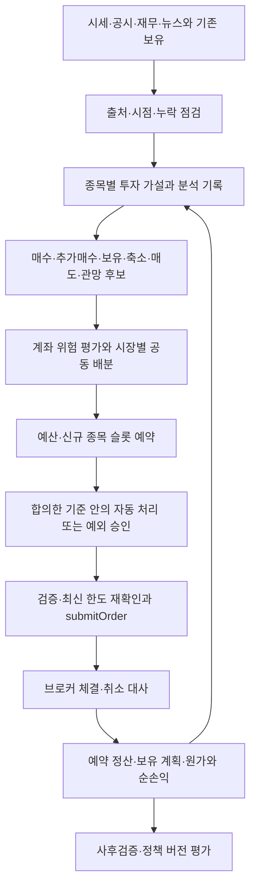

# StockInvest 개편안 — 분석에서 계좌 운용과 순손익 검증까지

> **T-078 통합 후 이 문서는 상세 설계 참고 자료다.** 실행 순서·현재 결정 목록은 [통합 작업절차서](2026-10-24-integrated-execution-procedure.md)의 S00~S09·§9만 사용한다. T-064 연구 설계도 같은 절차서에 합쳤다. 아래 A0~A7은 통합 전 대응 이력이며 두 계획을 병렬로 실행하지 않는다.

> Claude 작업 진입점: [인수인계](../../agent-vault/10-Flow/handoffs/2026-10-24-claude-restructure-handoff.md). 사용자 요구 근거: [인터뷰](../../agent-vault/10-Flow/handoffs/2026-10-23-project-direction-interview.md). 작업 이력: [T-077](../../agent-vault/10-Flow/tasks/T-077-portfolio-restructure-handoff.md).
>
> **문서 인수인계용 설계 초안이다.** 사용자 확정 정책은 §2, 구현 제안은 §5~12, 미정·승인이 필요한 값은 §13으로 구분한다. 문서 작성 승인을 실거래 활성화·운영 DB 마이그레이션·배포·유료 서비스 승인으로 확대하지 않는다. 수익률을 보장하거나 임의의 분석 점수를 검증된 승률로 취급하지 않는다.

## 1. 목표와 개편 범위

목표는 추천 건수를 늘리는 것이 아니라 **현재 자산으로 비용 차감 후 자산을 늘릴 가능성을 검증하고, 합의한 범위 안에서 매수·보유·매도·관망을 실제로 연결하는 것**이다. 추천을 본 시점과 실행 조건의 차이, 미체결·만료 후 성과 누락, 공유 자금의 중복 배정, 기존 보유 관리의 공백을 함께 다룬다.

- 한국투자증권 계좌의 현재 자산을 기준으로 한다. 약 1,800만 원과 과거 2,600만 원은 사용자 진술이며 이번 문서 작성 중 재조회하지 않았다.
- 시장별 예산, 종목 분석, 보유 관리, 주문, 장부, 사후평가를 하나의 결정 이력으로 연결한다.
- 기존 안전·인증·주문 인프라는 재사용한다. 기존 코드를 전부 폐기하는 재개발을 기본안으로 삼지 않는다.
- 이번 산출물은 문서다. 구현은 §11의 작은 작업 단위로 진행하고 각 단계의 증거를 남긴다.

## 2. 사용자 확정 정책 — Claude가 다시 묻거나 임의 변경하지 않을 항목

| ID | 확정 정책 | 구현·검토 시 보존할 의미 |
|---|---|---|
| U01 | 현재 자본으로 재편, 추가 자금 전제 없음 | 기존 현금·주식 전부 포함. 과거 실제 입출금 기록은 유지 |
| U02 | 현재 미국·국내의 자금 배분 유지 | 시장 간 자동 환전·이동·고정 비율 재조정 없음. 실제 금액은 최신 대사로 확인 |
| U03 | 기존 보유도 전부 관리 | 신규 후보군 밖의 기존 보유를 누락하지 않음. 사용자 과거 목록을 현재 보유 수량으로 고정하지 않음 |
| U04 | 두 시장 합산 최대 10종목 | 기존 보유·ETF 포함. 10개를 반드시 채우지 않음. 신규 매수 예약도 고려 |
| U05 | 미국은 Nasdaq100, 국내는 사용자가 말한 코스닥100 | 정확한 원천·구성 이력 확정 필요. NYSE50 추가는 자체 후보군 제안 상태이며 §4 적용 |
| U06 | 통상 매수·매도·보유·관망은 자동, 운용 기준 밖은 직접 승인 | 최종 목표 권한이다. 새 경로를 곧바로 운영에서 켜라는 승인은 아님 |
| U07 | 차트·기업정보·실적·경제뉴스·이슈를 함께 판단 | 가격 손절선 하나만으로 일반 매도 결정을 고정하지 않음 |
| U08 | 월 손실 5%를 관리 목표로 재평가 | 필요하면 매도·축소. 전망과 근거가 유지되면 보유 가능. 손실 5% 절대 보장이나 자동 전량 청산 아님 |
| U09 | 신규·추가 매수는 그 시점에 독립 판단 | 월 손실만으로 전면 중지하지 않음. 예산·집중도·검증·안전 관문은 계속 공유 |
| U10 | 새 분석에 따른 추가 매수 허용 | 최초 분할 계획에 한정하지 않되, 종목·시장 한도와 누적 투입 예산을 지킴 |
| U11 | 여러 시그널이 같은 자금을 중복 배정받지 않음 | 적격 후보 공동 비교 → 금액 배정·예약 → 실행 시그널. 모든 생성·집행 경로에 적용 |
| U12 | 기존 보유의 집중도 초과는 분석 점수의 우선순위로 점진 축소 | 축소 대상 분석과 순위 필요. 구체 한도·점수·수량은 미확정 |
| U13 | 종목별 기본 운용기간 최대 3개월 | 만료 재평가 후 필요한 매도·축소는 자동, 보유 연장은 근거·제안 기간을 제시해 직접 승인 |
| U14 | 연장 요청 미응답 시 보유하며 재알림 | 연장 승인 대기 상태. 미응답을 승인·자동 매도 사유로 취급하지 않음. 기존 위험 점검·매도 기준은 계속 적용 |
| U15 | 유료 데이터는 기존 웹검색·공식 원천 집계 결과를 본 뒤 결정 | 가입·결제·키 발급 선행 금지. 서버·AI 구독료는 이번 비용 검토에서 제외 |
| U16 | 적합한 기회가 없으면 기다림 | 거래 횟수·승인율·분석 건수나 자금 전액 사용을 성과 목표로 삼지 않음 |

우선순위는 최신 사용자 결정 → 프로젝트 안전·권한 규칙 → 이번 설계 제안 순이다. §13의 미정 값을 위 표의 확정 정책으로 오인하지 않는다.

## 3. 과거 설계와의 대체·재사용 관계

| 기존 항목 | 이번 처리 |
|---|---|
| T-064의 추가 200만 원 예정·미국70/국내30 및 옛 스냅샷 | 신규 자본 전제와 목표 비율로 사용하지 않음. 실제 입금 이력 자체를 지우지는 않음 |
| T-064 D3의 기존 보유는 표시·경고만, 자동 관리 없음 | U03·U12의 기존 보유 관리와 점수 기반 자동 축소가 대체 |
| T-064 §7.2의 월 -5% 신규 매수 전면 정지 | U08·U09의 재평가·필요 매도와 신규 매수 독립 판단이 대체 |
| 가격 도달만으로 일반 청산하는 하드/시간 손절 설계 | U07·U13에 맞춰 일반 전략의 매도 사유를 재설계. 기존 긴급 안전장치 해제나 exit-engine 활성화는 별도 문제 |
| 과거 2% heat, 손절폭 3%, 1회6%·일일10%, 분할4회 | 과거 정책·설정·제안을 구분해 대조. 새 인터뷰 승인 수치로 쓰거나 자동 폐기하지 않음. 2% heat와 월5%는 다른 지표 |
| T-068 현금 정보 표시·분할 보호·손절 알림 | 재사용 후보. 현금 하한을 새로 강제하지 않음. 손절 알림을 자동 매도 승인의 근거로 쓰지 않음 |
| T-071 WP-1/WP-1b 체결·취소 결과 확인 | 최신 구현을 재사용. WP-2 원가/통화/비용, WP-3 경합, D17 누적 분할, T-076 취소 후속과 구분 |
| T-072 검증 관문·paper_fills | 유지. 독립적인 매수 판단도 미검증 전략 실매수 허용을 뜻하지 않음 |
| T-074 입출금·자산 원장 | 재사용. 계좌 기준 설정·USD 현금 의미 대사와 실제 거래 원가 장부는 별도 완료 조건 |
| T-070 일봉 수집·사후검증 | 재사용. 당시 행 수·증분 관측 결과를 현재 정상 상태로 간주하지 않음 |
| T-064의 8주 섀도우 등 검증 계획 | 기존 검증 설계의 입력. 3개월 보유기간과 다르며 이번 문서로 단축·합격 처리하지 않음 |
| T-073 대시보드 정리 | 새 운용 정책과 맞춰 연결하되 기존 데모·사용자 승인 절차를 유지 |

관련 이력 정본은 각 task 문서다. [10-24 미완료 목록](../../agent-vault/00-Context/open-work-inventory-2026-10-24.md)은 조사 입력이며 현재 운영 사실의 증명이 아니다. 이 목록의 미결 표시 일부는 이번 인터뷰 후속 결정으로 갱신돼야 한다.

## 4. 착수 시 확인할 사실과 후보군

### 4.1 계좌 기준 대사

Claude의 첫 산출물은 읽기 전용 대사 보고서다. 최신 KIS 조회·현재 DB·원장 기록의 시각과 의미를 함께 확인한다. 기존 조회 권한 안에서 수행하고, 추가 권한이 필요하면 정확한 이유와 범위를 제시한다.

- 시장별 주식 평가액·현금·주문 가능 금액·증권사 점유금·미체결·미정산금·환율을 구분한다.
- 보유 고유종목·수량·평균원가·실체결 근거·원가 미상 여부를 확인한다. 후보군 밖 보유도 포함한다.
- 인터뷰에는 과거 5종목, 다른 10-24 조사에는 미국 3종목이 기록돼 있다. 양쪽을 합쳐 현재 보유로 만들거나 한쪽의 현재성을 임의 확정하지 않는다.
- 원화·달러 예수금의 의미가 다르면 신규 운용 기준 확정을 보류하고 차이를 설명한다. T-074의 기존 현금 불일치 기록을 재확인하되 이 문서에 적힌 금액으로 계좌를 수정하지 않는다.
- 실제 취득원가와 시스템이 처음 관측한 날짜를 구분한다. 입금을 수익으로, 매도대금 전체를 이익으로 계산하지 않는다.
- 실제 운영 DRY_RUN·Kill Switch·자동 청산·검증 상태·배포 버전은 읽기 전용으로 확인한다. 과거 문서의 ON/OFF를 현재 사실로 쓰지 않는다.

시장 배분의 의미는 현재 별도 자금 구획을 유지하는 것이다. 가격·환율·손익으로 평가 비율이 변해도 자동 이동으로 원래 비율을 맞추지 않는다. 보고용 원화 합산과 실제 주문용 KRW/USD 예산을 분리한다.

### 4.2 후보군 계약

| 구분 | 해야 할 일 | 금지할 단축 |
|---|---|---|
| Nasdaq100 | 공식 구성·효력일·기업/종목 식별자를 기록하고 편출·상장변경 이력 보존 | 현재 구성종목을 과거 전체 백테스트에 소급 |
| 코스닥100 | 사용자가 지칭한 대상과 KRX/KIS의 지수·대형주 분류를 대조해 정확한 구성 원천·갱신 규칙 제안 | 코스피100·코스닥150·자체 시총상위100으로 조용히 교체 |
| NYSE50 | 공식 지수라고 단정하지 않음. NYSE 상장 기업 중 유동성·규모·재무 등의 자체 50개 후보 선정안을 작성 | 기존 SP500_TOP50이 동등한 후보군이라고 간주 |
| ETF | 기존 보유는 항상 관리. 신규 편입 범위와 업종 노출 계산은 정책안에 명시 | ETF 한 종목이면 집중 위험이 없어지는 것으로 처리 |
| 관리/매수 구분 | 관리 대상 = 실제 보유 전체, 신규 매수 대상 = 확정한 후보군 | 편출된 기존 보유를 분석·위험 집계에서 제거 |

후보군은 투자 위험이 낮다는 보증이 아니다. NYSE 확대와 ETF 신규 범위는 아직 최종 편입 승인 목록이 아니므로 자료 수집·모의 비교부터 가능하고 실제 신규 매수에는 확정된 버전만 사용한다.

## 5. 목표 구조와 역할 분리

- **분석 계층**은 사실과 해석·가설·조건을 만든다. AI가 계좌 한도나 승인 상태를 직접 바꾸지 않는다.
- **정책 계층**은 후보 적격성·집중도·기한·허용 권한을 결정한다. 매수 분석과 보유 분석은 같은 종목의 최신 가설을 공유한다.
- **배분 계층**은 모든 적격 후보를 비교하고 실제 쓸 수 있는 자금·종목 슬롯을 예약한다.
- **집행 계층**은 기존 `submitOrder()`와 검증된 취소·대사 경로를 사용한다. DB와 증권사 호출을 하나의 원자적 트랜잭션인 것처럼 가정하지 않는다.
- **측정 계층**은 실거래·모의·미체결 가정을 구분한다. 성과가 확인되지 않은 전략을 승급시키지 않는다.

시세 감시와 주문 보호가 뉴스 수집·장시간 AI 배치 때문에 밀리지 않도록 작업 예산·타임아웃·갱신 시각을 둔다. 매 틱마다 전체 AI 분석을 새로 수행하는 구조를 기본으로 삼지 않는다.

## 6. 기존 모듈을 연결할 위치 — 정적 코드 대조

작성 기준 HEAD는 `330314e545b5dbfa1c9523ea68f134cc91bb2042`다. 타 세션의 미커밋 변경이 다수 포함돼 있어 실제 구현 착수 시 다시 확인한다. 아래는 지정 경로를 읽은 결과이며 운영 실행 증거는 아니다.

| 위치·함수 | 현재 확인한 것 | 새 요구의 연결점 |
|---|---|---|
| `src/lib/signals/service.ts:createSignal/approveSignal/approveSignalHybrid` | 검증·개별 현금 점검·승인 선점·주문 연결 | 생성·승인·자동·추가매수 모두 공통 배분·예약 참조 |
| `src/app/api/signals/custom/confirm/route.ts:POST` | 종목/방향 락·분할 INSERT. 전략 귀속 없는 매수는 T-072로 차단 | 계획 전체 예산 예약·실제 검증 전략 귀속. 관문 삭제로 해결 금지 |
| `src/lib/strategy/post-market-engine.ts` | 별도 signals INSERT 경로 | 공통 후보/예약 계약으로 연결하는 우회 경로 목록에 포함 |
| `signal-cash-gate.ts:evaluateSignalCashGate`, `entry-cash-precheck.ts:readAvailableCash` | 한 건 금액 비교·조회 캐시. 일부 불명은 기존 경로 진행 | 조회 공유는 예산 예약이 아님. 최종 배분은 불명 금액으로 새 자금 약정 금지 |
| `src/lib/safety/dry-run.ts:submitOrder`, `order-limits.ts:checkOrderMax/checkDailyMax` | 안전·감사·시장별 한도·송신 직전 검증 | 예약 소유권·정책 버전·최종 수량/가격 점검을 보완. 기존 보호 보존 |
| `src/lib/safety/validation-gate.ts:evaluateValidationGate` | T-072 매수 검증 관문 구현. 매도는 별도 취급 | 새 분석 점수·사용자 일반 승인으로 우회 금지. 정책/전략 버전의 증거 귀속 강화 |
| `src/lib/risk/defaults.ts`, `portfolio-stability.ts` | max10·월5%는 표시 정책. 종목별 24h 발화 횟수 제한은 다른 기능 | 합산 보유+예약 고유종목 상한과 월간 재평가 사건 구현 |
| `src/lib/safety/kill-switch.ts:checkAndTriggerDrawdownKillSwitch` | 24h 손실 관문. 월간 재평가와 다름 | 기존 일간 안전장치를 월간 정책으로 바꾸거나 해제하지 않음 |
| `position-state.ts:setPositionScenarioExit`, `cron/holding-checker/route.ts` | deadline 저장, 만료 알림 후 NULL 처리 | 기산일·만료일 보존, 연장 승인 대기와 영속 재알림으로 보완 |
| `approval-transitions.ts`, `telegram-approval.ts`, `safety/confirmed-alert.ts` | 승인 CAS·서명/허용 사용자 확인, 메모리 전달 억제 | 연장 승인 전용 유형·버전·대상·기간과 영속 알림 outbox |
| `entry-claim.ts:claimEntrySignal`, `order-sync.ts:syncPendingOrders` | 선점·결과 불명 유지·T-071 체결/잔량 대사 | 실제 체결·취소 증거에 맞춘 예약 정산·슬롯 해제 |
| `src/lib/ledger/compute.ts:computeSummary` | 입출금 보정 자산 성과·미확정 표시 | 월 경계·환율·원가 계약 보완. 별도 거래장부와 연결 |
| `src/lib/reports/trade-report.ts:computeLifoPnl/fetchOrderRows` | 기존 거래 성과 경로, 원가 미상 fallback 잔여 | WP-2와 대조·수정 후 사용. 현재 월 손실·전략 합격의 단독 정본으로 쓰지 않음 |

새 모듈 경로는 구현자가 기존 구조를 보고 최소로 선택한다. 이 문서의 도메인 명칭이 모두 새 DB 테이블·API를 만들라는 뜻은 아니다.

## 7. 분석과 점수화 계약

### 7.1 하나의 분석 기록에 남길 것

- 종목·시장·전략/정책 버전·대상 시각·자료가 실제로 공개된 시각·수집 시각.
- 기업 전망, 실적/재무, 가치평가, 경제·산업·뉴스/공시, 차트/변동성, 거래 가능성의 근거.
- 사실과 해석 구분, 투자 가설, 가설 무효 조건, 매수/추가매수 조건, 보유/축소/매도 사유, 다음 점검 시점.
- 데이터 누락·추정/확정·자료 충돌·갱신 지연을 별도 표시한다. 결측을 0점이나 악재로 바꾸지 않는다.
- 원문 링크·발표 시점·사용한 수치로 결론을 재생할 수 있게 한다. 웹페이지의 지시문은 데이터로만 취급하며 도구 실행·권한 변경에 사용하지 않는다.
- 조건부 매수 후보/시그널에는 분석 스냅샷·가설 버전·유효 시작/종료 시각을 연결한다. 매수 조건의 유효기간은 3개월 보유기간과 별도이며, 기간 자체는 전략별로 검증할 제안 값이다. 중요한 새 공시·실적·이슈가 가설을 바꾸면 미송신 신호를 재평가/무효화하고 과거 가격 도달만으로 실행하지 않는다. 이미 송신된 주문은 내부 만료 처리만으로 취소·예약 해제하지 않는다.

공시·기업 IR·KIS·SEC/OpenDART를 사실 확인의 우선 원천으로 사용하고, 포럼은 의견·심리 입력으로 구분한다. 기존 웹검색 자료로 먼저 품질·누락·갱신 지연을 측정한다. 유료 데이터가 없어서 과거 손실이 났다고 단정하지 않는다.

### 7.2 점수의 용도

| 점수/상태 | 의미 | 사용 위치 |
|---|---|---|
| 매수 적격 여부 | 필수 자료·전략 검증·실행 조건 충족 | 부적격이면 배정하지 않음 |
| 매수 우선순위 | 적격 후보 사이의 비교 | 공동 예산 배분 가중치 후보 |
| 보유 매력도 | 현재 투자 가설과 향후 보유의 근거 | 보유·추가매수·만료 재평가 |
| 축소 우선순위 | 높을수록 먼저 줄일 필요 | 한도 초과 해소에 기여하는 보유 사이의 순위 |
| 근거 충족도 | 자료의 충분성·일관성·시점 적합성 | 결측·불명 관리. 승률로 표시하지 않음 |

매수 우선순위 점수는 승률·기대수익률·투자 비율 그 자체가 아니다. LLM의 자신감 숫자를 확률로 사용하지 않는다. 가능한 수치 항목은 재현 가능한 함수로 계산하고, LLM은 출처에 근거한 사건·가설 정리에 사용한다.

**검증용 초기안:** 기업/재무, 가치평가, 산업/사건, 가격/변동성의 4개 축을 동일 비중으로 비교하는 기준안을 먼저 만든다. 각 축의 원자료·평가 기준을 Analyst가 사전 등록하며 결측 축은 미평가 상태로 남긴다. 이 동일 비중은 비교 실험의 기준일 뿐 실제 매수 가중치·사용자 승인 투자 비율이 아니다. 복잡한 점수식은 이 기준안보다 비용 후 성과·위험이 개선되는 근거가 있을 때 추가한다.

축소 점수는 투자 가설 약화·해당 축소로 줄일 집중 위험·가격/변동성 악화·실행 비용을 검토한다. 먼저 조정이 필요한 한도에 기여하는 후보를 고른다. 반도체 노출 초과를 줄이는 작업에서 무관한 업종을 점수가 낮다는 이유로 팔지 않는다. 단일 종목 상한 초과는 그 종목의 조정이 필요하다. 점수 순서와 실제 축소 수량은 별도 계산한다.

## 8. 공유 예산과 보유 슬롯 — 필수 구현 계약

### 8.1 계산 기준

- 국내는 KRW, 미국은 USD의 검증된 주문 가능 자금을 사용한다. 보고용 원화 환산액으로 달러 주문 예산을 약정하지 않는다.
- 브로커 금액 필드가 기존 주문 점유분을 이미 뺀 값인지 계약을 고정한다. 확인되지 않은 필드를 임의로 free cash로 취급하지 않는다.
- 현금 조회 시각·스냅샷 ID/버전·주문 조회 범위와 내부 예약의 브로커 반영 근거를 짝지어 보존한다. 오래된 현금 스냅샷에 새 반영 상태를 섞어 배정하지 않는다. 브로커가 반영 주문을 특정할 수 없는 경우에는 일관된 재조회·대사를 거치며 불명 금액을 새 예산으로 풀지 않는다.
- 배정 가능액은 검증된 주문 가능 현금에서 **그 필드에 아직 반영되지 않은 내부 예약**과 필요한 거래비용 여유를 뺀 금액이다. 브로커 차감과 내부 차감을 중복하지 않는다.
- 별도로 1회·일일/세션·종목·업종·계획 누적 투입 한도를 적용한다. 비용 여유는 거래비용을 위한 것이며 현금 비중 하한 규칙을 몰래 추가하는 것이 아니다.
- 매도 예정 대금·미확인 취소 잔액은 쓰지 않는다. 매도 대금은 해당 시장 자금으로 유지한다.

### 8.2 공동 배분

1. 최신 분석과 검증 상태로 적격 후보를 모으고 신규·추가·분할매수를 같은 풀에서 다룬다.
2. 가중치 초안을 계산한 뒤 종목/업종 남은 여유·당일 여유·정수 수량·가격과 비용에 맞춰 줄인다.
3. 한 주도 살 수 없으면 배정을 0으로 한다. 자본을 늘리거나 한도를 자동 완화하지 않는다.
4. 배정액을 확정·예약한 후보만 실행 가능한 매수 시그널로 만든다. 미배정 후보와 실행 시그널을 화면·통계에서도 구분한다.
5. 남은 예산을 반드시 모두 쓰거나 상위 한 후보에 재집중하지 않는다.

예산 100만 원과 50/30/20 가중치는 인터뷰의 **설명용 픽스처**다. 실제 비율이 아니다. 이 경우 A의 남은 종목 여유가 30만 원이면 A30/B30/C20, 합계80만 원처럼 제한할 수 있고 20만 원은 미배정으로 둘 수 있다. 비용·정수 수량을 반영한 결과는 별도로 확인한다.

### 8.3 원자적 예약과 생명주기

- 기본 구현 후보는 계좌 자원 행을 `SELECT ... FOR UPDATE`로 잠그고 예산·교차시장 슬롯·고유 intent를 같은 트랜잭션에서 확정하는 방식이다. 작은 단일 계좌에서는 복잡한 분산 락보다 이 경계를 먼저 검증한다.
- 잠금 순서는 계좌 공통 자원 → 시장 예산 → 종목 계획 등으로 고정한다. DB 잠금을 잡은 채 외부 시세·AI·KIS 호출을 기다리지 않는다.
- 증권사 송신은 예약 커밋 후 수행한다. DB 커밋과 외부 주문 사이의 장애는 durable intent/outbox와 대사로 복구한다. 결과 불명을 무조건 재송신하지 않는다.
- 송신 직전 최신 현금·가격·비용·위험/주문 한도·정책/가설 버전·시그널 유효기간과 예약 소유권을 재확인한다. 앱 밖 수동 주문·입출금이나 가격 변화가 확인되면 필요한 예산을 원자적으로 줄이거나 보류·재배분한다. 만료된 조건을 새 분석 없이 살리지 않는다. 외부 계좌 변화와 DB를 완전히 원자화할 수 있다는 보장은 하지 않으며, 브로커 거부/불명 결과도 대사한다.
- 예약은 미송신·송신 결과 불명·브로커 미체결·부분체결·확정 종결을 구분한다. 부분체결은 사용액과 잔량 예약을 나눈다.
- 미송신 만료/취소는 해제할 수 있다. 이미 송신했거나 송신 여부가 불명확하면 내부 TTL 또는 취소 요청만으로 해제하지 않는다. 브로커 확인 후 남은 부분만 해제한다.
- 동일 intent 재시도·워커 중복·서버 재시작은 같은 예약으로 귀속한다. 기존 `client_order_id`·선점·CAS와 연결한다.
- 신규 슬롯은 두 시장의 실제 보유 고유종목과 살아 있는 신규 매수 예약의 합집합으로 센다. 같은 종목의 분할·추가매수는 슬롯을 다시 쓰지 않는다. 완전 매도 중이라도 잔량/결과 불명이 남으면 조기에 슬롯을 비우지 않는다.
- 기존 보유가 이미 10개를 넘으면 새 종목 진입을 막고 전환 계획을 만든다. 기존 보유를 장부에서 지워 숫자를 맞추지 않는다.
- 종목의 현재 평가 노출과 계획별 누적 투입 예산을 따로 관리한다. 주가 하락만으로 추가매수 예산이 계속 생기지 않게 한다. 매도 후 예산 복원·새 계획 생성 조건은 §13에서 확정한다.
- 일일 매수 집행 누적액과 살아 있는 예약은 별도 집계하되 동일 주문을 중복 합산하지 않는다. 매도 수입으로 이미 사용한 매수 회전 한도가 리셋되지 않게 정의한다. KST 자정과 미국장 중간의 한도 리셋 문제도 시험한다.
- 매도도 계좌·종목별 송신 가능 수량을 공통 자원으로 관리한다. 집중도 축소·월 손실 대응·일반 매도·수동 승인 경로가 같은 잔량을 따로 약정하지 못하도록 기존 선점/CAS와 원자적 수량 예약을 결합한다. 브로커 매도 가능 수량에 이미 반영된 미체결과 내부 예약을 중복 공제하지 않으며 결과 불명·부분체결·취소 확인 규칙은 매수와 같은 근거 원칙으로 정산한다.

## 9. 월 손실·보유 관리·연장 승인

### 9.1 월 손실 지표 — 구현 제안

기준 통화는 계좌 합산 KRW를 제안하고, 시장별 원통화 성과도 병기한다. 평가손익·실현손익·확정/추정 비용·현금·환율·외부 입출금을 일관되게 반영한다. 원화/달러 자체 환전과 계좌 내부 이동은 외부 입금으로 세지 않는다.

월 경계는 KST 달력월을 초기안으로 제안한다. 월중 초기 편입은 완전한 월 기준이 아니라 관측 시작 이후로 표시한다. 기존 T-074의 누적 기준 성과를 그대로 월 손실로 이름만 바꾸지 않는다.

- 금액 손익: `P_m = E_now - E_start - sum(F_i)`; F는 외부 순입출금의 일관된 원화 평가액.
- 수익률: 입출금 시점별 평가가 있으면 TWR을 사용하고, 부족하면 T-074와 호환되는 가중 현금흐름 수익률을 별도 버전으로 검증한다. 예: `R = P_m / (E_start + sum(w_i * F_i))`.
- 분모가 0 이하이거나 중요한 현금·원가·가격이 미확정이면 유효 수익률을 만들지 않는다. 0% 손실로 표시하지 말고 자료 부족 사건을 남긴다. 비용을 이미 반영한 자산에서 다시 차감하지 않는다.
- 원화 환율 손익, 원통화 주가 손익, 외부 입출금 영향을 분리해 설명한다. 단순 총자산 감소율·24시간 손실·고점대비 낙폭을 월 손실과 혼용하지 않는다.

유효한 월 수익률이 -5% 이하이면 재평가 사건을 만들고 조정 필요·지표 악화이면 매도·축소한다. 그 이후에도 새로운 중요 정보에 따라 계속 평가한다. 이 사건 자체로 신규·추가 매수를 전면 정지하지 않는다. 신규 매수는 별도 분석을 거쳐 공통 예산·위험·검증·안전 조건을 충족해야 한다.

기존 Kill Switch와 기존 일일 손실 관문은 유지한다. 월 정책을 이유로 이 관문을 우회하지 않는다. 기존 안전/전략의 가격 청산과 새 종합 판단이 충돌하면 적용 우선순위와 전환 계획을 명시해 검토받는다. 이전 exit-engine을 그대로 켜서 새 보유 관리로 간주하지 않는다.

### 9.2 점진 축소

한도 초과 해소 대상 → 축소 점수 → 필요한 규모 → 공통 매도 수량 선점 → 단계별 주문 → 체결 확인 → 최신 노출·순위 재평가 순서다. 서로 다른 매도 사유도 같은 계좌·종목의 수량 약정을 공유하며, 이미 약정한 잔량을 다시 매도하지 않는다. 집중도 조정 목적을 달성하면 해당 축소는 종료한다. 투자 가설 훼손에 따른 일반 매도는 별도 사유로 계속 평가한다.

### 9.3 3개월 계획과 연장

| 사건 | 동작 |
|---|---|
| 기간 중 새 정보·악화 | 재평가 후 합의한 조건 안에서 매도·축소·보유 |
| 기본 3개월 만료 | 전면 재평가. 필요하면 자동 매도·축소, 연장이 타당하면 승인 요청 |
| 연장 승인 | 승인한 대상·근거 버전·새 만료일만 반영, 자동으로 다음 연장까지 허용하지 않음 |
| 응답 없음 | 보유하며 연장 승인 대기·재알림. 위험 점검과 기존 매도 기준 유지 |
| 정보/보유가 바뀜 | 오래된 제안 버전의 승인 적용을 막고 갱신된 평가를 제시 |
| 승인 거절 | 거절 상태를 기록하고 보유/정리 계획의 후속 규칙 적용. 구체 후속은 §13 확정 필요 |

기산일 초안은 신규 포지션의 첫 실제 체결일이다. 추가매수·일부 매도만으로 최초 기한을 계속 리셋하지 않는다. 3개월은 90일과 같다고 가정하지 않고 달력월 경계를 시험한다. 기존 보유의 편입 기산일은 과거 취득일과 현재 정책 시작일을 모두 보존한 전환안을 제시하고 운영 전 확정한다. 알 수 없는 날짜로 즉시 기한 초과 매도를 만들지 않는다.

연장 요청은 주문 승인과 별도 유형으로 관리한다. 대상 계좌·종목/계획·평가 버전·제안 기간·승인자 권한·현재 보유를 함께 확인하고 CAS로 반영한다. 한 번 누른 연장 버튼이 중복 매매를 만들거나 다른 종목에 적용되지 않아야 한다.

재알림은 DB 기반 요청 상태와 outbox로 재시작에도 살아 있게 한다. 초기 간격 후보는 하루 1회이며 사용자 확정 간격이 아니다. 중요 변경·긴급 위험 알림은 일반 재알림 주기와 구분한다. 미응답 횟수를 이유로 자동 청산하거나 자동 승인하지 않는다. 전달 실패·결과 불명·중복 전송 가능성을 기록하고, 알림 성공 여부와 보유 관리 상태를 분리한다. 현재 `holding_deadline=NULL`로 단발 종료하는 경로를 그대로 사용하지 않는다.

## 10. 상태·저장 계약과 최소 화면

기존 테이블·타입을 재사용할 수 있으면 우선 확장한다. 아래는 논리 모델이며 새 테이블 수를 확정한 DDL이 아니다.

| 논리 객체 | 최소 계약 |
|---|---|
| 정책 버전 | 상태 draft/모의검증/승인/active, 후보군·점수·한도·비용·권한·검증 근거·활성 시점 |
| 분석 스냅샷 | 종목·전략·정책·공개/수집/평가 시각·근거·가설·각 점수·결측·유효 조건 |
| 보유 계획 | 실제 보유 귀속·원가 신뢰도·원래 취득/편입/첫 체결일·기본/연장 만료일·누적 투입·상태 |
| 실행 intent/예약 | 계좌·시장·원통화·금액·수량·슬롯·시그널/주문 ID·정책 버전·확정 증거·멱등 키 |
| 연장 승인 요청 | 유형·대상 계획·제안 버전·기간·승인/거절/대기·권한·전달/재알림 이력 |
| 결정 이력 | 평가→관망/후보→배정→승인→송신→체결→청산→순손익·사후검증의 추적 ID |

T-072의 검증 상태·전략 등록을 다른 새 레지스트리로 중복 구현하지 않는다. 기존 단일 계좌 전역 모델과 회원 인증 경계를 확인하고, 단순히 user_id를 붙여 계좌를 중복 집계하지 않는다. 향후 다중 계좌를 고려한 자원 키와 현재 권한 검사를 구분한다.

모바일 412px·하단 5탭·상승 빨강/하락 파랑·lightweight-charts 원칙을 유지한다. 화면은 Designer 데모와 사용자 승인 이후 구현한다.

- 대시보드: 시장별 가용/예약 자금, 실제 순손익·신뢰 상태, 오늘의 보유/축소/매수/관망 근거, 승인 대기.
- 종목/보유: 가설·근거 시점·매수/보유/축소 점수의 의미, 실제 노출·한도·다음 점검·3개월 상태.
- 주문: 후보·예약·송신·미체결·부분체결·취소 요청/확정·결과 불명을 구분.
- 성과: 실제/모의/미체결 가정 분리, 비용 후 손익·낙폭·시장 비교·실패 원인.
- 설정: 정책 버전·한도·데이터 상태·연장 승인 이력. 구현 상수나 불명확한 AI 확률을 사용자 판단 근거처럼 노출하지 않음.

## 11. 통합 전 단계 대응 이력과 산출물

아래 A0~A7은 T-077 작성 당시의 단계다. 현재 실행은 통합 작업절차서 S00~S09로 이동했고 대응표는 통합 §4를 따른다. 각 실제 작업은 기존 관련 task를 재사용하거나 새 ID를 확보하며, 이 문서가 미래 task ID를 예약하지 않는다.

| 단계 | 담당·작업 | 산출물/완료 조건 | 선행·운영 영향 |
|---|---|---|---|
| A0 현황·정책 대조 | Leader·Judge·읽기 전용 조사 | 최신 코드/배포/설정·계좌 대사, 미정 값·충돌표, 작업 분할 | 이 문서부터 착수 가능. 실제 운영 쓰기 없음 |
| A1 장부·성과 기반 | Developer·Reviewer·QA, T-071 WP-2/T-074/T-076 대조 | 실제 체결가·수량·통화·비용·이월원가·입출금 대사. 부분체결·결과 불명 보존 | 새 매수 승급·성과 판단 전 필요. DDL은 별도 승인 |
| A2 분석·데이터·후보군 | Analyst·Developer | 무료 원천 품질표·시점 데이터·후보군 버전·가설/점수의 재현 가능한 기준안 | A1과 독립인 읽기/모의 작업은 병행 가능. 운영 데이터 경로 활성화는 따로 검토 |
| A3 계좌 정책·예약 | Leader·Developer·Reviewer·QA | 모든 생성 경로의 공동 배분·원자적 예산/슬롯·정산·재시작/경합 검증 | A0 자금 필드 계약 필요. 신규 기능은 모의/섀도우부터 |
| A4 보유·월 손실·승인 | Analyst·Developer·Reviewer·QA | 월 지표·점수 축소·기한 보존·연장 승인/재알림·매수 독립 판단 | A1 장부·A2 분석·A3 자원 계약 연결. 초기에는 주문 없이 결정만 기록 |
| A5 전략·포트폴리오 검증 | Analyst·Reviewer·QA | 사전 등록한 기준, 비용 후 OOS·전진 모의 결과, 기존 보유 포함 전환 계획 | A1~A4의 결합 검증. T-072 승급은 증거가 있을 때만 |
| A6 사용자 화면 | Designer→사용자 데모 승인→Developer→Reviewer/QA | 최소 화면과 412px·900px 전환 확인, 예산/승인/성과의 정합 | 데모 승인은 실제 화면 범위만. 매매 활성화 승인과 분리 |
| A7 단계적 운영 전환 | Leader·Reviewer·QA·Deployer | DRY_RUN/섀도우→승인된 소액→자동 범위 확대, RELEASE_RESULT·헬스·cron·장부 대사 | 현행 단계 가이드·실제 사용자 승인·검증 선행. push=배포 주의 |

읽기·순수 함수·격리 모의 구현은 미정 투자 수치를 이유로 모두 멈추지 않는다. 반대로 검증되지 않은 점수·후보군·한도로 실제 자금을 운용하지 않는다. 기술 선택은 담당자가 근거를 남겨 정하고, 투자 권한·허용 위험·새 비용이 바뀌는 결정만 검토 항목으로 묶어 제시한다.

모든 실제 구현 task는 AGENTS/CLAUDE의 Judge 접수→설계 C1→Developer→독립 Reviewer→C2→QA→Deployer 절차를 따른다. Codex 세션의 재귀 검토 불가 예외는 기록하고, Claude에서 재개하면 그 환경의 절차를 적용한다. 새 안전 코드의 scope를 이번 문서 검토로 승인받은 것처럼 쓰지 않는다.

## 12. 필수 검증과 성과 판정

### 12.1 기능·회계·장애 시험

| 사례 | 합격 기준 |
|---|---|
| 동시 3개 매수 요청이 각각 전액을 요구 | 살아 있는 총 약정이 검증된 자금·한도를 넘지 않음 |
| 기존 미체결이 브로커 현금에 이미 차감 | 같은 금액을 두 번 공제하지 않음 |
| 현금 조회 뒤 외부 수동 주문·입출금 발생 | 스냅샷/반영 근거의 시점 혼합을 탐지하고 송신 전 보류·축소·재조회 |
| 국내/미국에서 마지막 신규 슬롯 동시 신청 | 전체 보유+예약 고유종목이 10을 넘지 않음 |
| 동일 종목 분할·추가매수 | 슬롯 한 개, 계획 총투입·종목 한도는 누적 반영 |
| 시나리오/카드/자동/수동 경로 | 검증·자금·슬롯 계약을 우회하는 INSERT/송신 경로 없음 |
| 1주도 살 수 없음·가격 상승·비용 부족 | 0 배정/관망과 사유 기록, 임의 증액·자본 확대 없음 |
| 예약 후 장애·중복 워커·송신 응답 유실 | 중복 약정/주문 방지, 결과 불명 보존·대사 |
| 부분체결 후 잔량 유지/취소/조회 실패 | 사용분과 예약분 일치, 취소 요청만으로 해제하지 않음 |
| 월중 입금·출금·환전·평가 손익 | 월 성과와 자산 금액 대사, 입금 수익화·통화 혼용 없음 |
| 월 -5% 사건과 적격 새 매수 공존 | 보유 재평가 수행. 월 사건만으로 새 매수 전면 차단하지 않으면서 공통 한도 유지 |
| 기존 Kill Switch·검증 실패 | 새 경로도 차단 준수, 위험 매도 검증과 매수 승급을 혼동하지 않음 |
| 업종 집중·ETF 중복 노출 | 초과 해소에 기여하는 대상만 순위화, 같은 노출 중복 합산 없음 |
| 점진 축소 중 기존 매도 잔량 존재 | 과매도 없음. 체결 후 필요 축소량·점수 재계산 |
| 집중도·월 손실·일반 매도가 같은 수량에 동시 진입 | 공통 수량 선점으로 살아 있는 총 매도 약정이 실제 가능 수량을 넘지 않음 |
| 오래된 매수 조건 도달·유효기간 만료·새 악재 | 최신 가설/유효성 확인 없이 송신하지 않음. 3개월 보유기간과 신호 TTL 분리 |
| 3개월 만료·말일·추가매수·기존 편입 | 기산일 계약대로 처리, 추가매수로 무한 연장 없음 |
| 연장 승인 중복·오래된 버튼·다른 사용자 | 대상/권한/버전/기간 검증, 중복 반영·주문 없음 |
| 연장 미응답·앱 재시작·알림 실패 | 보유/재평가·재알림 상태 영속, 미응답 자동 승인/청산 없음 |
| 현금·원가·가격·공시 시점 미상 | 미확정 상태 노출. 가짜 0·임의 점수·잘못된 승급 없음 |
| KST 월 경계·미국 자정·DST·반일장 | 정책별 경계·시장 세션이 재현되고 두 번 한도를 쓰는 오류 없음 |

이 시험들은 구현 후 작성·실행할 수용 기준이다. 이번 문서 작업에서 실행하거나 통과했다고 주장하지 않는다. 현재 dirty 트리의 기존 테스트 실패를 이번 문서 결함이나 해결 완료로 바꾸지 않는다. 격리 DB·모의 KIS 환경에서 관련 시험과 타입 검사·필요 빌드를 수행하고 전후 기준을 구분한다. 테스트를 위해 공유 운영 MariaDB에 부팅 DDL이나 샘플 주문을 쓰지 않는다.

### 12.2 전략·점수의 성과 검증

- 사후 수정된 재무·현재 유니버스·미래 뉴스가 과거 결정에 들어가지 않게 공개 시점과 효력일을 재생한다. 자료가 없으면 검증 불가 구간을 표시한다.
- 실제 봉 주기와 전략 가설을 맞춘다. 미국 일봉을 시간봉으로 이름만 바꾸지 않는다. 조정 주가·실행 주가·배당/분할의 사용 목적도 분리한다.
- 매수·매도 비용·슬리피지·거래 단위·미체결·부분체결·갭을 반영한다. 미국 편도0.25%는 과거 확인 요율로 비용 추정의 근거이며 실제 계좌 요율·추정/확정 비용을 재확인해 기록한다. 세금/추가 부과액 미확인은 0원 확정이 아니다.
- 만료·미체결·배정 못 받은 후보·거절·관망도 모수에 포함한다. 추천 후 3일 내 하락 사례는 원문·조건 충족·실행 가능성을 확인한다. 구체 낙폭을 사용자 기억으로 복원하지 않는다.
- 시그널 생애 평가와 실제 체결 후 수익 평가를 별도 집계한다. 미체결 가정 성과를 실제 순손익으로 합치지 않는다.
- 승률보다 비용 후 순손익·보유 중 최대 낙폭·손실 꼬리·집중도·회전율·실행률·정보 지연·시장 구간별 안정성을 함께 본다. 승인율·매매 횟수는 운영 지표다.
- 비교 대상은 현금, 같은 시장 구획/원가·기간을 맞춘 단순 보유·동일 후보의 단순 배분 등으로 사전 등록한다. 벤치마크는 비교 지표이며 사용자가 새로 매수할 상품으로 간주하지 않는다.
- 학습/설계 구간과 시간상 뒤의 OOS·전진 모의를 분리한다. 기준선을 보고 반복 조정한 뒤 같은 구간을 새 검증으로 재사용하지 않는다.
- 승급 숫자·표본 수·검증 기간·비용 스트레스는 실험 전 정한다. 증거가 부족하면 실거래 승급을 보류하되 분석·기록은 계속한다. 3개월 보유나 과거 8주 계획 자체가 합격 증거는 아니다.

## 13. 미정 값과 승인 경계 — 묶어서 해결할 목록

| 번호 | 아직 정할 것 | 준비할 근거·처리 |
|---|---|---|
| C01 | 최신 시장별 자산·가용자금·기준일 | A0 대사. 현재 비율 유지 원칙은 다시 묻지 않음 |
| C02 | 코스닥100 구성 원천, 자체 NYSE50·신규 ETF 범위 | 공식/증권사 원천과 제안 목록·갱신·PIT 확보 여부. 임의 대체 금지 |
| C03 | 종목/업종 상한·계획 누적 투입·축소 규모 | 실제 집중도·변동·비용·기존 한도 비교로 정책안 제시. 기존 15/30/40% 등을 확정 수치로 복사 금지 |
| C04 | 점수 항목·가중치·임계값·배분 변환·조건부 신호 유효기간 | 단순 기준안과 OOS·전진 결과로 선택. AI 자신감을 확률화하지 않고 신호 TTL과 3개월 보유기간을 분리 |
| C05 | 월 손실의 정확한 평가/현금흐름/환율/경계 계산 | T-074와 장부를 대사하는 버전별 공식·시험. 관리 목표 5%와 새 매수 독립 원칙은 유지 |
| C06 | 기존 보유 기산일·추가매수·연장 기간/횟수·거절 처리 | 전환 정책안·사례. 미응답 보유/재알림은 확정이므로 자동 정리로 바꾸지 않음 |
| C07 | 재알림 간격·채널·요청 시점·중복 제어 | 기존 알림 인프라를 우선 활용. 하루1회는 초안, 실제 설정과 알림 권한 확인 |
| C08 | 매도 후 예산 복원·같은 종목 재진입 | 이전 매도 근거와 새 매수 근거의 충돌 해소·회전 비용·계획 갱신 규칙 |
| C09 | 전략/포트폴리오 합격 기준·운영 확대 | 사전 등록된 비교·손실·표본·기간·비용 기준과 단계별 증거 |
| C10 | 운영 DDL·배포·자동 운용 전환 | 기존 승인과 유효 범위를 확인. 이번 문서는 포괄 승인이 아님 |

이 목록은 문서 작성을 막는 질문지가 아니다. Claude가 A0~A5의 근거와 선택지를 작성해 정책 검토 단위로 제시한다. 이미 답한 13개 인터뷰 요구와 후속 결정을 반복 질문하지 않는다. 자금·권한·손실 허용을 바꾸는 미정 값은 실제 운용 전에 확정하고, 단순 기술 구현은 담당자가 근거를 남겨 진행한다.

## 14. 운영 전환·롤백·변경 범위

- 새 기능 기본 상태는 모의/섀도우다. 현재 운영 전체의 DRY_RUN·Kill Switch·자동 청산 설정을 이 문서 때문에 바꾸지 않는다.
- 검증·작은 한도·수동 확인·자동화 확대의 프로젝트 가이드를 따른다. 새 일반 자동 매도 목표가 기존 해외 취소/체결 선결 검증을 면제하지 않는다.
- 코드 배포 전후의 정책 버전·적용 계좌·예약·열린 주문을 대사한다. 옛 워커와 새 워커가 동시에 같은 자금을 쓰지 않게 전환 소유권/버전을 둔다.
- 롤백은 새 진입 차단/생성 중단, 실제 송신 주문 대사, 예약·장부 보존, 구버전 호환 확인 순서의 계획을 먼저 작성한다. DB 롤백을 코드 롤백과 동일시하지 않는다.
- 위험 코드는 독립 Reviewer의 실제 변경 scope 검토 후 커밋한다. 현재 `scripts/git-hooks/commit-msg`와 설치 상태가 정본이다. 새 환경/워크트리는 정해진 설치·시험을 하되 타 작업 변경을 일괄 스테이징하지 않는다.
- 배포 전 `docs/deploy-order.md`와 실제 origin ref·포함 커밋을 확인한다. push가 운영 배포를 발화하므로 문서 인수인계 과정에서 실행하지 않는다.
- 기존 기능 제거는 영향·검증·호환 이관 계획이 있는 최소 범위에서 한다. 중복 추천·여러 AI 판단 경로는 공통 분석 기록으로 연결하고, 수익과 무관한 새 기능은 이번 핵심 구현에 끼워 넣지 않는다.

## 15. 완료의 정의

**이 문서 인수인계 완료:** 요구 추적표·대체 정책·현행 모듈·단계·수용 기준·미정 값·시작 지시문이 있고, 문서 독립 검토 지적을 반영했으며 재개 문서가 연결된다.

**프로젝트 개편 완료:** 위 문서 완료와 별개다. 실제 계좌/장부 대사, 모든 주문 경로의 자금·슬롯·검증 계약, 보유/월손실/연장·재알림의 정상 동작, 비용 후 전략 증거, UI 승인/QA, 승인된 단계적 운영 적용이 모두 필요하다. 추천이 만들어지거나 앱이 빌드된 것만으로 완료하지 않는다.

## 16. 공식 자료와 확인 범위

2026-10-24 문서 작성 중 다음 공식 원천을 확인했다. API 필드·지수 구성·시간표의 실제 구현 값은 착수 시 최신 공식 문서와 대조한다.

- [Nasdaq100 공식 방법론](https://indexes.nasdaqomx.com/docs/methodology_NDX.pdf): Nasdaq 상장 대형 비금융 기업 지수. 구성 효력 이력 수집의 원천 후보.
- [KIS 공식 Open API 저장소](https://github.com/koreainvestment/open-trading-api): 계좌·주문·미체결·체결 조회 필드와 거래소별 계약 확인. 예제를 현재 래퍼의 안전 관문 우회 실행에 사용하지 않음.
- [SEC EDGAR API](https://www.sec.gov/search-filings/edgar-application-programming-interfaces), [금감원 OpenDART](https://opendart.fss.or.kr/intro/main.do): 공식 공시·재무 원천. 자료가 언제 공개됐는지 함께 관리.
- [FINRA 집중 위험 안내](https://syndication.finra.org/content/concentrate-concentration-risk-0): 업종과 펀드 구성 중복 점검 근거. 특정 종목/업종의 적정 상한 수치를 제공하는 문서로 사용하지 않음.

코스닥100의 정확한 구성 원천과 NYSE50의 공식 지수 여부는 이번 제한된 확인으로 확정하지 않았다. 존재하지 않는다고 단정하지 않으며 C02에서 해결한다. 구체 수익률·현재 계좌 상태·새 전략 성과는 외부 자료로 확인한 사실이 아니다.
