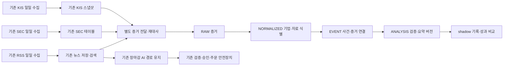

# 기업정보 통합 — 기존 수집 유지 기반 1차 설계

작성: 2026-10-28 · T-111 · **상태: 1차 설계 제안 / 미구현 / 2차 설계 필요**

입력: 사용자가 제공한 [기업정보수집 통합 작업계획서 V0.0.4의 원본 복사](../reference/2026-10-28-corporate-collection-plan-v0.0.4.md), [T-110 수집 현황·개선 검토](../reports/2026-10-28-corporate-intelligence-review.md), [T-109 3일 리서치 참고](../../agent-vault/10-Flow/tasks/T-109-research-context-for-analysis.md). 원본 복사는 첨부 파일과 SHA-256 일치 확인했다. 첨부 문서의 RAW → NORMALIZED → EVENT → ANALYSIS와 Phase 1~8을 존중하되 아래의 병행·단계별 통과 조건을 추가한다. 이번 소스 기준 HEAD `dc0c905`; 운영 DB·실제 실행 상태는 재조회하지 않았다. 기존 T-078 통합 절차 및 실행 원장은 그대로 정본이며 이 문서는 후속 설계 입력이다. T-068 품질 재검토 제외.

## 1. 핵심 결정과 한계

**[확실] 독립 일일 수집을 유지하고, 수집된 결과를 도착 순서대로 계층 처리하는 구조는 가능하다.** 네 계층은 전체 수집 잡의 실행 순서가 아니라 **각 자료가 통과하는 처리 단계**다. RSS, SEC, KIS와 IR이 동시에 준비될 때까지 기다리지 않는다. 한 원천이 나중에 도착하면 같은 사건에 근거를 추가해 새 버전을 만든다.

**[확실] 하루 1회 수집만 유지하면 최초 탐지 시점은 그 주기에 제약된다.** Fast Watch 30~60초는 기존 일일 잡 위에 별도 탐지/추가 수집이 구현되고 예산이 허용된 이후에만 가능하며, 이미 놓친 발표를 소급해 실시간으로 탐지할 수는 없다. 처음에는 정확한 축적·재처리와 비교 평가부터 진행한다.

**설계 우선순위**: 기존 수집·분석·주문 경로를 기준선으로 유지 → 부가 파이프라인 shadow → 정확성과 수익 효과 검증 → 추가 수집/분석 활용을 단계적으로 판단. 각 단계의 구현·DDL·배포는 2차 설계 이후 별도 작업이다.

## 2. 현행 처리와 시간 차이

아래 시간은 [현재 cron 소스](//brownjeon_nas/homes/brownjeon/project/StockInvest/scripts/cron-runner.sh:240)의 예정 주기(KST)이며 실제 실행 시각/성공 상태가 아니다. 순차 호출·재시도·설정·휴장에 따라 달라진다.

| 작업 | 코드상 예정 | 현재와 새 처리의 관계 |
|---|---|---|
| 뉴스 | 06시대 해외 → 다음 틱 국내, 각 시장 1일 1회 | 기존 M4 수집·검색 유지. 결과 확보 시 각각 후처리. 국내가 그날 빠질 수 있는 06시 끝자락 조건 존재 |
| 해외 리서치 | 07시대 | Yahoo 통계 결과는 독립. T-109의 최근 3일 활용은 별도 후속 작업 |
| SEC EDGAR | 07시대, 해외 리서치 뒤 순차 | 기업 매핑·공시 메타데이터·선별 XBRL 유지. 100초 예산으로 부분 처리될 수 있으며 날짜파일은 성공 여부와 무관한 호출 기록 |
| 해외 장마감 AI / KIS 재무 | 08시대, **장마감 분석 블록 다음에 KIS snapshot 블록** | 같은 틱의 KIS 새 결과가 AI보다 늦을 수 있음. 새 파이프라인은 이전 자료/미확인을 명시하고 기존 분석을 기다리게 만들지 않음 |
| 국내 장마감 / 리서치 | 16시대, 장마감 분석 블록 다음에 리서치 블록 | 같은 틱의 새 리서치를 반드시 장마감 분석에 쓸 수는 없음 |

진입 감시 등은 같은 cron 루프에서 동기 호출되며 느린 작업이 다음 작업과 하트비트에 영향을 준다. 새 후처리는 이 실매매 루프의 장시간 동기 작업으로 넣지 않는 방향을 권고한다. 실행 격리의 실제 프로세스·큐·호스트는 2차 설계에서 정한다.

## 3. 구조와 사건별 진행 예시

**예시(가상)**: 06시에 A기업 실적 기사가 수집되면 동일 기업 식별 후 `감지/공식확인 미확인` 사건 v1을 만든다. 07시에 같은 회계기간의 SEC 8-K와 관련 자료가 확인되면 증거를 연결해 v2로 올린다. KIS 값이 08시 AI 판단 뒤에 도착하면 그 판단은 v2 이전에 실제 존재한 자료만 사용하고, 이후 통합 결과는 새 버전으로 갱신한다. 관련 문서가 없거나 오류면 `partial/unknown`이며 완전한 사실 확인으로 표시하지 않는다. 이 예시는 예정된 도착 순서이지 실제 발표의 보장이 아니다.

## 4. 유지 / 변경 / 개선 / 영향

| 대상 | 현재 유지할 기준선 | 변경·추가 제안 | 영향·검증 |
|---|---|---|---|
| RSS·M4 | 시장별 일일 잡, 재시도·기존 KB/검색 소비 | 초기엔 기존 저장 결과를 읽는 제한된 shadow. 이후 원천 수집 시 URL/GUID·발행사·원문 허용 범위·최초관측을 보존하는 전달 계약 필요 | 현 뉴스 API 응답은 기사 payload가 아닌 집계이며 M4 저장 데이터만으로 URL/발행사·정확 기업 식별을 복원할 수 없음. M4 계약·용량·라이선스·기존 RAG 호환성 확인 |
| SEC | 현 일일 수집, CIK 매핑·submissions/XBRL·실적 일정, rate 제한 | 메타데이터에서 사건 연결; 향후 관련 Item/Exhibit·append-only 자료 및 정정 이력. fast watch는 별도 단계 | 기존 fact upsert는 이전 정정을 덮어씀. 원본 부재·과거 시점 미상은 미상으로 이관. 공유 SEC 예산 없이는 중복 수집 위험 |
| KIS 재무 | 별도 일일 snapshot·기존 응답 | 관측 항목을 기업/시점으로 연결, 출처·통화·값 기준 유지 | 같은 08시의 AI에 새 값 보장 불가. 결측 필드의 이전 값 유지와 스냅샷 갱신 시각 차이 주의 |
| IR·기업 이벤트 | 현재 추정/수동 일정 경로 유지 | IR 수집, 기업/사건 식별·증거 다대다 연결, 공식 확인/충돌 구분 | 새 외부 원천·권리·운영 비용·오병합 가능성. 초기 제공 범위를 소수로 제한 |
| 저장·후처리 | 현 테이블과 Qdrant의 소비 계약 유지 | 별도 증거·작업 상태·사건/버전·분석 기록. 수집 완료마다 증분 후처리 및 재대사 | DDL/저장 용량·이중쓰기·중복/유실·백필·이행/롤백 설계 필요. 다른 서비스 간 원자적 저장은 가정하지 않음 |
| 장중·장마감 분석 | 기존 후보 생성, 뉴스 RAG, LLM 및 룰 경로 유지 | 새 사건 자료는 먼저 별도 비교 기록; 효과 확인 후 각 분석별 연결 검토 | 자료 대기 장벽을 넣으면 기존 발화가 늦어지거나 줄 수 있음. 데이터 없음/부분/오류 상태를 결과와 기록 |
| 보유·주문 | 기존 청산·승인·검증·한도·킬스위치·DRY_RUN·KIS 경로 유지 | 장기적으로 사건 정보를 보조 근거로 검토 | 강제 청산 지연 금지, 신규 매수 검증 관문 유지, 실주문 영향 변경은 별도 재검증 |
| 운영 | 기존 잡 주기·날짜파일·실패 정책은 1차 구현 기준선 | 원천별 최초/마지막 성공·실패·건수, 누락·지연, 큐/이벤트 상태 및 알림 | 날짜파일=성공이 아님. 일부 피드 실패·부분 SEC·장애 복구를 독립 표시 |

근거: [EDGAR 수집](//brownjeon_nas/homes/brownjeon/project/StockInvest/src/lib/data/us-edgar/sync-job.ts:1), [뉴스 수집](//brownjeon_nas/homes/brownjeon/project/StockInvest/src/app/api/cron/news-fetch/route.ts:70), [M4 파서](//brownjeon_nas/homes/brownjeon/project/home-m4-api/app/routes/market_context.py:319), [장마감 검색·분석](//brownjeon_nas/homes/brownjeon/project/StockInvest/src/lib/strategy/post-market-overseas.ts:624), [공통 주문](//brownjeon_nas/homes/brownjeon/project/StockInvest/src/lib/safety/dry-run.ts:125).

## 5. 증분 통합·장애 복구 계약: 2차 설계 대상

1. **처리 단위**: 문서/관측의 원천 ID와 버전/해시를 가진 증거를 독립 처리한다. 각 단계는 동일 입력의 재처리에도 결과 중복이 없어야 한다. 발생·공개·최초관측·저장·처리 시각과 정정 버전을 구분한다.
2. **전달 무결성**: 초기 읽기 전용 스캔+커서+재대사는 기존 저장 결과 기준 비교에 적합하지만 저장되지 않았거나 덮어쓴 중간 원본을 복원하지 못한다. 이후 생산자와 같은 DB 안에서는 자료 저장과 outbox 기록을 한 트랜잭션으로 검토한다. M4/Qdrant와 MariaDB 등 서로 다른 시스템 사이에는 원자적 커밋을 가정하지 않고 내구성 있는 발행·중복 허용 소비·재대사 및 손실 창을 설계한다. exactly-once 전달을 전제로 하지 않는다.
3. **부분 실패**: 원천/종목/단계별 상태·watermark·시도 수·오류를 보존하고, bounded retry/backoff, lease 만료 복구와 수동 확인 가능한 실패 큐를 검토한다. 한 원천 실패로 다른 원천과 기존 분석을 중단하지 않는다. 프로세스를 분리해도 CPU·DB·네트워크는 공유하므로 우선순위·동시성·자원 예산과 진입 감시 지연을 검증한다.
4. **기업과 사건**: company ID ↔ CIK·거래소·ticker·별칭의 유효기간을 관리한다. EARNINGS 등 이벤트 종류·회계기간·원천 ID를 근거로 연결하고, 모호한 매칭·동명이의·상충 수치는 unresolved/conflict로 남긴다. 여러 기사를 한 사건에 연결하되 원문 증거는 각각 보존한다. 병렬 수집·늦은 도착의 충돌은 사건별 revision/CAS 등으로 방지하는 방안을 검토한다.
5. **확인과 정정**: 공식 출처인지, 특정 사실이 공식 증거로 뒷받침되는지, 뉴스 주장과 충돌하는지는 별도 상태다. 관계없는 8-K·IR이 왔다고 대상 사건을 확인하거나 fast watch를 종료하지 않는다. 초기 단계에서 사건 업데이트가 기존 카드 변경·자동 재분석·중복 시그널을 발생시키지 않는다.
6. **시점 재현**: 실제 의사결정 시점까지 공개·관측된 사건 버전과 사용 입력을 불변 스냅샷으로 보존한다. 저장되지 않은 옛 RSS 원문이나 덮어쓴 과거 XBRL은 `unavailable/unknown`으로 표시하고 재구성된 현재 값으로 과거 판단을 대체하지 않는다.
7. **검색 소유권**: 기존 M4/Qdrant는 검색 경로로 유지. 증거·사건의 정본 저장 위치, M4와 StockInvest 간 계약·배포 소유자·실패 시 재조정은 2차에서 결정한다. 외부 문서 내용은 데이터이며 LLM 지시로 실행하지 않는다.

## 6. 단계별 작업과 완료 기준

| 단계 | 범위 | 다음 단계 이전에 확인할 것 |
|---|---|---|
| 0 기준선 | 현 크론·설정·원천별 수집 결과, 기존 분석·발화·수익 지표의 읽기 전용 조사 | 실제 실행 성공/실패·건수·지연·기존 대상 범위 확인. 소스와 운영 차이 기록 |
| 1 병행 관측 | 기존 일일 결과를 별도 파이프라인에서 읽어 RAW 가능한 범위·기업 식별·사건 후보 축적 | 기존 호출/응답·저장·RAG·주문 흐름에 변화 없음, 데이터 결손 범위 명시, 재처리·중복 대사 |
| 2 원천 증거 보강 | 소수 미국 보유/관심 종목의 실적 이벤트에 뉴스·SEC 및 접근 가능한 IR 증거 보존·연결 | 원천별 식별·오병합/누락·정정·부분 장애·재시작 복구와 시점 기록 검증 |
| 3 종목 판단 shadow | 기존 AI 판단과 동일 시점의 사건 참고 판단을 각각 기록 | 데이터 시점 누출·모델/후보 차이 통제, 매매 결과는 기존 경로만 사용 |
| 4 Fast Watch 실험 | 신뢰할 수 있는 탐지 발생 뒤 한정 기업·소스의 별도 추가 호출 | SEC/KIS/IR 공유 예산·TTL·중복 방지·429/403·감시 루프 영향·실제 조기 탐지 효과 확인 |
| 5 검증 후 연결 | 계획서의 더 많은 이벤트/재무/LLM과 매매 분석 연결 검토 | 사전 등록된 표본 외 비교, 비용 후 성과·낙폭·거래 가능성과 기존 전략 검증 및 독립 안전 감사 |

위 단계는 첨부 §36의 8개 Phase를 실행 가능 범위로 재구성한 **1차 제안**이다. Phase 1~3(수집·기업·이벤트)을 단계 0~2, Phase 4 Fast Watch를 단계 4, Phase 5~7(SEC 심화·재무·LLM)을 단계 2~5, Phase 8 운영을 전 단계의 관측으로 연결한다. 2차 설계에서 담당·선후관계·계획서 §37/§38 완료 기준 충돌을 최종 정리한다.

## 7. 수익 관점의 검증

- 조기 탐지 성과: 실제 공개→첫 수집→기업 식별→사건 확인→분석 가능 지연, 결측·오탐·사건 오병합·출처별 커버리지. 일일 수집 기준선과 추가 수집 비용·속도를 비교한다.
- 거래 성과: 같은 시점·대상 후보에서 기존 판단과 신규 사건 참고 판단을 비교하고 해당 시점에 접근 가능했던 자료만 사용한다. 후보 전체의 미진입 기회도 추적한다.
- 비용 후 평가: 미국 매수/매도 **각 0.25%**와 슬리피지·미체결, 보유 기간, 자본 사용량을 반영해 순손익·자본 대비 성과·최대 낙폭·회전율을 표본 외 기간에 비교한다. 데이터/AI 비용도 별도 계상한다.
- 통과 임계·표본 크기·관측 기간·시장 구간은 분석 전에 등록하고, 결과가 부족하거나 개선되지 않으면 자동 거래 연결을 진행하지 않는다. 초기에 숫자를 근거 없이 고정하지 않는다.

## 8. Claude 2차 설계의 미결정 사항

1. 읽기 전용 shadow에서 각 원천별 접근 계약·변경 감지·재대사로 확보 가능한 필드와 복원 불가능한 원본의 구체 목록은 무엇인가?
2. StockInvest/M4 각각의 책임, raw 원본 정본 및 라이선스·보존 기간, 전달/outbox 위치, 트랜잭션 경계와 고장 복구 방법은 무엇인가?
3. 사건·문서·증거·분석·작업 상태의 키/제약·시각·정정·중복·락/lease·재처리 모델과 원천별 idempotency key는 무엇인가?
4. 기간별 일일 유지/추가 polling의 실행 위치와 리소스·공유 SEC/KIS 예산, 장애·만료·우선순위·주말/서머타임/휴장 정책은 무엇인가?
5. 미국 실적 pilot의 대상·기간, IR/공시 소스, 합격 기준·오탐률·지연·비용·OOS 성과·중단/롤백 조건은 무엇인가?
6. 기존 분석의 08시·16시 시간차와 부분자료/fallback, 사건 사용 시점·스냅샷을 어떤 API/스키마로 기록할 것인가? 기존 리서치 T-109의 3일 규칙과 사건의 신선도는 별도로 정의한다.
7. T-078 단일 실행 원장(S02 자료/사건, S03 정책/가설, S04 표본 외, S08 전진 관측, G-N 신규 매수/G-H 보유 관리), T-105/106과 M4 007/008 후속, 기존 사용자 승인·Reviewer/QA·DB 마이그레이션·화면 데모 절차를 어떻게 연결할 것인가? 기존의 공식/가용 검색 우선 원칙(U15)을 유지하고 유료 원천은 별도 평가한다.

### 8.1 각 미결정 사항에 대한 1차 권고안

아래는 **확정된 구현·운영 정책이 아니라 Claude가 대안과 함께 검토할 1차 제안**이다. 기본 방침은 기존 기능의 영향을 작게 하면서 기업별 사건의 실제 가치와 한계를 확인하는 것이다.

**1. 기존 자료를 어디까지 읽을 것인가**

- **권고:** 먼저 기존 수집 결과를 읽어 별도의 관찰 공간에서 분류한다. SEC의 accession·CIK·form·접수시각, KIS snapshot의 날짜·지표·기록된 원값, M4에 실제 남아 있는 제목·요약·날짜·시장 등 **조회 가능한 값만** 사용한다. 접근 방식과 M4가 실제로 제공하는 조회 범위는 2차에서 확인한다.
- RSS 기사 URL·GUID·개별 발행사·정확한 종목 ID, 덮어쓴 SEC 이전 값과 최초 관측시각은 현재 자료에 없으면 `unknown`/`historical_import`로 기록한다. 최초 단계에서 추가 외부 수집이나 LLM 호출을 전제하지 않는다.
- **대안·이유:** 원천 수집기를 먼저 확장하면 증거의 완전성을 빠르게 높일 수 있지만 M4/수집기와 저장 계약을 먼저 변경해야 한다. 먼저 기존 결과로 연결 관계와 한계를 확인하고, 결손 항목은 다음 단계에서 원천 수집 시 보강하는 쪽을 권한다.

**2. 어느 시스템이 무엇을 소유할 것인가**

- **권고:** StockInvest의 MariaDB를 **기업·사건·증거 관계·사건 버전의 정본 후보**, M4를 **기존 뉴스 수집·Qdrant 검색 담당**으로 둔다. 관찰 초기 결과는 기존 운영 테이블과 분리된 시험 저장소에 기록한다. 물리적으로 별도 DB를 둘지 별도 스키마를 둘지는 운영 환경·권한·비용을 확인해 2차에서 선택한다.
- 생산자와 같은 DB 안에서 증거와 전달 기록을 함께 저장할 수 있다면 트랜잭션 outbox를 권고한다. M4와 StockInvest 사이에는 내구성 있는 전달·재시도·중복 제거·재대사로 연결하고, 두 시스템이 한 번에 원자적으로 저장된다고 가정하지 않는다.
- 원문 전문은 권리와 보존 조건이 허용될 때만 저장한다. 원천별 보존 기간·용량·DB DDL 여부는 2차에서 정하고, 기존 데이터 삭제는 이 제안에 포함하지 않는다. **대안:** M4를 사건 정본으로 두는 구조도 가능하지만 앱의 사건/매매 이력과의 책임 경계가 달라지므로 소유권·장애 복구를 비교한다.

**3. 사건·문서·처리 상태를 어떻게 구분할 것인가**

- **권고:** 증거는 `source + 원천 ID + 버전/해시`, SEC 공시는 accession 및 첨부 경로로 식별한다. 기업은 내부 ID에 CIK·시장·ticker·별칭과 유효기간을 연결한다. 사건은 별도 ID를 부여하고 여러 증거를 연결한다.
- 초기 실적 사건의 병합 후보는 **기업 + 이벤트 종류 + 회계기간**으로 찾되, 모호하거나 서로 충돌하면 자동 확정하지 않고 `unresolved/conflict`로 남긴다. 원천의 사실·기사 주장·AI 추론을 분리하고, 공식 출처가 왔다는 사실과 개별 주장의 확인 상태를 구분한다.
- 공개·최초 관측·저장·분석·정정 시각을 구분하고, 자료가 추가되면 사건 버전을 올린다. 작업은 커서·중복 방지 키·lease·제한 재시도·실패 기록을 갖게 한다. 병렬 변경은 사건 revision/CAS 등을 검토한다. 물리 테이블과 최종 상태명은 2차 설계에서 결정한다.

**4. 수집 주기와 Fast Watch를 어떻게 운영할 것인가**

- **권고:** 초기에는 기존 06시 뉴스·07시 SEC·08시 KIS 등 **독립 일일 잡과 기존 실패 정책을 기준선으로 유지**한다. 병행 관찰 작업은 기존 결과만 주기적으로 읽으며, 예를 들어 별도 워커에서 5분마다 변경 여부를 확인하는 방안을 제안한다. 이 5분은 내부 처리 주기의 초기 가정이며 외부 정보를 5분마다 새로 수집한다는 뜻이 아니다.
- Fast Watch는 초기 기본 비활성, 기존 실매매 감시 루프와 분리된 워커에서 실험한다. 실제 발견된 사건의 관련 기업만 임시 감시하고, 계획서의 **최대 30분·30~60초 간격**을 시험용 후보로 둔다. 종류·회계기간·관련 공시를 확인하거나 시간이 끝나면 확인/부분/시간초과로 종료한다.
- 새 SEC 호출 전에는 기존 SEC 수집과 새 워커의 요청을 함께 제한하는 공유 예산·429/403 중단·재시도·유효 User-Agent가 필요하다. 기존 코드의 개별 클라이언트 제한을 전체 시스템 한도로 오인하지 않는다. 빈도·자원 상한은 측정 후 확정하며 초과 시 추가 감시를 보류한다.

**5. 첫 실험 대상과 성공 판단을 어떻게 정할 것인가**

- **권고:** 실제 거래 대상을 임의로 늘리지 않고 미국 보유·관심 종목에서 사전 고른 소수 종목의 `EARNINGS` 한 종류로 시작한다. SEC 메타데이터와 접근이 허용된 소수 IR/뉴스를 사용하며, 기존 일일 수집을 기준선으로 둔다.
- 예를 들어 **20거래일**을 운영 가능성 관찰 창으로 제안한다. 이는 지연·오류·실제 발생 건수를 살펴보는 초기 기간이지 수익성 검증을 통과하기에 충분한 표본이라는 뜻은 아니다. 표본 부족이면 `증거 부족`으로 기록한다.
- 시험 전 종목·기간·자료 출처·비교 방식·합격/중단 기준을 고정한다. 누락·기업 오식별·사건 오병합·중복·공개→관측 지연·기존 진입 감시 지연·복구를 확인한다. 거래 연결 전에는 당시 이용 가능한 자료를 이용한 별도 기간·전진 비교로 수수료 편도 0.25%·슬리피지·미체결·자본 사용·기회 손실·데이터/AI 비용을 평가한다.

**6. 실제 분석 시점에 어떤 자료를 사용할 것인가**

- **권고:** 판단 시각 이전에 공개되고 실제 관측된 해당 종목의 최신 적격 사건 버전만 사용하고, 그 버전 ID·자료 기준시각·사용/미사용 사유를 함께 고정한다. 늦게 들어온 증거는 다음 버전을 만들며 과거 판단 당시 자료를 덮어쓰지 않는다.
- 자료가 `available/partial/stale/unknown/error` 중 어느 상태인지 표시한다. 자료가 없거나 수집 중이라도 기존 분석은 계속하고, 기존 카드·시그널을 자동 변경하거나 재발행하지 않는다. 08시 KIS와 16시 리서치가 같은 틱의 분석보다 늦을 수 있음을 반영한다.
- T-109의 **최근 3일**은 리서치 참고 기준이다. 기업 공시·실적·뉴스 전체에 동일 기한을 자동 적용하지 않고 유형별 유효기간을 2차에서 정한다. 장마감 AI의 신규 문맥은 우선 별도 판단 비교에만 사용하며 실제 연결 전 검증한다.

**7. 기존 작업과 의사결정을 어떻게 연결할 것인가**

- **권고:** T-078의 S02에서 데이터·사건 및 시점 계약, S03에서 가설·정책, S04에서 재현 가능한 부분의 표본 외 검증, S08에서 주문 없는 전진 관측으로 연결한다. 재현 불가능한 자료는 한계를 명시하고 S08 관측으로 별도 증거를 모은다. 이를 매수 합격으로 자동 환산하지 않는다.
- 신규 매수 G-N과 보유 관리 G-H는 각각의 조건을 따른다. 기존 실적 차단·전략 검증·승인·킬스위치·강제 청산과 충돌하지 않도록 2차 설계에 영향 범위와 검증을 명시한다. T-105/106, M4 007/008, T-109의 이미 있는 작업과 중복하지 않는다.
- **대안·이유:** 새 기업정보 전용 실행 체계를 별도 정본으로 만드는 방법도 있지만 프로젝트의 기존 T-078 단일 원장과 우선순위가 갈릴 수 있다. 기존 원장에 연계하면서 기업정보의 상세 설계만 별도 문서로 관리하는 편을 권한다.

### 8.2 ‘읽기 전용 shadow’를 쉽게 설명하면

이 문서에서 권고하는 표현은 **‘기존 자료를 읽어 별도 공간에서 시험하는 병행 관찰’**이다. 기존 운영 자료를 읽기만 한다는 뜻이며, 비교에 필요한 **새 시험 결과와 오류는 별도 공간에 저장할 수 있다.** 그 공간을 운영 DB에 만들려면 필요한 DDL·권한·마이그레이션 절차를 별도로 따른다.

**예시(가상):** 기존 SEC 수집기가 A기업의 공시 메타데이터를 평소처럼 저장한다. 병행 관찰 작업이 그 저장 결과를 읽고 별도 기록에 `A기업 실적 사건 후보 / 공식 자료의 내용 확인 전`이라고 적는다. 담당자는 이 분류와 기존 자료를 비교한다. 이 과정에서 기존 공시·시그널·승인 카드·주문·설정은 수정하지 않는다. 기존 자료에 없는 기사 URL이나 과거 정정값은 읽는 것만으로 생기지 않는다.

두 가지 시험을 나눠야 한다.

| 구분 | 하는 일 | 추가 호출·거래 영향 |
|---|---|---|
| **① 수집 결과 병행 관찰** | 기존에 저장된 자료를 읽어 기업·사건으로 따로 분류하고 누락/오류를 비교 | 최초 단계는 새로운 SEC/뉴스 수집이나 LLM 호출을 전제하지 않음. 기존 데이터 읽기와 별도 기록에는 자원 사용이 있음 |
| **② 판단 병행 비교** | 같은 종목·같은 판단 시점에 기존 판단과 기업정보를 참고한 새 판단을 각각 기록 | 새 AI 호출이 있으면 비용·호출량·지연이 생길 수 있음. **새 비교 결과는 시그널·주문으로 전달하지 않음** |

이 경계는 **새 비교안이 거래에 영향을 주지 않는다**는 뜻이다. 기존 시스템의 실제 주문이 중지되거나 전체가 모의거래로 전환된다는 뜻은 아니다. 기존 실거래/모의 설정과 기존 안전장치는 별도로 적용된다. 이 두 시험은 아직 구현·실행되지 않은 제안이다.

T-105 작업 기록에는 10-28 16:09 국내 분석에서 날짜 보정 이후에도 뉴스 유사도 컷으로 `news=0`이 관찰됐다고 적혀 있다. 이는 당시 기록이며 이번 운영 실측이 아니다. 이 이슈를 통합 수집 개선 완료와 혼동하지 않고 2차 설계에서 기존 후속 작업과 중복을 피한다. [T-105](//brownjeon_nas/homes/brownjeon/project/StockInvest/agent-vault/10-Flow/tasks/T-105-news-rag-zero-hits.md:84)

## 9. 범위와 검증 이력

1차 설계 문서와 Claude 2차 설계 인계 자료만 작성했다. 앱 코드·cron·M4·DB·운영 설정·주문·배포는 변경하지 않았다. 새 구조의 구현 가능성과 성과는 문서 검토 수준이며 실행 시험·운영 상태·수익성은 확인하지 않았다.
