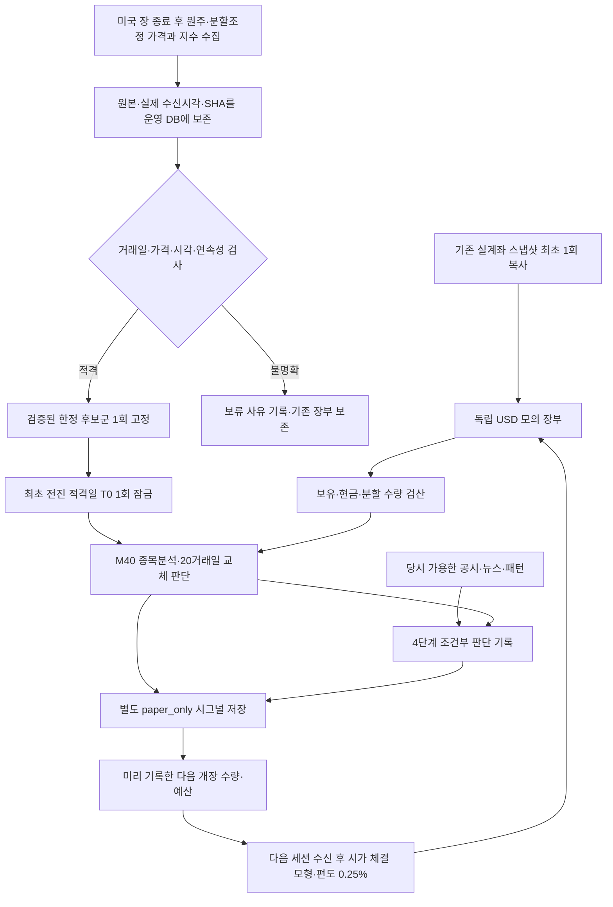

# T-156 M40 운영 자료와 독립 모의 시그널 연결

2026-11-08 · 사용자 승인 범위: Codex 직접 구현·DB 이관·DRY_RUN 연결. 실제 거래 해제는 승인하지 않았으며 이번 작업에서 해제하지 않는다. 정본 이력: `agent-vault/10-Flow/tasks/T-156-us-stock-entry-exit-forecast-design.md` F14.

## 확정한 운영 기준

| 항목 | 사용자가 선택한 기준 | 구현 결과 |
|---|---|---|
| 공통 교체 기준일 T0 | 첫 적격 거래일에 한 번 고정 | 등록 이후 실제 관측·검사한 최신 종료 미국 세션만 후보. 자료 수신·계좌 복사·후보군 고정 이후의 잠금 시각을 함께 기록. 결과를 보고 날짜를 바꾸지 않으며 재시작 때도 유지 |
| 모의 자금·보유 | 현재 실계좌를 복사한 독립 모의 계좌 | 기존 스냅샷의 미국 보유와 USD 순예수금을 한 번 복사. 국내/KRW는 환전·편입하지 않는다. 원래 수량·귀속·설정은 수정하지 않으며 복사 원본/시각/SHA는 비공개 DB에 보존 |
| 대상 범위 | 한정 후보군 모의 시험판 | 현 StockInvest 수동 목록 125개를 기준으로 자료를 검사. 전체 Nasdaq-100·NYSE 상위 50 및 과거 편입 목록의 완전성을 주장하지 않음 |
| 거래 비용 | 편도 0.25% | 매수·매도 각각 0.0025. 거래세·환전 비용·시장 충격·실제 슬리피지는 포함하지 않음 |
| 판단 에이전트 | 기존 설계의 조건부 근거 검토 | 공시·뉴스 해석→관찰 후보→조건 확인→우선순위의 4단계 기록을 유지. 기존 M40 거래 변경은 차단. 현재 별도 모델 활성화·버전 설정이 없어 실제 모델 호출은 하지 않음 |

## 수집·자료 적격성

| 자료 | 실제 확보·검사 | 사용 범위·남은 한계 |
|---|---|---|
| 종목 가격 | 125개×원주/분할조정 250판본, 114,900행. 원본 CSV·요청 매개변수·수신 시각·SHA 보존. 최신 기준일 2026-11-06 | 123종목에서 마지막 127거래일 연속성 통과. 가격 모멘텀은 분할만 조정한 가격, 평가·모의 체결은 원주 가격을 사용 |
| 초기 제외 | HONA는 102행, SPCX는 내부 102거래일 공백(각 판본 동일) | 이 두 개의 11/06 원본 SHA를 정책에 명시. 새로운 1~126개 부분 응답을 영구 제외로 자동 처리하지 않음. 초기 자료판을 사용하지 못하면 동결을 보류 |
| S&P 500 | IPv4로 실제 CSV 확보, 2025-01-01 이후 유효 463행, 마지막 11/05 | D0 판단은 D-1까지 200개 종가 필요. 11/06 리허설은 가능. 11/09 판단에는 11/06 자료가 추가로 필요하며 누락을 전일 값으로 채우지 않음 |
| 실제 보유 중 목록 외 종목 | 복사된 보유까지 수집 대상을 확장 | M40 신규 후보로 자동 편입하지 않음. 평가 및 분할 수량 검증용 가격이 불명확하면 장부 갱신·거래를 보류 |
| 거래일·시각 | 연구 정본 달력과 NYSE 공식 2026~2027 휴일·단축장을 검산, 뉴욕 DST 반영 | 가격 관측을 달력으로 생성하지 않음. 달력 지원 밖 또는 결제일 불확실 시 보류 |
| 공시·뉴스 | 기존 14일 근거 조회를 판단 기록에 연결 | 실제 공개/수신 가능한 시각만 허용. 과거 원문·전체 종목 커버리지는 여전히 불완전하며 누락을 표시. 패턴·뉴스로 M40 기준을 임의 변경하지 않음 |

원문 252응답(가격250+분할 검산2)과 목록·시각·실패 이력 등 264개 파일의 패키지를 보존한다. 원본 묶음과 DB 입력 묶음은 구분한다. 원본에 정확한 CSV와 S&P 500 응답을 첨부한 입력 JSON은 18,097,630바이트, SHA `65d66bf632a1e082e6e0877aa71593e56f133d746228ed337601a08f3aad2903`이며 운영 DB 압축 저장 후 원상 복원 SHA가 일치했다. 연구 원본과 모든 신규 입력은 `live_eligible=false`다.

[Kibot의 가격 조정 매개변수](https://www.kibot.com/api/history-request.html)와 [평가 계정의 사용 범위](https://www.kibot.com/api/api-overview.html)를 구분했다. guest 원천을 운영 실거래용 시세 공급 계약으로 승격하지 않는다. [NYSE 거래일](https://www.nyse.com/trade/hours-calendars), [미국 T+1 안내](https://www.sec.gov/compliance/risk-alerts/shortening-securities-transaction-settlement-cycle), [뉴욕 연준 은행 휴일](https://www.newyorkfed.org/aboutthefed/holiday_schedule.html)을 사용하되 아래 결제 모형은 KIS 실제 결제 확인을 대체하지 않는다.

## 실제 절차

- M40의 기준은 기존 검증본 그대로: 126거래일 모멘텀, D-1 S&P 500의 200일 평균 추세, 20거래일 공통 교체, 최대 5종목, 신규 한 종목에 평가액의 최대 15%. 매일 평가·자료 검사·대금 결제·전진 기록을 수행하지만 매일 후보를 재선정하지 않는다.
- `t156_paper_account`는 복사 원본·정책·원장·중단 상태·DB 임대를 보관한다. `t156_paper_cycle`은 등록 전 리허설/전진/보류를 구분하고, `t156_paper_signal`은 모의 매수·매도 의도를 저장한다. 정상 승인용 `signals`나 실제 주문·보유 표에 발행하지 않는다.
- 최초 동결은 전체 125개 응답을 검사한 뒤에만 가능하다. raw만 성공하고 split이 실패한 경우도 재수집하며 판본별 키로 교체해 중복을 만들지 않는다. 동결 후 누락된 종목을 다른 종목으로 조용히 대체하지 않는다.
- 분할 조정 기준이 이전 원장과 달라지거나 확인 자료가 사라지면 수량을 추정하지 않고 보류한다. 다른 비보유 종목/시장 이력만 부족한 경우에도 이미 확정된 편출은 좁게 처리할 수 있다. 이때 해당 보유의 원시 가격·현재 및 이전 분할 기준은 필수이며, 일반 매수·매도는 생성하지 않는다. 현재 수집기는 편출을 추정해 생성하지 않는다.
- 다음 개장 시가는 수신한 일봉으로 사후 평가하는 **체결 모형**이다. D0 수량·예산을 고정하고 미래 시가를 보고 수량을 줄이거나 후보를 바꾸지 않는다. 예산 초과·미확인 시가·필수 선행 매도 실패는 미체결로 끝낸다. 단순한 시가 체결 가정이며 실제 주문·호가·체결 지연 검증은 아니다.
- 매도대금은 보수적인 미국 거래일/은행 휴일 T+1 모형의 결제 전에는 매수에 쓰지 않는다. 지원하지 않는 결제일은 보류한다. 새 진입·청산 완료만 왕복 거래 표본으로 세며 복사 보유의 첫 매도는 새 왕복 거래로 세지 않는다.
- 전역 DRY_RUN이 DB 리터럴 `true`일 때만 작동한다. 이후 설정이 바뀌어도 예약 전략 `m40-paper-v1`과 `m40p_` 식별자는 주문 관문에서 매수·매도 모두 영구 차단한다.

## 실행·검증 증거

| 구분 | 결과 | 해석 |
|---|---|---|
| 독립 정적 감사 | 조건부 통과, 지적한 자료 동결·재수집·달력·T0·매도 의존성·분할 기준 보완 | 실제 실행은 QA/root의 별도 증거이며 실거래 승인 아님 |
| 최종 지정 Jest | 65 suites / 1,594건 통과, 기존 별도 DB 경합 1 suite / 15건 skip, exit 0 | 신규 집중 168건과 실제 격리 archive 저장소 14건 포함. 이전 결과와 합산하지 않음 |
| 타입·빌드 | tsc / Next production build 각각 exit 0 | 지정 격리 환경 기준 |
| cron 블록 | 가짜 시계·네트워크에서 시간창·15분 간격·하루 최대 2회·다음 날 재설정 통과 | 실제 운영에서 미래 예약 틱이 완료됐다는 증거 아님 |
| 실제 MariaDB 전체 경로 | 합성 계좌+실제 공개 자료로 12개 검사 통과, 리허설 6개 시그널 | 경쟁 임대1개, 중복 차단, 원장 보존, 확인 편출만1개, 보유 기준 불명 보류, 중단 및 DRY_RUN 관문 확인. 운영 계좌 값·LLM·브로커 사용 없음 |
| 운영 자료 보관 | 신규 입력 묶음 압축 저장→복원 SHA 일치 | 원본 공개 응답·실제 수신 시각 보존, live 적격 승급 없음 |
| 운영 복사 계좌 | 실계좌 스냅샷 5667의 해외 보유 4개+USD 순예수금 최초 복사, 원본 보존 확인 | 금액·수량·입력 본문은 비공개 DB에만 저장. 반복 초기화는 다시 복사하지 않음 |

첫 전체 Jest 시도는 기존 시험 2개의 mock 누락으로 기본 localhost DB에 빈 계정 접속을 시도했다가 인증 거부되고 비정상 종료했다. 이를 통과로 기록하지 않았다. 두 시험을 보완해 독립 검토받고 일반 DB 연결을 닫힌 포트로 제한한 최종 재실행이 위 1,594건/exit0이다. 최초 운영 복사 검산 스크립트는 JSON 객체 키 정렬 차이를 원본 변경으로 오인했다. canonical JSON 비교로 수정해 원본 불변을 재검산했으며 실제 보유 값을 다시 쓰거나 재복사하지 않았다.

## 운영 관측과 남은 검증

운영 DB에서 2026-11-06 기준 리허설 1회·모의 시그널 4개를 실제 저장했다. 모델 체결 0건, T0 미설정, 전진 0회·신규 왕복 완료 0건이다. 복사 계좌의 최초 등록은 2026-11-08 13:46:17 KST다. 이 리허설은 등록 전 자료이므로 전진 회차로 승격하지 않는다. 운영 실행 전후 안전·자동화 설정 해시가 같았고 쓰기 대상은 전용 `t156_*` 표로 제한됐다. 증거: `forward-operating-{ddl,archive,initialize,cycle,summary}.json` 및 `forward-real-fixture.json`. 배포 검증은 별도 영수증으로 남긴다. API의 HTTP 202는 작업 예약이며 완료가 아니다. 실제 `t156_paper_cycle/signal`과 응답 이후 로그를 함께 확인한다. cron은 KST 08:40~09:10 창에서 하루 최대 두 번, 15분 이상 간격으로 호출하고 DB 임대·세션 중복 차단을 적용한다.

| 남은 항목 | 통과 기준 | 현재의 의미 |
|---|---|---|
| 전진 검증 기간 | 등록 후 최소 84일과 신규 포지션 왕복 완료 100건 | 미래 관측이 필요. 과거 리허설과 복사 보유 청산을 표본으로 대체하지 않음 |
| 에이전트 거래 변경 | 동일 조건 병행 비교에서 거래가 달라진 20일 이상, 피한 손실·놓친 상승·비용·최대낙폭 비교 | 직접 변경 arm 비활성. 해석 기록만으로 수익 개선을 주장하지 않음 |
| 정식 전체 대상 | 당시 구성·NYSE 시총 순위·상장/기업 신원·가격 조정 근거·충분한 자료 | 현재 123개 제한군 결과와 구분 |
| 공급·자료 도착 | 다음 판단에 필요한 최신 종가·지수와 모든 보유의 분할 검산 근거 확보 | 확보 지연 시 해당 회차 보류. 복제·선형 보간·미래 정보 사용 없음 |
| 실제 체결 검증 | 별도 사용자 승인 후 단계적 전환 절차 | 이번 범위에서 실거래 해제하지 않음 |

중단은 모의 계좌 `status='paused'`로 수행한다. 원문/테스트 이력은 삭제하지 않고 필요 시 새 데이터셋을 철회한다. 코드 롤백만으로 DB가 되돌아가지 않으므로 실계좌 원본 또는 운영 전체 DB를 과거 덤프로 덮어쓰지 않는다. 수익률·최대낙폭의 개선 여부와 연 15% 달성은 이번 연결 완료와 별개이며 아직 입증하지 않았다.

## 보존한 시험 원본

운영 DB의 `t156_test_artifact`와 분할 blob에 공개 원본 패키지 `forward-public-data-20261108.tar.gz`(3,769,697바이트, SHA `de8de8c181b37513a3d4578d55eb483f368cd800efec93722aeb6c88bf9e165a`) 및 `t156-forward-validation-evidence-20261108.tar.gz`(4,836,503바이트, SHA `9031521e27bcbd9755fa499db38216c1bc61920ebf5e4ff928e0d8c05168fa93`)를 보관한다. 후자는 실제 공개 입력·원문 지수·초기 제외 증거·합성 계좌 SQL 검증 코드/결과·최종 Jest/타입/빌드/cron 로그·가린 운영 영수증과 각 파일 SHA 목록을 포함한다. 실제 계좌 복사 본문과 금액·수량은 이 배포용 증거 묶음에 포함하지 않았다. 소스 23파일의 정본/격리 검증본 집합 SHA는 `9157803c5cd774db8c09fe22c9010cf334c0610cc47526eb6c327e962af86aae`이다. 초기 11개 검증본의 집합 SHA는 `22d319a0b5535b1528d46f1ec92d3ec2f9b58bfe279b0bb717abf48edf4db0c9`로 구분한다.

## 배포와 마지막 초기 재시도 보완

초기 연결 커밋 `c296116`은 릴리스 `20261108-135514-c2961167`로 배포됐고 `RELEASE_RESULT ok`·`END exit0`, web/cron 각각1개·health200/green·DRY_RUN true·킬스위치 false를 확인했다. 실제 인증 cron 요청은 HTTP202(`completed=false`) 후 `already_observed` 로그가 남았다. 운영 장부는 기존 리허설1회/모의 **매도**4개를 유지하고 중복·추가 체결이 없었다. 검증본과 배포본23파일 SHA가 모두 일치했다.

이어 초기 부분 자료를 재검산하는 과정에서, 후보군이 미확정이어도 리허설로 기록돼 재시도를 막을 수 있는 경로를 실제 SQL 시험으로 재현했다. 운영 계좌는 이미123개가 확정되어 영향이 없었다. 후보군 미확정은 `blocked`/모의 시그널0으로 남기도록 한 조건을 추가했고, 같은 날 완전한 자료 재시도→123개 동결/리허설 회복까지 12개 실제 SQL 검사를 통과했다. 이 수정은 독립 정적 재검토와 전체 지정 QA 재실행을 통과했다(1,594 pass/15 skip·tsc/build exit0). 이전 결과를 합산하지 않는다. 최종 실행 영수증과 소스 집합은 `forward-final-validation-evidence-20261108.tar.gz`, 최종 운영 배포 검산은 `forward-final-release-audit.json`으로 DB 테스트 이력에 별도 보관한다. 초기 공개 원본·검증 묶음은 덮어쓰지 않는다.

최종 추가 증거 묶음은23,494바이트, SHA `b367bc6fe0a33987729dde25d9f80498cd8fc24ada1433838e353658eae269e0`이며 수정 전 실패/수정 후 회복·최종 QA 영수증과 실제 코드 판본을 보존한다.
