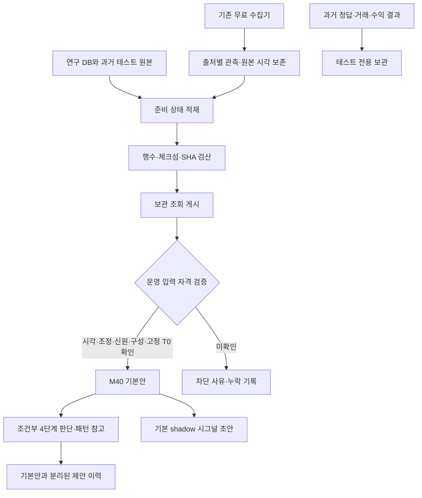

# T-156 M40 구현과 연구 자료·테스트 이력 이관

2026-11-08 KST. 사용자 승인: “이번 T-156은 Codex가 구현·DB 이관까지 직접 진행”. 구현·자료 보존의 승인과 전략 검증 승급·실주문 활성화는 구분한다.

현재 운영 이관은 **staged 적재 진행 중**이다. 아래 원본 행수와 복원 검증은 완료됐지만 운영 게시·배포 완료를 뜻하지 않는다. 실제 최종 영수증으로 갱신한다.

## 구현

| 구간 | 적용 내용 | 거래 권한 |
|---|---|---|
| 기존 수집 | 일봉 대상에 해외 분석 유니버스 추가. 보유 우선·중복 제거·예산/재개 유지 | 기존 읽기 수집과 가격 저장 |
| 증분 보존 | 기존 일봉·SEC·기업정보 행을 최신 관측/갱신 기준으로 보관. 원래 발행시각·관측·KST/UTC·소수 문자열 보존 | 신규 `t156_*` 자료만 작성 |
| M40 기본 | 양수 126세션 모멘텀, D−1 S&P500/SMA200, 공통 T0의 20세션 검토, 상위5·신규 비용포함15%·정수주·결제현금·편도25bp | 기본안과 shadow 초안 |
| 기존 보유 | 해당 전략 귀속만 일반 매도안. 미확인 구성/가격은 unknown, 입증된 편출을 별도 처리 | 기존/다른 전략 보유 자동 편입·매도 없음 |
| 패턴 | 20/60세션별 유사도≥.90, 독립3사례, 과거 평가까지 현재 창 시작 전에 완료 | 참고 기록. 기본 순위/매매 변경 없음 |
| 4단계 판단 | 공시·뉴스 해석→관찰→조건→우선순위. 최근14일 발행·관측·출처·인용과 응답 schema 검증 | 제안은 shadow. 실패 시 기본안 보존 |
| 운영 연결 | 기존 해외 장마감 실제 분석 후 Next `after()`로 보관·M40 관측. 기존 응답/재시도는 대기하지 않음 | 실주문/알림 경로 호출 없음 |
| 조회 | 출처별 일봉·시장·문서 운영 조회 어댑터, cron 비밀 인증 실행 API, 로그인 전용 자료/테스트 목록 API | 계좌 입력·판단 원문·아카이브 본문 미노출 |

## 저장과 복구

새 공통 표는 dataset/record/blob/blob_part/test_artifact/analysis_run/judgment/signal_draft의 8개다. 원천 연구 DB의 27개 표는 `t156_research_` 접두어로 자료형·키·원문 바이트를 보존한다. 기존 `daily_bars`, `us_filings`, `signals`, `orders`, 포지션과 설정에 원본을 덮지 않는다.

원천 27개 표 **4,383,186행**을 단일 트랜잭션 dump로 백업했다. gzip 522,322,333바이트, SHA256 `7fc5bfd44ce23e4a90a4d9be944d210e106067ccdaeba58a56080ac737981aaa`. 격리 MariaDB 복원에서 27개 표 모두 COUNT와 CHECKSUM EXTENDED가 일치했다. NULL 체크섬은 거부한다.

| 원천 표 | 원본 행수 | 의미 |
|---|---:|---|
| backfill_stock_bar | 2,714,056 | 두 원주 가격 원천 포함. 겹친 날짜/티커를 독립 표본으로 합산하지 않음 |
| stock_bar | 410,041 | 이전 평가에서 사용한 별도 가격판 |
| market_close / backfill_session | 27,839 / 9,281 | 지수·VIX 및 정식 거래일. 비거래일 과거 행은 원본 보존하되 운영 조회에서 달력과 조인해 제외 |
| backfill_breadth_daily / membership | 15,587 / 813 | 원천 정의·재구성 등급 보존 |
| backfill_sec_index / document | 419,599 / 29,005 | 제출 색인과 원문/요약/메타 혼재. 모든 document가 원문이라는 뜻 아님 |
| closed_trade / replay_run | 16,515 / 4 | 실제 주문과 분리된 기존 연구 이력 |

별도 파일 28개·57,339,111바이트의 시뮬레이션 입력·결과·수집 감사 원본은 512KiB 단위로 저장하고 복원 SHA를 검사한다. 과거 15/25/30bp 실험·USD 초기금·기간과 원본 결과를 바꾸지 않는다. 반복 설정 100개를 독립 판단 100회로 재분류하지 않는다.

이관 재개는 동일 dump SHA와 신규 소유 표에만 허용한다. 대량 INSERT는 최대100문/8MiB 묶음으로 저장하고 큰 단일 문장은 별도 트랜잭션으로 처리한다. 완료 표는 COUNT와 유효 체크섬이 모두 일치할 때만 재전송을 생략한다. 단일 operator로 실행하며 기존 프로세스 종료·잔존 SQL 0 확인 후 재개했다. 이관 중 철회·다른 공개를 함께 실행하지 않는다. 자료 철회는 dataset 상태를 rejected로 바꾸며, 게시 중 철회가 발생하면 다시 공개하지 못한다. 공개 검산과 신규 레코드 추가는 전용 연결에서 동일 dataset 행 잠금으로 직렬화한다. 기존 운영 DB 전체를 오래된 백업으로 복원하거나 새 표를 일괄 삭제하지 않는다.

## 검증 결과

- Ubuntu 로컬 복제본: Jest 55 suites·1,343 tests 통과, 1 suite·15 tests 미실행. 미실행은 기존 별도 MariaDB 한도 경합 fixture이며 통과 수에 포함하지 않았다.
- T-156 격리 MariaDB: 14 tests 통과. 실제 InnoDB 잠금 대기를 확인한 게시/삽입 경합 2건 포함.
- TypeScript 및 전체 Next production build 통과. archive 스크립트 11 tests 통과(기존4+묶음/재개7). 실제 별도 MariaDB에서 부분 재개·완료 표 생략·큰 원문 체크섬 일치를 추가 확인했다. isolated build는 공유 패키지를 올바르게 복사하고 이전 경로 cache를 지운 뒤 통과했으며 앱 소스 수정으로 처리한 환경 문제는 아니다.
- 최초 Mac 시험은 native binding/NFS 문제로 미완료. Ubuntu 첫 광역 실행은 AppleDouble 메타파일 5개를 시험으로 잘못 읽어 실패했으며, 해당 파일만 제외한 재실행 결과를 위에 기록했다.
- 로컬 Next 15.5.27 서버에서 실제 `after()`와 정본 observer/store를 연결해 응답 이후 blocked 기록과 소스별 실패 기록 저장을 확인했다. 격리 DB 및 누락 API-usage 모듈 대체물을 사용했고 실제 LLM·증권사는 미호출. production 서버 생명주기나 수익성 검증으로 확대하지 않는다.
- 종목별 연구 일봉 조회 추가30 tests와 실제 MariaDB SQL fixture에서 미래·휴장일·다른 원천 제외, 소수·큰 거래량 정밀도 보존, 미확인 조정/신원 표기와 쓰기0을 확인했다.
- 독립 Reviewer는 구현과 시험 본문을 검토해 PASS. 동시 게시, 철회 재게시, T0, 20/60 패턴 시점, 기존 응답 지연, 오래된 발행분 신규 관측 누락을 수정한 뒤 재검토했다.

## 운용 자격과 남은 검토

운영 DB에서 조회 가능한 자료와 live 적격 입력은 다르다. 원주/조정 혼합, 불완전 과거 기업 신원, Nasdaq 과거 구성 재구성, NYSE24개 참조를 정식 상위50개로 잘못 승격하지 않는다. 1990년부터의 SEC·언론 원문 전수와 당시 최초 관측 자료는 미확보다. 자료의 기간·누락 원인은 기존 감사와 신규 원천 표에 보존한다.

F09의 공통 교체 기준일은 아직 정해지지 않았다. `T156_M40_EPOCH_SESSION`이 없거나 스냅샷의 기준일·정식 달력·확정 시각·신선도가 맞지 않으면 이유를 기록하고 거래안 발행을 보류한다. 연구 자료판은 live_eligible=false이며 자동으로 검증 승급하지 않는다. 에이전트는 기본 비활성이며 명시적 정책판과 검증된 근거가 있을 때만 호출한다.

현재 버전의 시그널 산출물은 shadow 초안이다. 기존 일반 시그널·주문·보호 청산 경로를 대체하거나 검증된 전략으로 등록하지 않았다. 실제 일반 매매 연결에는 F09의 기준일·중간 합류·다음 개장 집행/만료·위험 예산·전략 귀속 및 전진 검증을 확정해야 한다. 이를 임의의 값으로 채워 실주문을 활성화하지 않는다.
