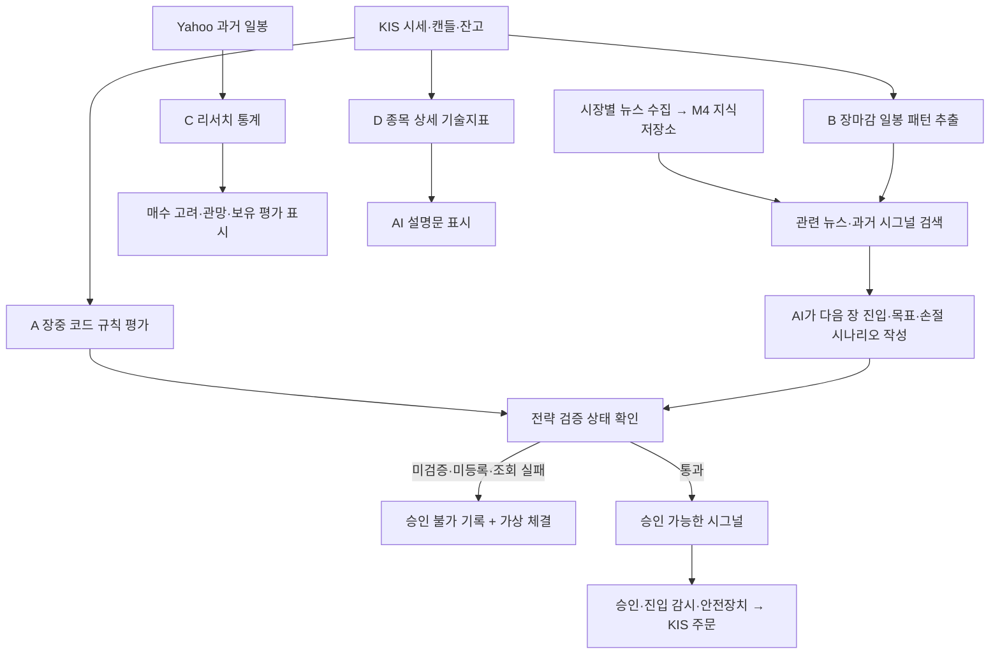
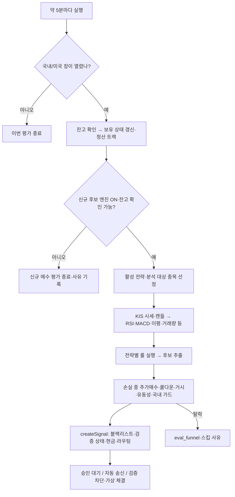
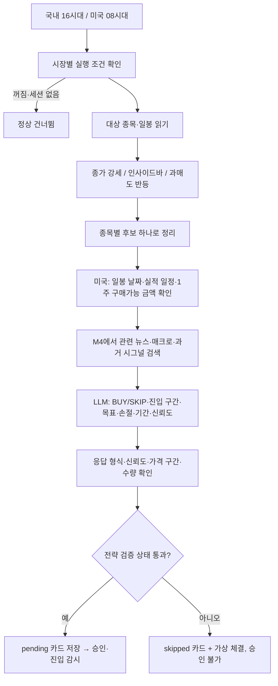
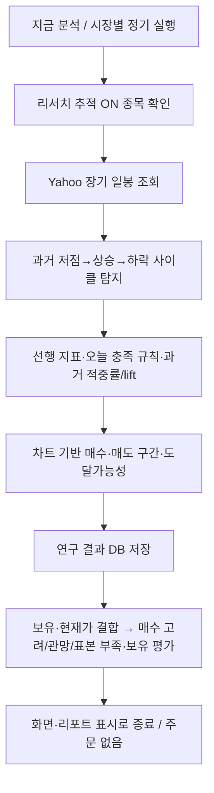
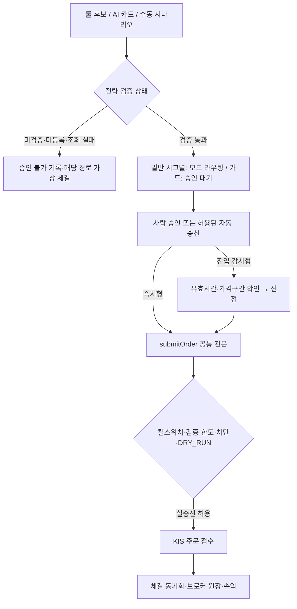

# StockInvest 분석 처리 절차 — 현재 소스 기준

작성: 2026-10-28 · T-107 · 기준 HEAD `0825250` 및 현재 작업트리

## 읽는 기준

**[확실] 앱의 분석은 한 줄로 이어지는 단일 AI 작업이 아니다.** 장중 룰 평가, 장마감 AI 시나리오, 리서치 통계, 종목 상세 AI 설명이 각각 존재한다. 같은 ‘분석’이라는 표현이라도 입력·판단 주체·저장 위치·주문 연결이 다르다.

아래의 [확실]은 이번에 읽은 코드의 동작을 뜻한다. 현재 운영 DB의 설정값·전략 검증 상태·실제 뉴스 검색 건수는 조회하지 않았다. 시간은 cron 코드의 예정 주기이며 순차 실행·외부 응답 지연으로 실제 시작시각은 달라질 수 있다. 앱 소스·설정·주문·배포는 변경하지 않았다. 10-22 감사 결과를 현재 결함으로 그대로 재사용하지 않았다.

## 1. 전체 지도

**[확실] C·D에서 A·B의 주문 경로로 자동 연결되는 화살표는 없다.** 사람이 분석을 보고 별도 시나리오를 만들면 그때 시그널 확정·검증 경로에 진입한다. 분석 화면을 여는 것과 장중 엔진을 실행하는 것도 다르다.

| 경로 | 언제 시작하나 | 판단 주체 | 결과 | 직접 주문 연결 |
|---|---|---|---|---|
| A 장중 | 약 5분마다 strategy-eval, 열린 시장만 | 코드 규칙 | 매수/매도 후보·차단 사유·시그널 | 공통 검증·라우팅 후 조건부 |
| B 장마감 | 국내 16시대·미국 08시대 | 코드 패턴 → AI | 다음 거래일 시나리오 카드 | 승인·진입 감시 후 조건부 |
| C 리서치 | 해외 07시대·국내 16시대 또는 ‘지금 분석’ | 순수 통계 코드 | 과거 패턴·적중률·지지/목표 구간 | 없음 |
| D 상세 설명 | 종목 상세 AI 차트분석 조회·갱신 | 기술지표 코드 → AI | 짧은 자연어 설명 | 없음 |

근거: [cron 주기](//brownjeon_nas/homes/brownjeon/project/StockInvest/scripts/cron-runner.sh:194), [장중 진입점](//brownjeon_nas/homes/brownjeon/project/StockInvest/src/app/api/cron/strategy-eval/route.ts:1), [장마감 진입점](//brownjeon_nas/homes/brownjeon/project/StockInvest/src/app/api/cron/post-market-analysis/route.ts:1), [리서치 버튼](//brownjeon_nas/homes/brownjeon/project/StockInvest/src/app/analytics/components/ResearchTab.tsx:196).

## 2. A — 장중 자동 분석: AI 없이 룰로 후보를 만든다

| 단계 | 실제 처리 | 중요한 구분 |
|---|---|---|
| 1 시장·설정 | runAll이 열린 시장을 고르고 runMarket이 다시 개장을 확인 | force도 runMarket의 장 마감 차단을 우회하지 않음 |
| 2 보유·청산 | 잔고를 먼저 확인하고 보유 상태·청산 트랙을 처리 | 신규 분석 엔진 OFF와 청산 스위치는 별도 |
| 3 종목 선정 | 추세 30·평균회귀 40·돌파 30 목록, 항상 포함 종목·보유 종목을 합쳐 중복 제거 | 최대 100개의 서로 다른 종목이라는 뜻은 아님. 중복·추가 종목이 있음 |
| 4 지표·룰 | 활성 전략에 필요한 캔들을 구하고 순수 함수 룰 실행 | 장중 1h, 장기 일봉 룰 1d. 후보별 필요 봉 수 확인 |
| 5 필터 | 손실 보유 추가매수·미보유 매도·쿨다운, 거시 게이트, 유동성/극단값, 국내 장마감·포트폴리오 가드 | 국내와 미국이 같은 필터를 모두 쓰는 것은 아님 |
| 6 공통 생성 | createSignal에서 블랙리스트 → 검증 상태 → 매수 현금 → 라우팅 | 통과·탈락·오류가 다른 결과임 |

필터는 여러 함수에 분산돼 있어 도표에서는 한 묶음으로 압축했다. 실제 순서는 후보 수집 중 가드 → 전체 거시/한도 가드 → applyFilters → createSignal이다. 시장 국면은 기본적으로 라벨이며 그 자체가 모든 룰의 실행을 막는 관문은 아니다.

근거: [runMarket](//brownjeon_nas/homes/brownjeon/project/StockInvest/src/lib/strategy/engine.ts:1179), [종목 합치기](//brownjeon_nas/homes/brownjeon/project/StockInvest/src/lib/strategy/engine.ts:412), [후보·지표](//brownjeon_nas/homes/brownjeon/project/StockInvest/src/lib/strategy/engine.ts:459), [필터](//brownjeon_nas/homes/brownjeon/project/StockInvest/src/lib/strategy/engine.ts:1011), [활성 룰 등록](//brownjeon_nas/homes/brownjeon/project/StockInvest/src/lib/strategy/rules/index.ts:28), [공통 생성](//brownjeon_nas/homes/brownjeon/project/StockInvest/src/lib/signals/service.ts:525).

## 3. B — 장마감 분석: 코드로 추리고 AI가 시나리오를 쓴다

**[확실] 국내·미국은 별도 분기다.** 미국은 해외 분석 스위치가 정확히 활성일 때만 진행한다. 휴장표·종료 세션·환율·실적 일정 등을 먼저 확인하고, 마지막 일봉이 기준 세션과 다르면 제외한다. 확정/수동 실적 일정이 다음 5거래일 안이면 BUY 후보를 제외한다. 추정 일정과 확정 일정은 같은 의미가 아니다.

코드 패턴은 AI를 부르기 전에 후보를 줄인다. 종가 강세·인사이드바·과매도 반등 중 하나가 맞으면 후보가 되고, 같은 종목이 여러 패턴에 걸리면 고정 우선순위로 하나를 남긴다. 후보가 없으면 AI 호출도 없다.

RAG는 ‘모델이 관련 문서를 찾아 참고하도록 붙이는 과정’이다. 시장별 뉴스, 매크로, 과거 시그널을 검색해 프롬프트에 넣는다. 장마감 경로의 명시 옵션은 뉴스 최근 3일·최대 5건, 과거 시그널 최대 3건이다. 과거 시그널의 기본 검색 기간은 별도로 30일이다. 검색 실패·0건이어도 문맥을 줄인 채 AI 호출이 이어질 수 있다. T-106은 수집/검색 0건과 검색 오류의 연속 발생을 별도로 감시한다.

AI가 BUY를 제시해도 곧바로 주문하지 않는다. 미국 경로는 JSON 구조·신뢰도 60 이상·가격 단위/범위·목표/손절 값·1주 수량 등을 확인한다. 국내도 후보·BUY·진입구간·신뢰도·수량을 거르지만 미국과 똑같은 강화 검증 코드라고 볼 수는 없다. 그 뒤 전략 검증 관문이 카드 저장 상태를 결정한다.

LLM은 runLlm 공통 공급자를 거친다. 실제 모델/공급자는 DB 설정에 따라 달라진다. `hybrid`라는 설정명이 이 경로에서 항상 ‘AI 두 개가 순서대로 검토’한다는 뜻은 아니다. 이 호출은 stage를 넘기지 않아 공급자 기본 분기를 사용한다.

근거: [국내 패턴→RAG→AI](//brownjeon_nas/homes/brownjeon/project/StockInvest/src/lib/strategy/post-market-engine.ts:451), [미국 선행 조건](//brownjeon_nas/homes/brownjeon/project/StockInvest/src/lib/strategy/post-market-overseas.ts:456), [미국 패턴·실적·금액](//brownjeon_nas/homes/brownjeon/project/StockInvest/src/lib/strategy/post-market-overseas.ts:549), [미국 AI·응답검증](//brownjeon_nas/homes/brownjeon/project/StockInvest/src/lib/strategy/post-market-overseas.ts:633), [카드 검증 관문](//brownjeon_nas/homes/brownjeon/project/StockInvest/src/lib/strategy/post-market-engine.ts:311), [RAG 검색](//brownjeon_nas/homes/brownjeon/project/StockInvest/src/lib/rag/retrieval.ts:112), [LLM 공급자](//brownjeon_nas/homes/brownjeon/project/StockInvest/src/lib/llm/provider.ts:88).

## 4. C — ‘리서치분석 → 지금 분석’: AI 없는 통계

| 단계 | 처리 |
|---|---|
| 대상 | stock_favorites의 research_enabled가 켜진 종목. 시장별 정기 배치 또는 단일 종목 수동 재분석 |
| 이력 | Yahoo 일봉 조회. 국내는 시장 후보 중 이력이 더 긴 쪽을 선택. 최신 KIS 캔들 경로와 원천이 다름 |
| 패턴 | 과거 저점과 이후 랠리·하락 사이클을 찾고 전조 지표를 계산 |
| 통계 | 당시 조건의 과거 적중률과 기본 적중률 대비 비율(lift), 오늘 맞는 규칙 계산 |
| 목표 구간 | 차트 지지/저항과 ATR 등으로 매수/매도 구간·도달가능성 계산 |
| 표시 판정 | 표본 8 이상인 오늘의 규칙 중 lift가 가장 높은 것을 골라 1.8 이상·매수구간 도달가능 등의 조건으로 ‘매수 고려’ 표시 |
| 보유 평가 | position_state·현재가·관측 보유기간을 결합해 매도/보유 평가 표시 |

**[확실] ‘과거 적중률’은 미래 승률이 아니고, ‘매수 고려’는 주문 시그널이 아니다.** 표본·lift·목표 구간은 탐색용 휴리스틱이다. 데이터가 부족하면 실패와 ‘패턴 없음’을 구분해 경고한다. 재분석은 같은 날의 저장 행을 갱신하며 새 주문이나 승인 요청을 만들지 않는다.

근거: [버튼과 API](//brownjeon_nas/homes/brownjeon/project/StockInvest/src/app/api/research/tracked/[symbol]/run/route.ts:30), [정기 배치](//brownjeon_nas/homes/brownjeon/project/StockInvest/src/lib/research/run-cycle.ts:48), [리포트 조립](//brownjeon_nas/homes/brownjeon/project/StockInvest/src/lib/research/research-report.ts:50), [이력 원천](//brownjeon_nas/homes/brownjeon/project/StockInvest/src/lib/research/data/history-source.ts:36), [화면용 평가 결합](//brownjeon_nas/homes/brownjeon/project/StockInvest/src/lib/research/recommendation-view.ts:136), [매수 고려 규칙](//brownjeon_nas/homes/brownjeon/project/StockInvest/src/lib/research/pattern/recommendation.ts:158).

### 4.1 리서치의 입력과 통계 계산 상세(후속 질문)

**[확실] 계산 단위는 종목 하나의 과거 일별 데이터다.** 일반 실행은 Yahoo chart API의 기본 `range=5y`, `interval=1d`로 조회한다. 실제 기간은 받은 일봉의 처음·마지막 날짜로 기록한다. Yahoo가 만든 투자 의견을 받아오는 것이 아니라 앱이 아래 입력을 직접 계산한다.

| 입력 | 처리 |
|---|---|
| 날짜 | 거래소 현지 날짜로 변환하고 오름차순 정렬 |
| 시가·고가·저가·종가 | 유효한 adjclose가 있으면 `adjclose/close` 비율을 네 가격에 적용. 없으면 원값 유지 |
| 거래량 | Yahoo 값을 그대로 사용. 결측·비정상 값은 0 |
| 결측 가격 행 | 보간하지 않고 제외 |
| 국내 심볼 후보 | `.KS`·`.KQ` 조회 후 유효 일봉이 더 많은 후보 선택 |

원시 일봉을 연구용 테이블에 쌓아 계속 덧붙이는 방식은 아니다. 실행 때 이력을 조회하고 계산 결과를 `research_rally_results`에 종목·실행일별로 저장한다. 같은 날 재실행하면 결과를 갱신한다. 이력이 500거래일 미만이면 경고를 붙이지만 계산을 일괄 중단하는 조건은 아니다.

**처리 흐름:** 일봉 정리 → 과거 랠리 이벤트 탐지 → 각 날짜의 지표 계산 → 저점 주변 날짜 표시 → 규칙별 빈도·적중률 집계 → 마지막 일봉 조건과 비교 → 화면용 평가.

**과거 랠리의 기본 정의**는 다음과 같다. 일수는 모두 거래일이다.

1. 해당 날짜의 종가가 최근 60거래일의 최저 종가인지 확인한다.
2. 그 뒤 20거래일 안의 최고 **고가**가 저점 종가보다 15% 이상 높으면 랠리 이벤트로 기록한다.
3. 그 최고점 이후 20거래일 안에 **저가**가 10% 이상 하락했는지 `confirmedCycle`로 별도 표시한다. 재하락 확인은 통계의 양성 저점으로 포함되기 위한 필수 조건이 아니다(`troughIndices`는 랠리 이벤트마다 추가).
4. 발견한 랠리는 최고점 다음 날짜부터 탐색을 이어가 중복을 줄인다. 앞으로 관측할 기간이 부족하면 별도 보류를 기록한다.

평균 상승률은 이들 이벤트의 `저점 종가→관측 최고 고가` 상승률 평균이고, 평균 소요일은 그 최고점까지의 거래일 평균이다. 실제 매수·매도 체결로 얻은 수익률이 아니다.

| 매일 계산하는 지표 | 비교하는 규칙(총 10개) |
|---|---|
| RSI14 | 30 미만 / 35 미만 |
| 볼린저(20,2) %B | 0.10 미만 / 0.20 미만 |
| 최근 60일 최고 종가 대비 낙폭 | 15% 초과 / 25% 초과 |
| 당일 거래량 ÷ 당일 포함 20일 평균 거래량 | 1.5배 초과 |
| ATR14 ÷ 종가 × 100 | 4% 초과 |
| 복합 조건 | RSI < 35 + 거래량 > 1.5배 / 낙폭 > 15% + %B < 0.20 |

각 날짜의 지표는 그 날짜까지의 봉으로 계산한다. 통계에서는 모든 지표가 계산 가능한 날짜만 평가한다. 랠리 저점 **전후 3거래일**을 양성 날짜로 묶고 겹치는 날짜는 한 번만 센다.

- 기준 비율(baseRate) = 양성 날짜 수 ÷ 평가 가능 날짜 수.
- 규칙 적중률(precision) = 규칙이 참이면서 양성인 날짜 수 ÷ 규칙이 참인 날짜 수.
- 배수(lift) = 규칙 적중률 ÷ 기준 비율.

**계산 예시(실측 아님):** 평가 가능 1,000일 중 저점 주변이 70일이면 기준 비율은 7%. RSI < 30이 100일이고 그중 21일이 저점 주변이면 적중률 21%, lift는 3배다. 이것은 100번 거래해 21번 이겼다는 뜻이 아니라, 조건이 나타난 **날짜**가 사후 확인된 저점 주변에 얼마나 겹쳤는지를 뜻한다.

화면의 매수 고려는 마지막 일봉에서 충족한 규칙 중 과거 발동일수 8 이상인 규칙을 추린 다음 lift가 가장 큰 하나를 고른다. lift 1.8 이상일 때 매수 고려 후보가 된다. 목표가 정보가 있으면 지지선·도달가능성도 확인하고 부족하면 관망으로 낮춘다. **목표가 정보 자체가 없을 때는 이 추가 관문을 생략하는 예외가 있다.** 신뢰도 라벨은 발동일수 8~14일 낮음·15~29일 중간·30일 이상 높음이며 통계적 유의성 검정 결과가 아니다.

차트 가격 구간은 위 적중률과 별도로 계산한다. 매수 희망가는 기준 종가 아래의 볼린저 하단·직전 20일 저점·MA60 중 가장 가까운 값, 매도 목표가는 위쪽의 볼린저 상단·직전 60일 고점·MA60 중 가장 가까운 값이다. 기본 14달력일(약 10거래일)의 범위 판단은 `ATR14 × √10` 이내인지로 정한다. 이 값은 도달 확률이나 보장된 가격 예측이 아니다.

**[확실] 이 통계에 없는 수익 검증:** 각 조건에서 실제로 진입·청산했을 때의 순수익, 수수료·슬리피지, 미체결, 손절, 최대 낙폭, 표본 외 성과는 이 계산에서 구하지 않는다. 연속된 날짜를 각각 세므로 발동 8일은 서로 독립적인 거래 8건과도 다르다. 마지막 일봉의 장마감 확정 여부를 별도 검증하는 분기도 이 로더/파서에는 없다. 이 점들을 확인해야 탐색 통계를 실매매 근거로 발전시킬 수 있다.

근거: [입력 조회·정리](//brownjeon_nas/homes/brownjeon/project/StockInvest/src/lib/research/data/yahoo-finance-source.ts:69), [랠리 기본값](//brownjeon_nas/homes/brownjeon/project/StockInvest/src/lib/research/types.ts:36), [랠리 탐지](//brownjeon_nas/homes/brownjeon/project/StockInvest/src/lib/research/pattern/rally-cycle.ts:39), [일별 지표](//brownjeon_nas/homes/brownjeon/project/StockInvest/src/lib/research/pattern/precursor-features.ts:31), [10개 규칙](//brownjeon_nas/homes/brownjeon/project/StockInvest/src/lib/research/pattern/precursor-analysis.ts:39), [집계식](//brownjeon_nas/homes/brownjeon/project/StockInvest/src/lib/research/pattern/precursor-analysis.ts:96), [매수 고려 판정](//brownjeon_nas/homes/brownjeon/project/StockInvest/src/lib/research/pattern/recommendation.ts:158), [가격 구간](//brownjeon_nas/homes/brownjeon/project/StockInvest/src/lib/research/pattern/price-targets.ts:191), [결과 저장](//brownjeon_nas/homes/brownjeon/project/StockInvest/src/lib/research/storage.ts:91).

### 4.2 저장된 리서치 결과의 실제 활용처(후속 질문)

**[확실] 현재 소비처는 리서치 화면과 정기 거래 리포트다.** 저장된 결과가 장중 전략·장마감 AI·주문 엔진의 판단 입력으로 전달되는 경로는 조사한 `src/`·`scripts/`에서 찾지 못했다. 설계 문서 `docs/research-rally-cycle.md`도 이 소비 경계를 명시한다.

| 활용처 | 읽는 데이터와 처리 | 시스템 행동 |
|---|---|---|
| 리서치 화면 | 추적중 종목별 최신 결과·규칙 통계·마지막 일봉 조건·차트 목표가. 보유 정보와 시세를 표시용으로 결합 | 매수 고려/관망/표본 부족, 보유종목 매도 고려와 목표가 표시 |
| 정기 리포트의 리서치 요약 | 추적중 종목의 최신 결과를 화면과 같은 `evaluateBuySignal`로 평가. 매수 고려와 활성 규칙이 있는 표본 부족만 선별 | 매수 고려 우선·lift 내림차순으로 요약, 설정된 Slack/Telegram 채널 전송 경로에 포함 |
| 정기 리포트의 보유종목 설명 | 보유종목의 최신 `price_targets`를 읽어 `evaluateSellSignal`로 평가 | 차트 저항선 근접/돌파에 따른 매도 고려·관망·판단 보류를 메시지에 표시 |
| 일별 이력 저장 | 종목·실행일별 `research_rally_results` 저장. 같은 날은 갱신 | 계산 이력 보관. 일반 조회는 최신 결과 한 건을 사용 |

리포트 전송은 활성화·기준 시각·주기·채널 등 설정에 따른 조건부 경로다. 이번 조사에서 운영 설정이나 실제 발송 성공 여부를 조회하지 않았으므로 현재 수신 중이라고 단정하지 않는다.

**[확실] 다음 분석은 이전 결과를 학습해 개선하는 방식이 아니다.** `buildResearchReport`가 새로 조회한 Yahoo 이력으로 정해진 지표·규칙을 다시 계산한다. 현재 결과 저장 경로에는 추천 후 수익/손실과의 대사, 규칙 임계치 자동 변경, 전략 검증 상태 승급, 분석 대상 자동 편입, 리서치 기반 주문 생성이 없다. 정기 거래 리포트의 계좌 손익과 리서치 요약이 같은 메시지에 있어도 둘의 인과적 성과를 검증하는 결합은 아니다.

**[확실] 보유종목 리포트의 목표가 조회는 추적을 끈 종목도 과거 행이 있으면 사용하며, 조회 자체에 최대 경과일 제한이 없다.** [가능성 높음] 오래된 목표가가 현재의 참고 설명으로 재사용될 수 있어, 기준일·신선도를 확인하는 후속 검토가 필요하다. 실제 해당 사례의 발생 여부는 운영 데이터로 확인하지 않았다.

수익 목표에서의 후속 권고는 리서치 결과를 사후 성과와 연결하는 것이다. 기준일·추천 조건·가격 구간을 고정한 뒤 체결 가능한 진입/청산·비용·손실을 평가하고, 별도 기간 검증과 기존 전략 검증 관문을 거쳐 매매 판단에 활용할 가치를 판단한다. 이번에는 설명만 보완했으며 이 연결을 구현하지 않았다.

근거: [최신 결과 조회](//brownjeon_nas/homes/brownjeon/project/StockInvest/src/lib/research/storage.ts:138), [화면 조회 API](//brownjeon_nas/homes/brownjeon/project/StockInvest/src/app/api/research/tracked/route.ts:16), [화면 평가 조립](//brownjeon_nas/homes/brownjeon/project/StockInvest/src/lib/research/recommendation-view.ts:136), [리포트 매수 요약](//brownjeon_nas/homes/brownjeon/project/StockInvest/src/lib/reports/trade-report.ts:1195), [보유종목 목표가 조회](//brownjeon_nas/homes/brownjeon/project/StockInvest/src/lib/reports/trade-report.ts:980), [보유종목 매도 평가](//brownjeon_nas/homes/brownjeon/project/StockInvest/src/lib/reports/trade-report.ts:1104), [리포트 출력](//brownjeon_nas/homes/brownjeon/project/StockInvest/src/lib/reports/trade-report.ts:591), [리포트 전송 연결](//brownjeon_nas/homes/brownjeon/project/StockInvest/src/app/api/cron/trade-report/route.ts:166).

### 4.3 최근 3일 리서치를 매매 판단에 참고시키는 연결안(제안·미구현)

사용자 제안: 종목을 분석할 때 최신 리포트에 해당 종목 정보가 있으면 참고해 매수/매도 판단할 수 있는 구조가 효과적인지 검토. **사용자 지정: 최신 3일.** 이 절은 연결 설계와 효과 검증 제안이며 제품 코드 변경·운영 적용 승인이 완료됐다는 뜻은 아니다.

**[가능성 높음] 구현할 가치가 있는 보조 입력이다.** 현재 장마감 AI에는 후보의 당일 OHLCV·RSI·MA·패턴과 뉴스/과거 시그널이 전달되므로, 같은 종목의 장기 통계·표본 크기·차트 가격 구간을 명시적으로 추가할 수 있다. 다만 같은 가격에서 파생한 지표를 독립적인 증거처럼 중복 계산하면 확신만 높아질 수 있다. 실제 순수익 개선 여부는 미검증이다.

**제안 흐름:** 기존 후보 생성 → 종목·시장 정확 일치로 리서치 최신 결과 조회 → 신선도·오류·단위 확인 → 구조화된 리서치 참고 블록 → 기존 분석과 함께 판단 → 응답 검증·전략 검증·승인·진입 감시·공통 안전장치.

| 항목 | 제안 규칙 |
|---|---|
| 리포트의 의미 | 메시지 전체를 다시 해석하지 않고 `research_rally_results`의 원본 구조화 결과 사용 |
| 신선도 | **3일은 우선 달력일로 해석**. 판단 기준시점의 거래소 현지 날짜 D를 포함한 최근 3개 날짜(D-2~D). 이 세부 해석은 제안 기본값이며 사용자에게 확정받은 것은 '최신 3일' 범위 |
| 날짜 기준 | `created_at` 재실행 시각이 아니라 `data_range_to`(마지막 일봉 날짜)로 판단. 미래 날짜·미완료 세션 입력은 제외. 해외는 장마감 엔진의 완료 세션 `d0`를 상한으로 사용 |
| 결과 선택 | 같은 심볼·시장에 대한 최신 시도 1건 확인. 최신 결과가 오류·오래됨·날짜 불명인 경우 더 오래된 성공 결과를 조용히 가져오지 않고 참고자료 없음/불가 사유를 기록 |
| 전달 정보 | 결과 식별자·기준일·원천/원통화·데이터 기간·이벤트 수·규칙 발동일수·적중률/lift·라벨 ±3일·마지막 일봉 활성 규칙·지지/저항·ATR·경고 |
| 해석 제한 | precision은 과거 저점 주변 날짜 적중률, confidence는 표본일수 라벨. 평균 랠리 상승률을 미래 목표수익이나 실현 가능한 수익으로 치환하지 않음 |
| 자료가 없을 때 | 신규 분석의 필수 통과 조건으로 만들지 않음. 기존 경로 유지하고 `missing/stale/error/future` 등의 원인을 기록 |
| 가격 정합 | Yahoo 조정가격·KIS 가격의 원천 차이, USD/KRW·기준일 차이를 표시. 과거 가격 구간과 현재 KIS 가격의 괴리를 재확인. 검증 전 자동 목표가/손절가 대체·고정 가산점 없음 |
| 중복 방지 | 같은 종목의 일별 결과 3건을 독립적인 찬성표로 세지 않고 최신 1건만 참고 |
| 감사·재현 | 판단 시 실제 사용한 리서치 스냅샷과 조회 상태를 분석 실행에 고정. 사후 재실행으로 바뀐 행을 과거 판단 자료로 대체하지 않음 |

예를 들어 기준 날짜가 10-28이면 10-26~10-28의 데이터 기준일을 허용하는 해석이다. 10-28에 다시 실행했어도 마지막 일봉이 10-23이면 제외한다. 주말·휴장으로 범위 안의 결과가 없어도 3거래일로 자동 확장하지 않고 기존 분석을 계속한다. **3일은 리서치 결과의 사용 기한**이며 과거 통계의 기본 5년 조회 범위나 차트 목표 기한 14달력일을 3일로 바꾸는 뜻은 아니다.

**현재 진입점에 맞춘 단계적 활용:**

1. 장마감 AI에 보조 컨텍스트로 붙이는 경로를 먼저 비교 평가한다. 현재 프롬프트 출력은 **BUY/SKIP**이며 SELL 결정을 만드는 경로가 아니다. 통계와 AI 판단이 충돌하면 충돌·근거를 기록하고 검증 없이 강제 매매 규칙으로 승격하지 않는다.
2. 장중 룰은 LLM 없이 동작하므로 같은 방식으로 텍스트를 넣을 곳이 없다. 초기에는 후보에 참고 정보·충돌만 기록한다. 필터·점수·가격·수량 변경은 변경된 전략으로 따로 검증한다.
3. 보유종목의 매도 참고 정보를 모으는 것은 가능하나, 강제 손절·기존 청산을 리서치 매수 의견 때문에 지연시키지 않는다. 매도 엔진의 실제 판단 변경은 별도 평가 대상으로 둔다.

**효과 판정 방법:** 같은 시점·후보·시장 데이터·모델 조건에서 기존 판단과 리서치 추가 판단을 함께 저장하고, 추가 판단은 우선 주문에 반영하지 않는다. 후보 전체에 대해 매수/skip 변화와 이후 성과를 기록해 선택한 종목만 비교하는 편향을 피한다. 체결 가능한 가격·가용자금·기존 위험 한도·기존 전략별 보유기간을 적용한 가상 평가에서 미국 수수료 편도 0.25%, 슬리피지 등을 공통 반영한다. 비용 후 손익·자본 대비 성과·최대 낙폭·회전율·체결가능성·기회손실을 비교하고 별도 기간에 다시 평가한다. 리서치의 14일 목표와 장마감 전략의 1~5일 보유를 같은 기간으로 오인하지 않는다.

과거 재현 시에는 당시 생성된 스냅샷 또는 그 시점까지로 제한한 원천 데이터로 계산해야 한다. 오늘의 5년 통계에는 이후에 발생한 랠리의 라벨이 들어 있으므로 이를 과거 의사결정에 붙이면 미래 정보가 섞인다. 일별 행도 같은 날 갱신될 수 있어 저장 행이 있다는 사실만으로 당시 입력이 재현된다고 볼 수 없다.

연구 근거: 기술 규칙을 많이 비교할 때 데이터 탐색 편향을 조정해야 한다는 [Sullivan·Timmermann·White 연구](https://onlinelibrary.wiley.com/doi/abs/10.1111/0022-1082.00163), 비용 반영이 전략 수익성과 통계적 유의성을 낮출 수 있음을 분석한 [Novy-Marx·Velikov 연구](https://www.nber.org/papers/w20721). 이 연구들이 본 프로젝트의 리서치 추가 효과를 직접 입증하는 것은 아니다.

소스 연결 근거: [미국 프롬프트](//brownjeon_nas/homes/brownjeon/project/StockInvest/src/lib/strategy/post-market-overseas.ts:315), [미국 LLM 호출 직전](//brownjeon_nas/homes/brownjeon/project/StockInvest/src/lib/strategy/post-market-overseas.ts:633), [국내 프롬프트](//brownjeon_nas/homes/brownjeon/project/StockInvest/src/lib/strategy/post-market-engine.ts:388), [현재 결과 조회](//brownjeon_nas/homes/brownjeon/project/StockInvest/src/lib/research/storage.ts:138), [검증 관문](//brownjeon_nas/homes/brownjeon/project/StockInvest/src/lib/safety/validation-gate.ts:1).

## 5. D — 종목 상세의 AI 설명은 별도 경로

종목 상세가 `/technical`로 시세·30분봉/일봉·지표를 읽고, `/chart-analysis`가 그 결과로 AI에 짧은 기술적 설명을 요청한다. 기술지표 캐시는 5분, AI 설명 캐시는 30분이다. AI 결과는 stock_chart_analysis에 저장돼 화면에 표시되며 createSignal·submitOrder를 호출하지 않는다.

따라서 이 화면에서 긍정적인 설명이 나와도 A·B가 같은 판단을 했거나 주문이 승인된 것은 아니다. 장중 룰과 종목 상세의 지표 시간축도 다를 수 있다. 구 `/api/analyst/run`은 국내 고정 종목에 간단 룰을 실행하는 별도 API로 남아 있지만 검토한 프런트 소스에서 호출을 찾지 못해 현재 화면의 주요 경로로 그리지 않았다.

근거: [AI 설명](//brownjeon_nas/homes/brownjeon/project/StockInvest/src/app/api/favorites/[symbol]/chart-analysis/route.ts:12), [기술지표](//brownjeon_nas/homes/brownjeon/project/StockInvest/src/app/api/favorites/[symbol]/technical/route.ts:49), [종목 상세 화면](//brownjeon_nas/homes/brownjeon/project/StockInvest/src/app/favorites/[symbol]/FavoriteDetailPage.tsx), [별도 구 API](//brownjeon_nas/homes/brownjeon/project/StockInvest/src/app/api/analyst/run/route.ts:12).

## 6. 분석 뒤의 공통 경로 — 분석 성공과 실주문은 다르다

**[확실] 현재 검증 관문은 이미 구현돼 있다.** strategies.validation_status가 `backtested` 또는 `paper_validated`인 신규 매수만 허용하며 미등록·미검증·조회 실패는 차단한다. 검증 상태를 이 분석이 스스로 승급시키지 않는다. 매도는 이 검증 상태 관문 때문에 막히지 않지만 최종 주문의 킬스위치 등은 별도 적용된다.

일반 시그널은 블랙리스트·검증·현금 확인 후 manual/assist/auto로 갈라진다. manual은 `detected`로 기록돼 사람의 수동 처리가 필요하고, assist는 `awaiting_approval`로 승인 대기한다. auto도 상한 조건이 있다. 하드손절 등 일부 청산은 별도 자동 라우팅이 존재한다. 장마감 카드는 pending으로 저장되며 승인 후 진입 감시 또는 즉시 승인 경로는 공통 승인 규칙이 결정한다.

**중간 결과를 구분해야 한다:** 후보 0건, 정상 필터 탈락, 데이터 오류, AI 실패, 미검증 차단, 가상 체결, 승인 대기, 진입구간 미도달, 킬스위치 차단, 실제 주문 접수, 실제 체결은 모두 다른 단계다. 가상 체결은 실계좌 체결도 아니고 수익성이 입증됐다는 뜻도 아니다.

특히 AI가 정상 응답해도 전략 검증 관문에 막힌 카드는 `skipped`로 저장되므로 승인 대기 화면에 나오지 않을 수 있다. ‘AI가 아무 분석도 안 했다’와 ‘분석했지만 승인 가능한 카드가 아니다’를 구분해야 한다. 가상 체결/감시 기록이 생성된 것 역시 가상 체결이 이미 확정됐다는 뜻은 아니다.

근거: [검증 규약](//brownjeon_nas/homes/brownjeon/project/StockInvest/src/lib/safety/validation-gate.ts:1), [가상 체결 모델](//brownjeon_nas/homes/brownjeon/project/StockInvest/src/lib/signals/paper-fill.ts:37), [일반 라우팅](//brownjeon_nas/homes/brownjeon/project/StockInvest/src/lib/signals/router.ts:274), [승인 방식 결정](//brownjeon_nas/homes/brownjeon/project/StockInvest/src/app/api/signals/[id]/approve/route.ts), [진입 감시](//brownjeon_nas/homes/brownjeon/project/StockInvest/src/app/api/cron/entry-watcher/route.ts:243), [최종 주문 관문](//brownjeon_nas/homes/brownjeon/project/StockInvest/src/lib/safety/dry-run.ts).

## 7. 개선을 검토할 지점

이번에는 코드나 설정을 고치지 않았다. 다음은 이번에 확인한 구조와 그로부터의 개선 후보다. 진행 중·설계 중인 작업의 미완성 부분을 새 운영 결함으로 판정하지 않는다. 이전 사용자 지시대로 T-068 자체의 구현 품질은 이번에 재감사하지 않았다.

| 위치 | 확인된 구조 | 개선을 검토할 이유·다음 확인 |
|---|---|---|
| A·D 캔들 입력 | 엔진의 장중 요청은 1h, 상세는 30m. 해외 어댑터는 두 요청 모두 일봉 반환 | **[확실] 시간축 계약 불일치.** 실제 봉 간격·확정 여부를 표시하고 다른 봉으로 조용히 대체하지 않도록 검토 |
| 데이터 원천 | A/B는 KIS, C는 Yahoo. daily_bars 저장소·신규 백테스트는 별도 경로 | **[가능성 높음] 동일 종목 분석이 서로 다르게 보일 원인.** 봉 기준일·수정주가·통화·원천을 나란히 표시하고 전략별 입력 계약을 정할 필요 |
| B 뉴스/RAG | 검색 0건·실패해도 문맥을 줄인 AI 분석이 가능 | **[확실] 결과 생성과 입력 충실도는 다름.** 이번 실행의 뉴스 건수·기준일·오류를 결과와 연결. T-105/M4 수정·T-106 감시 진행 결과를 확인해 중복 개발 방지 |
| B AI 판정 | confidence와 양수 목표/손절·범위 검사. 신뢰도는 모델 출력 | **[가능성 높음] 높은 등급이 비용 후 기대수익을 뜻하지 않음.** 미국 편도 0.25% 비용과 검증된 전략 성과를 별도 기준으로 연결하는 검토 필요 |
| C 리서치 | 과거 같은 표본의 lift로 오늘 매수 고려를 표시, 주문은 없음 | **[확실] 탐색 통계를 실전 검증으로 오해할 수 있음.** 표본 외·실제 체결·비용 검증과 표시 의미를 분리 |
| 공통 결과 | 정상 건너뜀·오류·검증 차단·대기·가상 체결·실주문이 여러 테이블/로그로 분산 | **[가능성 높음] ‘왜 거래가 없나’를 화면 하나로 알기 어려움.** 분석 실행 식별자와 단계별 건수·최종 탈락 사유를 연결하는 관측 개선부터 검토 |

관련 근거: [해외 실제 캔들](//brownjeon_nas/homes/brownjeon/project/StockInvest/src/lib/exchanges/kis-overseas.ts:138), [KIS 캔들 분기](//brownjeon_nas/homes/brownjeon/project/StockInvest/src/lib/exchanges/kis.ts:24), [신규 일봉 수집의 격리](//brownjeon_nas/homes/brownjeon/project/StockInvest/src/lib/profit-engine/daily-bars-collector.ts:1), [AI 목표/신뢰도 검사](//brownjeon_nas/homes/brownjeon/project/StockInvest/src/lib/strategy/post-market-overseas.ts:281), [리서치 휴리스틱](//brownjeon_nas/homes/brownjeon/project/StockInvest/src/lib/research/pattern/recommendation.ts:1), [장중 관측 기록](//brownjeon_nas/homes/brownjeon/project/StockInvest/src/lib/strategy/eval-funnel.ts:10).

**[가능성 높음] 개선의 첫 순서는 ‘이번 분석이 어느 경로로 돌았고 어디에서 멈췄는지 보이게 하기’와 ‘봉·원천·기준일 계약 확인’이 적합하다.** 그 뒤에 AI·뉴스를 바꿨을 때 실제로 후보 품질·체결 가능성·비용 후 성과가 개선됐는지 비교할 수 있다. 시그널 수만 늘리려고 검증·현금·안전장치를 제거하는 방향은 이 목적과 맞지 않는다.

## 8. 검증 범위

- 소스의 프런트 호출 → API → 본체 → 저장·주문 호출 관계와 핵심 조건을 직접 대조했다.
- 화면을 실제로 조작하거나 분석 API를 실행하지 않았다. 운영 DB·KIS·LLM·실계좌 상태는 재조회하지 않았다.
- 도표는 처리 원리를 설명하기 위한 압축 표현이며 모든 예외·DB 쓰기를 함수 호출 수준으로 전부 나열한 것은 아니다.
- 절차서·대화용 시각화만 생성했다. 제품 화면·매매 로직·설정·배포 변경 없음.
