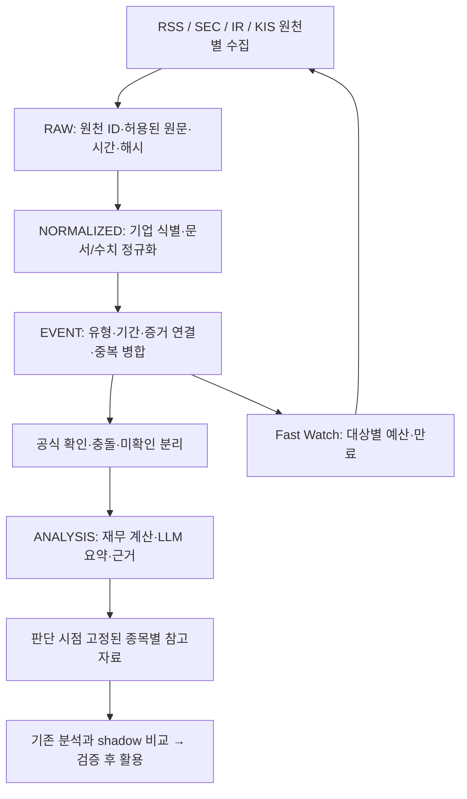

# 기업정보 통합 수집 도입 검토

작성 2026-10-28 · T-110 · 읽기 전용 소스 조사 기준 StockInvest HEAD `c0369aa`. 업로드 문서 `기업정보수집_통합론_작업계획서_V0.0.4.md` 전체 1,578줄의 구조·절차를 검토했다. 사용자가 직전 지정한 최신 3일 리서치 참고는 별도 [[T-109-research-context-for-analysis]]로 접수했다. 운영 DB·현재 스케줄/로그·원천 제공자의 계약은 이번에 확인하지 않았다. 소스 동작과 과거 운영 기록은 구분한다. T-068 구현 품질은 이번 범위에서 제외한다.

## 1. 결론과 수익 목표

**[가능성 높음] 계획서의 RAW → NORMALIZED → EVENT → ANALYSIS 방향은 채택할 가치가 있다.** 기업별 실적·공시·뉴스를 같은 사건으로 묶으면 종목 판단에 근거와 발표 시각을 제공하고, 근거가 없거나 충돌하는 상황을 구분할 수 있다. 수집 데이터가 많아지는 것 자체가 수익 향상을 입증하지는 않는다.

현재 SEC 메타데이터/XBRL·실적 일정·KIS 원값·뉴스 수집은 각각 존재한다. 먼저 **기존 자산을 연결할 증거·기업식별·시점 계약**을 만들고, 제한된 미국 종목의 실적 이벤트 한 가지로 검증한 다음 Fast Watch와 추가 이벤트를 확장하는 편을 권한다. 기존의 T-078 통합 절차서와 단일 실행 원장을 대체하지 않으며 실제 착수 순서는 그 원장과 조율한다.

## 2. 계획서의 순서와 현재 구현

| 계획서 단계 | 현재 확인된 코드 | 차이와 도입 방향 |
|---|---|---|
| 외부 수집: SEC·뉴스·IR | `edgar-sync` 07시, KIS 재무 08시; 뉴스 해외·국내 06시대 각 1회 | 기존 어댑터 재사용. 주기는 소스상 예정이며 실제 실행·성공은 미확인. 계획서의 1~5분 수집 체계와 차이 큼 |
| SEC·재무 데이터 | CIK 매핑, submissions 메타데이터, 일부 companyfacts, 실적 일정 테이블, KIS snapshot | 공시 원문·첨부 수집, IR 자동 수집, 이벤트 통합은 조사 범위에서 확인되지 않음. 기존 XBRL fact는 갱신 시 같은 키의 이전 값이 덮어써져 시점 재현이 불완전 |
| RSS 원본 → 기업 식별 | M4 RSS title/description/date → 시장별 벡터 저장, 시장별 요청 총 20건 | 현 파서는 개별 기사 link/GUID·발행사·종목 식별자를 보존하지 않음. 현재 저장물만으로 사건별 원문·독립 출처를 완전 복원할 수 없음 |
| 사건 분류·병합·검증 | 장마감은 시장 뉴스/과거 시그널을 벡터 검색해 후보 묶음에 제공 | 기업-증거 다대다 매핑·사건 ID·공식 자료와 주장별 검증은 별도 설계 필요. 현재 검색은 정확한 종목 일치를 보장하지 않음 |
| 실적 및 재무 분석 | `us_earnings_events`는 해외 장마감 경로의 발표 전 5거래일 블랙아웃에 사용. KIS 관측값은 재무 API에서 별도 응답 | XBRL과 KIS는 의미·시점이 다르다. 숫자·기간·통화·GAAP/비GAAP 및 원천/발표시각을 명시하고 자동 통합 분석 소비를 새로 설계 |
| LLM 및 매매 | 기존 장마감 BUY/SKIP 프롬프트는 뉴스/RAG를 사용. 장중 룰·매도 청산은 별도 경로 | 검증된 자료를 시점 고정된 보조 문맥으로 연결하고 먼저 shadow 비교. 기존 신규 매수 검증·승인·실행 관문 유지 |

근거: [cron](//brownjeon_nas/homes/brownjeon/project/StockInvest/scripts/cron-runner.sh:240), [SEC 수집기](//brownjeon_nas/homes/brownjeon/project/StockInvest/src/lib/data/us-edgar/sync-job.ts:1), [공시 파싱](//brownjeon_nas/homes/brownjeon/project/StockInvest/src/lib/data/us-edgar/parse.ts:58), [재무 테이블](//brownjeon_nas/homes/brownjeon/project/StockInvest/scripts/migrations/T-059-us-data-collector.sql:48), [KIS 스냅샷](//brownjeon_nas/homes/brownjeon/project/StockInvest/src/lib/data/kis-fundamentals-snapshot.ts:1), [뉴스 실행](//brownjeon_nas/homes/brownjeon/project/StockInvest/src/app/api/cron/news-fetch/route.ts:70), [M4 RSS 파서](//brownjeon_nas/homes/brownjeon/project/home-m4-api/app/routes/market_context.py:319), [검색](//brownjeon_nas/homes/brownjeon/project/StockInvest/src/lib/rag/retrieval.ts:112), [실적 차단](//brownjeon_nas/homes/brownjeon/project/StockInvest/src/lib/strategy/earnings-blackout.ts:50).

### 현재 동작의 경계

- SEC submissions의 최근 filing 메타데이터와 문서 URL을 얻지만, 조사한 수집기에서 공시 전문·Exhibit 전문 다운로드/분석이나 IR 사이트 자동 수집은 발견하지 못했다. EX-99.1은 대표 후보이지 항상 존재하는 필수 파일이 아니다. 99.2·없음·정정도 남겨야 한다.
- XBRL은 선택한 태그와 `frame`이 있는 정기보고서 위주다. 기간 누적치·결손 Q4·정정·단위에 주의해야 하며, 네 개 분기를 무조건 더해 TTM을 만들면 안 된다.
- KIS snapshot의 재무 지표와 SEC GAAP 값은 서로 다른 의미일 수 있다. `fundamentals` API의 AI 생성값은 원천 공시를 제공받아 검증한 공식 사실로 취급하지 않는다. [재무 API](//brownjeon_nas/homes/brownjeon/project/StockInvest/src/app/api/fundamentals/[symbol]/route.ts:65)
- 뉴스 응답 `fresh`는 72시간 내 발행 항목 수이지 신규 DB 삽입 건수가 아니다. M4는 피드별 결과를 반환하지만 StockInvest 뉴스 실행기는 피드별 오류를 소비하지 않아 일부 피드 장애가 합계에 가려질 수 있다.
- T-105의 과거 뉴스 0건 원인 기록을 현재 상태로 단정하지 않는다. M4 task-007/008의 날짜 정규화와 다중 피드 및 10-28 13:59 배포 성공은 [M4 작업 기록](//brownjeon_nas/homes/brownjeon/project/home-m4-api/agent-vault/10-Flow/tasks/task-008-news-multi-feed.md:144)에 남아 있으며, 이번에는 운영을 재측정하지 않았다. 환경별 실제 피드 설정은 별도 확인이 필요하다.

## 3. 계획서에서 먼저 보완할 점

1. **완료 기준 충돌:** §36 Phase 1은 IR을 포함하지만 §37의 1차에는 IR이 없다. §38의 '1차 완료'는 이벤트 병합·Fast Watch·EX-99.1까지 요구한다. 아래 단계별 산출물과 완료 기준으로 분리해 진척을 오인하지 않는다.
2. **시장 시간:** §5의 00:00~04:30 KST를 미국 정규장으로 고정할 수 없다. 보통 NYSE 09:30~16:00 ET는 서머타임 22:30~익일 05:00 KST, 표준시 23:30~익일 06:00 KST다. `America/New_York`와 거래소 휴일·조기폐장 달력을 기준으로 구간을 계산한다. [NYSE 거래시간](https://www.nyse.com/trade/trading-information), [휴장·조기폐장](https://www.nyse.com/trade/hours-calendars)
3. **SEC 부하:** 계획서의 30~60초 개별 기업 Fast Watch는 기업 수에 비례해 부하가 증가한다. 현 07시 cron은 동기 실행이며 여러 작업과 하트비트 예산을 공유하므로 그 안에서 모든 종목을 고빈도 순회하면 진입 감시 등이 지연될 수 있다. 별도 내구성 있는 스케줄러/워커와 전체 공유 예산·우선순위·유효기간·동시성 상한, 429/403 backoff가 필요하다. SEC 10회/초는 장비 수와 무관한 사용자 합산 상한이지 목표 속도가 아니다. 식별 가능한 User-Agent와 여유 있는 예산을 둔다. [SEC Fair Access](https://www.sec.gov/about/developer-resources)
4. **Fast Watch 종료:** 아무 8-K 또는 IR 문서가 나왔다고 완료하면 안 된다. 기업/CIK, 이벤트 종류, 회계기간, 관련 item·첨부를 맞추고 확인·부분확인·충돌·시간초과를 구분한다. 기한 경과는 `unconfirmed/partial`로 남긴다.
5. **신뢰도:** 출처별 0.95/1.0은 실측된 확률이 아니다. 출처 등급, 자료 자체의 확인, 개별 주장에 대한 근거 상태를 분리한다. 공식 문서 존재와 기사 내 모든 주장 검증을 같은 의미로 처리하지 않는다.
6. **시점·정정:** 이벤트 발생, 공시 공개/접수, 최초 관측, 저장/분석 시각과 수정 버전, 원본 해시를 따로 보존한다. 동일 key 최신값 덮어쓰기와 재수집 시각만으로는 과거에 실제 알았던 정보를 복원할 수 없다. 미관측과 부정 사실도 구분한다.
7. **컨센서스:** 제공자가 없으면 `unknown`으로 둔다. 실제 실적과 비교할 때 발표 전 확보 시각, 제공자/라이선스, 회계기간, 단위, 통화, GAAP·non-GAAP 및 수정 버전의 일치가 필요하다. 사후 컨센서스는 당시 예측값이 아니다.
8. **대상 시장:** 초기 미국 실적 이벤트에서 시작하고 국내 공시는 별도 DART 어댑터·기업 식별자로 확장한다. 뉴스 본문 저장·출처별 빈도는 공급자별 이용 조건을 먼저 확인한다.

## 4. 추천 아키텍처: 계획서 계층을 유지

- **RAW:** `source`, source-native id/accession, 허용된 URL/내용, content hash, 발행/공개/최초관측/재관측 시각, 응답 상태, parser 버전. 출처·라이선스에 따라 본문과 메타데이터 보존 범위 구분.
- **NORMALIZED:** company ID ↔ CIK·거래소·ticker의 유효기간·별칭/변경 이력. 동명이의·복수 상장·상장폐지와 확신 낮은 연결은 미해결 큐로 남긴다. 수치별 단위·기간·기준·수정 버전 보존.
- **EVENT:** 기업/이벤트 유형/회계기간·시간을 활용해 후보 사건을 만들고 `event_source`에 다수 증거를 연결. 기사 중복과 같은 사건의 다른 기사 병합은 별개이며 병합/분리 이력과 충돌을 보존.
- **ANALYSIS:** 근거 문서 ID·해당 발췌 위치·기준시각과 결과 버전 연결. 확인 사실·주장·모델 추론·미확인/충돌을 구분하고 prompt injection 방어와 출력 검증을 둔다.
- 회사별 데이터와 인덱스는 기존 MariaDB를 정본으로 검토하고, M4/Qdrant는 검색 보조로 사용. 소유권·원본 위치·재처리·장애 시 복구 계약을 먼저 정한다. 신규 서비스/테이블 배포나 마이그레이션은 별도 작업이다.

## 5. 계획서 §36/§37에 맞춘 단계별 도입안

| 계획서 | 제안 산출물과 단계별 완료 기준 |
|---|---|
| Phase 1 수집 구조 정리 / 1차 | 기존 SEC·RSS·KIS 조사와 원천/저장 책임, RAW 계약·수집 이력·피드별 상태. 작은 대상에 중복 재수집·오류·재처리를 확인. IR은 접근 가능 소수 원천 조사까지이며 자동 수집 완료로 세지 않음 |
| Phase 2 기업 식별 / 1차 | 기존 `symbol_cik_map` 재사용·확장. ticker/CIK/거래소/alias·유효기간, 모호/미매핑 격리. 표본 기업 식별 정확도와 실패 사례 기록 |
| Phase 3 Event Detector / 2차 | 미국 EARNINGS 한 종류부터 기사·공시·IR 근거를 사건에 다대다 연결. 중복 기사와 다른 사건의 오병합·누락을 평가하고 출처별 증거를 열람 가능하게 함 |
| Phase 4 Adaptive / 3차 | 위 검증 가능한 기업·사건 대상으로만 제한적 fast watch. 영속 상태, TTL·예산·중복 실행 방지·부분 실패·재시작 복구 및 기존 cron 간섭 확인. 기본 polling 수치는 측정 후 정함 |
| Phase 5 SEC 심화 / 4차 | 8-K item 및 관련 Exhibit 탐색·파일 식별·원문 보존·파서. 증거 없는 문서/EX-99.1 부재/정정/다른 Exhibit를 명시적으로 처리 |
| Phase 6 재무 / 5차 | 기존 XBRL/KIS 재사용, 단위·기간·보고기준·정정 이력 및 원천 일치 검사. 발표 전 컨센서스가 있으면 별도로 비교, 없으면 unknown |
| Phase 7 LLM / 6차 | 출처·사실별 검증 상태를 포함한 한 종목 이벤트 요약. 모델 출력은 사실과 구분하고 schema·근거·비용·재현성 검사. 거래 결정을 직접 변경하기 전 shadow 비교 |
| Phase 8 운영 | 수집 성공/실패·피드별 신선도·관측 지연·매핑 실패·Fast Watch·출처/재처리 상태 관측. 제품 화면을 만들 경우 기존 데모 검토 절차 적용 |

**§38의 포괄 완료 조건은 Phase 1 하나가 아니라 위 단계들의 통합 완료 기준이다.** 특히 IR·Fast Watch·Exhibit는 각 구현과 검증 전까지 완료로 표시하지 않는다.

## 6. 투자 판단과 성과 검증

1. 결과를 종목·시장·이벤트·공개 시각으로 조회해 원천/사실/추론 및 `confirmed/partial/conflict/unknown`을 전달한다. 종목 불일치·오래된 자료·공식 증거 없음은 명시한다.
2. 현재 장마감 AI는 BUY/SKIP다. 이벤트의 적용 전/후를 같은 후보·같은 시점에 비교하여 결과를 기록하고 초기에는 주문에 반영하지 않는다. 매도 엔진은 별도 검증, 강제 청산을 지연시키지 않는다.
3. 발표 시각 이전에 이미 가격에 반영됐을 수 있으므로 최초 공개·수집·판단·주문 가능 시각을 고정하고, 실제로 이용할 수 있던 정보만 사용한다. 이벤트가 검증됐다는 것과 유리한 매매 기회라는 것은 다른 판단이다.
4. **수익 평가지표:** 비용 후 손익·자본 대비 성과·최대 낙폭·체결 가능성·회전율·기회 손실, 이벤트 포착률/오탐·지연·근거 누락률. 미국 매수/매도 각 0.25% 수수료와 슬리피지를 동일하게 반영하고 후보 전체·기간 외 검증을 포함한다. 수집량/모델 신뢰도만으로 승급하지 않는다.
5. 실제 신규 매수는 T-072 검증 상태, 공통 승인·한도·킬스위치·DRY_RUN, T-078 S단계/H·N 관문을 그대로 거친다. 리서치 3일 참고는 별도 T-109로 관리하며 기업 이벤트 3일 정책과 혼동하지 않는다.

## 7. 우선순위와 다음 착수 범위

| 우선 | 작업 | 목적 |
|---|---|---|
| P0 | 3일 리서치 참고 T-109를 기존 통합 원장과 조율해 별도 후속 작업으로 관리 | 이미 요청된 분석 개선을 잃지 않음 |
| P0 | 현 수집의 소유권·원천/기업 식별·최초 관측/정정/누락 계약과 T-105/106·M4 007/008 실제 반영 상태를 대조 | 중복 수집과 최신성 오판 방지 |
| P1 | 소수의 미국 보유/관심 종목 × 실적 이벤트에 RSS·SEC·IR 증거를 연결하는 수직 검증 | 사건 정확도와 분석 사용 가능성을 먼저 측정 |
| P1 | 이벤트 공개→관측→분석 지연과 비용 후 사후 성과를 기존 판단과 비교 | 실제 수익 기여 평가 |
| P2 | 예산 통제된 Fast Watch·추가 이벤트·국내 DART 확장 | 데이터 품질과 가치가 확인된 뒤 범위 확대 |

계획·분석 문서와 작업 접수만 수행했다. 운영 조회·새 수집·주문·코드 구현·DB 변경·배포는 수행하지 않았다.
